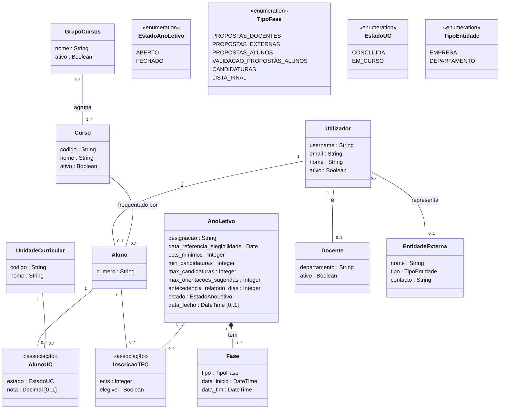
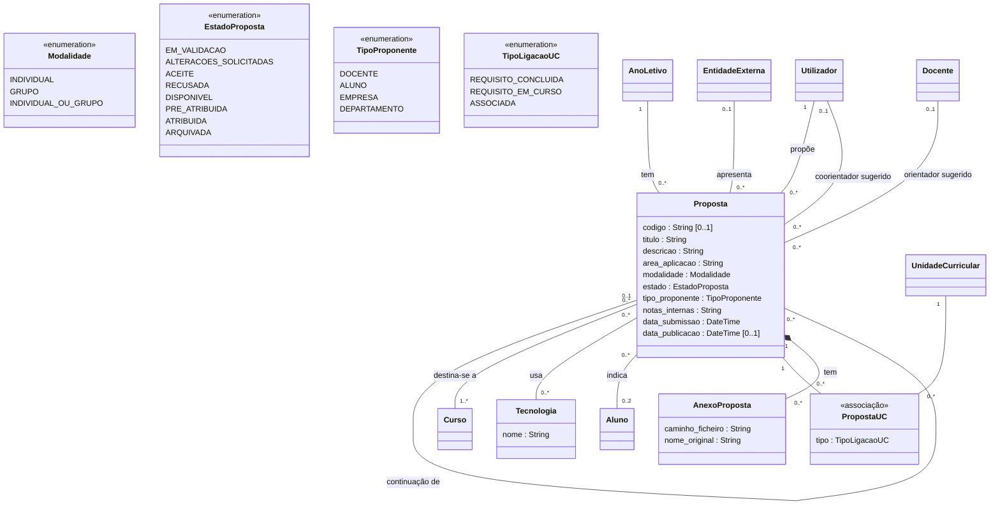
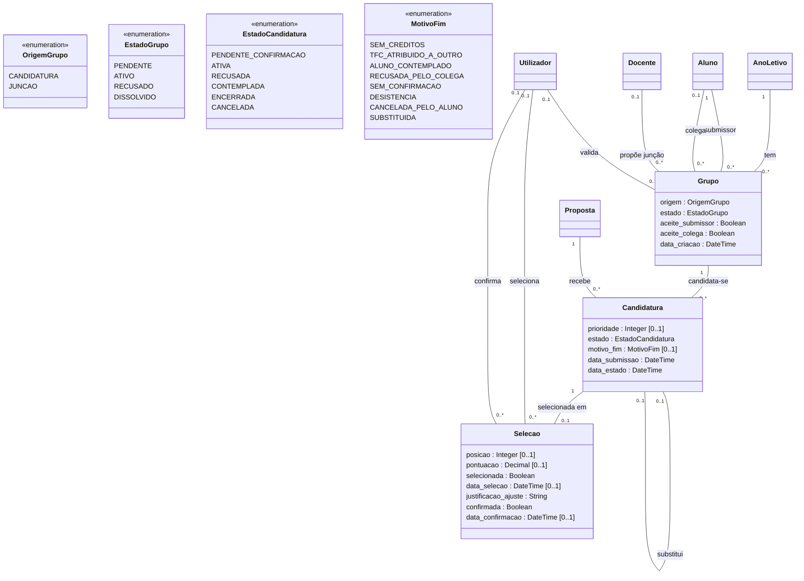
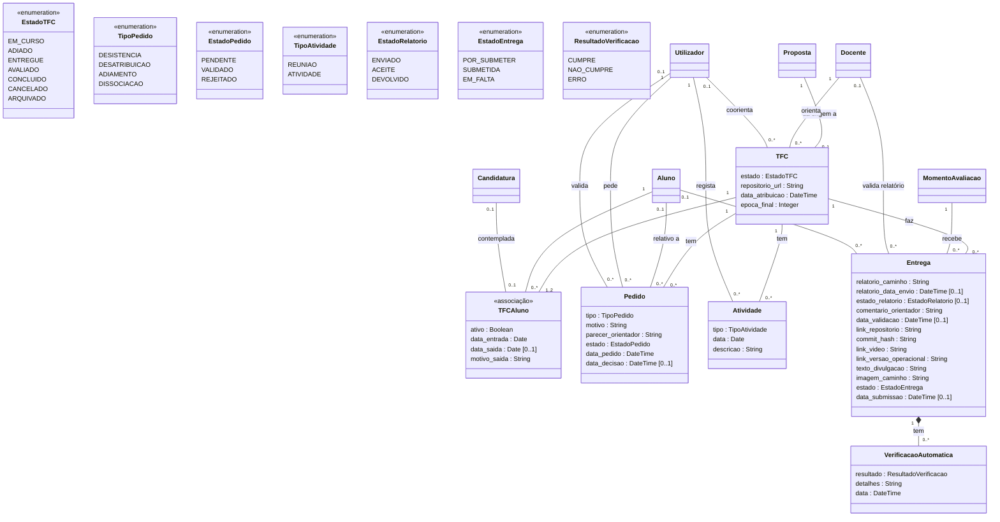
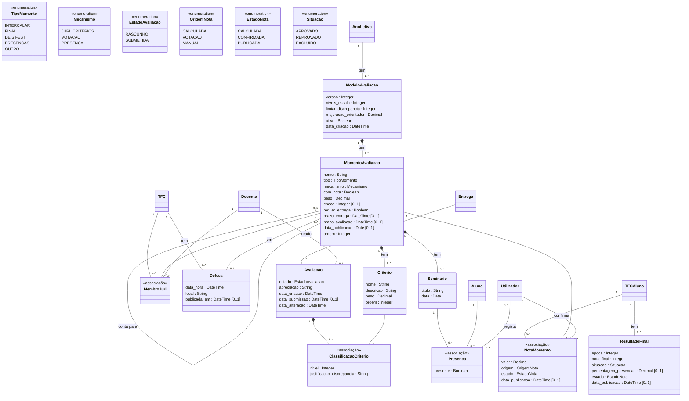
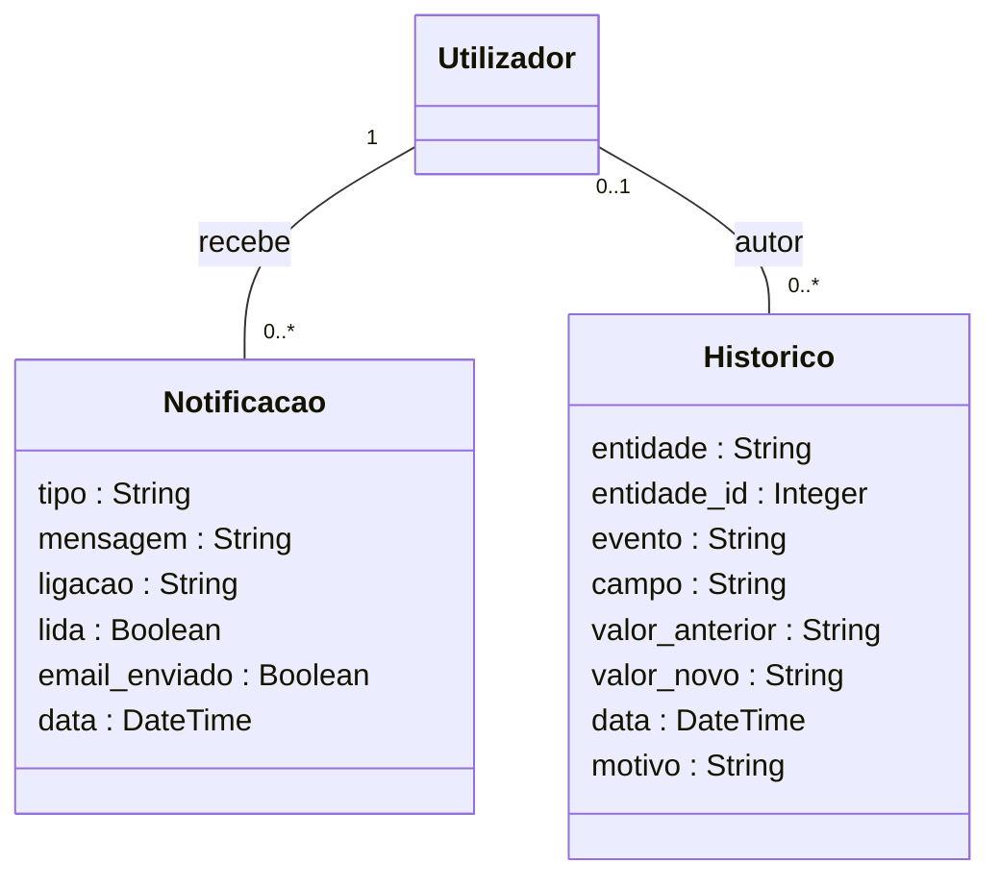

> **Aviso:** documento elaborado com apoio de IA generativa (Claude, Anthropic). A utilização, os prompts, as fontes e a revisão estão descritos em [04_utilizacao_de_ia.md](04_utilizacao_de_ia.md).

# 03 — Modelo de dados

Este documento descreve o modelo de dados da plataforma de gestão de TFC em dois níveis complementares: o modelo de classes (UML), global e por área, e o modelo entidade-relação (E-R) completo, obtido do modelo de classes por normalização. Descreve também os atributos e relações de cada classe, as regras implementadas na própria base de dados e as vistas usadas no reporting. Parte dos processos descritos em [02_processos.md](02_processos.md).

## 1. Decisões de base

- **Base de dados:** PostgreSQL, feita de raiz e partilhada pelos três TFC (Reunião 4, 21/10).
- **Backend:** Python com Django (17/11). Cada classe deste documento corresponde a um modelo do Django e a uma tabela da base de dados. Os nomes das classes e dos atributos não têm acentos, porque passam diretamente para o código.
- **Dois modelos (Reunião 8 e email do orientador de 25/11):** o modelo de classes descreve o domínio (classes, atributos com tipos UML, associações e multiplicidades) e é feito por área, como os restantes modelos (casos de uso, estados e atividades). O E-R descreve a base de dados (tabelas, chaves, restrições e tipos do PostgreSQL) e é apresentado completo, logo a seguir ao modelo de classes global. A secção 2.3 diz como se passa de um para o outro.
- **Lógica dos dados na base de dados:** as regras que garantem a consistência dos dados (estados, prioridades, prazos e cálculos) ficam em restrições, triggers e funções do PostgreSQL. Uma operação principal desencadeia as restantes, como na atribuição de um TFC (Reunião 4). A lógica de negócio que não é sobre dados (permissões, ficheiros, notificações e exportações) fica no backend (secção 7).
- **Histórico de todos os anos:** os dados estão sempre ligados a um ano letivo. Fechar o ano não apaga nada; os dados passam a ser só de leitura (P-01.4; Reunião 5, 28/10).
- **Ficheiros:** os relatórios e as imagens ficam numa pasta do servidor; a base de dados guarda só o caminho. Cada relatório enviado substitui o anterior (Reunião 7, 11/11).
- **Utilizadores:** usa-se o modelo de utilizador do Django, estendido com os dados de aluno, docente e entidade externa. Os perfis (aluno, docente, coordenação, administrador, organização de seminários e proponente externo) são grupos do Django, e um utilizador pode ter mais do que um.

## 2. Modelo global

### 2.1 Modelo de classes (UML)

```mermaid
classDiagram
    class AnoLetivo
    class Fase
    class Curso
    class GrupoCursos
    class UnidadeCurricular
    class Utilizador
    class Aluno
    class AlunoUC {
        <<associação>>
    }
    class InscricaoTFC {
        <<associação>>
    }
    class Docente
    class EntidadeExterna
    class Proposta
    class Tecnologia
    class PropostaUC {
        <<associação>>
    }
    class AnexoProposta
    class Grupo
    class Candidatura
    class Selecao
    class TFC
    class TFCAluno {
        <<associação>>
    }
    class Pedido
    class Atividade
    class Entrega
    class VerificacaoAutomatica
    class ModeloAvaliacao
    class MomentoAvaliacao
    class Criterio
    class MembroJuri {
        <<associação>>
    }
    class Defesa
    class Avaliacao
    class ClassificacaoCriterio {
        <<associação>>
    }
    class Seminario
    class Presenca {
        <<associação>>
    }
    class NotaMomento {
        <<associação>>
    }
    class ResultadoFinal
    class Notificacao
    class Historico
    AnoLetivo "1" *-- "1..*" Fase : tem
    GrupoCursos "0..*" -- "1..*" Curso : agrupa
    Utilizador "1" -- "0..1" Aluno : é
    Utilizador "1" -- "0..1" Docente : é
    Utilizador "0..*" -- "0..1" EntidadeExterna : representa
    Curso "1" -- "0..*" Aluno : frequentado por
    Aluno "1" -- "0..*" AlunoUC
    UnidadeCurricular "1" -- "0..*" AlunoUC
    Aluno "1" -- "0..*" InscricaoTFC
    AnoLetivo "1" -- "0..*" InscricaoTFC
    AnoLetivo "1" -- "0..*" Proposta : tem
    Utilizador "1" -- "0..*" Proposta : propõe
    EntidadeExterna "0..1" -- "0..*" Proposta : apresenta
    Docente "0..1" -- "0..*" Proposta : orientador sugerido
    Utilizador "0..1" -- "0..*" Proposta : coorientador sugerido
    Proposta "0..1" -- "0..*" Proposta : continuação de
    Proposta "0..*" -- "1..*" Curso : destina-se a
    Proposta "0..*" -- "0..*" Tecnologia : usa
    Proposta "0..*" -- "0..2" Aluno : indica
    Proposta "1" -- "0..*" PropostaUC
    UnidadeCurricular "1" -- "0..*" PropostaUC
    Proposta "1" *-- "0..*" AnexoProposta : tem
    AnoLetivo "1" -- "0..*" Grupo : tem
    Aluno "1" -- "0..*" Grupo : submissor
    Aluno "0..1" -- "0..*" Grupo : colega
    Docente "0..1" -- "0..*" Grupo : propõe junção
    Utilizador "0..1" -- "0..*" Grupo : valida
    Grupo "1" -- "0..*" Candidatura : candidata-se
    Proposta "1" -- "0..*" Candidatura : recebe
    Candidatura "0..1" -- "0..1" Candidatura : substitui
    Candidatura "1" -- "0..1" Selecao : selecionada em
    Utilizador "0..1" -- "0..*" Selecao : seleciona
    Utilizador "0..1" -- "0..*" Selecao : confirma
    Proposta "1" -- "0..1" TFC : dá origem a
    Docente "1" -- "0..*" TFC : orienta
    Utilizador "0..1" -- "0..*" TFC : coorienta
    TFC "1" -- "1..2" TFCAluno
    Aluno "1" -- "0..*" TFCAluno
    Candidatura "0..1" -- "0..1" TFCAluno : contemplada
    TFC "1" -- "0..*" Pedido : tem
    Aluno "0..1" -- "0..*" Pedido : relativo a
    Utilizador "1" -- "0..*" Pedido : pede
    Utilizador "0..1" -- "0..*" Pedido : valida
    TFC "1" -- "0..*" Atividade : tem
    Utilizador "1" -- "0..*" Atividade : regista
    TFC "1" -- "0..*" Entrega : faz
    MomentoAvaliacao "1" -- "0..*" Entrega : recebe
    Docente "0..1" -- "0..*" Entrega : valida relatório
    Aluno "0..1" -- "0..*" Entrega : submete
    Entrega "1" *-- "0..*" VerificacaoAutomatica : tem
    AnoLetivo "1" -- "1..*" ModeloAvaliacao : tem
    ModeloAvaliacao "1" *-- "1..*" MomentoAvaliacao : tem
    MomentoAvaliacao "0..1" -- "0..*" MomentoAvaliacao : conta para
    MomentoAvaliacao "1" *-- "0..*" Criterio : tem
    TFC "1" -- "0..*" MembroJuri
    MomentoAvaliacao "1" -- "0..*" MembroJuri
    Docente "1" -- "0..*" MembroJuri
    TFC "1" -- "0..*" Defesa : tem
    MomentoAvaliacao "1" -- "0..*" Defesa : em
    Entrega "1" -- "0..*" Avaliacao : avaliada em
    Docente "1" -- "0..*" Avaliacao : jurado
    Avaliacao "1" *-- "1..*" ClassificacaoCriterio
    Criterio "1" -- "0..*" ClassificacaoCriterio
    MomentoAvaliacao "1" *-- "0..*" Seminario : tem
    Seminario "1" -- "0..*" Presenca
    Aluno "1" -- "0..*" Presenca
    Utilizador "0..1" -- "0..*" Presenca : regista
    TFCAluno "1" -- "0..*" NotaMomento
    MomentoAvaliacao "1" -- "0..*" NotaMomento
    Utilizador "0..1" -- "0..*" NotaMomento : confirma
    TFCAluno "1" -- "0..*" ResultadoFinal : tem
    Utilizador "1" -- "0..*" Notificacao : recebe
    Utilizador "0..1" -- "0..*" Historico : autor
```

O modelo tem 37 classes, divididas em seis áreas que seguem os macro-processos. O diagrama global mostra todas as classes e associações; os atributos estão nos diagramas por área (secção 3). As classes marcadas `<<associação>>` são classes de associação: guardam dados da ligação entre duas classes (por exemplo, a nota de um aluno numa UC).

| Área | Classes | Processos |
|---|---|---|
| 3.1 Configuração e utilizadores | AnoLetivo, Fase, Curso, GrupoCursos, UnidadeCurricular, Utilizador, Aluno, AlunoUC, InscricaoTFC, Docente, EntidadeExterna | MP-01 |
| 3.2 Propostas | Proposta, PropostaUC, Tecnologia, AnexoProposta | MP-02 |
| 3.3 Candidaturas e atribuição | Grupo, Candidatura, Selecao | MP-03 |
| 3.4 TFC, acompanhamento e entregas | TFC, TFCAluno, Pedido, Atividade, Entrega, VerificacaoAutomatica | MP-03, MP-04, MP-05 |
| 3.5 Avaliação e resultados | ModeloAvaliacao, MomentoAvaliacao, Criterio, MembroJuri, Defesa, Avaliacao, ClassificacaoCriterio, Seminario, Presenca, NotaMomento, ResultadoFinal | MP-06, MP-07, MP-08 |
| 3.6 Transversais | Notificacao, Historico | MP-09 e todos |

### 2.2 Modelo E-R completo

O E-R tem 41 entidades, uma por tabela da base de dados, e 81 relações. Foi gerado a partir do esquema real do PostgreSQL (depois de aplicadas todas as migrações), para coincidir sempre com o código.

- **Atributos:** nome, tipo do PostgreSQL, `PK` (chave primária), `FK` (chave estrangeira), `UK` (única) e `NN` (obrigatório) ou `NULL` (opcional).
- **Relações:** `||` = exatamente um; `|o` = zero ou um; `o{` = zero ou mais; `o|` = zero ou um do lado dependente (relação 1:1). O texto da relação é o nome da chave estrangeira.
- **Nomes:** em maiúsculas; a tabela física é `<app>_<classe>` (por exemplo, `CANDIDATURA` é `candidaturas_candidatura`).
- **Fora do E-R:** as tabelas internas do Django (sessões, permissões, migrações) e cinco colunas herdadas do utilizador do Django que a plataforma não usa (`first_name`, `last_name`, `is_staff`, `is_superuser`, `date_joined`).
- **Valores por omissão:** são definidos no Django (por exemplo, `estado` de uma proposta começa em `EM_VALIDACAO`), por isso não aparecem como `DEFAULT` na base de dados.

```mermaid
erDiagram
    ANO_LETIVO {
        id BIGINT PK "NN"
        designacao VARCHAR(9) UK "NN"
        data_referencia_elegibilidade DATE "NN"
        ects_minimos SMALLINT "NN"
        min_candidaturas SMALLINT "NN"
        max_candidaturas SMALLINT "NN"
        max_orientacoes_sugeridas SMALLINT "NN"
        antecedencia_relatorio_dias SMALLINT "NN"
        estado VARCHAR(10) "NN"
        data_fecho TIMESTAMPTZ "NULL"
    }
    FASE {
        id BIGINT PK "NN"
        tipo VARCHAR(30) "NN"
        data_inicio TIMESTAMPTZ "NN"
        data_fim TIMESTAMPTZ "NN"
        ano_letivo_id BIGINT FK "NN"
    }
    CURSO {
        id BIGINT PK "NN"
        codigo VARCHAR(10) UK "NN"
        nome VARCHAR(200) "NN"
        ativo BOOL "NN"
    }
    GRUPO_CURSOS {
        id BIGINT PK "NN"
        nome VARCHAR(100) UK "NN"
        ativo BOOL "NN"
    }
    GRUPO_CURSOS_CURSO {
        id BIGINT PK "NN"
        grupocursos_id BIGINT FK "NN"
        curso_id BIGINT FK "NN"
    }
    UNIDADE_CURRICULAR {
        id BIGINT PK "NN"
        codigo VARCHAR(20) UK "NN"
        nome VARCHAR(200) "NN"
    }
    ENTIDADE_EXTERNA {
        id BIGINT PK "NN"
        nome VARCHAR(200) "NN"
        tipo VARCHAR(15) "NN"
        contacto VARCHAR(200) "NN"
    }
    UTILIZADOR {
        id BIGINT PK "NN"
        password VARCHAR(128) "NN"
        last_login TIMESTAMPTZ "NULL"
        username VARCHAR(150) UK "NN"
        is_active BOOL "NN"
        email VARCHAR(254) UK "NN"
        nome VARCHAR(200) "NN"
        entidade_id BIGINT FK "NULL"
    }
    ALUNO {
        id BIGINT PK "NN"
        numero VARCHAR(20) UK "NN"
        utilizador_id BIGINT FK,UK "NN"
        curso_id BIGINT FK "NN"
    }
    ALUNO_UC {
        id BIGINT PK "NN"
        estado VARCHAR(10) "NN"
        nota NUMERIC "NULL"
        aluno_id BIGINT FK "NN"
        uc_id BIGINT FK "NN"
    }
    INSCRICAO_TFC {
        id BIGINT PK "NN"
        ects SMALLINT "NN"
        elegivel BOOL "NN"
        aluno_id BIGINT FK "NN"
        ano_letivo_id BIGINT FK "NN"
    }
    DOCENTE {
        id BIGINT PK "NN"
        departamento VARCHAR(100) "NN"
        ativo BOOL "NN"
        utilizador_id BIGINT FK,UK "NN"
    }
    TECNOLOGIA {
        id BIGINT PK "NN"
        nome VARCHAR(100) UK "NN"
    }
    PROPOSTA {
        id BIGINT PK "NN"
        codigo VARCHAR(20) UK "NULL"
        titulo VARCHAR(300) "NN"
        descricao TEXT "NN"
        area_aplicacao VARCHAR(200) "NN"
        modalidade VARCHAR(20) "NN"
        estado VARCHAR(25) "NN"
        tipo_proponente VARCHAR(15) "NN"
        notas_internas TEXT "NN"
        data_submissao TIMESTAMPTZ "NN"
        data_publicacao TIMESTAMPTZ "NULL"
        ano_letivo_id BIGINT FK "NN"
        continuacao_de_id BIGINT FK "NULL"
        coorientador_sugerido_id BIGINT FK "NULL"
        entidade_id BIGINT FK "NULL"
        orientador_sugerido_id BIGINT FK "NULL"
        proponente_id BIGINT FK "NN"
    }
    PROPOSTA_CURSO {
        id BIGINT PK "NN"
        proposta_id BIGINT FK "NN"
        curso_id BIGINT FK "NN"
    }
    PROPOSTA_TECNOLOGIA {
        id BIGINT PK "NN"
        proposta_id BIGINT FK "NN"
        tecnologia_id BIGINT FK "NN"
    }
    PROPOSTA_UC {
        id BIGINT PK "NN"
        tipo VARCHAR(20) "NN"
        proposta_id BIGINT FK "NN"
        uc_id BIGINT FK "NN"
    }
    PROPOSTA_ALUNO {
        id BIGINT PK "NN"
        aluno_id BIGINT FK "NN"
        proposta_id BIGINT FK "NN"
    }
    ANEXO_PROPOSTA {
        id BIGINT PK "NN"
        caminho_ficheiro VARCHAR(500) "NN"
        nome_original VARCHAR(255) "NN"
        proposta_id BIGINT FK "NN"
    }
    GRUPO {
        id BIGINT PK "NN"
        origem VARCHAR(15) "NN"
        estado VARCHAR(10) "NN"
        aceite_submissor BOOL "NN"
        aceite_colega BOOL "NN"
        data_criacao TIMESTAMPTZ "NN"
        ano_letivo_id BIGINT FK "NN"
        colega_id BIGINT FK "NULL"
        proposto_por_id BIGINT FK "NULL"
        submissor_id BIGINT FK "NN"
        validado_por_id BIGINT FK "NULL"
    }
    CANDIDATURA {
        id BIGINT PK "NN"
        prioridade SMALLINT "NULL"
        estado VARCHAR(25) "NN"
        motivo_fim VARCHAR(25) "NN"
        data_submissao TIMESTAMPTZ "NN"
        data_estado TIMESTAMPTZ "NN"
        ano_letivo_id BIGINT FK "NN"
        proposta_id BIGINT FK "NN"
        substitui_id BIGINT FK,UK "NULL"
        grupo_id BIGINT FK "NN"
    }
    SELECAO {
        id BIGINT PK "NN"
        posicao SMALLINT "NULL"
        pontuacao NUMERIC "NULL"
        justificacao_ajuste TEXT "NN"
        confirmada BOOL "NN"
        candidatura_id BIGINT FK,UK "NN"
        confirmada_por_id BIGINT FK "NULL"
        proposta_id BIGINT FK "NN"
        selecionada BOOL "NN"
        selecionada_por_id BIGINT FK "NULL"
        data_selecao TIMESTAMPTZ "NULL"
        data_confirmacao TIMESTAMPTZ "NULL"
    }
    TFC {
        id BIGINT PK "NN"
        estado VARCHAR(10) "NN"
        repositorio_url VARCHAR(200) "NN"
        data_atribuicao TIMESTAMPTZ "NN"
        epoca_final SMALLINT "NN"
        ano_letivo_id BIGINT FK "NN"
        coorientador_id BIGINT FK "NULL"
        orientador_id BIGINT FK "NN"
        proposta_id BIGINT FK,UK "NN"
    }
    TFC_ALUNO {
        id BIGINT PK "NN"
        ativo BOOL "NN"
        data_entrada DATE "NN"
        data_saida DATE "NULL"
        motivo_saida VARCHAR(200) "NN"
        aluno_id BIGINT FK "NN"
        ano_letivo_id BIGINT FK "NN"
        candidatura_id BIGINT FK,UK "NULL"
        tfc_id BIGINT FK "NN"
    }
    PEDIDO {
        id BIGINT PK "NN"
        tipo VARCHAR(15) "NN"
        motivo TEXT "NN"
        parecer_orientador TEXT "NN"
        estado VARCHAR(10) "NN"
        data_pedido TIMESTAMPTZ "NN"
        data_decisao TIMESTAMPTZ "NULL"
        aluno_id BIGINT FK "NULL"
        pedido_por_id BIGINT FK "NN"
        validado_por_id BIGINT FK "NULL"
        tfc_id BIGINT FK "NN"
    }
    ATIVIDADE {
        id BIGINT PK "NN"
        tipo VARCHAR(10) "NN"
        data DATE "NN"
        descricao TEXT "NN"
        autor_id BIGINT FK "NN"
        tfc_id BIGINT FK "NN"
    }
    ENTREGA {
        id BIGINT PK "NN"
        relatorio_caminho VARCHAR(500) "NN"
        relatorio_data_envio TIMESTAMPTZ "NULL"
        estado_relatorio VARCHAR(10) "NN"
        comentario_orientador TEXT "NN"
        data_validacao TIMESTAMPTZ "NULL"
        link_repositorio VARCHAR(200) "NN"
        commit_hash VARCHAR(40) "NN"
        link_video VARCHAR(200) "NN"
        link_versao_operacional VARCHAR(200) "NN"
        texto_divulgacao TEXT "NN"
        imagem_caminho VARCHAR(500) "NN"
        estado VARCHAR(15) "NN"
        data_submissao TIMESTAMPTZ "NULL"
        momento_id BIGINT FK "NN"
        submetida_por_id BIGINT FK "NULL"
        validado_por_id BIGINT FK "NULL"
        tfc_id BIGINT FK "NN"
    }
    VERIFICACAO_AUTOMATICA {
        id BIGINT PK "NN"
        resultado VARCHAR(10) "NN"
        detalhes JSONB "NN"
        data TIMESTAMPTZ "NN"
        entrega_id BIGINT FK "NN"
    }
    MODELO_AVALIACAO {
        id BIGINT PK "NN"
        versao SMALLINT "NN"
        niveis_escala SMALLINT "NN"
        limiar_discrepancia SMALLINT "NN"
        majoracao_orientador NUMERIC "NN"
        ativo BOOL "NN"
        data_criacao TIMESTAMPTZ "NN"
        ano_letivo_id BIGINT FK "NN"
    }
    MOMENTO_AVALIACAO {
        id BIGINT PK "NN"
        nome VARCHAR(100) "NN"
        tipo VARCHAR(15) "NN"
        mecanismo VARCHAR(15) "NN"
        com_nota BOOL "NN"
        peso NUMERIC "NN"
        epoca SMALLINT "NULL"
        requer_entrega BOOL "NN"
        prazo_entrega TIMESTAMPTZ "NULL"
        prazo_avaliacao TIMESTAMPTZ "NULL"
        data_publicacao DATE "NULL"
        ordem SMALLINT "NN"
        conta_para_id BIGINT FK "NULL"
        modelo_id BIGINT FK "NN"
    }
    CRITERIO {
        id BIGINT PK "NN"
        nome VARCHAR(150) "NN"
        descricao TEXT "NN"
        peso NUMERIC "NN"
        ordem SMALLINT "NN"
        momento_id BIGINT FK "NN"
    }
    MEMBRO_JURI {
        id BIGINT PK "NN"
        docente_id BIGINT FK "NN"
        tfc_id BIGINT FK "NN"
        momento_id BIGINT FK "NN"
    }
    DEFESA {
        id BIGINT PK "NN"
        data_hora TIMESTAMPTZ "NN"
        local VARCHAR(200) "NN"
        publicada_em TIMESTAMPTZ "NULL"
        tfc_id BIGINT FK "NN"
        momento_id BIGINT FK "NN"
    }
    AVALIACAO {
        id BIGINT PK "NN"
        estado VARCHAR(10) "NN"
        apreciacao TEXT "NN"
        data_criacao TIMESTAMPTZ "NN"
        data_submissao TIMESTAMPTZ "NULL"
        data_alteracao TIMESTAMPTZ "NN"
        jurado_id BIGINT FK "NN"
        entrega_id BIGINT FK "NN"
    }
    CLASSIFICACAO_CRITERIO {
        id BIGINT PK "NN"
        nivel SMALLINT "NN"
        justificacao_discrepancia TEXT "NN"
        avaliacao_id BIGINT FK "NN"
        criterio_id BIGINT FK "NN"
    }
    SEMINARIO {
        id BIGINT PK "NN"
        titulo VARCHAR(200) "NN"
        data DATE "NN"
        momento_id BIGINT FK "NN"
    }
    PRESENCA {
        id BIGINT PK "NN"
        presente BOOL "NN"
        aluno_id BIGINT FK "NN"
        registado_por_id BIGINT FK "NULL"
        seminario_id BIGINT FK "NN"
    }
    NOTA_MOMENTO {
        id BIGINT PK "NN"
        valor NUMERIC "NN"
        origem VARCHAR(10) "NN"
        estado VARCHAR(10) "NN"
        data_publicacao TIMESTAMPTZ "NULL"
        confirmada_por_id BIGINT FK "NULL"
        momento_id BIGINT FK "NN"
        tfc_aluno_id BIGINT FK "NN"
    }
    RESULTADO_FINAL {
        id BIGINT PK "NN"
        epoca SMALLINT "NN"
        nota_final SMALLINT "NN"
        situacao VARCHAR(10) "NN"
        percentagem_presencas NUMERIC "NULL"
        estado VARCHAR(10) "NN"
        data_publicacao TIMESTAMPTZ "NULL"
        tfc_aluno_id BIGINT FK "NN"
    }
    NOTIFICACAO {
        id BIGINT PK "NN"
        tipo VARCHAR(50) "NN"
        mensagem TEXT "NN"
        ligacao VARCHAR(300) "NN"
        lida BOOL "NN"
        email_enviado BOOL "NN"
        data TIMESTAMPTZ "NN"
        destinatario_id BIGINT FK "NN"
    }
    HISTORICO {
        id BIGINT PK "NN"
        entidade VARCHAR(50) "NN"
        entidade_id BIGINT "NN"
        evento VARCHAR(100) "NN"
        campo VARCHAR(50) "NN"
        valor_anterior TEXT "NN"
        valor_novo TEXT "NN"
        data TIMESTAMPTZ "NN"
        motivo TEXT "NN"
        utilizador_id BIGINT FK "NULL"
    }
    ANO_LETIVO ||--o{ FASE : "ano_letivo"
    CURSO ||--o{ GRUPO_CURSOS_CURSO : "curso"
    GRUPO_CURSOS ||--o{ GRUPO_CURSOS_CURSO : "grupocursos"
    ENTIDADE_EXTERNA |o--o{ UTILIZADOR : "entidade"
    CURSO ||--o{ ALUNO : "curso"
    UTILIZADOR ||--o| ALUNO : "utilizador"
    ALUNO ||--o{ ALUNO_UC : "aluno"
    UNIDADE_CURRICULAR ||--o{ ALUNO_UC : "uc"
    ALUNO ||--o{ INSCRICAO_TFC : "aluno"
    ANO_LETIVO ||--o{ INSCRICAO_TFC : "ano_letivo"
    UTILIZADOR ||--o| DOCENTE : "utilizador"
    ANO_LETIVO ||--o{ PROPOSTA : "ano_letivo"
    PROPOSTA |o--o{ PROPOSTA : "continuacao_de"
    UTILIZADOR |o--o{ PROPOSTA : "coorientador_sugerido"
    ENTIDADE_EXTERNA |o--o{ PROPOSTA : "entidade"
    DOCENTE |o--o{ PROPOSTA : "orientador_sugerido"
    UTILIZADOR ||--o{ PROPOSTA : "proponente"
    CURSO ||--o{ PROPOSTA_CURSO : "curso"
    PROPOSTA ||--o{ PROPOSTA_CURSO : "proposta"
    PROPOSTA ||--o{ PROPOSTA_TECNOLOGIA : "proposta"
    TECNOLOGIA ||--o{ PROPOSTA_TECNOLOGIA : "tecnologia"
    PROPOSTA ||--o{ PROPOSTA_UC : "proposta"
    UNIDADE_CURRICULAR ||--o{ PROPOSTA_UC : "uc"
    ALUNO ||--o{ PROPOSTA_ALUNO : "aluno"
    PROPOSTA ||--o{ PROPOSTA_ALUNO : "proposta"
    PROPOSTA ||--o{ ANEXO_PROPOSTA : "proposta"
    ANO_LETIVO ||--o{ GRUPO : "ano_letivo"
    ALUNO |o--o{ GRUPO : "colega"
    DOCENTE |o--o{ GRUPO : "proposto_por"
    ALUNO ||--o{ GRUPO : "submissor"
    UTILIZADOR |o--o{ GRUPO : "validado_por"
    ANO_LETIVO ||--o{ CANDIDATURA : "ano_letivo"
    GRUPO ||--o{ CANDIDATURA : "grupo"
    PROPOSTA ||--o{ CANDIDATURA : "proposta"
    CANDIDATURA |o--o| CANDIDATURA : "substitui"
    CANDIDATURA ||--o| SELECAO : "candidatura"
    UTILIZADOR |o--o{ SELECAO : "confirmada_por"
    PROPOSTA ||--o{ SELECAO : "proposta"
    UTILIZADOR |o--o{ SELECAO : "selecionada_por"
    ANO_LETIVO ||--o{ TFC : "ano_letivo"
    UTILIZADOR |o--o{ TFC : "coorientador"
    DOCENTE ||--o{ TFC : "orientador"
    PROPOSTA ||--o| TFC : "proposta"
    ALUNO ||--o{ TFC_ALUNO : "aluno"
    ANO_LETIVO ||--o{ TFC_ALUNO : "ano_letivo"
    CANDIDATURA |o--o| TFC_ALUNO : "candidatura"
    TFC ||--o{ TFC_ALUNO : "tfc"
    ALUNO |o--o{ PEDIDO : "aluno"
    UTILIZADOR ||--o{ PEDIDO : "pedido_por"
    TFC ||--o{ PEDIDO : "tfc"
    UTILIZADOR |o--o{ PEDIDO : "validado_por"
    UTILIZADOR ||--o{ ATIVIDADE : "autor"
    TFC ||--o{ ATIVIDADE : "tfc"
    MOMENTO_AVALIACAO ||--o{ ENTREGA : "momento"
    ALUNO |o--o{ ENTREGA : "submetida_por"
    TFC ||--o{ ENTREGA : "tfc"
    DOCENTE |o--o{ ENTREGA : "validado_por"
    ENTREGA ||--o{ VERIFICACAO_AUTOMATICA : "entrega"
    ANO_LETIVO ||--o{ MODELO_AVALIACAO : "ano_letivo"
    MOMENTO_AVALIACAO |o--o{ MOMENTO_AVALIACAO : "conta_para"
    MODELO_AVALIACAO ||--o{ MOMENTO_AVALIACAO : "modelo"
    MOMENTO_AVALIACAO ||--o{ CRITERIO : "momento"
    DOCENTE ||--o{ MEMBRO_JURI : "docente"
    MOMENTO_AVALIACAO ||--o{ MEMBRO_JURI : "momento"
    TFC ||--o{ MEMBRO_JURI : "tfc"
    MOMENTO_AVALIACAO ||--o{ DEFESA : "momento"
    TFC ||--o{ DEFESA : "tfc"
    ENTREGA ||--o{ AVALIACAO : "entrega"
    DOCENTE ||--o{ AVALIACAO : "jurado"
    AVALIACAO ||--o{ CLASSIFICACAO_CRITERIO : "avaliacao"
    CRITERIO ||--o{ CLASSIFICACAO_CRITERIO : "criterio"
    MOMENTO_AVALIACAO ||--o{ SEMINARIO : "momento"
    ALUNO ||--o{ PRESENCA : "aluno"
    UTILIZADOR |o--o{ PRESENCA : "registado_por"
    SEMINARIO ||--o{ PRESENCA : "seminario"
    UTILIZADOR |o--o{ NOTA_MOMENTO : "confirmada_por"
    MOMENTO_AVALIACAO ||--o{ NOTA_MOMENTO : "momento"
    TFC_ALUNO ||--o{ NOTA_MOMENTO : "tfc_aluno"
    TFC_ALUNO ||--o{ RESULTADO_FINAL : "tfc_aluno"
    UTILIZADOR ||--o{ NOTIFICACAO : "destinatario"
    UTILIZADOR |o--o{ HISTORICO : "utilizador"
```

**Restrições que não cabem no diagrama** (verificações e unicidades com mais de uma coluna; as condições `>= 0` dos inteiros positivos ficam de fora):

| Entidade | Tipo | Nome | Definição |
|---|---|---|---|
| ALUNO_UC | CHECK | aluno_uc_nota_0_20 | `(((nota IS NULL) OR ((nota >= (0)::numeric) AND (nota <= (20)::numeric))))` |
| ALUNO_UC | UNIQUE | aluno_uc_unica | `(aluno_id, uc_id)` |
| ANO_LETIVO | CHECK | ano_min_max_candidaturas | `((min_candidaturas <= max_candidaturas))` |
| AVALIACAO | UNIQUE | avaliacao_unica_por_jurado | `(jurado_id, entrega_id)` |
| CANDIDATURA | UNIQUE parcial | candidatura_unica_por_tfc | `(proposta_id, grupo_id) WHERE ((estado) = ANY ((['PENDENTE_CONFIRMACAO', 'ATIVA'])))` |
| CANDIDATURA | UNIQUE parcial | prioridade_unica | `(grupo_id, prioridade) WHERE ((estado) = ANY ((['PENDENTE_CONFIRMACAO', 'ATIVA'])))` |
| CLASSIFICACAO_CRITERIO | CHECK | nivel_1_a_10 | `(((nivel >= 1) AND (nivel <= 10)))` |
| CLASSIFICACAO_CRITERIO | UNIQUE | classificacao_unica | `(avaliacao_id, criterio_id)` |
| CRITERIO | CHECK | criterio_peso_0_100 | `(((peso > (0)::numeric) AND (peso <= (100)::numeric)))` |
| ENTREGA | UNIQUE | entrega_unica_por_momento | `(momento_id, tfc_id)` |
| FASE | CHECK | fase_fim_depois_inicio | `((data_fim > data_inicio))` |
| FASE | UNIQUE | fase_unica_por_ano | `(tipo, ano_letivo_id)` |
| GRUPO | CHECK | grupo_alunos_diferentes | `((NOT (submissor_id = colega_id)))` |
| GRUPO | UNIQUE parcial | grupo_individual_unico | `(ano_letivo_id, submissor_id) WHERE ((colega_id IS NULL) AND (NOT ((estado) = 'DISSOLVIDO')))` |
| GRUPO_CURSOS_CURSO | UNIQUE | configuracao_grupocursos_grupocursos_id_curso_id_6422c17f_uniq | `(grupocursos_id, curso_id)` |
| INSCRICAO_TFC | UNIQUE | inscricao_unica_por_ano | `(aluno_id, ano_letivo_id)` |
| MEMBRO_JURI | UNIQUE | jurado_unico | `(docente_id, tfc_id, momento_id)` |
| MODELO_AVALIACAO | UNIQUE | modelo_versao_unica | `(versao, ano_letivo_id)` |
| MODELO_AVALIACAO | UNIQUE parcial | um_modelo_ativo_por_ano | `(ano_letivo_id) WHERE ativo` |
| MOMENTO_AVALIACAO | CHECK | momento_epoca_1_ou_2 | `(((epoca IS NULL) OR (epoca = ANY (ARRAY[1, 2]))))` |
| MOMENTO_AVALIACAO | CHECK | momento_peso_0_100 | `(((peso >= (0)::numeric) AND (peso <= (100)::numeric)))` |
| NOTA_MOMENTO | CHECK | nota_momento_0_20 | `(((valor >= (0)::numeric) AND (valor <= (20)::numeric)))` |
| NOTA_MOMENTO | UNIQUE | nota_unica_por_momento | `(momento_id, tfc_aluno_id)` |
| PRESENCA | UNIQUE | presenca_unica | `(aluno_id, seminario_id)` |
| PROPOSTA_ALUNO | UNIQUE | proposta_aluno_unico | `(aluno_id, proposta_id)` |
| PROPOSTA_CURSO | UNIQUE | propostas_proposta_cursos_proposta_id_curso_id_9f19771a_uniq | `(proposta_id, curso_id)` |
| PROPOSTA_TECNOLOGIA | UNIQUE | propostas_proposta_tecno_proposta_id_tecnologia_i_f1943864_uniq | `(proposta_id, tecnologia_id)` |
| PROPOSTA_UC | UNIQUE | proposta_uc_unica | `(proposta_id, uc_id)` |
| RESULTADO_FINAL | CHECK | nota_final_0_20 | `((nota_final <= 20))` |
| RESULTADO_FINAL | UNIQUE | resultado_unico_por_epoca | `(epoca, tfc_aluno_id)` |
| SELECAO | UNIQUE parcial | um_selecionado_por_tfc | `(proposta_id) WHERE selecionada` |
| TFC | CHECK | tfc_epoca_1_ou_2 | `((epoca_final = ANY (ARRAY[1, 2])))` |
| TFC_ALUNO | UNIQUE parcial | um_tfc_ativo_por_aluno | `(aluno_id, ano_letivo_id) WHERE ativo` |

As regras que dependem de mais do que uma linha ou tabela (por exemplo, "um aluno só está num grupo de dois ativo") estão em triggers e funções (secção 5.2).

### 2.3 Das classes ao E-R

O E-R obtém-se do modelo de classes aplicando sempre as mesmas regras de transformação:

| Modelo de classes | E-R | Exemplos |
|---|---|---|
| Classe | Entidade com chave primária técnica `id BIGINT` | `Proposta` → `PROPOSTA` |
| Atributo `String`, `Integer`, `Decimal`, `Boolean`, `Date`, `DateTime` | `VARCHAR(n)` ou `TEXT`, `SMALLINT`, `NUMERIC`, `BOOL`, `DATE`, `TIMESTAMPTZ` | `peso : Decimal` → `peso NUMERIC` (no PostgreSQL, `NUMERIC(5,2)`; o diagrama omite a precisão porque o Mermaid do GitHub não aceita a vírgula) |
| Atributo com multiplicidade `[0..1]` | Coluna `NULL`; os restantes são `NN` | `data_fecho : DateTime [0..1]` |
| Enumeração | `VARCHAR` com os valores da enumeração | `estado : EstadoProposta` → `estado VARCHAR(25)` |
| Associação 1 — 0..* | `FK` no lado "muitos": `NN` se o outro lado é `1`, `NULL` se é `0..1` | `Grupo 1 — 0..* Candidatura` → `CANDIDATURA.grupo_id` |
| Associação 1 — 0..1 | `FK` com `UK` | `Proposta 1 — 0..1 TFC` → `TFC.proposta_id` |
| Associação 0..* — 0..* sem atributos | Tabela de junção com as duas `FK` e unicidade no par | `Proposta — Curso` → `PROPOSTA_CURSO`; `Proposta — Aluno : indica` → `PROPOSTA_ALUNO` |
| Classe de associação (`<<associação>>`) | Entidade com as duas `FK` (três em `MembroJuri`) e os atributos da ligação | `AlunoUC` → `ALUNO_UC (aluno_id, uc_id, estado, nota)` |
| Composição (losango cheio) | `FK` `NN`; a parte é apagada com o todo (feito pelo Django) | `ModeloAvaliacao ◆— MomentoAvaliacao` |
| Atributo derivado (não está no modelo de classes) | Coluna repetida, para a base de dados poder garantir regras por ano | `ano_letivo_id` em `CANDIDATURA`, `TFC` e `TFC_ALUNO` (regra R3) |

Por isso, o modelo de classes não tem `id` nem chaves estrangeiras (as ligações são associações), e os tipos são tipos UML. O E-R tem os dois, e os tipos do PostgreSQL.

## 3. Classes por área

Cada área tem o seu diagrama de classes UML: as classes da área com os atributos e as enumerações que usam, e, sem atributos, as classes de outras áreas a que se ligam. Os atributos têm tipos UML; as chaves e os tipos da base de dados estão no E-R (secção 2.2). As tabelas a seguir a cada diagrama resumem os atributos e as regras de cada classe.

### 3.1 Configuração e utilizadores (MP-01)

| Classe | Atributos principais | Regras |
|---|---|---|
| AnoLetivo | designacao (ex.: "2026/27"), data de referência da elegibilidade, ECTS mínimos (90), mínimo e máximo de candidaturas (3 e 6), orientações sugeridas por docente (5), antecedência do relatório (7 dias), estado, data de fecho | Os valores do regulamento ficam como parâmetros do ano e podem mudar (P-01.1). Ano fechado → só leitura (P-01.4). |
| Fase | ano letivo, tipo, início e fim | As datas abrem e fecham as funcionalidades (P-01.1). Fim posterior ao início. |
| Curso | código (ex.: LEI), nome, ativo | Código único (P-01.3). |
| GrupoCursos | nome (ex.: "LEI + LIG"), ativo, cursos (N:M) | Desativar não apaga das propostas antigas (P-01.3). |
| UnidadeCurricular | código, nome | Usada no perfil do candidato e na seleção. |
| Utilizador | email, nome, ativo, perfis (grupos do Django), entidade externa | Email único. |
| Aluno | utilizador, número, curso | Número único. |
| AlunoUC | aluno, UC, estado (concluída ou em curso), nota | Usada no perfil do candidato e na ordenação da seleção (P-03.7). |
| InscricaoTFC | aluno, ano letivo, ECTS na data de referência, elegível | Um registo por aluno e ano. Elegível se ECTS ≥ mínimo do ano (cap. 4). |
| Docente | utilizador, departamento, ativo | Só os docentes ativos aparecem nas listas de escolha (P-01.2). |
| EntidadeExterna | nome, tipo (empresa ou departamento), contacto | O tipo define o formulário de proposta (P-02.1). |

### 3.2 Propostas (MP-02)

| Classe | Atributos principais | Regras |
|---|---|---|
| Proposta | ano letivo, código, título, descrição, área de aplicação, modalidade, estado, tipo de proponente, proponente, entidade externa, orientador sugerido, coorientador sugerido, proposta de que é continuação, cursos (N:M), tecnologias (N:M), notas internas, datas | Estado inicial depende do proponente (P-02.1). Orientador sugerido tem de ser docente ativo. As notas internas só são visíveis para docentes e coordenação (pedido no inquérito). |
| PropostaUC | proposta, UC, tipo (requisito concluída, requisito em curso ou disciplina associada) | Define o perfil do candidato e as disciplinas associadas (P-02.1). |
| Tecnologia | nome | Tabela própria para permitir o filtro por tecnologia, o mais pedido no inquérito. |
| Proposta — Aluno : indica | (associação sem atributos; tabela `PROPOSTA_ALUNO` no E-R) | Aluno indicado ou pré-selecionado. No máximo 2 por proposta, e só 1 se a modalidade for individual. Um aluno não pode ser o 2.º elemento de duas propostas em grupo (P-02.1). |
| AnexoProposta | proposta, caminho do ficheiro, nome original | Anexos em PDF, pedidos pelos docentes no inquérito. |

### 3.3 Candidaturas e atribuição (MP-03)

| Classe | Atributos principais | Regras |
|---|---|---|
| Grupo | ano letivo, submissor, colega (vazio numa candidatura individual), origem (candidatura ou junção pelo docente), estado, docente que propôs a junção, aceitação de cada aluno, quem validou | É sempre o grupo que se candidata: uma candidatura individual é um grupo só com o submissor (Reunião 8). O grupo individual fica ativo ao ser criado; o grupo de dois fica ativo quando o colega confirma a primeira candidatura. Um aluno só tem um grupo individual e só está num grupo de dois ativo por ano (R4, cap. 4). Na junção, os dois alunos aceitam e a coordenação valida (P-03.8). |
| Candidatura | ano letivo, proposta, grupo, prioridade, estado, motivo do fim, candidatura que substitui, datas | A lista de prioridades é sempre a do grupo. Ver as regras R1, R2, R8 e R9 da secção 5. A prioridade só existe enquanto a candidatura está na lista (pendente ou ativa). |
| Selecao | proposta, candidatura, posição, pontuação, selecionada (por quem e quando), justificação do ajuste, confirmada (por quem e quando) | O orientador ou o proponente seleciona o candidato e a coordenação confirma, o que atribui o TFC e publica a atribuição (Reunião 8; P-03.7 e P-03.9). Só há um candidato selecionado por proposta. |

### 3.4 TFC, acompanhamento e entregas (MP-03 a MP-05)

| Classe | Atributos principais | Regras |
|---|---|---|
| TFC | proposta (1:1), ano letivo, estado, orientador, coorientador, repositório, data de atribuição, época da entrega final | Criado pela atribuição (R7). O orientador tem de ser docente ativo; aviso acima de 5 orientações (P-02.2). |
| TFCAluno | TFC, aluno, candidatura contemplada, ativo, datas de entrada e saída, motivo da saída | Liga 1 ou 2 alunos a um TFC e permite a dissociação de grupos e a desistência de um só elemento (P-04.2, P-03.12). Um aluno só tem um TFC ativo por ano (cap. 4). |
| Pedido | TFC, tipo (desistência, desatribuição, adiamento ou dissociação), aluno, quem pediu, motivo, parecer do orientador, estado, quem validou, datas | Junta numa só classe os pedidos que precisam de parecer e validação (P-03.12, P-03.13, P-04.2, P-04.3). |
| Atividade | TFC, autor, tipo (reunião ou atividade), data, descrição | P-04.1. |
| Entrega | TFC, momento, caminho do relatório, estado do relatório, comentário e validação do orientador, links (repositório, vídeo, versão operacional), hash do commit, texto de divulgação, imagem, quem submeteu, estado, datas | Uma entrega por TFC e momento. Só há um ficheiro de relatório: cada envio substitui o anterior (P-05.1). Bloqueada depois do prazo de entrega (R10). |
| VerificacaoAutomatica | entrega, resultado, detalhes (JSON), data | Resultado da verificação feita pelo DEISI2258. A forma de escrita ainda tem de ser combinada (questão 3 da secção 9). |

### 3.5 Avaliação e resultados (MP-06 a MP-08)

| Classe | Atributos principais | Regras |
|---|---|---|
| ModeloAvaliacao | ano letivo, versão, níveis da escala (10), limiar de discrepância (2), majoração do orientador (0), ativo | Só um modelo ativo por ano. Alterar um modelo com avaliações cria uma nova versão (P-06.1). |
| MomentoAvaliacao | modelo, nome, tipo, mecanismo, com nota, peso, momento para que conta (vazio = nota final), época, requer entrega, prazos de entrega e de avaliação, data de publicação | O tipo corresponde aos modelos do modelo base: intercalar, final, DEISIFest e presenças, mais "outro" (P-06.1, P-06.3; Reunião 7). Soma dos pesos que contam para o mesmo destino = 100% (R12). |
| Criterio | momento, nome, descrição, peso, ordem | Soma dos pesos de um momento = 100% (P-06.2). |
| MembroJuri | TFC, momento, docente | O orientador não pode ser jurado nas avaliações intercalares (cap. 5). |
| Defesa | TFC, momento, data e hora, local | Publicada com pelo menos 48 h de antecedência (P-06.5). |
| Avaliacao | entrega, jurado, estado (rascunho ou submetida), apreciação (texto com Markdown), datas | A avaliação avalia a entrega, que identifica o TFC e o momento (e, com ele, a época), por isso o mesmo docente avalia o TFC uma vez em cada momento (Reunião 8). Nos momentos sem ficheiros (por exemplo, uma apresentação), a entrega existe na mesma, como registo da participação. Uma avaliação por entrega e jurado. O rascunho é guardado à medida que o jurado escreve, para o texto não se perder quando a sessão expira (pedido no inquérito). Bloqueada depois do prazo de avaliação (R10). |
| ClassificacaoCriterio | avaliação, critério, nível, justificação da discrepância | Nível entre 1 e o número de níveis da escala. Justificação obrigatória acima do limiar (R11). |
| Seminario | momento (do tipo presenças), título, data | Cada sessão de seminário de um momento de presença obrigatória. |
| Presenca | seminário, aluno, presente, quem registou | P-08.1. |
| NotaMomento | TFC e aluno, momento, valor (2 casas decimais), origem (calculada, votação ou manual), estado (calculada, confirmada ou publicada), data de publicação | Uma nota por aluno e momento. O resultado do DEISIFest entra aqui com origem "votação" (P-08.2). |
| ResultadoFinal | TFC e aluno, época, nota final (inteiro), situação, percentagem de presenças, estado, data de publicação | P-07.2 e P-07.3. Aprovado com nota ≥ 10 e presenças ≥ 70% (cap. 5 e 6). |

### 3.6 Transversais

| Classe | Atributos principais | Regras |
|---|---|---|
| Notificacao | destinatário, tipo, mensagem, ligação, lida, email enviado, data | Base do subsistema de notificações (P-09.4), a detalhar na arquitetura. |
| Historico | entidade, identificador do registo, evento, campo, valor anterior, valor novo, utilizador, data, motivo | Preenchido por triggers sempre que muda um estado, uma prioridade, uma nota ou um dado já publicado (R14). Dá o histórico pedido em vários processos e a auditoria das correções. |

## 4. Enumerações

Os estados seguem as máquinas de estados da secção 4 de [02_processos.md](02_processos.md). Nos diagramas de classes, cada enumeração aparece como uma classe `<<enumeration>>`; na base de dados, é uma coluna `VARCHAR` (secção 2.3).

| Enumeração | Valores |
|---|---|
| EstadoAnoLetivo | ABERTO, FECHADO |
| TipoFase | PROPOSTAS_DOCENTES, PROPOSTAS_EXTERNAS, PROPOSTAS_ALUNOS, VALIDACAO_PROPOSTAS_ALUNOS, CANDIDATURAS, LISTA_FINAL |
| EstadoUC | CONCLUIDA, EM_CURSO |
| TipoEntidade | EMPRESA, DEPARTAMENTO |
| Modalidade | INDIVIDUAL, GRUPO, INDIVIDUAL_OU_GRUPO |
| TipoProponente | DOCENTE, ALUNO, EMPRESA, DEPARTAMENTO |
| EstadoProposta | EM_VALIDACAO, ALTERACOES_SOLICITADAS, ACEITE, RECUSADA, DISPONIVEL, PRE_ATRIBUIDA, ATRIBUIDA, ARQUIVADA |
| TipoLigacaoUC | REQUISITO_CONCLUIDA, REQUISITO_EM_CURSO, ASSOCIADA |
| OrigemGrupo | CANDIDATURA, JUNCAO |
| EstadoGrupo | PENDENTE, ATIVO, RECUSADO, DISSOLVIDO |
| EstadoCandidatura | PENDENTE_CONFIRMACAO, ATIVA, RECUSADA, CONTEMPLADA, ENCERRADA, CANCELADA |
| MotivoFim | SEM_CREDITOS, TFC_ATRIBUIDO_A_OUTRO, ALUNO_CONTEMPLADO, RECUSADA_PELO_COLEGA, SEM_CONFIRMACAO, DESISTENCIA, CANCELADA_PELO_ALUNO, SUBSTITUIDA |
| EstadoTFC | EM_CURSO, ADIADO, ENTREGUE, AVALIADO, CONCLUIDO, CANCELADO, ARQUIVADO |
| TipoPedido | DESISTENCIA, DESATRIBUICAO, ADIAMENTO, DISSOCIACAO |
| EstadoPedido | PENDENTE, VALIDADO, REJEITADO |
| TipoAtividade | REUNIAO, ATIVIDADE |
| EstadoRelatorio | ENVIADO, ACEITE, DEVOLVIDO |
| EstadoEntrega | POR_SUBMETER, SUBMETIDA, EM_FALTA |
| ResultadoVerificacao | CUMPRE, NAO_CUMPRE, ERRO |
| TipoMomento | INTERCALAR, FINAL, DEISIFEST, PRESENCAS, OUTRO |
| Mecanismo | JURI_CRITERIOS, VOTACAO, PRESENCA |
| EstadoAvaliacao | RASCUNHO, SUBMETIDA |
| OrigemNota | CALCULADA, VOTACAO, MANUAL |
| EstadoNota | CALCULADA, CONFIRMADA, PUBLICADA |
| Situacao | APROVADO, REPROVADO, EXCLUIDO |

## 5. Regras na base de dados

A base de dados garante estas regras, mesmo que o pedido não venha do backend (por exemplo, quando o DEISI2258 escreve diretamente na base de dados).

### 5.1 Restrições

| # | Regra | Implementação | Processo |
|---|---|---|---|
| R1 | Um aluno não se candidata duas vezes ao mesmo TFC | Índice único parcial em Candidatura (proposta, grupo) para os estados pendente e ativa; entre grupos diferentes do mesmo aluno, verificado pelo trigger R9 | P-03.1, P-03.2 |
| R2 | A lista de candidaturas não tem prioridades repetidas | Índice único parcial em Candidatura (grupo, prioridade) para os estados pendente e ativa | P-03.4 |
| R3 | Um aluno só tem um TFC ativo por ano | Índice único parcial em TFCAluno (aluno, ano letivo) quando ativo | P-03.9 |
| R4 | Um aluno só tem um grupo individual e só está num grupo de dois ativo por ano | Índice único parcial em Grupo (ano, submissor) para os grupos individuais; trigger em Grupo para os grupos de dois (o aluno pode ser submissor ou colega) | P-03.2, P-03.8 |
| R5 | Níveis, pesos e notas dentro dos limites | Restrições CHECK (por exemplo, nível entre 1 e 10, peso entre 0 e 100, nota entre 0 e 20) | P-06.1, P-06.6 |
| R6 | Uma entrega por TFC e momento; uma avaliação por entrega e jurado; um só candidato selecionado por proposta | Restrições UNIQUE | P-03.7, P-05.3, P-06.6 |

### 5.2 Triggers e funções

| # | Regra | Implementação | Processo |
|---|---|---|---|
| R7 | **Atribuir um TFC** desencadeia as restantes operações: a proposta passa a Atribuída, o TFC é criado no estado Em curso com os seus alunos, a candidatura passa a Contemplada, as outras candidaturas dos alunos do grupo são encerradas e as candidaturas dos outros alunos a esse TFC também (R8). A **seleção** é feita pelo orientador ou proponente e a **confirmação** pela coordenação, que chama a atribuição | Funções `selecionar_candidato(candidatura, utilizador)`, `confirmar_selecao(seleção, orientador, coorientador, utilizador)` e `atribuir_tfc(candidatura, orientador, coorientador)`, numa só transação | P-03.7, P-03.9, P-03.10 |
| R8 | **Renumerar a lista do grupo** quando uma candidatura sai (cancelada, encerrada, recusada pelo colega ou contemplada): as seguintes sobem uma posição. Uma candidatura que volta à lista fica na última posição. Quando o colega confirma a primeira candidatura, o grupo fica ativo | Triggers BEFORE e AFTER UPDATE do estado da candidatura | P-03.3, P-03.6, P-03.10 |
| R9 | **Validar uma candidatura nova:** fase de candidaturas aberta, grupo não dissolvido, modalidade compatível (grupo individual só em TFC individuais ou individual ou em grupo; grupo de dois só em TFC em grupo ou individual ou em grupo), nenhum aluno do grupo já candidato a esse TFC, limite de candidaturas do grupo, créditos de todos os alunos do grupo. Individual → Ativa; em grupo → Pendente de confirmação. Sem créditos → estado Recusada; caso contrário fica na última posição | Trigger BEFORE INSERT da candidatura | P-03.1, P-03.2 |
| R10 | **Fechar no prazo:** depois do prazo de entrega, a entrega não pode ser alterada; depois do prazo de avaliação, a avaliação também não. Continuam disponíveis para consulta | Trigger BEFORE UPDATE em Entrega e em Avaliacao | P-05.3, P-06.6 |
| R11 | **Discrepância entre jurados:** ao submeter, se a diferença para outro jurado num critério for superior ao limiar, a justificação é obrigatória | Trigger BEFORE UPDATE da avaliação (passagem a Submetida) | P-06.6 |
| R12 | **Pesos e recálculo:** ao ativar o modelo, a soma dos pesos de cada destino tem de ser 100%. Acrescentar um outro momento recalcula os restantes, mantendo a proporção | Função `recalcular_pesos(momento)` e trigger na ativação do modelo | P-06.1, P-06.3 |
| R13 | **Calcular as notas:** nota do momento pela média dos jurados (níveis × 2, com os pesos dos critérios e a majoração) e nota final com os pesos dos momentos | Funções `calcular_nota_momento(tfc, momento)` e `calcular_resultado_final(tfc, epoca)` | P-07.1, P-07.2 |
| R14 | **Histórico:** cada mudança de estado, prioridade, nota ou dado publicado é registada em Historico, com o evento e o utilizador | Trigger AFTER UPDATE genérico nas tabelas principais | Todos |
| R15 | **Fechar o ano letivo:** arquiva os TFC e as propostas não atribuídas e passa o ano a só leitura | Função `fechar_ano_letivo(ano)` e trigger que bloqueia alterações em anos fechados | P-01.4 |

**Estado da implementação (24/11):** as restrições R1 a R6 e as regras R4, R7, R8 e R9 (incluindo a seleção e a confirmação) estão implementadas e testadas no backend; R14 está implementada só para as candidaturas. As restantes (R10 a R13 e R15) ficam para as próximas iterações.

## 6. Vistas para o reporting

As consultas dos relatórios ficam em vistas da base de dados, para o backend e as exportações usarem sempre os mesmos dados. As primeiras são as que os docentes mais pediram no inquérito.

| Vista | Conteúdo | Processo |
|---|---|---|
| `vw_avaliacoes_pendentes` | Avaliações por submeter, por jurado e momento, com o prazo | P-09.3 (pedido por 7 em 8 docentes) |
| `vw_entregas_em_falta` | Entregas não submetidas ou com relatório por validar, por TFC e momento | P-09.3 |
| `vw_tfc_por_estado` | Número de TFC em cada estado, por ano letivo e orientador | P-09.3 |
| `vw_candidaturas_por_proposta` | Número de candidaturas por proposta e propostas sem candidatos | P-09.3 |
| `vw_alunos_sem_tfc` | Alunos elegíveis sem TFC atribuído e candidaturas recusadas por falta de créditos | P-09.3 |
| `vw_discrepancias_jurados` | Critérios com diferença entre jurados acima do limiar | P-09.3 |
| `vw_notas_por_criterio` | Classificações por critério, momento e TFC, de todos os anos | P-09.2 |

## 7. Lógica no backend

Fica no backend (Django) o que não é sobre a consistência dos dados:
- **Permissões:** quem pode ver e fazer o quê, conforme o perfil e a função no TFC (por exemplo, o aluno só vê os resultados publicados; o orientador vê sempre as avaliações dos TFC que orienta).
- **Ficheiros:** guardar o relatório na pasta e apagar o anterior; a base de dados só guarda o caminho.
- **Notificações:** criar e enviar as notificações e os emails (subsistema, P-09.4).
- **Exportações:** gerar os ficheiros Excel e PDF a partir das vistas da secção 6.
- **API:** expor os dados ao frontend e, se for essa a opção, ao DEISI2258.
- **Validações de formato:** links do vídeo e do repositório, tipo e tamanho dos ficheiros.

## 8. Rastreabilidade

| Macro-processo | Classes principais |
|---|---|
| MP-01 Configuração do ano letivo | AnoLetivo, Fase, Curso, GrupoCursos, UnidadeCurricular, Utilizador, Aluno, AlunoUC, InscricaoTFC, Docente, EntidadeExterna |
| MP-02 Gestão de propostas | Proposta, PropostaUC, Tecnologia, AnexoProposta, Historico |
| MP-03 Candidatura e atribuição | Grupo, Candidatura, Selecao, TFC, TFCAluno, Pedido |
| MP-04 Acompanhamento do TFC | Atividade, Pedido, TFCAluno |
| MP-05 Submissão de entregáveis | Entrega, VerificacaoAutomatica |
| MP-06 Avaliação | ModeloAvaliacao, MomentoAvaliacao, Criterio, MembroJuri, Defesa, Avaliacao, ClassificacaoCriterio |
| MP-07 Apuramento de resultados | NotaMomento, ResultadoFinal |
| MP-08 Seminários e DEISIFest | Seminario, Presenca, NotaMomento |
| MP-09 Consulta e notificações | Vistas da secção 6, Notificacao, Historico |

## 9. Questões em aberto

| # | Questão | Classes |
|---|---|---|
| 1 | Num grupo, as notas são sempre iguais para os dois alunos ou podem ser diferentes (por exemplo, na defesa final)? O modelo guarda uma nota por aluno, que serve para os dois casos. | NotaMomento, ResultadoFinal |
| 2 | Um aluno pode ter ao mesmo tempo candidaturas individuais (no seu grupo individual) e candidaturas num grupo de dois? O modelo permite-o, com uma lista por grupo; se não for permitido, basta acrescentar essa verificação ao trigger R4. Depende da questão 3 de [02_processos.md](02_processos.md). | Grupo, Candidatura |
| 3 | Como chegam à base de dados os resultados da verificação do DEISI2258: escrita direta, ação a pedido no frontend ou tarefa do servidor em batch? A combinar com o DEISI2258. | VerificacaoAutomatica |
| 4 | Como entra a majoração do orientador no cálculo da nota? O modelo guarda o valor (inicialmente 0), mas a fórmula ainda não está definida. | ModeloAvaliacao, NotaMomento |
| 5 | O MP-08 passa a definir os modelos do modelo base de avaliação? O atributo `tipo` de MomentoAvaliacao já prevê os quatro modelos. | MomentoAvaliacao |