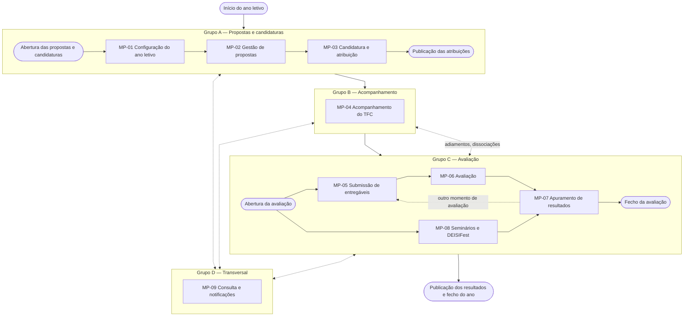
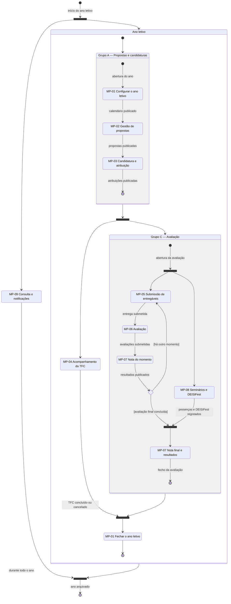

> **Aviso:** documento elaborado com apoio de IA generativa (Claude, Anthropic). A utilização está descrita em [04_utilizacao_de_ia.md](04_utilizacao_de_ia.md).

# 05 — Casos de uso

Este documento descreve os casos de uso da plataforma de gestão de TFC. É derivado de [02_processos.md](02_processos.md): **cada processo `P-xx.yy` dá origem ao caso de uso `UC-xx.yy`**, com o mesmo número, para que a rastreabilidade seja direta. A única exceção é o UC-02.7, que junta num caso de uso uma atualização que em 02 está repetida em quatro processos (ver a lacuna 10). Os estados (da proposta, da candidatura e do TFC) são os da secção 4 de 02 e as regras citam as mesmas fontes (regulamento [1], reuniões e emails do orientador).

**Divisão do trabalho** (registo de 11/11): o frontend é desenvolvido no DEISI2256 e o backend no DEISI2257; os dois cobrem toda a plataforma. A verificação automática dos entregáveis é feita por um agente do DEISI2258, que corre no GitHub (Actions e workflows): a plataforma regista o endereço do repositório e recebe o resultado do agente (email do orientador, 11/11).

## 1. Como ler este documento

**Nível de abstração.** Todos os casos de uso estão descritos ao mesmo nível, o **mezzo**: cada um é um objetivo do ator, com os passos essenciais e sem pormenores de interface (botões, ecrãs, mensagens). O detalhe de cada caso de uso (ecrãs, campos, validações finas) fica para os sprints em que for implementado.

**Organização.** Os 9 macro-processos estão agregados em **4 grupos funcionais**, pela ordem do ano letivo (secção 3.1): A — Propostas e candidaturas, B — Acompanhamento, C — Avaliação e D — Consulta e notificações. As secções 5 a 8 têm um grupo cada, com o diagrama e as fichas de cada macro-processo.

Cada ficha tem sempre os mesmos campos:

- **Ator principal:** quem inicia e tem o objetivo. «Plataforma» indica uma ação automática, que não é um ator (secção 1 de 02).
- **Atores secundários:** quem participa sem iniciar (dá parecer, valida, fornece um resultado).
- **Objetivo:** o resultado que o ator quer obter.
- **Evento:** o que desencadeia o caso de uso.
- **Pré-condições:** o que tem de ser verdade antes.
- **Fluxo principal:** os passos essenciais do cenário de sucesso.
- **Alternativas e exceções:** os desvios e o que acontece em cada um.
- **Critérios de aceitação (casos de teste):** os testes que verificam o caso de uso, numa tabela antes das pós-condições. Cada teste tem um identificador (`CT-xx.yy.n`), a situação inicial com os dados de teste, os passos e o resultado esperado.
- **Pós-condições:** o que se pode observar no fim (estados, registos, notificações).
- **Regras:** com a fonte.
- **Relações:** `include` (o caso de uso inclui sempre o outro), `extend` (acrescenta comportamento em certas condições) e «desencadeia» (o fim de um caso de uso inicia outro).
- **Notas** (só quando existem): pontos *a validar* e pedidos do inquérito que ainda não estão em 02.

**Como ler os diagramas de casos de uso:** usam a notação UML, com a sintaxe `usecase-beta` do Mermaid 12.
- Os **atores** (bonecos) estão fora da plataforma e ligam-se por uma linha aos casos de uso que iniciam.
- Os **casos de uso** (elipses) estão dentro de um **pacote** com o nome do macro-processo. Quando um caso de uso inclui outro de um macro-processo diferente, o pacote desse macro-processo também aparece.
- **«include»** (seta tracejada): o caso de uso inclui sempre o outro (por exemplo, atribuir um TFC inclui atualizar as propostas disponíveis e as listas de candidaturas).
- **«extend»** (seta tracejada): o caso de uso acrescenta comportamento ao outro, só em certas condições ou variantes.
- **Generalização** (seta com triângulo): um ator é um caso particular de outro (por exemplo, o aluno é um proponente).
- As notificações (UC-09.4) são incluídas por todos os casos de uso que notificam alguém; essas ligações não estão desenhadas, para não sobrecarregar os diagramas.
- A ordem em que os casos de uso acontecem está escrita por baixo de cada diagrama.

## 2. Atores

| Ator | Descrição | Casos de uso em que é ator principal |
|---|---|---|
| Aluno | Inscrito na UC de TFC; trabalha sozinho ou em grupo de 2. Num grupo, o **submissor** cria e altera as candidaturas e o **colega** confirma-as | UC-02.1, 02.3, 03.1 a 03.6, 03.12, 04.1, 04.3, 05.1, 05.3, 09.1, 09.2 |
| Docente | Do DEISI. Em cada TFC tem uma função: proponente, orientador, coorientador ou jurado | UC-02.1, 02.3, 02.6, 03.7, 03.8, 03.13, 04.1, 04.2, 05.2, 06.6, 09.1, 09.2 |
| Proponente externo | Empresa ou instituição, ou docente de outro departamento | UC-02.1, 02.3, 03.7 |
| Coordenação | Coordenação de TFC | UC-01.1 a 01.4, 02.2, 02.4, 03.7, 03.9, 03.11, 06.1 a 06.5, 06.7, 07.1 a 07.3, 08.1, 08.2, 09.3 |
| Organização de seminários | Regista as presenças | UC-08.1 |
| Administrador | Gestão técnica | UC-01.2 |
| Plataforma | Ações automáticas (prazos, validações, cálculos, notificações). Não é um ator (secção 1 de 02); aparece só para identificar quem executa os casos de uso automáticos | UC-02.7, 03.10, 09.4 |
| Agente de verificação (DEISI2258) | Sistema externo que corre no GitHub e verifica os entregáveis. É **ator secundário**: não inicia casos de uso da plataforma, mas fornece o resultado da verificação | UC-04.1, UC-05.3 (secundário) |

**Proponente** (aluno, docente ou proponente externo) e **Utilizador** (qualquer pessoa com conta) são atores abstratos: aparecem nos diagramas com a seta de generalização, para não repetir as mesmas ligações.

As permissões dependem do **perfil** da conta e da **função** que o docente tem em cada TFC: o mesmo docente pode ser proponente num TFC, orientador noutro e jurado noutro.

## 3. Visão geral

### 3.1 Grupos funcionais

Os 9 macro-processos agregam-se em 4 grupos funcionais:

| Grupo | Macro-processos | Começa com | Acaba com |
|---|---|---|---|
| A — Propostas e candidaturas | MP-01 Configuração do ano letivo, MP-02 Gestão de propostas, MP-03 Candidatura e atribuição | Abertura das propostas e candidaturas (UC-01.1) | Publicação das atribuições (UC-03.11) |
| B — Acompanhamento | MP-04 Acompanhamento do TFC | TFC atribuído (UC-03.9) | TFC entregue, adiado ou cancelado |
| C — Avaliação | MP-05 Submissão de entregáveis, MP-06 Avaliação, MP-07 Apuramento de resultados, MP-08 Seminários e DEISIFest | Abertura da avaliação (UC-06.1) | Publicação dos resultados finais (UC-07.3) |
| D — Consulta e notificações | MP-09 Consulta e notificações | Início do ano letivo | Fecho do ano letivo (UC-01.4) |

O diagrama mostra como os grupos se ligam. As setas contínuas são a sequência do ano; as tracejadas são ligações que acontecem em qualquer altura: o Grupo B interage com a avaliação (adiamentos, dissociações) e o Grupo D, que funciona durante todo o ano, liga-se a todos os outros (consultas e notificações). Nenhum macro-processo fica desligado.



### 3.2 Orquestração do ano letivo (diagrama de atividades)

O mesmo ano letivo como diagrama de atividades (`stateDiagram-v2` do Mermaid, adaptado): as barras pretas são **fork** (as atividades seguintes decorrem em paralelo) e **join** (espera que todas acabem); o losango é uma **escolha**. O ano letivo e o MP-09 decorrem em paralelo; depois da atribuição, o acompanhamento (MP-04) decorre em paralelo com a avaliação; dentro da avaliação, os seminários e o DEISIFest (MP-08) decorrem em paralelo com o ciclo de cada momento (MP-05 → MP-06 → MP-07), que se repete enquanto houver momentos (AI1, AI2, final).



### 3.3 Diagrama global de casos de uso

Cada macro-processo aparece como um caso de uso, dentro do pacote do seu grupo funcional, ligado aos atores que nele iniciam casos de uso. Para reduzir as linhas, o aluno, o docente e o proponente externo ligam-se ao MP-02 através do ator abstrato **Proponente**; o **Utilizador** representa todos os atores com conta (todos consultam e recebem notificações). Os atores da direita são os da coordenação, da administração e os sistemas externos.

```mermaid
usecase-beta
direction LR
actor AG("Agente de verificação\n(DEISI2258)")
actor PE("Proponente externo")
actor AD("Administrador")
actor UT("Utilizador")
actor AL("Aluno")
actor PR("Proponente")
actor OS("Organização de seminários")
actor DO("Docente")
actor CD("Coordenação")
systemBoundary GC["C — Avaliação"]
    M08("MP-08\nSeminários e DEISIFest")
    M07("MP-07\nApuramento de resultados")
    M05("MP-05\nSubmissão de entregáveis")
    M06("MP-06\nAvaliação")
end
GC@{ type: package }
systemBoundary GA["A — Propostas e candidaturas"]
    M03("MP-03\nCandidatura e atribuição")
    M02("MP-02\nGestão de propostas")
    M01("MP-01\nConfiguração do ano letivo")
end
GA@{ type: package }
systemBoundary GB["B — Acompanhamento"]
    M04("MP-04\nAcompanhamento do TFC")
end
GB@{ type: package }
systemBoundary GD["D — Consulta e notificações"]
    M09("MP-09\nConsulta e notificações")
end
GD@{ type: package }
PE --|> PR
DO --|> PR
AL --|> PR
AL -- M03
M09 -- UT
DO -- M06
M01 -- AD
AL -- M04
M08 -- OS
DO -- M04
M07 -- CD
M02 -- CD
M05 -- AG
M01 -- CD
M08 -- CD
PR -- M02
AL -- M05
M06 -- CD
DO -- M03
M03 -- CD
```

### 3.4 O que cada ator faz

Um diagrama de casos de uso por ator, em notação UML: o ator está fora da plataforma e liga-se aos casos de uso que inicia, agrupados por tema em pacotes.

**Aluno**

```mermaid
usecase-beta
direction LR
actor AL("Aluno")
systemBoundary P2["Propostas"]
    a1("UC-02.1\nSubmeter proposta")
    a2("UC-02.5\nConsultar propostas")
end
P2@{ type: package }
systemBoundary P3["Candidaturas"]
    a3("UC-03.1 / UC-03.2\nCandidatar-se sozinho ou em grupo")
    a4("UC-03.3\nConfirmar candidatura do colega")
    a5("UC-03.4 a UC-03.6\nMudar prioridade, substituir ou cancelar")
    a6("UC-03.12\nDesistir do TFC")
end
P3@{ type: package }
systemBoundary P5["TFC e entregas"]
    a7("UC-04.1\nRegistar repositório")
    a8("UC-05.1\nEnviar relatório ao orientador")
    a9("UC-05.3\nSubmeter entrega")
end
P5@{ type: package }
systemBoundary P9["Consultas"]
    a10("UC-09.1\nVer estado do TFC e prazos")
    a11("UC-09.2\nVer avaliações")
end
P9@{ type: package }
AL -- a1
AL -- a2
AL -- a3
AL -- a4
AL -- a5
AL -- a6
AL -- a7
AL -- a8
AL -- a9
AL -- a10
AL -- a11
```

**Docente** (o mesmo ator, com funções diferentes de TFC para TFC)

```mermaid
usecase-beta
direction LR
actor DO("Docente")
systemBoundary Prop["Como proponente"]
    d1("UC-02.1 / UC-02.6\nSubmeter e alterar propostas")
    d2("UC-03.7\nSelecionar candidatos")
    d3("UC-03.8\nJuntar dois alunos num TFC")
end
Prop@{ type: package }
systemBoundary Ori["Como orientador"]
    d4("UC-05.2\nValidar relatório")
    d5("UC-04.1\nRegistar atividades")
    d6("UC-03.13\nPedir desatribuição")
    d7("UC-09.2\nVer avaliações dos seus TFC")
end
Ori@{ type: package }
systemBoundary Jur["Como jurado"]
    d8("UC-06.6\nPreencher formulário de avaliação")
end
Jur@{ type: package }
DO -- d1
DO -- d2
DO -- d3
DO -- d4
DO -- d5
DO -- d6
DO -- d7
DO -- d8
```

**Coordenação**

```mermaid
usecase-beta
direction LR
actor CD("Coordenação")
systemBoundary Ano["Ano letivo"]
    c1("UC-01.1\nDefinir calendário")
    c2("UC-01.2 / UC-01.3\nGerir utilizadores e cursos")
    c3("UC-01.4\nFechar o ano letivo")
end
Ano@{ type: package }
systemBoundary Prop["Propostas e atribuição"]
    c4("UC-02.2 / UC-02.4\nValidar e publicar propostas")
    c5("UC-03.9\nAtribuir TFC e orientador")
    c6("UC-03.11\nPublicar a lista final")
end
Prop@{ type: package }
systemBoundary Aval["Avaliação"]
    c7("UC-06.1 / UC-06.2\nDefinir momentos e critérios")
    c8("UC-06.4 / UC-06.5\nConstituir júri e agendar defesas")
end
Aval@{ type: package }
systemBoundary Res["Resultados"]
    c9("UC-07.1 / UC-07.2\nCalcular notas")
    c10("UC-06.7 / UC-07.3\nPublicar resultados")
    c11("UC-09.3\nVer relatórios de gestão")
end
Res@{ type: package }
CD -- c1
CD -- c2
CD -- c3
CD -- c4
CD -- c5
CD -- c6
CD -- c7
CD -- c8
CD -- c9
CD -- c10
CD -- c11
```

**Restantes atores**

```mermaid
usecase-beta
direction LR
actor PE("Proponente externo")
actor OS("Organização de seminários")
actor AD("Administrador")
systemBoundary Out["Plataforma de gestão de TFC"]
    e1("UC-02.1\nSubmeter proposta")
    e2("UC-03.7\nSelecionar candidatos")
    o1("UC-08.1\nRegistar presenças")
    ad1("UC-01.2\nGerir utilizadores")
end
Out@{ type: package }
PE -- e1
PE -- e2
OS -- o1
AD -- ad1
```

A secção 4 tem a lista completa e as secções 5 a 8 têm o detalhe, por grupo funcional.

## 4. Lista de casos de uso

| UC | Grupo | Nome | Ator principal | Prioridade para a 1.ª entrega |
|---|---|---|---|---|
| UC-01.1 | A | Definir calendário | Coordenação | Alta |
| UC-01.2 | A | Gerir utilizadores e perfis | Coordenação, Administrador | Alta |
| UC-01.3 | A | Gerir cursos e grupos de cursos | Coordenação | Média |
| UC-01.4 | A | Fechar o ano letivo | Coordenação | Baixa |
| UC-02.1 | A | Submeter proposta | Docente, Aluno, Proponente externo | Alta |
| UC-02.2 | A | Validar proposta | Coordenação | Alta |
| UC-02.3 | A | Rever proposta | Docente, Aluno, Proponente externo | Média |
| UC-02.4 | A | Publicar proposta | Coordenação | Alta |
| UC-02.5 | A | Consultar propostas | Todos | Alta |
| UC-02.6 | A | Alterar proposta disponível | Docente (proponente) | Média |
| UC-02.7 | A | Atualizar propostas disponíveis | Plataforma | Alta |
| UC-03.1 | A | Submeter candidatura individual | Aluno | Alta |
| UC-03.2 | A | Submeter candidatura em grupo | Aluno (submissor) | Alta |
| UC-03.3 | A | Confirmar candidatura em grupo | Aluno (colega) | Alta |
| UC-03.4 | A | Alterar a prioridade de uma candidatura | Aluno | Alta |
| UC-03.5 | A | Substituir o TFC de uma candidatura | Aluno | Média |
| UC-03.6 | A | Cancelar candidatura | Aluno | Alta |
| UC-03.7 | A | Selecionar candidatos | Docente (proponente), Proponente externo, Coordenação | Alta |
| UC-03.8 | A | Juntar alunos num TFC | Docente, Coordenação | Baixa |
| UC-03.9 | A | Atribuir TFC e orientador | Coordenação | Alta |
| UC-03.10 | A | Atualizar as listas de candidaturas após a atribuição | Plataforma | Alta |
| UC-03.11 | A | Publicar atribuições | Coordenação | Alta |
| UC-03.12 | A | Registar desistência | Aluno | Média |
| UC-03.13 | A | Desatribuir TFC | Docente (orientador) | Média |
| UC-04.1 | B | Registar repositório e atividades | Aluno, Docente (orientador) | Média |
| UC-04.2 | B | Dissociar grupo | Docente (orientador), Coordenação | Baixa |
| UC-04.3 | B | Pedir adiamento para a época de recurso | Aluno | Baixa |
| UC-05.1 | C | Enviar relatório ao orientador | Aluno | Alta |
| UC-05.2 | C | Validar relatório | Docente (orientador) | Alta |
| UC-05.3 | C | Submeter entrega | Aluno | Alta |
| UC-06.1 | C | Definir momentos de avaliação | Coordenação | Média |
| UC-06.2 | C | Definir critérios de avaliação | Coordenação | Média |
| UC-06.3 | C | Definir outro momento de avaliação | Coordenação | Baixa |
| UC-06.4 | C | Constituir júri | Coordenação | Média |
| UC-06.5 | C | Agendar defesas | Coordenação | Baixa |
| UC-06.6 | C | Preencher formulário de avaliação | Docente (jurado) | Média |
| UC-06.7 | C | Publicar resultados intercalares | Coordenação | Média |
| UC-07.1 | C | Calcular a nota de cada momento | Coordenação | Média |
| UC-07.2 | C | Calcular a nota final e a situação | Coordenação | Baixa |
| UC-07.3 | C | Publicar resultados finais | Coordenação | Baixa |
| UC-08.1 | C | Registar presenças em seminários | Organização de seminários | Baixa |
| UC-08.2 | C | Registar resultado do DEISIFest | Coordenação | Baixa |
| UC-09.1 | D | Consultar estado do TFC | Aluno, Docente | Alta |
| UC-09.2 | D | Consultar avaliações | Aluno, Docente (orientador) | Média |
| UC-09.3 | D | Consultar relatórios de gestão | Coordenação | Média |
| UC-09.4 | D | Receber notificações | Todos (Plataforma envia) | Média |

**Critério da prioridade** (proposta da equipa, a validar): *Alta* é o ciclo propostas → candidaturas → atribuição e o envio e validação do relatório, que estão em uso na fase atual do ano e são onde se concentram os resultados do inquérito; *Média* é o que é preciso até à AI2; *Baixa* é o que só é preciso no fim do ano letivo.

---

## 5. Grupo A — Propostas e candidaturas

Da abertura do ano letivo à publicação das atribuições.

### 5.1 MP-01 — Configuração do ano letivo

```mermaid
usecase-beta
direction LR
actor CD("Coordenação")
actor AD("Administrador")
systemBoundary MP01["MP-01 Configuração do ano letivo"]
    U011("UC-01.1\nDefinir calendário")
    U013("UC-01.3\nGerir cursos e grupos de cursos")
    U014("UC-01.4\nFechar o ano letivo")
    U012("UC-01.2\nGerir utilizadores e perfis")
end
MP01@{ type: package }
CD -- U011
CD -- U013
CD -- U014
CD -- U012
AD -- U012
```

Ordem: UC-01.1 a UC-01.3 no início do ano; UC-01.4 no fim, depois de publicados os resultados finais (UC-07.3).

#### UC-01.1 Definir calendário
- **Ator principal:** Coordenação.
- **Atores secundários:** nenhum.
- **Objetivo:** registar as fases do ano, para que cada funcionalidade só esteja disponível nas datas certas.
- **Evento:** preparação de um novo ano letivo.
- **Pré-condições:** utilizador com perfil Coordenação.
- **Fluxo principal:**
  1. A coordenação define as fases do ano (propostas, candidaturas, lista final, entregas e defesas), com início e fim.
  2. A plataforma verifica a coerência das datas.
  3. A coordenação publica o calendário.
- **Alternativas e exceções:** datas incoerentes → o calendário não é publicado; alteração de uma fase que já tem submissões → a plataforma pede confirmação e regista a alteração.

**Critérios de aceitação (casos de teste)**

| Teste | Situação inicial | Passos | Resultado esperado |
|---|---|---|---|
| CT-01.1.1 | Fase de candidaturas de 09/09 a 04/10; hoje é 05/10 | Um aluno tenta candidatar-se a um TFC Disponível | A candidatura não é aceite, porque a fase está fechada |
| CT-01.1.2 | Fase de propostas com início a 30/09 e fim a 01/09 | A coordenação publica o calendário | A plataforma indica a incoerência das datas e o calendário não é publicado |
| CT-01.1.3 | Fase de propostas aberta, com 3 propostas submetidas | A coordenação altera a data de fim da fase e confirma | A alteração fica registada, com a data e o utilizador |

- **Pós-condições:** calendário publicado e visível para todos; cada funcionalidade só está disponível dentro da sua fase.
- **Regras:** datas de 2026/27 do regulamento [1] (Anexo A de 02), alteráveis pela coordenação; as datas são sempre verificadas no servidor.
- **Relações:** desencadeia UC-02.1 (abertura da fase de propostas) e UC-02.4 (abertura da fase de candidaturas).

#### UC-01.2 Gerir utilizadores e perfis
- **Ator principal:** Coordenação ou Administrador.
- **Atores secundários:** nenhum.
- **Objetivo:** que cada pessoa entre na plataforma com o perfil e os dados certos.
- **Evento:** início do ano letivo ou entrada de um novo utilizador.
- **Pré-condições:** perfil Coordenação ou Administrador.
- **Fluxo principal:**
  1. O ator regista ou importa os utilizadores (alunos com número, curso, ECTS e UCs concluídas; docentes; entidades externas).
  2. Atribui o perfil de cada um e indica, para cada docente, se está ativo.
  3. A plataforma verifica duplicados e guarda.
- **Alternativas e exceções:** utilizador duplicado → os registos são fundidos.

**Critérios de aceitação (casos de teste)**

| Teste | Situação inicial | Passos | Resultado esperado |
|---|---|---|---|
| CT-01.2.1 | Ficheiro de importação com um aluno com 85 ECTS | A coordenação importa o ficheiro | O aluno fica registado e marcado como não elegível para candidaturas |
| CT-01.2.2 | Docente inativo, orientador de um TFC de 2025/26 | A coordenação escolhe o orientador de uma proposta nova | O docente não está entre os orientadores possíveis; o TFC de 2025/26 continua associado a ele |

- **Pós-condições:** cada utilizador entra com o perfil atribuído; os alunos com menos de 90 ECTS ficam não elegíveis para candidaturas.
- **Regras:** só os docentes ativos podem ser proponentes, orientadores, coorientadores ou jurados; os inativos mantêm o histórico (Reunião 5, 28/10).
- **Relações:** nenhuma.

#### UC-01.3 Gerir cursos e grupos de cursos
- **Ator principal:** Coordenação.
- **Atores secundários:** nenhum.
- **Objetivo:** manter os cursos e os grupos de cursos usados nas propostas e nos perfis de candidato.
- **Evento:** preparação do ano letivo ou criação de um curso.
- **Pré-condições:** perfil Coordenação.
- **Fluxo principal:**
  1. A coordenação cria ou altera os cursos (por exemplo LEI, LIG, LCD) e os grupos de cursos (por exemplo «LEI + LIG»).
  2. Associa cada curso aos seus grupos.
  3. A plataforma guarda.
- **Alternativas e exceções:** desativar um curso usado em propostas → o curso deixa de estar disponível para propostas novas, mas mantém-se nas existentes.

**Critérios de aceitação (casos de teste)**

| Teste | Situação inicial | Passos | Resultado esperado |
|---|---|---|---|
| CT-01.3.1 | Curso LCD desativado; uma proposta antiga com o curso LCD | Um docente submete uma proposta nova e consulta a proposta antiga | LCD não pode ser escolhido na proposta nova; a proposta antiga continua com LCD |

- **Pós-condições:** os cursos e grupos ativos podem ser escolhidos nas propostas (UC-02.1) e nos perfis de candidato.
- **Regras:** um curso ou grupo desativado deixa de estar disponível para novas propostas, mas mantém-se nas antigas (Reunião 5, 28/10).
- **Relações:** nenhuma.

#### UC-01.4 Fechar o ano letivo
- **Ator principal:** Coordenação.
- **Atores secundários:** nenhum.
- **Objetivo:** passar o ano para o histórico, consultável mas não alterável.
- **Evento:** fim do ano letivo, depois de publicados os resultados finais da última época (UC-07.3).
- **Pré-condições:** perfil Coordenação; resultados finais publicados em todas as épocas.
- **Fluxo principal:**
  1. A coordenação pede o fecho do ano.
  2. A plataforma apresenta as pendências (avaliações por lançar, TFC sem situação).
  3. A coordenação confirma.
  4. A plataforma passa os TFC e as propostas para o histórico.
- **Alternativas e exceções:** há pendências → a coordenação decide se fecha na mesma.

**Critérios de aceitação (casos de teste)**

| Teste | Situação inicial | Passos | Resultado esperado |
|---|---|---|---|
| CT-01.4.1 | Ano 2025/26 fechado | A coordenação tenta alterar uma nota de 2025/26 | A alteração é recusada; a nota continua disponível para consulta |
| CT-01.4.2 | Ano 2026/27 com 2 avaliações por lançar | A coordenação pede o fecho do ano | A plataforma apresenta as 2 avaliações pendentes antes de pedir confirmação |

- **Pós-condições:** ano fechado; TFC no estado Arquivado; propostas não atribuídas no estado Arquivada; dados consultáveis e não alteráveis.
- **Regras:** a plataforma guarda todos os anos (Reunião 5, 28/10); o fecho passa os dados para um histórico consultável (Reunião 6, 04/11).
- **Relações:** desencadeado por UC-07.3.

### 5.2 MP-02 — Gestão de propostas

```mermaid
usecase-beta
direction LR
actor AL("Aluno")
actor PE("Proponente externo")
actor DO("Docente")
actor PR("Proponente")
actor CD("Coordenação")
systemBoundary MP02["MP-02 Gestão de propostas"]
    U021("UC-02.1\nSubmeter proposta")
    U023("UC-02.3\nRever proposta")
    U025("UC-02.5\nConsultar propostas")
    U026("UC-02.6\nAlterar proposta disponível")
    U022("UC-02.2\nValidar proposta")
    U024("UC-02.4\nPublicar proposta")
    U027("UC-02.7\nAtualizar propostas disponíveis")
end
MP02@{ type: package }
AL --|> PR
PE --|> PR
DO --|> PR
PR -- U021
PR -- U023
PR -- U025
DO -- U026
CD -- U025
CD -- U022
CD -- U024
U024 ..> : include U027
```

O aluno, o docente e o proponente externo são especializações do ator **Proponente** (seta de generalização). Ordem habitual: UC-02.1 → UC-02.2 → UC-02.4. Se a coordenação pedir alterações em UC-02.2, o proponente faz UC-02.3 e a proposta volta a UC-02.2. A publicação (UC-02.4) inclui a atualização automática das propostas disponíveis (UC-02.7), que também é incluída pela atribuição, pela desistência e pela desatribuição (secção 5.3). A alteração de uma proposta disponível pelo docente (UC-02.6) muda os dados da proposta, mas não o seu estado.

#### UC-02.1 Submeter proposta
- **Ator principal:** Proponente (Docente, Aluno ou Proponente externo).
- **Atores secundários:** nenhum.
- **Objetivo:** propor um tema de TFC.
- **Evento:** o proponente quer propor um tema.
- **Pré-condições:** autenticado; fase de propostas do seu tipo aberta (UC-01.1); se for aluno, inscrito na UC.
- **Fluxo principal:**
  1. O proponente indica os dados da proposta do seu tipo (docente, aluno, empresa ou outro departamento): título, descrição, orientador sugerido, modalidade, cursos, disciplinas, tecnologias e perfil do candidato ou alunos pré-selecionados.
  2. A plataforma verifica os dados obrigatórios e as regras da modalidade.
  3. A plataforma regista a proposta e define o estado inicial.
- **Alternativas e exceções:** fase fechada → não é possível submeter; sem perfil de candidato nem alunos pré-selecionados → não regista; proposta individual com 2.º aluno, ou 2.º aluno já indicado noutra proposta em grupo → não regista.

**Critérios de aceitação (casos de teste)**

| Teste | Situação inicial | Passos | Resultado esperado |
|---|---|---|---|
| CT-02.1.1 | Docente DEISI ativo; fase de propostas de docentes aberta | O docente submete uma proposta sem aluno indicado | A proposta fica Aceite |
| CT-02.1.2 | Aluno inscrito na UC; fase de propostas de alunos aberta | O aluno submete uma proposta | A proposta fica Em validação e a coordenação é notificada |
| CT-02.1.3 | Proposta com modalidade individual e um 2.º aluno indicado | O proponente submete a proposta | A proposta não é registada e a plataforma indica o erro na modalidade |

- **Pós-condições:** proposta de docente DEISI sem aluno indicado → **Aceite**; restantes → **Em validação**, e a coordenação é notificada.
- **Regras:** propostas de docentes aceites sem validação, exceto com aluno indicado (regulamento [1], cap. 3); um aluno pode submeter várias propostas e a proposta em grupo é submetida por um só elemento (cap. 3); o orientador indicado pelo aluno tem de ter dado acordo prévio (cap. 3); só docentes ativos podem ser orientadores sugeridos; empresas e outros departamentos têm formulários diferentes e podem indicar um coorientador (Reunião 6, 04/11); a modalidade é vinculativa (orientador, email de 01/11).
- **Relações:** desencadeia UC-02.2 (proposta Em validação).
- **Notas:** o 03 já prevê campos que o P-02.1 não lista (área de aplicação, continuação de outra proposta, anexos, notas internas). Ver a lacuna 3.

#### UC-02.2 Validar proposta
- **Ator principal:** Coordenação.
- **Atores secundários:** nenhum.
- **Objetivo:** só deixar seguir temas adequados e nomear o orientador.
- **Evento:** existe uma proposta Em validação.
- **Pré-condições:** proposta Em validação.
- **Fluxo principal:**
  1. A coordenação analisa o tema, o esforço, o enquadramento e a disponibilidade do orientador.
  2. Decide: aceita, pede alterações ou recusa (com justificação).
  3. Se aceitar, pode acrescentar tarefas ou requisitos e nomeia o orientador e o coorientador.
  4. A plataforma regista a decisão e notifica o proponente.
- **Alternativas e exceções:** recusa sem justificação → não regista; orientador com mais de 5 orientações → aviso, sem bloquear.

**Critérios de aceitação (casos de teste)**

| Teste | Situação inicial | Passos | Resultado esperado |
|---|---|---|---|
| CT-02.2.1 | Proposta Em validação | A coordenação recusa a proposta sem justificação | A recusa não é registada e a plataforma pede a justificação |
| CT-02.2.2 | Docente já com 5 orientações | A coordenação nomeia-o orientador de mais uma proposta | A plataforma avisa, mas a nomeação fica registada |

- **Pós-condições:** proposta **Aceite**, **Alterações solicitadas** ou **Recusada**; a decisão fica no histórico; o proponente é notificado.
- **Regras:** nas propostas de empresas e outros departamentos, a coordenação nomeia o orientador pela área científica e pode substituir o sugerido (cap. 2 e 3).
- **Relações:** desencadeia UC-02.3 (alterações solicitadas) ou UC-02.4 (aceite).

#### UC-02.3 Rever proposta
- **Ator principal:** Proponente (Docente, Aluno ou Proponente externo).
- **Atores secundários:** nenhum.
- **Objetivo:** corrigir a proposta conforme o pedido da coordenação.
- **Evento:** a coordenação pediu alterações (UC-02.2).
- **Pré-condições:** proposta em **Alterações solicitadas**; fase de propostas aberta.
- **Fluxo principal:**
  1. O proponente consulta o pedido de alterações.
  2. Altera a proposta.
  3. Reenvia a proposta para validação.
- **Alternativas e exceções:** fase fechada → a proposta só pode ser consultada.

**Critérios de aceitação (casos de teste)**

| Teste | Situação inicial | Passos | Resultado esperado |
|---|---|---|---|
| CT-02.3.1 | Proposta em Alterações solicitadas; fase de propostas aberta | O proponente altera a proposta e reenvia-a | A proposta volta a Em validação e a coordenação é notificada |
| CT-02.3.2 | Proposta em Alterações solicitadas; fase de propostas fechada | O proponente tenta alterar a proposta | A alteração não é aceite |

- **Pós-condições:** proposta volta a **Em validação**; a coordenação é notificada.
- **Regras:** só dentro da fase de propostas (UC-01.1).
- **Relações:** desencadeia UC-02.2.

#### UC-02.4 Publicar proposta
- **Ator principal:** Coordenação.
- **Atores secundários:** nenhum.
- **Objetivo:** tornar uma proposta aceite visível para candidatura.
- **Evento:** abertura da fase de candidaturas, ou aceitação de uma proposta durante essa fase.
- **Pré-condições:** proposta **Aceite**.
- **Fluxo principal:**
  1. A coordenação escolhe as propostas aceites a publicar (podem ser todas).
  2. Confirma a publicação.
  3. A plataforma atualiza as propostas disponíveis (UC-02.7) e notifica os proponentes.
- **Alternativas e exceções:** nenhuma proposta escolhida → nada é publicado.

**Critérios de aceitação (casos de teste)**

| Teste | Situação inicial | Passos | Resultado esperado |
|---|---|---|---|
| CT-02.4.1 | 3 propostas Aceites, sem aluno pré-selecionado | A coordenação publica as 3 | As 3 propostas ficam Disponíveis e os alunos elegíveis podem consultá-las |
| CT-02.4.2 | Proposta Aceite com o aluno A pré-selecionado | A coordenação publica a proposta; os alunos A e B consultam as propostas | A proposta fica Pré-atribuída; o aluno A vê-a e o aluno B não |

- **Pós-condições:** sem aluno pré-selecionado → **Disponível**, visível para os alunos elegíveis; com aluno pré-selecionado → **Pré-atribuída**, visível só para esse aluno; o proponente é notificado.
- **Regras:** «aceite» e «disponível» são estados diferentes porque a publicação é um evento entre eles (Reunião 6, 04/11); mesmo com pré-seleção, o aluno tem de se candidatar (cap. 3).
- **Relações:** include UC-02.7.

#### UC-02.5 Consultar propostas
- **Ator principal:** Utilizador (Aluno, Docente, Proponente externo ou Coordenação).
- **Atores secundários:** nenhum.
- **Objetivo:** encontrar propostas e ver o seu detalhe.
- **Evento:** o utilizador quer ver as propostas.
- **Pré-condições:** autenticado.
- **Fluxo principal:**
  1. A plataforma apresenta as propostas que o utilizador pode ver (ID, título, orientador e coorientador).
  2. O utilizador pesquisa e filtra (orientador, modalidade).
  3. O utilizador consulta o detalhe de uma proposta (empresa, orientador, título, descrição, modalidade, estado, cursos, disciplinas e tecnologias).
- **Alternativas e exceções:** nenhuma proposta corresponde aos filtros → resultado vazio.

**Critérios de aceitação (casos de teste)**

| Teste | Situação inicial | Passos | Resultado esperado |
|---|---|---|---|
| CT-02.5.1 | 4 propostas Disponíveis, 2 delas com a tecnologia Python | O aluno filtra pela tecnologia Python | O resultado tem só as 2 propostas com Python |
| CT-02.5.2 | 4 propostas Disponíveis | O aluno consulta as propostas sem filtros | O resultado tem as 4 propostas |
| CT-02.5.3 | Proposta X no estado Atribuída | O aluno consulta as propostas disponíveis | A proposta X não está entre as disponíveis para candidatura |

- **Pós-condições:** nenhum dado é alterado.
- **Regras:** o aluno vê as propostas Disponíveis e a sua Pré-atribuída; o proponente vê as suas em todos os estados; a coordenação vê todas.
- **Relações:** nenhuma.
- **Notas:** melhorias pedidas no inquérito (analise-exploratoria, secção 6; a incluir em 02): filtros por tecnologia (42%), disciplina (35%), orientador e palavra-chave (29% cada); descrição breve na lista; TFC atribuídos assinalados ou retirados; consulta e candidatura no mesmo sítio.

#### UC-02.6 Alterar proposta disponível
- **Ator principal:** Docente (proponente).
- **Atores secundários:** nenhum.
- **Objetivo:** corrigir uma proposta já publicada sem prejudicar quem já se candidatou.
- **Evento:** o docente quer alterar uma proposta publicada.
- **Pré-condições:** proposta **Disponível** ou **Pré-atribuída**.
- **Fluxo principal:**
  1. O docente altera os dados da proposta.
  2. A plataforma verifica a compatibilidade com as candidaturas existentes.
  3. A plataforma guarda e notifica os candidatos.
- **Alternativas e exceções:** mudar para grupo com candidaturas individuais existentes, ou para individual com candidaturas em grupo → não guarda.

**Critérios de aceitação (casos de teste)**

| Teste | Situação inicial | Passos | Resultado esperado |
|---|---|---|---|
| CT-02.6.1 | Proposta Disponível, individual, com 2 candidaturas individuais | O docente muda a modalidade para «em grupo» | A alteração não é guardada e a plataforma indica que há candidaturas individuais |
| CT-02.6.2 | Proposta Disponível com 2 candidatos | O docente altera a descrição | A alteração fica guardada e os 2 candidatos são notificados |

- **Pós-condições:** proposta com os novos dados, no mesmo estado; candidatos notificados.
- **Regras:** o docente pode alterar tudo num TFC não atribuído, desde que compatível com as candidaturas existentes (orientador, email de 01/11).
- **Relações:** nenhuma. Não muda o estado da proposta; a mudança de estado é feita em UC-02.7.

#### UC-02.7 Atualizar propostas disponíveis
- **Ator principal:** Plataforma (incluído em UC-02.4, UC-03.9, UC-03.12 e UC-03.13).
- **Atores secundários:** nenhum.
- **Objetivo:** manter a lista de propostas disponíveis para candidatura igual ao estado real das propostas.
- **Evento:** uma proposta é publicada, atribuída ou libertada (desistência ou desatribuição).
- **Pré-condições:** a proposta existe no ano letivo em curso.
- **Fluxo principal:**
  1. A plataforma recebe o evento e a proposta afetada.
  2. Muda o estado da proposta: publicada → Disponível ou Pré-atribuída; atribuída → Atribuída; libertada → Disponível.
  3. Acrescenta a proposta à lista de propostas disponíveis ou retira-a, conforme o novo estado e a fase.
- **Alternativas e exceções:** proposta libertada com a fase de candidaturas fechada → fica Disponível, mas fora da lista de candidatura (só a coordenação a atribui); falha a meio → o evento que a desencadeou não fica registado.

**Critérios de aceitação (casos de teste)**

| Teste | Situação inicial | Passos | Resultado esperado |
|---|---|---|---|
| CT-02.7.1 | Proposta X Disponível | O TFC X é atribuído (UC-03.9) | X fica Atribuída e deixa de estar entre as propostas disponíveis para candidatura |
| CT-02.7.2 | TFC X Em curso; fase de candidaturas aberta | A desistência do aluno é validada (UC-03.12) | X fica Disponível e volta à lista de propostas para candidatura |
| CT-02.7.3 | TFC X Em curso; fase de candidaturas fechada | A desatribuição é validada (UC-03.13) | X fica Disponível, mas os alunos não se podem candidatar; só a coordenação a pode atribuir |

- **Pós-condições:** o estado de cada proposta e a lista de propostas disponíveis coincidem.
- **Regras:** os estados e as transições são os da máquina de estados da proposta (secção 4.1 de 02); com a fase de candidaturas fechada, uma proposta libertada só é atribuída pela coordenação (P-03.12 de 02).
- **Relações:** incluído por UC-02.4, UC-03.9, UC-03.12 e UC-03.13.
- **Notas:** em 02, esta atualização está dentro de cada um dos quatro processos. Fica como caso de uso à parte porque é a mesma nos quatro; propõe-se acrescentá-la a 02 como P-02.7 (lacuna 10).

### 5.3 MP-03 — Candidatura e atribuição

```mermaid
usecase-beta
direction LR
actor CO("Colega do grupo")
actor AL("Aluno")
systemBoundary MP03["MP-03 Candidatura"]
    U033("UC-03.3\nConfirmar candidatura em grupo")
    U032("UC-03.2\nEm grupo")
    U031("UC-03.1\nIndividual")
    U03C("Submeter candidatura")
    U034("UC-03.4\nAlterar prioridade")
    U035("UC-03.5\nSubstituir TFC")
    U036("UC-03.6\nCancelar candidatura")
end
MP03@{ type: package }
CO -- U033
AL -- U03C
AL -- U034
AL -- U035
AL -- U036
U031 ..> : extend U03C
U032 ..> : extend U03C
U032 ..> : include U033
```

```mermaid
usecase-beta
direction LR
actor PE("Proponente externo")
actor DO("Docente")
actor CD("Coordenação")
actor AL("Aluno")
systemBoundary MP03b["MP-03 Seleção e atribuição"]
    U037("UC-03.7\nSelecionar candidatos")
    U038("UC-03.8\nJuntar alunos num TFC")
    U0313("UC-03.13\nDesatribuir TFC")
    U039("UC-03.9\nAtribuir TFC e orientador")
    U0310("UC-03.10\nAtualizar listas de candidaturas")
    U0311("UC-03.11\nPublicar atribuições")
    U0312("UC-03.12\nRegistar desistência")
end
MP03b@{ type: package }
systemBoundary MP02x["MP-02 Gestão de propostas"]
    U027("UC-02.7\nAtualizar propostas disponíveis")
end
MP02x@{ type: package }
PE -- U037
DO -- U037
DO -- U038
DO -- U0313
CD -- U037
CD -- U039
CD -- U0311
AL -- U0312
U038 ..> : include U039
U039 ..> : include U0310
U039 ..> : include U027
U0312 ..> : include U027
U0313 ..> : include U027
```

O primeiro diagrama tem as candidaturas e o segundo a seleção e a atribuição. A candidatura individual (UC-03.1) e a candidatura em grupo (UC-03.2) são extensões de *Submeter candidatura*; a candidatura em grupo inclui a confirmação pelo colega (UC-03.3). A atribuição (UC-03.9) inclui a atualização das listas dos outros candidatos (UC-03.10) e a atualização das propostas disponíveis (UC-02.7, do MP-02); a desistência (UC-03.12) e a desatribuição (UC-03.13) também incluem UC-02.7, porque devolvem a proposta às disponíveis. Juntar alunos num TFC (UC-03.8) inclui a atribuição. Num grupo, só o aluno que submete (submissor) faz UC-03.2 e UC-03.4 a UC-03.6. Ordem habitual: UC-03.1 ou UC-03.2 → UC-03.7 → UC-03.9 → UC-03.11.

**Lista de candidaturas** (secção 4.2 de 02): contém as candidaturas Pendentes e Ativas do aluno ou grupo, com prioridade de 1 a n, sem lacunas. Sempre que uma sai, as seguintes sobem uma posição. Num grupo, só o **submissor** cria, ordena, substitui e cancela; o **colega** confirma cada candidatura e consulta a lista.

#### UC-03.1 Submeter candidatura individual
- **Ator principal:** Aluno.
- **Atores secundários:** nenhum.
- **Objetivo:** candidatar-se a um TFC.
- **Evento:** o aluno escolhe um TFC e quer candidatar-se.
- **Pré-condições:** inscrito na UC; fase de candidaturas aberta; TFC **Disponível** com modalidade individual ou «individual ou em grupo», ou **Pré-atribuída** se for o pré-selecionado; limite de candidaturas não atingido; sem candidatura a esse TFC.
- **Fluxo principal:**
  1. O aluno pede a candidatura ao TFC.
  2. A plataforma verifica os créditos, o perfil, a modalidade e o limite.
  3. A plataforma regista a candidatura na última posição da lista do aluno.
- **Alternativas e exceções:** sem os créditos mínimos → candidatura **Recusada** registada (aluno, TFC, data, motivo); limite atingido → não regista e indica que tem de retirar uma candidatura; TFC só para grupos → não regista; TFC atribuído entretanto → não regista.

**Critérios de aceitação (casos de teste)**

| Teste | Situação inicial | Passos | Resultado esperado |
|---|---|---|---|
| CT-03.1.1 | Aluno elegível com 3 candidaturas Ativas | O aluno candidata-se a um quarto TFC Disponível | A nova candidatura fica Ativa na posição 4 |
| CT-03.1.2 | Aluno com 85 ECTS (mínimo 90) | O aluno candidata-se a um TFC | A candidatura fica Recusada, com o motivo «créditos insuficientes», e aparece no relatório da coordenação |
| CT-03.1.3 | Aluno com 6 candidaturas Ativas (limite 6) | O aluno candidata-se a outro TFC | A candidatura não é registada e a plataforma indica que o limite foi atingido |
| CT-03.1.4 | Aluno com uma candidatura Ativa ao TFC X | O aluno candidata-se outra vez ao TFC X | A segunda candidatura não é registada |

- **Pós-condições:** candidatura **Ativa** na última posição, com data e hora; o número de candidaturas do TFC aumenta um. Na alternativa, **Recusada**, fora da lista e visível nos relatórios da coordenação (UC-09.3).
- **Regras:** pelo menos 90 ECTS na data de referência (cap. 4); 3 a 6 candidaturas por ordem de preferência, limite parametrizável (cap. 3 e 4); com pré-seleção, a candidatura é obrigatória (cap. 3).
- **Relações:** extend de *Submeter candidatura*; desencadeia UC-03.9 quando o aluno é o pré-selecionado.

#### UC-03.2 Submeter candidatura em grupo
- **Ator principal:** Aluno (submissor).
- **Atores secundários:** Aluno (colega do grupo).
- **Objetivo:** candidatar o grupo a um TFC.
- **Evento:** o aluno escolhe um TFC e quer candidatar-se com um colega.
- **Pré-condições:** os dois alunos inscritos; fase aberta; TFC **Disponível** com modalidade em grupo ou «individual ou em grupo»; nenhum dos dois noutro grupo; limite do grupo não atingido.
- **Fluxo principal:**
  1. O aluno pede a candidatura do grupo ao TFC e indica o colega (nas candidaturas seguintes, o colega já é conhecido).
  2. A plataforma verifica os créditos e o perfil dos dois, a modalidade, o limite e a duplicação.
  3. A plataforma regista a candidatura na última posição e pede a confirmação do colega (UC-03.3).
- **Alternativas e exceções:** TFC individual → não regista; um dos alunos sem créditos → **Recusada**, como em UC-03.1; colega já noutro grupo → não regista.

**Critérios de aceitação (casos de teste)**

| Teste | Situação inicial | Passos | Resultado esperado |
|---|---|---|---|
| CT-03.2.1 | TFC X com modalidade em grupo; alunos A e B elegíveis e sem grupo | O aluno A candidata o grupo A + B ao TFC X | A candidatura fica Pendente de confirmação e o aluno B é notificado |
| CT-03.2.2 | TFC Y com modalidade individual | O aluno A candidata o grupo ao TFC Y | Nada é registado e a plataforma indica que o TFC é individual |
| CT-03.2.3 | Grupo A + B com uma candidatura já feita | O aluno A candidata o grupo a outro TFC | O colega B é associado sem ter de ser indicado de novo |

- **Pós-condições:** candidatura **Pendente de confirmação** na última posição, com data e hora; não entra na seleção enquanto estiver pendente.
- **Regras:** cada aluno só pode estar num grupo (cap. 4); só o submissor cria e altera as candidaturas do grupo (Reunião 6, 04/11).
- **Relações:** extend de *Submeter candidatura*; include UC-03.3.

#### UC-03.3 Confirmar candidatura em grupo
- **Ator principal:** Aluno (colega do grupo).
- **Atores secundários:** nenhum.
- **Objetivo:** aceitar ou recusar cada candidatura que o grupo faz.
- **Evento:** existe uma candidatura do grupo por confirmar.
- **Pré-condições:** candidatura **Pendente de confirmação**; fase aberta.
- **Fluxo principal:**
  1. O colega consulta a candidatura e o TFC.
  2. Confirma a candidatura.
  3. A plataforma verifica de novo a disponibilidade do TFC e o perfil do colega, regista e notifica o submissor.
- **Alternativas e exceções:** o colega recusa → a candidatura sai da lista e as seguintes sobem; sem resposta até ao fim da fase → a candidatura fecha sem confirmação.

**Critérios de aceitação (casos de teste)**

| Teste | Situação inicial | Passos | Resultado esperado |
|---|---|---|---|
| CT-03.3.1 | Candidatura do grupo Pendente de confirmação, na posição 2 | O aluno B confirma a candidatura | A candidatura fica Ativa e mantém a posição 2 |
| CT-03.3.2 | Lista do grupo com 4 candidaturas; a da posição 2 está Pendente | O aluno B recusa a candidatura da posição 2 | A candidatura fica Encerrada; as das posições 3 e 4 passam a 2 e 3 |
| CT-03.3.3 | Candidatura Pendente de confirmação; a fase de candidaturas acaba hoje | A fase fecha sem resposta do aluno B | A candidatura fica Encerrada, com o motivo «sem confirmação» |

- **Pós-condições:** confirmada → **Ativa** na mesma posição e o submissor é notificado; recusada ou sem resposta → **Encerrada**, com o motivo.
- **Regras:** o colega confirma cada candidatura, uma a uma, e pode aceitar umas e recusar outras (decisão da equipa depois da Reunião 6, 04/11).
- **Relações:** incluído por UC-03.2.

#### UC-03.4 Alterar a prioridade de uma candidatura
- **Ator principal:** Aluno (o submissor, se for grupo).
- **Atores secundários:** nenhum.
- **Objetivo:** ordenar as candidaturas pela preferência real.
- **Evento:** o aluno quer mudar a ordem das candidaturas.
- **Pré-condições:** fase aberta; candidatura Ativa ou Pendente.
- **Fluxo principal:**
  1. O aluno consulta a lista de candidaturas, pela ordem de prioridade.
  2. Muda a posição de uma candidatura.
  3. A plataforma renumera a lista e regista as posições anterior e nova.
- **Alternativas e exceções:** fase fechada → a lista só pode ser consultada; o colega do grupo tenta alterar → não é permitido.

**Critérios de aceitação (casos de teste)**

| Teste | Situação inicial | Passos | Resultado esperado |
|---|---|---|---|
| CT-03.4.1 | Lista do aluno: A(1), B(2), C(3) | O aluno sobe a candidatura C uma posição | A lista fica A(1), C(2), B(3) |
| CT-03.4.2 | Candidaturas criadas pela ordem C, A, B, com prioridades A(1), B(2), C(3) | O aluno consulta a lista | A lista vem pela ordem A, B, C |
| CT-03.4.3 | Grupo A + B com 3 candidaturas | O aluno B (colega) tenta mudar a ordem | A ordem não muda; o aluno B só pode consultar |

- **Pós-condições:** lista com a nova ordem, de 1 a n e sem lacunas; posições anterior e nova registadas; data e hora da candidatura inalteradas.
- **Regras:** num grupo, só o submissor altera a ordem (Reunião 6, 04/11).
- **Relações:** nenhuma.
- **Notas:** melhoria pedida no inquérito: a lista deve vir pela ordem de prioridade e não pela ordem de criação.

#### UC-03.5 Substituir o TFC de uma candidatura
- **Ator principal:** Aluno (o submissor, se for grupo).
- **Atores secundários:** nenhum.
- **Objetivo:** trocar o TFC A pelo TFC B sem perder a posição.
- **Evento:** o aluno quer trocar de TFC numa candidatura.
- **Pré-condições:** candidatura a A Ativa ou Pendente; fase aberta; B **Disponível**.
- **Fluxo principal:**
  1. O aluno escolhe a candidatura a A e o TFC B.
  2. A plataforma verifica B (créditos, perfil, disponibilidade, modalidade, duplicação).
  3. A plataforma regista a troca na mesma posição.
- **Alternativas e exceções:** B já na lista, indisponível ou atribuído → não troca e mantém A; fase fechada → não troca.

**Critérios de aceitação (casos de teste)**

| Teste | Situação inicial | Passos | Resultado esperado |
|---|---|---|---|
| CT-03.5.1 | Candidatura ao TFC A na posição 2; TFC B Disponível | O aluno substitui A por B | A candidatura a B fica na posição 2 e a candidatura a A fica Cancelada |
| CT-03.5.2 | Candidaturas aos TFC A e B já na lista | O aluno tenta substituir A por B | Nada muda e a plataforma indica que B já está na lista |

- **Pós-condições:** candidatura a A **Cancelada** (substituída); candidatura a B na mesma posição, com data e hora da troca, **Ativa** se for individual ou **Pendente** se for em grupo; número de candidaturas inalterado.
- **Regras:** só na fase de candidaturas; um TFC atribuído não se troca sem ser primeiro desatribuído (UC-03.13) (orientador, email de 01/11). Ver a questão 2 de 02.
- **Relações:** em grupo, a nova candidatura segue UC-03.3.

#### UC-03.6 Cancelar candidatura
- **Ator principal:** Aluno (o submissor, se for grupo).
- **Atores secundários:** nenhum.
- **Objetivo:** retirar uma candidatura.
- **Evento:** o aluno quer retirar uma candidatura.
- **Pré-condições:** fase aberta; candidatura Ativa ou Pendente.
- **Fluxo principal:**
  1. O aluno escolhe a candidatura a retirar.
  2. Confirma o cancelamento.
  3. A plataforma retira a candidatura da lista e as seguintes sobem uma posição.
- **Alternativas e exceções:** fase fechada → não cancela.

**Critérios de aceitação (casos de teste)**

| Teste | Situação inicial | Passos | Resultado esperado |
|---|---|---|---|
| CT-03.6.1 | Lista do aluno: A(1), B(2), C(3) | O aluno cancela a candidatura A e confirma | A lista fica B(1), C(2) e a plataforma avisa que tem menos de 3 candidaturas |

- **Pós-condições:** candidatura **Cancelada**, fora da lista e no histórico; as seguintes sobem; com menos de 3 candidaturas, o aluno é avisado.
- **Regras:** o mínimo de 3 é verificado no fim da fase (cap. 3).
- **Relações:** nenhuma.

#### UC-03.7 Selecionar candidatos
- **Ator principal:** Docente (proponente), Proponente externo ou Coordenação.
- **Atores secundários:** nenhum.
- **Objetivo:** escolher o candidato de cada TFC.
- **Evento:** fim da fase de candidaturas.
- **Pré-condições:** TFC com pelo menos uma candidatura **Ativa** (as pendentes não entram).
- **Fluxo principal:**
  1. A plataforma apresenta os candidatos de cada TFC, com média, notas nas UCs do perfil, prioridade dada ao TFC e data da candidatura.
  2. Com proponente, este escolhe o candidato (pode entrevistar fora da plataforma); sem proponente, a plataforma ordena pelas notas nas UCs do perfil e, em empate, pela data.
  3. A plataforma gera uma simulação das atribuições, sem gravar.
  4. A coordenação revê, ajusta com justificação e confirma a seleção.
- **Alternativas e exceções:** TFC sem candidatos → continua Disponível; aluno sem TFC no fim → a coordenação atribui-lhe um TFC, com justificação; ajuste sem justificação → não guarda.

**Critérios de aceitação (casos de teste)**

| Teste | Situação inicial | Passos | Resultado esperado |
|---|---|---|---|
| CT-03.7.1 | TFC com 1 candidatura Pendente e 2 Ativas; fase de candidaturas fechada | O proponente consulta os candidatos do TFC | Só aparecem as 2 candidaturas Ativas |
| CT-03.7.2 | Simulação de atribuições gerada | A coordenação altera uma atribuição sem justificação | O ajuste não é guardado e a plataforma pede a justificação |

- **Pós-condições:** cada TFC com candidatos tem um candidato selecionado e confirmado; ordenações e ajustes registados.
- **Regras:** ordem para aluno com tema próprio e candidaturas (cap. 4); a seleção é igual, seja feita pelo proponente, pelo orientador ou pela coordenação, e a confirmação é só da coordenação (Reunião 8, 18/11).
- **Relações:** desencadeia UC-03.9.

#### UC-03.8 Juntar alunos num TFC
- **Ator principal:** Docente (proponente ou orientador).
- **Atores secundários:** Aluno (os dois alunos aceitam); Coordenação (valida).
- **Objetivo:** formar um grupo de dois alunos para um TFC que aceita grupos.
- **Evento:** o docente identifica dois alunos que podem trabalhar juntos.
- **Pré-condições:** TFC Disponível com modalidade em grupo ou «individual ou em grupo»; os dois alunos sem TFC, sem grupo e com os créditos.
- **Fluxo principal:**
  1. O docente escolhe dois alunos entre os candidatos individuais e os alunos sem TFC.
  2. A plataforma verifica as regras e notifica os alunos e a coordenação.
  3. Os dois alunos aceitam.
  4. A coordenação valida.
  5. A plataforma forma o grupo e atribui-lhe o TFC (UC-03.9).
- **Alternativas e exceções:** um aluno recusa ou a coordenação não valida → o grupo não se forma; TFC individual ou aluno já num grupo → não junta.

**Critérios de aceitação (casos de teste)**

| Teste | Situação inicial | Passos | Resultado esperado |
|---|---|---|---|
| CT-03.8.1 | TFC em grupo Disponível; alunos A e B sem TFC e sem grupo | O docente junta A e B; os dois aceitam; a coordenação valida | O TFC fica atribuído ao grupo A + B e as outras candidaturas dos dois ficam Encerradas |
| CT-03.8.2 | Junção proposta para os alunos A e B | O aluno B recusa | O grupo não é criado e as candidaturas de A e B não mudam |

- **Pós-condições:** grupo formado; candidaturas anteriores dos dois **Encerradas**; TFC atribuído ao grupo sem passar pela lista de candidaturas.
- **Regras:** os dois alunos têm de aceitar (orientador, email de 01/11); grupos de 2 e cada aluno num só grupo (cap. 4).
- **Relações:** include UC-03.9.

#### UC-03.9 Atribuir TFC e orientador
- **Ator principal:** Coordenação.
- **Atores secundários:** nenhum.
- **Objetivo:** atribuir o TFC e nomear o orientador e o coorientador.
- **Evento:** seleção confirmada (UC-03.7), grupo formado (UC-03.8) ou candidatura de um aluno pré-selecionado.
- **Pré-condições:** proposta Disponível ou Pré-atribuída; aluno ou grupo sem TFC.
- **Fluxo principal:**
  1. A plataforma propõe a atribuição e o orientador sugerido.
  2. A coordenação confirma ou nomeia outro orientador e o coorientador (só ativos).
  3. A plataforma regista a atribuição, atualiza as propostas disponíveis (UC-02.7) e as listas de candidaturas dos outros alunos (UC-03.10), e notifica os envolvidos.
- **Alternativas e exceções:** pré-selecionado sem créditos → alerta; pré-selecionado em dois TFC → decide a coordenação; orientador com mais de 5 orientações → aviso, sem bloquear.

**Critérios de aceitação (casos de teste)**

| Teste | Situação inicial | Passos | Resultado esperado |
|---|---|---|---|
| CT-03.9.1 | Aluno com 4 candidaturas Ativas | A coordenação atribui-lhe o TFC da posição 2 e confirma o orientador | A candidatura da posição 2 fica Contemplada e as outras 3 ficam Encerradas |
| CT-03.9.2 | Seleção confirmada para o TFC X, com orientador e coorientador | A coordenação confirma a atribuição | O TFC X fica Em curso; o aluno, o orientador e o coorientador são notificados |

- **Pós-condições:** proposta **Atribuída**; TFC **Em curso**; candidatura do aluno **Contemplada** e as restantes dele **Encerradas**; orientador e coorientador associados; aluno, orientador e coorientador notificados.
- **Regras:** cada aluno só tem um TFC (cap. 4); atribuição automática quando o pré-selecionado se candidata ou quando o aluno só tem tema próprio aceite (cap. 3 e 4); o aluno pode começar logo após a atribuição (cap. 5).
- **Relações:** include UC-02.7 e UC-03.10; incluído por UC-03.8; desencadeia UC-03.11.

#### UC-03.10 Atualizar as listas de candidaturas após a atribuição
- **Ator principal:** Plataforma (incluído em UC-03.9).
- **Atores secundários:** nenhum.
- **Objetivo:** retirar o TFC atribuído das listas dos outros candidatos sem deixar lacunas.
- **Evento:** um TFC passa a Atribuída.
- **Pré-condições:** existem candidaturas de outros alunos a esse TFC, Ativas ou Pendentes.
- **Fluxo principal:**
  1. A plataforma encontra as candidaturas dos outros alunos ao TFC.
  2. Encerra cada uma, guardando a posição *k*.
  3. Em cada lista, as candidaturas abaixo de *k* sobem uma posição.
- **Alternativas e exceções:** falha a meio → nenhuma lista fica atualizada só em parte; aluno a alterar a lista ao mesmo tempo (UC-03.4) → prevalece a atualização da plataforma e o aluno é avisado.

**Critérios de aceitação (casos de teste)**

| Teste | Situação inicial | Passos | Resultado esperado |
|---|---|---|---|
| CT-03.10.1 | Lista de outro aluno: A(1), B(2), C(3), D(4) | O TFC B é atribuído a um aluno diferente | A lista fica A(1), C(2), D(3) e a candidatura a B fica Encerrada |
| CT-03.10.2 | 5 listas afetadas pela atribuição; falha simulada a meio da atualização | A plataforma executa a atribuição | A atribuição é desfeita e nenhuma das 5 listas fica alterada |

- **Pós-condições:** essas candidaturas ficam **Encerradas** (TFC atribuído a outro); cada lista fica de 1 a n−1, com a mesma ordem relativa; posições registadas.
- **Regras:** os outros candidatos não são notificados; veem a lista atualizada quando a consultam (Reunião 6, 04/11).
- **Relações:** incluído por UC-03.9.

#### UC-03.11 Publicar atribuições
- **Ator principal:** Coordenação.
- **Atores secundários:** nenhum.
- **Objetivo:** tornar pública a lista final de TFC atribuídos e orientadores.
- **Evento:** data da lista final de atribuídos (UC-01.1).
- **Pré-condições:** seleção concluída em todos os TFC com candidatos.
- **Fluxo principal:**
  1. A coordenação revê a lista final.
  2. Publica-a.
  3. A plataforma torna a lista visível e notifica os alunos atribuídos.
- **Alternativas e exceções:** correção depois da publicação → fica registada e os envolvidos são notificados.

**Critérios de aceitação (casos de teste)**

| Teste | Situação inicial | Passos | Resultado esperado |
|---|---|---|---|
| CT-03.11.1 | Lista final publicada; aluno com TFC atribuído | O aluno consulta o seu TFC | O aluno vê o TFC e o orientador |
| CT-03.11.2 | Lista final já publicada | A coordenação corrige o orientador de um TFC | A correção fica registada e o aluno e os dois orientadores são notificados |

- **Pós-condições:** lista visível para alunos e docentes; alunos atribuídos notificados; as atribuições ficam fechadas.
- **Regras:** a publicação é um passo à parte da seleção, só da coordenação (Reunião 8, 18/11).
- **Relações:** desencadeado por UC-03.9; desencadeia o Grupo B (acompanhamento) e o Grupo C (avaliação).

#### UC-03.12 Registar desistência
- **Ator principal:** Aluno.
- **Atores secundários:** Docente (orientador, dá parecer); Coordenação (valida).
- **Objetivo:** desistir do TFC e libertá-lo.
- **Evento:** o aluno pede para desistir.
- **Pré-condições:** TFC **Em curso** com o aluno associado.
- **Fluxo principal:**
  1. O aluno pede a desistência e indica o motivo.
  2. A plataforma apresenta as consequências e pede confirmação.
  3. O orientador dá parecer.
  4. A coordenação valida.
  5. A plataforma cancela o TFC e atualiza as propostas disponíveis (UC-02.7).
- **Alternativas e exceções:** num grupo, se um aluno desiste e o outro continua, o TFC mantém-se com quem fica e o orientador ajusta o âmbito.

**Critérios de aceitação (casos de teste)**

| Teste | Situação inicial | Passos | Resultado esperado |
|---|---|---|---|
| CT-03.12.1 | TFC X Em curso; fase de candidaturas aberta | O aluno pede a desistência, o orientador dá parecer e a coordenação valida | O TFC fica Cancelado e a proposta X volta à lista de propostas disponíveis |
| CT-03.12.2 | Aluno com 3 candidaturas Encerradas antes da atribuição | A desistência do aluno é validada | As 3 candidaturas continuam Encerradas |

- **Pós-condições:** TFC **Cancelado** e histórico guardado; candidatura contemplada **Encerrada** (desistência); proposta volta a **Disponível**; orientador, coorientador, proponente e coordenação notificados.
- **Regras:** as candidaturas antigas do aluno não são repostas; não se admitem novos trabalhos depois da data-limite das candidaturas (cap. 1).
- **Relações:** include UC-02.7.
- **Notas:** o mesmo padrão (pedido → parecer → validação) repete-se em UC-03.13, UC-04.2 e UC-04.3.

#### UC-03.13 Desatribuir TFC
- **Ator principal:** Docente (orientador).
- **Atores secundários:** Coordenação (valida).
- **Objetivo:** desfazer uma atribuição.
- **Evento:** o orientador pede a desatribuição.
- **Pré-condições:** TFC **Em curso**.
- **Fluxo principal:**
  1. O orientador pede a desatribuição e indica o motivo.
  2. A coordenação valida.
  3. A plataforma cancela o TFC, repõe a candidatura do aluno e atualiza as propostas disponíveis (UC-02.7).
- **Alternativas e exceções:** a coordenação não valida → a atribuição mantém-se.

**Critérios de aceitação (casos de teste)**

| Teste | Situação inicial | Passos | Resultado esperado |
|---|---|---|---|
| CT-03.13.1 | TFC Em curso; fase de candidaturas aberta | O orientador pede a desatribuição e a coordenação valida | O TFC fica Cancelado e a candidatura do aluno volta a Ativa |
| CT-03.13.2 | TFC Em curso | O orientador pede a desatribuição e a coordenação recusa | O TFC continua Em curso |

- **Pós-condições:** TFC **Cancelado** e histórico guardado; proposta volta a **Disponível**; com a fase aberta, a candidatura do aluno volta a **Ativa** e pode ser alterada (UC-03.4 a UC-03.6); aluno, orientador e coordenação notificados.
- **Regras:** um TFC atribuído só se altera depois de desatribuído; pedida pelo orientador e validada pela coordenação (orientador, email de 01/11). Ao contrário da desistência, não é pedida pelo aluno.
- **Relações:** include UC-02.7.

## 6. Grupo B — Acompanhamento

Da atribuição até à entrega final, em paralelo com a avaliação.

### 6.1 MP-04 — Acompanhamento do TFC

```mermaid
usecase-beta
direction LR
actor AL("Aluno")
actor DO("Docente")
actor CD("Coordenação")
systemBoundary MP04["MP-04 Acompanhamento do TFC"]
    U043("UC-04.3\nPedir adiamento para recurso")
    U041("UC-04.1\nRegistar repositório e atividades")
    U042("UC-04.2\nDissociar grupo")
end
MP04@{ type: package }
AL -- U043
AL -- U041
DO -- U041
DO -- U042
CD -- U042
```

UC-04.1 acontece ao longo de todo o TFC. UC-04.2 e UC-04.3 seguem o mesmo padrão da desistência (pedido → parecer → validação) e mudam o grupo ou o estado do TFC durante a avaliação; por isso o Grupo B está ligado ao Grupo C na secção 3.1.

#### UC-04.1 Registar repositório e atividades
- **Ator principal:** Aluno ou Docente (orientador).
- **Atores secundários:** Agente de verificação (DEISI2258).
- **Objetivo:** associar o repositório Git ao TFC e registar as atividades e as reuniões.
- **Evento:** TFC atribuído (o aluno regista o repositório) ou nova atividade ou reunião.
- **Pré-condições:** TFC **Em curso**; o ator é aluno ou orientador desse TFC.
- **Fluxo principal:**
  1. O aluno regista o endereço do repositório Git do TFC.
  2. A plataforma verifica que o repositório é acessível (*a validar* com o DEISI2258).
  3. O aluno ou o orientador registam atividades e reuniões (data e descrição).
  4. A plataforma guarda-as no histórico do TFC.
- **Alternativas e exceções:** repositório inacessível → não é associado (*a validar*); TFC que não está Em curso → não regista.

**Critérios de aceitação (casos de teste)**

| Teste | Situação inicial | Passos | Resultado esperado |
|---|---|---|---|
| CT-04.1.1 | TFC Em curso sem repositório associado | O aluno regista o endereço do repositório do TFC | O repositório fica associado ao TFC e o orientador vê-o no TFC |
| CT-04.1.2 | TFC Em curso com repositório associado | O orientador regista uma reunião de 20/11 | A reunião fica no histórico do TFC, com a data e o orientador |
| CT-04.1.3 | TFC Cancelado | O aluno tenta registar uma atividade | A atividade não é registada |

- **Pós-condições:** repositório associado ao TFC; atividades e reuniões no histórico do TFC.
- **Regras:** a plataforma regista o endereço do repositório e recebe o resultado do agente, que corre no GitHub (orientador, email de 11/11).
- **Relações:** o repositório registado é usado em UC-05.3.
- **Notas:** *a combinar com o DEISI2258:* que verificações o agente faz ao repositório e como o resultado chega à base de dados (lacuna 4).

#### UC-04.2 Dissociar grupo
- **Ator principal:** Docente (orientador).
- **Atores secundários:** Coordenação (valida).
- **Objetivo:** separar um grupo quando não há equilíbrio de esforço.
- **Evento:** o orientador identifica um desequilíbrio de esforço no grupo.
- **Pré-condições:** TFC **Em curso** de um grupo.
- **Fluxo principal:**
  1. O orientador pede a dissociação e indica o motivo.
  2. A coordenação valida.
  3. A plataforma separa o grupo, mantendo as avaliações já feitas, e notifica os alunos.
- **Alternativas e exceções:** a coordenação não valida → o grupo mantém-se.

**Critérios de aceitação (casos de teste)**

| Teste | Situação inicial | Passos | Resultado esperado |
|---|---|---|---|
| CT-04.2.1 | Grupo A + B com TFC Em curso e a AI1 avaliada | O orientador pede a dissociação e a coordenação valida | A e B deixam de estar no mesmo grupo e a nota da AI1 de cada um mantém-se |
| CT-04.2.2 | Grupo A + B com TFC Em curso | O orientador pede a dissociação e a coordenação recusa | O grupo mantém-se |

- **Pós-condições:** os alunos deixam de estar no mesmo grupo; as avaliações já feitas não se repetem; alunos e orientador notificados.
- **Regras:** as avaliações já feitas não se repetem (P-04.2 de 02).
- **Relações:** nenhuma.
- **Notas:** *a validar:* quem fica com o TFC e em que estado fica o aluno que sai (lacuna 5).

#### UC-04.3 Pedir adiamento para a época de recurso
- **Ator principal:** Aluno.
- **Atores secundários:** Docente (orientador, dá parecer); Coordenação (decide).
- **Objetivo:** passar a entrega final para a época de recurso.
- **Evento:** o aluno prevê que não consegue fazer a entrega final na época normal.
- **Pré-condições:** TFC **Em curso**; antes do prazo da entrega final (*a validar*).
- **Fluxo principal:**
  1. O aluno pede o adiamento e indica o motivo.
  2. O orientador dá parecer.
  3. A coordenação decide.
  4. A plataforma regista a decisão e notifica o aluno e o orientador.
- **Alternativas e exceções:** parecer desfavorável do orientador ou recusa da coordenação → o TFC continua Em curso.

**Critérios de aceitação (casos de teste)**

| Teste | Situação inicial | Passos | Resultado esperado |
|---|---|---|---|
| CT-04.3.1 | TFC Em curso; pedido de adiamento com parecer favorável do orientador | A coordenação aprova o pedido | O TFC fica Adiado para recurso |
| CT-04.3.2 | TFC Em curso; pedido de adiamento | O orientador dá parecer desfavorável | O pedido é recusado e o TFC continua Em curso |

- **Pós-condições:** com parecer favorável do orientador e aprovação da coordenação → TFC **Adiado para recurso** (secção 4.3 de 02); caso contrário, **Em curso**.
- **Regras:** o adiamento exige parecer favorável do orientador (P-04.3 de 02).
- **Relações:** nenhuma.

## 7. Grupo C — Avaliação

Da definição dos momentos de avaliação à publicação dos resultados finais. O ciclo MP-05 → MP-06 → MP-07 repete-se em cada momento (AI1, AI2, final).

### 7.1 MP-05 — Submissão de entregáveis

```mermaid
usecase-beta
direction LR
actor AL("Aluno")
actor DO("Docente")
actor AG("Agente de verificação (DEISI2258)")
systemBoundary MP05["MP-05 Submissão de entregáveis"]
    U051("UC-05.1\nEnviar relatório ao orientador")
    U053("UC-05.3\nSubmeter entrega")
    U052("UC-05.2\nValidar relatório")
end
MP05@{ type: package }
AL -- U051
AL -- U053
DO -- U052
AG -- U053
```

Ordem: UC-05.1 → UC-05.2 → UC-05.3. Se o orientador devolver o relatório em UC-05.2, o aluno volta a UC-05.1.

**Entregáveis por momento** (regulamento [1], cap. 5 e anexo D):

| Momento | Entregáveis |
|---|---|
| AI1 | Relatório; vídeo até 2 min |
| AI2 | Relatório; versão funcional no Git; vídeo até 5 min |
| Final | Relatório; texto de divulgação (máx. 10 linhas) e imagem; código-fonte no Git; versão operacional; vídeo até 5 min |

#### UC-05.1 Enviar relatório ao orientador
- **Ator principal:** Aluno.
- **Atores secundários:** nenhum.
- **Objetivo:** pôr o relatório de um momento à validação do orientador.
- **Evento:** o relatório de um momento está pronto.
- **Pré-condições:** TFC **Em curso**; momento de avaliação definido (UC-06.1); antes do prazo de entrega.
- **Fluxo principal:**
  1. O aluno envia o relatório do momento, em PDF.
  2. A plataforma verifica a antecedência em relação ao prazo.
  3. A plataforma guarda o ficheiro, substitui o anterior, se existir, e notifica o orientador.
- **Alternativas e exceções:** fora da antecedência mínima → aviso, mas o envio fica registado (o orientador pode recusar).

**Critérios de aceitação (casos de teste)**

| Teste | Situação inicial | Passos | Resultado esperado |
|---|---|---|---|
| CT-05.1.1 | Relatório da AI1 já enviado (ficheiro v1) | O aluno envia um novo PDF (v2) | Só existe o ficheiro v2; o v1 foi apagado |
| CT-05.1.2 | Prazo de entrega da AI1 daqui a 3 dias (antecedência mínima de 7 dias) | O aluno envia o relatório | A plataforma avisa da antecedência, mas o envio fica registado |
| CT-05.1.3 | TFC Em curso; momento AI1 aberto | O aluno envia o relatório | O orientador é notificado e a base de dados guarda só o caminho do ficheiro |

- **Pós-condições:** relatório à espera de validação, com data e hora; só existe um ficheiro por momento, o último; orientador notificado.
- **Regras:** antecedência mínima parametrizável, por defeito 1 semana (regulamento [1], cap. 1, ponto 13); versões anteriores não são guardadas; ficheiros numa pasta do servidor e não na base de dados (Reunião 7, 11/11). Ver a questão 7 de 02 (ficheiros no GitHub).
- **Relações:** desencadeia UC-05.2.

#### UC-05.2 Validar relatório
- **Ator principal:** Docente (orientador).
- **Atores secundários:** nenhum.
- **Objetivo:** aceitar ou devolver o relatório.
- **Evento:** existe um relatório para validar.
- **Pré-condições:** relatório à espera de validação (UC-05.1).
- **Fluxo principal:**
  1. O orientador consulta o relatório.
  2. Aceita-o ou devolve-o com comentários.
  3. A plataforma regista a decisão e informa o aluno e, se for aceite, a coordenação.
- **Alternativas e exceções:** devolvido → o aluno pode enviar outro (UC-05.1).

**Critérios de aceitação (casos de teste)**

| Teste | Situação inicial | Passos | Resultado esperado |
|---|---|---|---|
| CT-05.2.1 | Relatório da AI1 à espera de validação | O orientador devolve-o com o comentário «rever a secção 3» | O aluno vê o comentário e pode enviar um novo ficheiro |
| CT-05.2.2 | Relatório da AI1 à espera de validação | O orientador aceita-o | O relatório fica entregue, com a data e o orientador que o aceitou |

- **Pós-condições:** aceite → registado como entregue, com a data e o orientador, e a coordenação é informada; devolvido → o aluno vê os comentários.
- **Regras:** só são aceites para avaliação relatórios validados pelo orientador (cap. 5); o relatório só está entregue quando o orientador o aceita (Reunião 7, 11/11).
- **Relações:** desencadeia UC-05.3 (aceite) ou UC-05.1 (devolvido).

#### UC-05.3 Submeter entrega
- **Ator principal:** Aluno (qualquer elemento, se for grupo).
- **Atores secundários:** Agente de verificação (DEISI2258).
- **Objetivo:** completar a entrega de um momento de avaliação.
- **Evento:** o aluno quer completar a entrega.
- **Pré-condições:** relatório aceite (UC-05.2); momento aberto; antes do prazo de entrega.
- **Fluxo principal:**
  1. O aluno indica os restantes entregáveis do momento (repositório Git e vídeo; na final, também a versão operacional).
  2. A plataforma verifica os links.
  3. A plataforma regista a entrega e notifica o orientador e a coordenação.
  4. O agente de verificação verifica os entregáveis e a plataforma regista o resultado.
- **Alternativas e exceções:** prazo ultrapassado → não submete e regista a falta; link para um canal em vez de um vídeo, ou link inacessível → alerta e não submete.

**Critérios de aceitação (casos de teste)**

| Teste | Situação inicial | Passos | Resultado esperado |
|---|---|---|---|
| CT-05.3.1 | Relatório da AI1 ainda não aceite | O aluno tenta submeter a entrega da AI1 | A submissão não é aceite, porque falta o relatório aceite |
| CT-05.3.2 | Relatório aceite | O aluno indica como vídeo o link de um canal e submete | A plataforma pede o link de um vídeo e a entrega não é registada |
| CT-05.3.3 | Entrega da AI1 submetida; prazo de entrega ultrapassado | O aluno tenta alterar o link do vídeo | A alteração não é aceite; a entrega continua disponível para consulta |
| CT-05.3.4 | TFC Em curso; relatório final aceite | O aluno submete a entrega final | O TFC fica Entregue |

- **Pós-condições:** entrega registada com data e hora; resultado da verificação (cumpre, não cumpre ou erro) disponível para o aluno e o orientador; na entrega final, o TFC passa a **Entregue**; depois do prazo, a entrega não pode ser alterada, mas continua disponível para consulta.
- **Regras:** vídeo público, indicado pelo link, e inalterável até à nota final (anexo D); todos os relatórios incluem o inquérito sobre IA generativa (anexo E); num grupo, qualquer elemento submete, sem validação do outro (orientador, email de 01/11); o prazo fecha as entregas, que continuam consultáveis (Reunião 6, 04/11).
- **Relações:** desencadeia UC-06.6.
- **Notas:** falta decidir se a plataforma regista o hash do commit na submissão (lacuna 4).

### 7.2 MP-06 — Avaliação

```mermaid
usecase-beta
direction LR
actor CD("Coordenação")
actor DO("Docente")
systemBoundary MP06["MP-06 Preparar a avaliação"]
    U061("UC-06.1\nDefinir momentos de avaliação")
    U063("UC-06.3\nDefinir outro momento de avaliação")
    U062("UC-06.2\nDefinir critérios de avaliação")
    U064("UC-06.4\nConstituir júri")
    U065("UC-06.5\nAgendar defesas")
    U067("UC-06.7\nPublicar resultados intercalares")
end
MP06@{ type: package }
systemBoundary MP06b["MP-06 Avaliar"]
    U066("UC-06.6\nPreencher formulário de avaliação")
    U066J("Justificar diferença entre jurados")
end
MP06b@{ type: package }
CD -- U061
CD -- U062
CD -- U064
CD -- U065
CD -- U067
DO -- U066
U063 ..> : extend U061
U066J ..> : extend U066
```

A definição de outro momento (UC-06.3) é uma extensão da definição dos momentos (UC-06.1), para os momentos que não estão no modelo base. A justificação da diferença entre jurados é uma extensão do preenchimento do formulário (UC-06.6): só acontece quando a diferença passa o limite. Ordem: UC-06.1 a UC-06.4 → UC-06.6 → UC-07.1 → UC-06.7 (intercalares); na final, UC-06.5 antes da defesa.

#### UC-06.1 Definir momentos de avaliação
- **Ator principal:** Coordenação.
- **Atores secundários:** nenhum.
- **Objetivo:** definir os momentos do ano, com datas, pesos e mecanismo de avaliação.
- **Evento:** preparação do ano letivo.
- **Pré-condições:** perfil Coordenação; ano letivo criado (UC-01.1).
- **Fluxo principal:**
  1. A coordenação define os momentos do ano: nome, prazo de entrega, prazo de avaliação, data de publicação, peso e mecanismo (júri com critérios, votação ou presença).
  2. Define os dados do modelo (escala, diferença máxima entre jurados, majoração do orientador, arredondamentos).
  3. A plataforma verifica que a soma dos pesos é 100% e ativa o modelo.
- **Alternativas e exceções:** soma diferente de 100% → não ativa; alteração de um momento com avaliações → nova versão do modelo, sem mudar as avaliações feitas.

**Critérios de aceitação (casos de teste)**

| Teste | Situação inicial | Passos | Resultado esperado |
|---|---|---|---|
| CT-06.1.1 | Momentos com pesos AI1 20%, AI2 20%, final 50% e DEISIFest 5% (total 95%) | A coordenação ativa o modelo | O modelo não é ativado e a plataforma indica que os pesos somam 95% |
| CT-06.1.2 | Momento AI1 com 3 avaliações já submetidas (versão 1 do modelo) | A coordenação altera o peso da AI1 | É criada a versão 2 do modelo; as 3 avaliações continuam ligadas à versão 1 |

- **Pós-condições:** momentos no calendário de alunos e docentes; prazos aplicados em UC-05.3 e UC-06.6; cada avaliação fica associada à versão do modelo.
- **Regras:** 2026/27: AI1 20%, AI2 20%, final 55%, DEISIFest 5% (regulamento [1], cap. 6); escala de 10 níveis; justificação acima de 2 níveis de diferença (cap. 6); notas parciais com 2 casas decimais e final às unidades; aprovação com 10 ou mais (cap. 6); nota = nível × 2 (orientador, email de 01/11); majoração do orientador começa em 0 (questão 1 de 02).
- **Relações:** estendido por UC-06.3 (momentos fora do modelo base); desencadeia UC-06.2 (momentos com júri e critérios).
- **Notas:** os quatro modelos base de avaliação ainda não estão fechados (lacuna 7).

#### UC-06.2 Definir critérios de avaliação
- **Ator principal:** Coordenação.
- **Atores secundários:** nenhum.
- **Objetivo:** definir os critérios e os pesos de cada momento avaliado por júri.
- **Evento:** foi criado um momento com o mecanismo «júri com critérios».
- **Pré-condições:** momento com esse mecanismo (UC-06.1).
- **Fluxo principal:**
  1. A coordenação escolhe o momento.
  2. Define os critérios (nome, descrição, peso).
  3. A plataforma verifica que os pesos somam 100% e guarda.
- **Alternativas e exceções:** soma diferente de 100% → não guarda; alteração de critérios com avaliações feitas → nova versão do modelo.

**Critérios de aceitação (casos de teste)**

| Teste | Situação inicial | Passos | Resultado esperado |
|---|---|---|---|
| CT-06.2.1 | Momento AI1 com 7 critérios cujos pesos somam 100% | A coordenação guarda os critérios | A avaliação da AI1 (UC-06.6) passa a ter os 7 critérios |
| CT-06.2.2 | Momento AI1 com critérios cujos pesos somam 90% | A coordenação guarda os critérios | Os critérios não são guardados e a plataforma indica a soma |

- **Pós-condições:** a avaliação do momento (UC-06.6) usa os critérios definidos.
- **Regras:** critérios e pesos do regulamento (cap. 5); por exemplo, a entrega de 13/12 tem 7 critérios (Reunião 6, 04/11).
- **Relações:** desencadeado por UC-06.1.

#### UC-06.3 Definir outro momento de avaliação
- **Ator principal:** Coordenação.
- **Atores secundários:** nenhum.
- **Objetivo:** acrescentar um momento que não está no modelo base.
- **Evento:** a coordenação quer acrescentar um momento (seminário, apresentação, avaliação adicional).
- **Pré-condições:** modelo do ano criado (UC-06.1).
- **Fluxo principal:**
  1. A coordenação define o momento (nome, data, tipo com nota ou só presença, peso, mecanismo, critérios) e a que conta: nota final ou um momento específico.
  2. A plataforma recalcula os pesos afetados e apresenta-os.
  3. A coordenação confirma.
- **Alternativas e exceções:** a coordenação não confirma os novos pesos → o momento não é criado.

**Critérios de aceitação (casos de teste)**

| Teste | Situação inicial | Passos | Resultado esperado |
|---|---|---|---|
| CT-06.3.1 | Modelo base: AI1 20%, AI2 20%, final 55%, DEISIFest 5% | A coordenação acrescenta um momento de 10% na nota final | Antes da confirmação, a plataforma apresenta AI1 18%, AI2 18%, final 49,5% e DEISIFest 4,5% |
| CT-06.3.2 | Modelo de avaliação ativo | A coordenação cria um seminário só de presença | O seminário não entra no cálculo das notas e fica disponível para o registo de presenças (UC-08.1) |

- **Pós-condições:** momento no calendário; com nota, entra no cálculo (UC-07.1, UC-07.2); de presença, as presenças registam-se em UC-08.1.
- **Regras:** o novo momento tem peso fixo e os restantes são recalculados na mesma proporção (orientador, email de 01/11); o processo é genérico (Reunião 6, 04/11).
- **Relações:** estende UC-06.1; desencadeia UC-08.1 (momentos de presença).

#### UC-06.4 Constituir júri
- **Ator principal:** Coordenação.
- **Atores secundários:** nenhum.
- **Objetivo:** definir o júri de cada TFC em cada momento.
- **Evento:** abertura de um momento avaliado por júri.
- **Pré-condições:** momento com o mecanismo «júri com critérios» (UC-06.1); TFC Em curso.
- **Fluxo principal:**
  1. A coordenação escolhe o momento.
  2. Indica os jurados de cada TFC (só docentes ativos).
  3. A plataforma verifica as regras do júri.
  4. A plataforma regista o júri e notifica os jurados.
- **Alternativas e exceções:** orientador indicado como jurado do seu TFC numa intercalar → não regista.

**Critérios de aceitação (casos de teste)**

| Teste | Situação inicial | Passos | Resultado esperado |
|---|---|---|---|
| CT-06.4.1 | Momento AI1 do TFC X, cujo orientador é o docente D | A coordenação indica o docente D como jurado | O júri não é registado e a plataforma indica que o orientador não pode ser jurado na intercalar |
| CT-06.4.2 | Momento AI1 do TFC X | A coordenação indica 3 jurados | Os 3 jurados são notificados e têm o TFC X nas avaliações pendentes |

- **Pós-condições:** os jurados têm o TFC nas suas avaliações pendentes (UC-06.6).
- **Regras:** nas intercalares, o orientador não pode ser jurado do seu TFC (secção 1 de 02); júri cego nas intercalares (cap. 5); 2 a 4 jurados por TFC (orientador, email de 01/11).
- **Relações:** desencadeia UC-06.6.
- **Notas:** *a validar:* se a plataforma propõe o júri automaticamente ou se é sempre a coordenação a indicá-lo.

#### UC-06.5 Agendar defesas
- **Ator principal:** Coordenação.
- **Atores secundários:** nenhum.
- **Objetivo:** marcar e publicar as defesas finais.
- **Evento:** júri da época final constituído (UC-06.4).
- **Pré-condições:** TFC **Entregue**; júri do momento final definido.
- **Fluxo principal:**
  1. A coordenação marca a defesa de cada TFC (data, hora e local).
  2. A plataforma verifica a antecedência mínima.
  3. A coordenação publica as defesas e a plataforma notifica os alunos e o júri.
- **Alternativas e exceções:** menos de 48 h de antecedência → não publica; jurado com duas defesas à mesma hora → aviso (*a validar*).

**Critérios de aceitação (casos de teste)**

| Teste | Situação inicial | Passos | Resultado esperado |
|---|---|---|---|
| CT-06.5.1 | Defesa marcada para daqui a 24 h | A coordenação publica-a | A defesa não é publicada e a plataforma indica que são precisas pelo menos 48 h |
| CT-06.5.2 | Defesa marcada para daqui a 5 dias | A coordenação publica-a | O aluno e os jurados veem a data, a hora e o local e são notificados |

- **Pós-condições:** defesas publicadas, com data, hora e local, visíveis para os alunos e o júri.
- **Regras:** publicadas com pelo menos 48 h de antecedência (P-06.5 de 02).
- **Relações:** desencadeado por UC-06.4.

#### UC-06.6 Preencher formulário de avaliação
- **Ator principal:** Docente (jurado).
- **Atores secundários:** nenhum.
- **Objetivo:** classificar cada critério e escrever a apreciação.
- **Evento:** existe uma entrega num momento em que o docente é jurado.
- **Pré-condições:** jurado do TFC nesse momento (UC-06.4); entrega submetida (UC-05.3); antes do prazo de avaliação.
- **Fluxo principal:**
  1. O jurado consulta os critérios e os entregáveis.
  2. Classifica cada critério de 1 a 10 e escreve a apreciação.
  3. Submete a avaliação.
  4. A plataforma compara com os outros jurados e regista.
- **Alternativas e exceções:** diferença acima do limite num critério → o jurado justifica a diferença (*Justificar diferença entre jurados*, extend) antes de submeter; prazo ultrapassado → só consulta.

**Critérios de aceitação (casos de teste)**

| Teste | Situação inicial | Passos | Resultado esperado |
|---|---|---|---|
| CT-06.6.1 | O jurado 1 deu nível 5 no critério «relatório» | O jurado 2 dá nível 8 nesse critério e submete | A plataforma pede a justificação; a avaliação só fica submetida depois de justificada |
| CT-06.6.2 | Prazo de avaliação da AI1 ultrapassado | O jurado tenta alterar a avaliação da AI1 | A alteração não é aceite; a avaliação está disponível só para consulta |
| CT-06.6.3 | Jurado a meio da apreciação | A sessão expira e o jurado volta a entrar | O texto já escrito está guardado como rascunho |

- **Pós-condições:** avaliação submetida, associada ao jurado, à entrega e à versão do modelo; alterável até ao prazo; depois, só consulta.
- **Regras:** justificação acima de 2 níveis de diferença (cap. 6); júri cego nas intercalares (cap. 5); depois do prazo não se submete nem altera (Reunião 6, 04/11); a avaliação está ligada à entrega, que identifica o TFC e o momento (Reunião 8, 18/11).
- **Relações:** estendido por *Justificar diferença entre jurados*; desencadeia UC-07.1.
- **Notas:** o rascunho da avaliação ainda não está no P-06.6 (lacuna 8).

#### UC-06.7 Publicar resultados intercalares
- **Ator principal:** Coordenação.
- **Atores secundários:** nenhum.
- **Objetivo:** disponibilizar aos alunos as notas e as apreciações de uma intercalar.
- **Evento:** data de publicação do momento (UC-06.1).
- **Pré-condições:** notas do momento calculadas e confirmadas (UC-07.1).
- **Fluxo principal:**
  1. A coordenação revê as notas do momento.
  2. Publica-as.
  3. A plataforma torna as notas visíveis aos alunos e notifica-os.
- **Alternativas e exceções:** notas por confirmar → não publica.

**Critérios de aceitação (casos de teste)**

| Teste | Situação inicial | Passos | Resultado esperado |
|---|---|---|---|
| CT-06.7.1 | Notas da AI1 confirmadas | A coordenação publica-as e o aluno consulta as avaliações | O aluno vê a nota e as apreciações da AI1 e foi notificado |
| CT-06.7.2 | Nota da AI1 de um TFC por confirmar | A coordenação tenta publicar a AI1 | A publicação não é feita e a plataforma indica o TFC em falta |

- **Pós-condições:** cada aluno vê a nota e as apreciações (UC-09.2) e é notificado.
- **Regras:** até 10 dias úteis depois do prazo de entrega (cap. 5).
- **Relações:** desencadeado por UC-07.1.

### 7.3 MP-07 — Apuramento de resultados

```mermaid
usecase-beta
direction LR
actor CD("Coordenação")
systemBoundary MP07["MP-07 Apuramento de resultados"]
    U071("UC-07.1\nCalcular nota do momento")
    U072("UC-07.2\nCalcular nota final e situação")
    U073("UC-07.3\nPublicar resultados finais")
end
MP07@{ type: package }
CD -- U071
CD -- U072
CD -- U073
```

Ordem: UC-07.1 em cada momento; no fim, UC-07.2 → UC-07.3.

#### UC-07.1 Calcular a nota de cada momento
- **Ator principal:** Coordenação (o cálculo é feito pela plataforma).
- **Atores secundários:** nenhum.
- **Objetivo:** obter a nota do momento de forma automática e verificável.
- **Evento:** fim do prazo de avaliação de um momento.
- **Pré-condições:** avaliações submetidas por todos os jurados (UC-06.6).
- **Fluxo principal:**
  1. A plataforma calcula a nota de cada jurado a partir das classificações (convertidas para 0 a 20) e dos pesos dos critérios.
  2. Calcula a média das notas dos jurados, com a majoração do orientador, e junta os outros momentos que contam para este (UC-06.3).
  3. A coordenação revê e confirma.
- **Alternativas e exceções:** falta a avaliação de um jurado, ou há uma diferença acima do limite sem justificação → não calcula e alerta.

**Critérios de aceitação (casos de teste)**

| Teste | Situação inicial | Passos | Resultado esperado |
|---|---|---|---|
| CT-07.1.1 | 2 jurados com notas 14,00 e 16,00; majoração do orientador 0 | A coordenação pede o cálculo da nota do momento | A nota do momento é 15,00 |
| CT-07.1.2 | 1 de 2 jurados sem avaliação submetida | A coordenação pede o cálculo | O cálculo não é feito e a coordenação é alertada |

- **Pós-condições:** nota com 2 casas decimais, pronta a publicar (UC-06.7); cálculo guardado com as notas de cada jurado.
- **Regras:** média aritmética de 2 a 4 jurados, sem peso por jurado; majoração começa em 0 (orientador, email de 01/11; questão 1 de 02).
- **Relações:** desencadeia UC-06.7 (intercalares) ou UC-07.2 (final).

#### UC-07.2 Calcular a nota final e a situação
- **Ator principal:** Coordenação (o cálculo é feito pela plataforma).
- **Atores secundários:** nenhum.
- **Objetivo:** combinar as notas dos momentos e decidir a situação.
- **Evento:** notas de todos os momentos confirmadas.
- **Pré-condições:** notas dos momentos (UC-07.1); presenças (UC-08.1) e resultado do DEISIFest (UC-08.2) registados.
- **Fluxo principal:**
  1. A plataforma combina as notas com os pesos do modelo (incluindo os outros momentos) e arredonda às unidades.
  2. Determina a situação (aprovado, reprovado ou excluído).
  3. A coordenação confirma.
- **Alternativas e exceções:** falta a nota de um momento, as presenças ou o resultado do DEISIFest → não calcula e alerta.

**Critérios de aceitação (casos de teste)**

| Teste | Situação inicial | Passos | Resultado esperado |
|---|---|---|---|
| CT-07.2.1 | AI1 = 14, AI2 = 15, final = 16, DEISIFest = 12; pesos de 2026/27 | A coordenação pede o cálculo da nota final | A nota final é 15 (14×0,20 + 15×0,20 + 16×0,55 + 12×0,05 = 15,2, arredondado às unidades) |
| CT-07.2.2 | Aluno com nota final 14 e presença em 60% dos seminários | A coordenação pede o cálculo da situação | O aluno não fica Aprovado, porque não tem 70% de presenças (cap. 5) |

- **Pós-condições:** nota final e situação registadas; TFC **Avaliado**; cálculo guardado.
- **Regras:** aprovação com 10 ou mais (cap. 6); presença em pelo menos 70% dos seminários do ano (cap. 5).
- **Relações:** desencadeia UC-07.3.

#### UC-07.3 Publicar resultados finais
- **Ator principal:** Coordenação.
- **Atores secundários:** nenhum.
- **Objetivo:** disponibilizar a nota final e a situação.
- **Evento:** nota final de uma época confirmada.
- **Pré-condições:** TFC **Avaliado**.
- **Fluxo principal:**
  1. A coordenação revê as notas finais da época.
  2. Publica-as.
  3. A plataforma torna-as visíveis e notifica os alunos e os orientadores.
- **Alternativas e exceções:** correção depois da publicação → registada com motivo; envolvidos notificados.

**Critérios de aceitação (casos de teste)**

| Teste | Situação inicial | Passos | Resultado esperado |
|---|---|---|---|
| CT-07.3.1 | Resultados finais publicados | O orientador consulta um TFC que orienta | O orientador vê a nota final e a situação do aluno |
| CT-07.3.2 | Resultados finais publicados | A coordenação corrige uma nota final e indica o motivo | A correção fica registada com o motivo e o aluno e o orientador são notificados |

- **Pós-condições:** o aluno vê a nota final e a situação; o orientador vê o resultado dos TFC que orienta; TFC **Concluído**; aluno e orientador notificados.
- **Regras:** a publicação existe também no apuramento final (Reunião 6, 04/11).
- **Relações:** desencadeia UC-01.4 (depois da última época).

### 7.4 MP-08 — Seminários e DEISIFest

```mermaid
usecase-beta
direction LR
actor OS("Organização de seminários")
actor CD("Coordenação")
systemBoundary MP08["MP-08 Seminários e DEISIFest"]
    U081("UC-08.1\nRegistar presenças em seminários")
    U082("UC-08.2\nRegistar resultado do DEISIFest")
end
MP08@{ type: package }
OS -- U081
CD -- U081
CD -- U082
```

UC-08.1 acontece ao longo do ano, em cada seminário definido como momento de presença; UC-08.2 depois do DEISIFest. Os dois alimentam a nota final (UC-07.2).

#### UC-08.1 Registar presenças em seminários
- **Ator principal:** Organização de seminários ou Coordenação.
- **Atores secundários:** nenhum.
- **Objetivo:** registar as presenças nos seminários definidos como momentos de avaliação.
- **Evento:** realização de um seminário definido como momento de presença (UC-06.3).
- **Pré-condições:** seminário definido como momento de presença.
- **Fluxo principal:**
  1. O ator escolhe o seminário.
  2. Regista os alunos presentes.
  3. A plataforma guarda as presenças e atualiza a percentagem de presenças de cada aluno.
- **Alternativas e exceções:** aluno que não está inscrito na UC → não regista; seminário que não é momento de presença → não aceita presenças.

**Critérios de aceitação (casos de teste)**

| Teste | Situação inicial | Passos | Resultado esperado |
|---|---|---|---|
| CT-08.1.1 | Seminário S definido como momento de presença; 10 seminários no ano | A organização regista a presença do aluno A no seminário S | A presença fica registada e conta para a percentagem do aluno A |
| CT-08.1.2 | Seminário T que não é momento de presença | A organização tenta registar presenças no seminário T | As presenças não são registadas |

- **Pós-condições:** presenças disponíveis para a regra dos 70% (UC-07.2).
- **Regras:** presença em pelo menos 70% dos seminários do ano (cap. 5).
- **Relações:** desencadeado por UC-06.3; desencadeia UC-07.2.
- **Notas:** *a validar:* como se identifica o aluno no seminário (lista, código, leitura de cartão).

#### UC-08.2 Registar resultado do DEISIFest
- **Ator principal:** Coordenação.
- **Atores secundários:** nenhum.
- **Objetivo:** registar a média das votações de cada trabalho.
- **Evento:** fim da votação do DEISIFest.
- **Pré-condições:** momento DEISIFest definido (UC-06.1).
- **Fluxo principal:**
  1. A coordenação escolhe o momento DEISIFest.
  2. Regista a média das votações de cada trabalho.
  3. A plataforma verifica os valores e guarda.
- **Alternativas e exceções:** valor fora da escala → não guarda; TFC sem resultado → fica pendente e UC-07.2 alerta.

**Critérios de aceitação (casos de teste)**

| Teste | Situação inicial | Passos | Resultado esperado |
|---|---|---|---|
| CT-08.2.1 | Momento DEISIFest definido; TFC X apresentado | A coordenação regista a média 16,4 para o TFC X | O resultado fica registado e entra no cálculo da nota final do TFC X (UC-07.2) |
| CT-08.2.2 | Momento DEISIFest definido | A coordenação regista a média 23 para um TFC | O valor não é guardado e a plataforma indica que está fora da escala de 0 a 20 |

- **Pós-condições:** resultado disponível para a nota final (UC-07.2).
- **Regras:** o DEISIFest vale 5% da nota final em 2026/27 (cap. 6); a média é registada na escala de 0 a 20 (*a validar*).
- **Relações:** desencadeia UC-07.2.
- **Notas:** *a validar:* se a votação é feita na plataforma ou fora dela (só se regista a média). Ver também a questão 6 de 02 (retirar o MP-08 ou transformá-lo na definição dos modelos base).

## 8. Grupo D — Consulta e notificações

Durante todo o ano letivo, ligado a todos os outros grupos.

### 8.1 MP-09 — Consulta e notificações

```mermaid
usecase-beta
direction LR
actor AL("Aluno")
actor DO("Docente")
actor CD("Coordenação")
actor UT("Utilizador")
systemBoundary MP09["MP-09 Consulta e notificações"]
    U091("UC-09.1\nConsultar estado do TFC")
    U092("UC-09.2\nConsultar avaliações")
    U094("UC-09.4\nReceber notificações")
    U093("UC-09.3\nConsultar relatórios de gestão")
end
MP09@{ type: package }
AL --|> UT
DO --|> UT
CD --|> UT
UT -- U091
UT -- U092
UT -- U094
CD -- U093
```

**Utilizador** generaliza o aluno, o docente e a coordenação: todos consultam o estado do TFC e as avaliações (com o âmbito do seu perfil) e recebem notificações; só a coordenação consulta os relatórios de gestão.

#### UC-09.1 Consultar estado do TFC
- **Ator principal:** Aluno ou Docente (orientador).
- **Atores secundários:** nenhum.
- **Objetivo:** ver o TFC, os prazos, o estado das entregas e o que está por fazer.
- **Evento:** o utilizador entra na plataforma ou quer ver o ponto de situação.
- **Pré-condições:** autenticado; aluno com candidaturas ou TFC, ou orientador de pelo menos um TFC.
- **Fluxo principal:**
  1. A plataforma reúne o estado do TFC, as etapas e os prazos do calendário e as tarefas pendentes do utilizador.
  2. O utilizador consulta o ponto de situação e o detalhe de uma etapa.
- **Alternativas e exceções:** aluno ainda sem TFC atribuído → vê o estado das candidaturas e os prazos da fase.

**Critérios de aceitação (casos de teste)**

| Teste | Situação inicial | Passos | Resultado esperado |
|---|---|---|---|
| CT-09.1.1 | Relatório da AI1 do aluno devolvido pelo orientador | O aluno consulta o estado do TFC | A tarefa «enviar novo relatório» aparece entre as pendentes, com o prazo |
| CT-09.1.2 | Orientador com um relatório da AI1 à espera de validação | O orientador consulta o estado dos seus TFC | A validação do relatório aparece entre as tarefas pendentes |

- **Pós-condições:** nenhum dado é alterado.
- **Regras:** cada utilizador só vê os TFC em que participa.
- **Relações:** nenhuma.
- **Notas:** pedidos do inquérito (a incluir em 02): o aluno quer ver o estado do TFC (73%), a linha temporal com as etapas e prazos (67%) e as tarefas pendentes (60%); o docente quer ver as tarefas e as avaliações pendentes (7 em 8), o que não tem processo próprio (lacuna 1).

#### UC-09.2 Consultar avaliações
- **Ator principal:** Aluno ou Docente (orientador).
- **Atores secundários:** nenhum.
- **Objetivo:** ver as notas e as apreciações de cada momento.
- **Evento:** o utilizador quer ver as avaliações de um TFC.
- **Pré-condições:** aluno: resultados publicados (UC-06.7 ou UC-07.3); orientador: é orientador do TFC.
- **Fluxo principal:**
  1. O utilizador escolhe o TFC e, se for orientador, o ano letivo.
  2. A plataforma apresenta os momentos com a nota.
  3. O utilizador consulta a classificação por critério e as apreciações de um momento.
- **Alternativas e exceções:** momento ainda não publicado → o aluno não o vê.

**Critérios de aceitação (casos de teste)**

| Teste | Situação inicial | Passos | Resultado esperado |
|---|---|---|---|
| CT-09.2.1 | Docente orientador de um TFC de 2025/26 | O docente consulta as avaliações desse TFC no ano 2025/26 | O docente vê todas as avaliações desse TFC |
| CT-09.2.2 | TFC com a AI1 publicada e a AI2 por publicar | O aluno consulta as avaliações | O aluno vê só a AI1 |
| CT-09.2.3 | Aluno com a AI1 avaliada e a entrega da AI2 submetida | O orientador consulta as avaliações do TFC | O orientador continua a ver a avaliação da AI1 |

- **Pós-condições:** nenhum dado é alterado.
- **Regras:** o orientador consulta sempre as avaliações dos TFC que orienta, em todos os momentos e anos (Reunião 6, 04/11); o aluno só vê momentos publicados.
- **Relações:** nenhuma.

#### UC-09.3 Consultar relatórios de gestão
- **Ator principal:** Coordenação.
- **Atores secundários:** nenhum.
- **Objetivo:** ver propostas, candidaturas (incluindo as recusadas por falta de créditos), alunos sem TFC, entregas em atraso e avaliações por lançar.
- **Evento:** a coordenação quer acompanhar o ano letivo.
- **Pré-condições:** perfil Coordenação.
- **Fluxo principal:**
  1. A coordenação escolhe o relatório e o ano letivo.
  2. A plataforma apresenta os dados atuais.
  3. A coordenação filtra o resultado (curso, estado, orientador).
- **Alternativas e exceções:** sem dados para o filtro → resultado vazio.

**Critérios de aceitação (casos de teste)**

| Teste | Situação inicial | Passos | Resultado esperado |
|---|---|---|---|
| CT-09.3.1 | Aluno com candidatura Recusada por falta de créditos | A coordenação consulta o relatório de candidaturas | A candidatura aparece no relatório, com o motivo «sem créditos» |
| CT-09.3.2 | Atribuições publicadas; 2 alunos elegíveis sem TFC | A coordenação consulta o relatório de alunos sem TFC | O relatório tem os 2 alunos |

- **Pós-condições:** nenhum dado é alterado.
- **Regras:** só a coordenação vê os relatórios de gestão.
- **Relações:** nenhuma.
- **Notas:** pedido do inquérito (a incluir em 02): exportação para Excel ou PDF (6 em 8 docentes; lacuna 2).

#### UC-09.4 Receber notificações
- **Ator principal:** Plataforma (envia); destinatários: todos os utilizadores.
- **Atores secundários:** nenhum.
- **Objetivo:** avisar cada utilizador dos eventos relevantes, na plataforma e por email.
- **Evento:** um caso de uso regista um evento que tem de ser notificado (por exemplo, UC-02.2, UC-03.9, UC-05.1).
- **Pré-condições:** destinatário com conta ativa.
- **Fluxo principal:**
  1. A plataforma identifica os destinatários do evento.
  2. Cria a notificação na plataforma.
  3. Nos eventos que o exigem, envia também um email.
  4. O destinatário consulta a notificação, que fica lida.
- **Alternativas e exceções:** o email falha → a notificação na plataforma mantém-se e o envio é repetido (*a validar*).

**Critérios de aceitação (casos de teste)**

| Teste | Situação inicial | Passos | Resultado esperado |
|---|---|---|---|
| CT-09.4.1 | TFC Em curso | O aluno envia o relatório da AI1 (UC-05.1) | O orientador recebe uma notificação na plataforma e um email |
| CT-09.4.2 | TFC X com 3 candidatos | O TFC X é atribuído a um deles (UC-03.9) | Os outros 2 candidatos não recebem notificação |

- **Pós-condições:** o destinatário tem a notificação na plataforma e, nos eventos que o exigem, um email.
- **Regras:** as notificações são um subsistema, detalhado na arquitetura (P-09.4 de 02); os outros candidatos não são notificados quando um TFC é atribuído (Reunião 6, 04/11).
- **Relações:** incluído por todos os casos de uso que notificam (não está desenhado nos diagramas, para não os sobrecarregar).

## 9. Lacunas detetadas ao escrever os casos de uso

Pontos que não estão definidos em 02, ou em que os documentos do projeto não coincidem, e que convém fechar com o orientador e com os outros grupos:

| # | Lacuna | Casos de uso |
|---|---|---|
| 1 | O docente não tem processo próprio para ver as suas tarefas e avaliações pendentes (pedido de 7 em 8 docentes). O 03 já prevê a vista `vw_avaliacoes_pendentes`, mas liga-a ao P-09.3, que é da coordenação | UC-09.1, UC-09.3 |
| 2 | A exportação para Excel ou PDF não está em nenhum processo | UC-09.3 |
| 3 | O P-02.5 não refere os filtros por tecnologia, disciplina e palavra-chave nem a descrição breve na lista, e o P-02.1 não refere os campos que o 03 já tem (área de aplicação, continuação de outra proposta, anexos, notas internas). O backend já filtra por tecnologia e palavra-chave | UC-02.1, UC-02.5 |
| 4 | Falta definir com o DEISI2258 o que o agente verifica e como o resultado chega à base de dados, e se a plataforma regista o hash do commit na submissão | UC-04.1, UC-05.3 |
| 5 | Não está definido quem fica com o TFC numa dissociação de grupo | UC-04.2 |
| 6 | Os nomes dos estados têm de se perceber sem explicação (13% dos alunos não perceberam «À espera de publicação») | todos os de MP-03 |
| 7 | Os quatro modelos base de avaliação não estão fechados. O registo do DEISI2257 (Reunião 7) indica intercalar, final com júri e apresentação, DEISIFest e presenças, e o 03 segue-o; as notas do DEISI2256 da mesma reunião indicam intercalar, final com júri, final sem júri e DEISIFest. Ligado à questão 6 de 02 | UC-06.1, UC-08.1, UC-08.2 |
| 8 | O rascunho da avaliação (03) não está no P-06.6 | UC-06.6 |
| 9 | Os registos da Reunião 7 não coincidem sobre os ficheiros: o do DEISI2257 diz que guardar os entregáveis só no GitHub, com o hash do commit, «não avança para já»; o do DEISI2256 regista-o como decisão. O 02 e o 03 seguem a pasta no servidor | UC-05.1, UC-05.3 |
| 10 | A atualização das propostas disponíveis está repetida em P-02.4, P-03.9, P-03.12 e P-03.13. Nos casos de uso está num só, o UC-02.7; propõe-se acrescentá-la a 02 como P-02.7 | UC-02.4, UC-02.7, UC-03.9, UC-03.12, UC-03.13 |

## Referências

[1] Universidade Lusófona, DEISI. *Regulamento de Trabalho Final de Curso 2026/27*. Disponível em: [link a acrescentar].

- [02_processos.md](02_processos.md): processos, estados e questões em aberto.
- [03_modelo_de_dados.md](03_modelo_de_dados.md): classes e relações do modelo de dados.
- [analise-exploratoria.md](analise-exploratoria.md): resultados do inquérito.
