> **Aviso:** documento elaborado com apoio de IA generativa (Claude, Anthropic). A utilização está descrita em [04_utilizacao_de_ia.md](04_utilizacao_de_ia.md).

# 05 — Casos de uso

Este documento descreve os casos de uso da plataforma de gestão de TFC. É derivado de [02_processos.md](02_processos.md): **cada processo `P-xx.yy` dá origem ao caso de uso `UC-xx.yy`**, com o mesmo número, para que a rastreabilidade seja direta. Os estados (da proposta, da candidatura e do TFC) são os da secção 4 de 02 e as regras citam as mesmas fontes (regulamento [1], reuniões e emails do orientador).

As histórias de utilizador não fazem parte dos casos de uso: estão num documento à parte, [06_user_stories.md](06_user_stories.md).

**Divisão do trabalho** (registo de 11/11): o frontend é desenvolvido no DEISI2256 e o backend no DEISI2257; os dois cobrem toda a plataforma. A verificação automática dos entregáveis é feita por um agente do DEISI2258, que corre no GitHub (Actions e workflows): a plataforma regista o endereço do repositório e recebe o resultado do agente (email do orientador, 11/11).

## 1. Como ler este documento

Cada caso de uso tem:

- **Ator principal:** quem inicia e tem o objetivo. «Plataforma» indica uma ação automática, que não é um ator (secção 1 de 02).
- **Objetivo:** o resultado que o ator quer obter.
- **Evento:** o que desencadeia o caso de uso.
- **Pré-condições:** o que tem de ser verdade antes.
- **Fluxo principal:** os passos do cenário de sucesso.
- **Alternativas e exceções:** os desvios e o que acontece em cada um.
- **Critérios de aceitação (casos de teste):** os testes que verificam o caso de uso, numa tabela antes das pós-condições. Cada teste tem um identificador (`CT-xx.yy.n`), a situação inicial com os dados de teste, os passos e o resultado esperado.
- **Pós-condições:** o que se pode observar no fim (estados, registos, notificações).
- **Regras:** com a fonte.
- **Relações:** `include` (o caso de uso inclui sempre o outro), `extend` (acrescenta comportamento em certas condições) e «desencadeia» (o fim de um caso de uso inicia outro).
- **Modelo de dados:** quando é útil, as classes de [03_modelo_de_dados.md](03_modelo_de_dados.md) envolvidas.

**Como ler os diagramas de cada macro-processo:** cada linha tem um ator (círculo azul) à esquerda, ligado aos casos de uso que ele inicia (caixas brancas) à direita. Um caso de uso que pode ser feito por dois atores aparece nas duas linhas. A ordem em que os casos de uso acontecem está escrita por baixo de cada diagrama.

Os casos de uso dos processos que em 02 só estão descritos no nível mezzo (MP-04, MP-08, P-06.4, P-06.5, P-09.1, P-09.3 e P-09.4) estão assinalados com **[mezzo]**. Têm só o que o nível mezzo permite afirmar; o detalhe fica por validar com o orientador.

## 2. Atores

| Ator | Descrição | Casos de uso em que é ator principal |
|---|---|---|
| Aluno | Inscrito na UC de TFC; trabalha sozinho ou em grupo de 2. Num grupo, o **submissor** cria e altera as candidaturas e o **colega** confirma-as | UC-02.1, 02.3, 03.1 a 03.6, 03.12, 04.1, 04.3, 05.1, 05.3, 09.1, 09.2 |
| Docente | Do DEISI. Em cada TFC tem uma função: proponente, orientador, coorientador ou jurado | UC-02.1, 02.3, 02.6, 03.7, 03.8, 03.13, 04.1, 04.2, 05.2, 06.6, 09.1, 09.2 |
| Proponente externo | Empresa ou instituição, ou docente de outro departamento | UC-02.1, 02.3, 03.7 |
| Coordenação | Coordenação de TFC | UC-01.1 a 01.4, 02.2, 02.4, 03.7, 03.9, 03.11, 04.2, 04.3, 06.1 a 06.5, 06.7, 07.1 a 07.3, 08.1, 08.2, 09.3 |
| Organização de seminários | Regista as presenças | UC-08.1 |
| Administrador | Gestão técnica | UC-01.2 |
| Plataforma | Ações automáticas (prazos, validações, cálculos, notificações). Não é um ator (secção 1 de 02); aparece só para identificar quem executa os casos de uso automáticos | UC-03.10, 09.4 |
| Agente de verificação (DEISI2258) | Sistema externo que corre no GitHub e verifica os entregáveis. É **ator secundário**: não inicia casos de uso da plataforma, mas fornece o resultado da verificação | UC-04.1, UC-05.3 (secundário) |

As permissões dependem do **perfil** da conta e da **função** que o docente tem em cada TFC: o mesmo docente pode ser proponente num TFC, orientador noutro e jurado noutro.

## 3. Visão geral

### 3.1 O ano letivo em 9 macro-processos

Cada caixa é um macro-processo e agrupa vários casos de uso. Seguem a ordem do ano letivo, de cima para baixo.

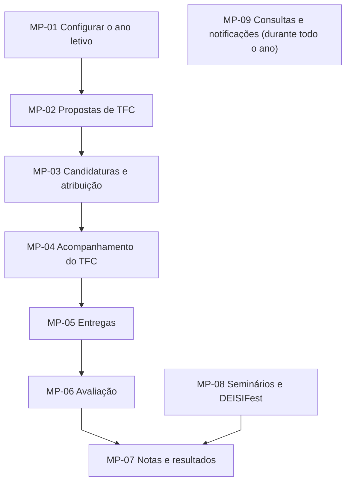

### 3.2 O que cada ator faz

Um diagrama por ator. Em cima está o ator; em baixo, agrupados por tema, os casos de uso que ele inicia.

**Aluno**

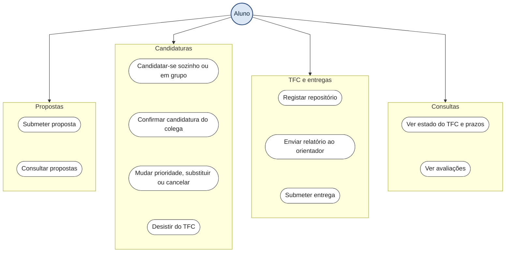

**Docente** (as funções mudam de TFC para TFC)

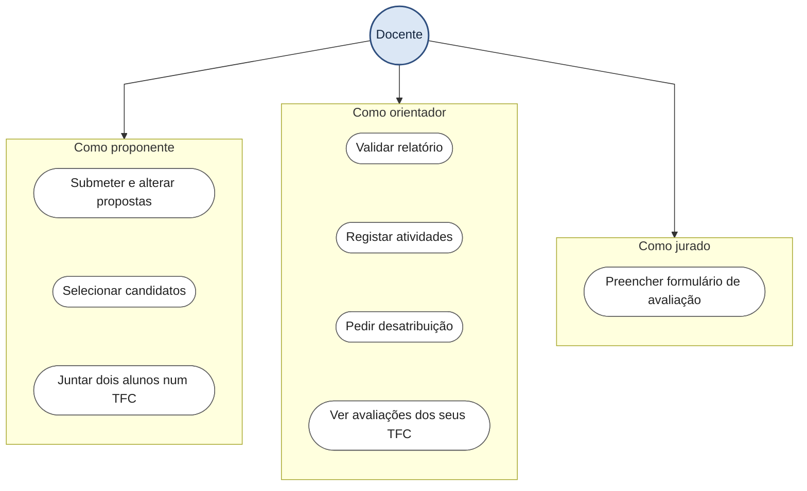

**Coordenação**

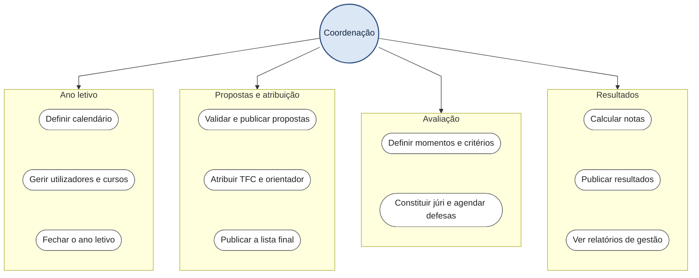

**Restantes atores**

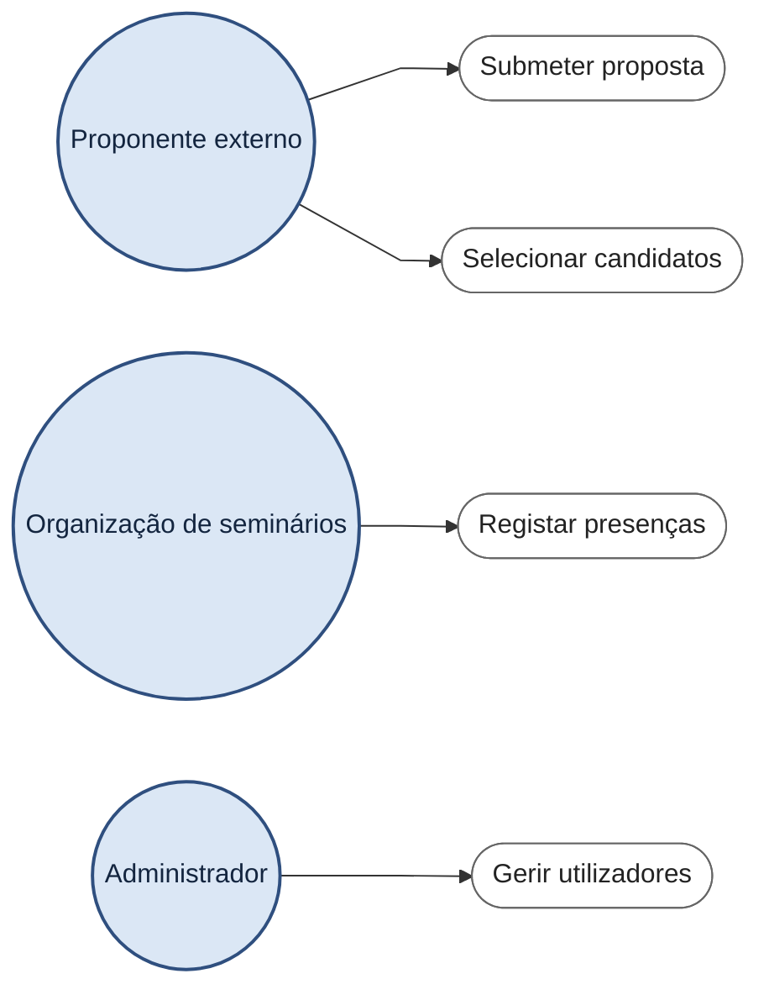

A secção 4 tem a lista completa, com o número de cada caso de uso, e as secções 5 a 12 têm o detalhe.

## 4. Lista de casos de uso

| UC | Nome | Ator principal | Prioridade para a 1.ª entrega |
|---|---|---|---|
| UC-01.1 | Definir calendário | Coordenação | Alta |
| UC-01.2 | Gerir utilizadores e perfis | Coordenação, Administrador | Alta |
| UC-01.3 | Gerir cursos e grupos de cursos | Coordenação | Média |
| UC-01.4 | Fechar o ano letivo | Coordenação | Baixa |
| UC-02.1 | Submeter proposta | Docente, Aluno, Proponente externo | Alta |
| UC-02.2 | Validar proposta | Coordenação | Alta |
| UC-02.3 | Rever proposta | Docente, Aluno, Proponente externo | Média |
| UC-02.4 | Publicar proposta | Coordenação | Alta |
| UC-02.5 | Consultar propostas | Todos | Alta |
| UC-02.6 | Alterar proposta disponível | Docente (proponente) | Média |
| UC-03.1 | Submeter candidatura individual | Aluno | Alta |
| UC-03.2 | Submeter candidatura em grupo | Aluno (submissor) | Alta |
| UC-03.3 | Confirmar candidatura em grupo | Aluno (colega) | Alta |
| UC-03.4 | Alterar a prioridade de uma candidatura | Aluno | Alta |
| UC-03.5 | Substituir o TFC de uma candidatura | Aluno | Média |
| UC-03.6 | Cancelar candidatura | Aluno | Alta |
| UC-03.7 | Selecionar candidatos | Docente (proponente), Proponente externo, Coordenação | Alta |
| UC-03.8 | Juntar alunos num TFC | Docente, Coordenação | Baixa |
| UC-03.9 | Atribuir TFC e orientador | Coordenação | Alta |
| UC-03.10 | Atualizar as listas de candidaturas após a atribuição | Plataforma | Alta |
| UC-03.11 | Publicar atribuições | Coordenação | Alta |
| UC-03.12 | Registar desistência | Aluno | Média |
| UC-03.13 | Desatribuir TFC | Docente (orientador) | Média |
| UC-04.1 | Registar repositório e atividades [mezzo] | Aluno, Docente (orientador) | Média |
| UC-04.2 | Dissociar grupo [mezzo] | Docente (orientador), Coordenação | Baixa |
| UC-04.3 | Pedir adiamento para a época de recurso [mezzo] | Aluno | Baixa |
| UC-05.1 | Enviar relatório ao orientador | Aluno | Alta |
| UC-05.2 | Validar relatório | Docente (orientador) | Alta |
| UC-05.3 | Submeter entrega | Aluno | Alta |
| UC-06.1 | Definir momentos de avaliação | Coordenação | Média |
| UC-06.2 | Definir critérios de avaliação | Coordenação | Média |
| UC-06.3 | Definir outro momento de avaliação | Coordenação | Baixa |
| UC-06.4 | Constituir júri [mezzo] | Coordenação | Média |
| UC-06.5 | Agendar defesas [mezzo] | Coordenação | Baixa |
| UC-06.6 | Preencher formulário de avaliação | Docente (jurado) | Média |
| UC-06.7 | Publicar resultados intercalares | Coordenação | Média |
| UC-07.1 | Calcular a nota de cada momento | Coordenação | Média |
| UC-07.2 | Calcular a nota final e a situação | Coordenação | Baixa |
| UC-07.3 | Publicar resultados finais | Coordenação | Baixa |
| UC-08.1 | Registar presenças em seminários [mezzo] | Organização de seminários | Baixa |
| UC-08.2 | Registar resultado do DEISIFest [mezzo] | Coordenação | Baixa |
| UC-09.1 | Consultar estado do TFC [mezzo] | Aluno, Docente | Alta |
| UC-09.2 | Consultar avaliações | Aluno, Docente (orientador) | Média |
| UC-09.3 | Consultar relatórios de gestão [mezzo] | Coordenação | Média |
| UC-09.4 | Receber notificações [mezzo] | Todos (Plataforma envia) | Média |

**Critério da prioridade** (proposta da equipa, a validar): *Alta* é o ciclo propostas → candidaturas → atribuição e o envio e validação do relatório, que estão em uso na fase atual do ano e são onde se concentram os resultados do inquérito; *Média* é o que é preciso até à AI2; *Baixa* é o que só é preciso no fim do ano letivo.

---

## 5. MP-01 — Configuração do ano letivo

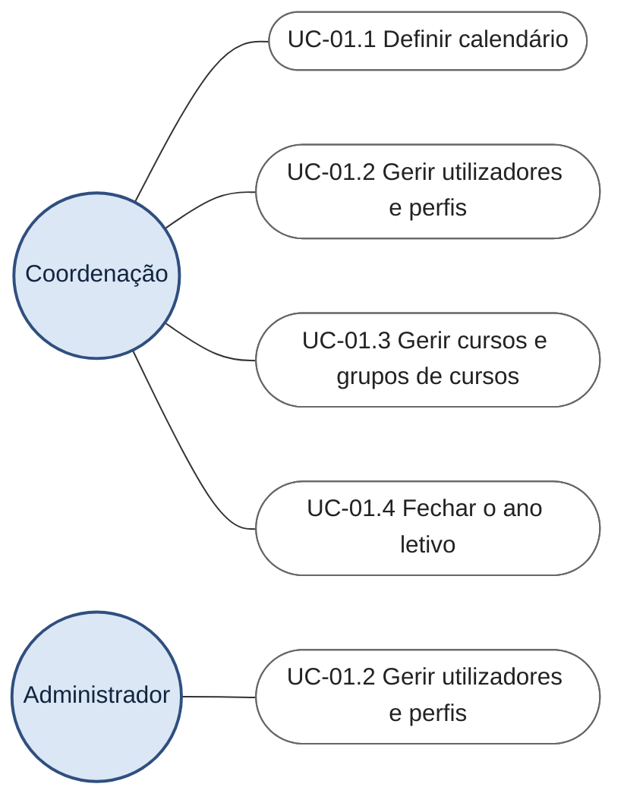

### UC-01.1 Definir calendário
- **Ator principal:** Coordenação.
- **Objetivo:** registar as fases do ano, para a plataforma abrir e fechar cada funcionalidade nas datas certas.
- **Evento:** preparação de um novo ano letivo.
- **Pré-condições:** utilizador com perfil Coordenação.
- **Fluxo principal:**
  1. A coordenação cria as fases (propostas, candidaturas, lista final, entregas e defesas) com início e fim.
  2. A plataforma verifica a coerência das datas.
  3. A coordenação publica o calendário.
- **Alternativas e exceções:** datas incoerentes → erro e não publica; alterar uma data quando já há submissões nessa fase → pede confirmação e regista a alteração.

**Critérios de aceitação (casos de teste)**

| Teste | Situação inicial | Passos | Resultado esperado |
|---|---|---|---|
| CT-01.1.1 | Fase de candidaturas de 09/09 a 04/10; hoje é 05/10 | O aluno abre um TFC Disponível | O botão **Candidatar** não aparece |
| CT-01.1.2 | Fase de propostas com início a 30/09 e fim a 01/09 | A coordenação carrega em **Publicar calendário** | A plataforma mostra o erro nas datas e o calendário não é publicado |
| CT-01.1.3 | Fase de propostas aberta, com 3 propostas submetidas | A coordenação altera a data de fim da fase | A plataforma pede confirmação; depois de confirmar, a alteração fica registada com a data e o utilizador |

- **Pós-condições:** calendário publicado e visível para todos; cada funcionalidade só está disponível dentro da sua fase.
- **Regras:** datas de 2026/27 do regulamento [1] (Anexo A de 02), alteráveis pela coordenação; as datas são sempre verificadas no servidor.

### UC-01.2 Gerir utilizadores e perfis
- **Ator principal:** Coordenação ou Administrador.
- **Objetivo:** que cada pessoa entre na plataforma com o perfil e os dados certos.
- **Evento:** início do ano letivo ou entrada de um novo utilizador.
- **Pré-condições:** perfil Coordenação ou Administrador.
- **Fluxo principal:**
  1. Regista ou importa os utilizadores (alunos com número, curso, ECTS e UCs concluídas; docentes; entidades externas).
  2. Atribui o perfil de cada um.
  3. Indica, para cada docente, se está ativo ou inativo.
  4. A plataforma verifica duplicados e guarda.
- **Alternativas e exceções:** utilizador duplicado → os registos são fundidos.

**Critérios de aceitação (casos de teste)**

| Teste | Situação inicial | Passos | Resultado esperado |
|---|---|---|---|
| CT-01.2.1 | Ficheiro de importação com um aluno com 85 ECTS | A coordenação importa o ficheiro | O aluno fica registado e marcado como não elegível para candidaturas |
| CT-01.2.2 | Docente marcado como inativo, orientador de um TFC de 2025/26 | A coordenação abre a lista de escolha de orientador | O docente não aparece na lista; o TFC de 2025/26 continua associado a ele |

- **Pós-condições:** cada utilizador entra com o perfil atribuído; alunos com menos de 90 ECTS aparecem como não elegíveis para candidaturas.
- **Regras:** só docentes ativos aparecem nas listas de proponente, orientador, coorientador e jurado; os inativos mantêm o histórico (Reunião 5, 28/10).

### UC-01.3 Gerir cursos e grupos de cursos
- **Ator principal:** Coordenação.
- **Objetivo:** manter os cursos e grupos usados nas propostas e nos perfis de candidato.
- **Evento:** preparação do ano letivo ou criação de um curso.
- **Pré-condições:** perfil Coordenação.
- **Fluxo principal:**
  1. Cria ou edita cursos (por exemplo LEI, LIG, LCD) e grupos (por exemplo "LEI + LIG").
  2. Associa cada curso aos seus grupos.

**Critérios de aceitação (casos de teste)**

| Teste | Situação inicial | Passos | Resultado esperado |
|---|---|---|---|
| CT-01.3.1 | Curso LCD desativado; uma proposta antiga com o curso LCD | Um docente abre o formulário de nova proposta e depois a proposta antiga | No formulário novo, LCD não aparece; na proposta antiga, LCD continua visível |

- **Pós-condições:** cursos e grupos aparecem como caixas de verificação no formulário de proposta (UC-02.1) e no perfil do candidato.
- **Regras:** um curso ou grupo desativado deixa de aparecer nas novas propostas, mas mantém-se nas antigas (Reunião 5, 28/10).

### UC-01.4 Fechar o ano letivo
- **Ator principal:** Coordenação.
- **Objetivo:** passar o ano para o histórico, consultável mas não alterável.
- **Evento:** fim do ano letivo, depois de publicados os resultados finais da última época (UC-07.3).
- **Pré-condições:** perfil Coordenação; resultados finais publicados em todas as épocas.
- **Fluxo principal:**
  1. A coordenação pede para fechar o ano.
  2. A plataforma mostra as pendências (avaliações por lançar, TFC sem situação).
  3. A coordenação confirma.
  4. A plataforma passa os TFC e as propostas para o histórico.
- **Alternativas e exceções:** há pendências → aviso; a coordenação decide se fecha na mesma.

**Critérios de aceitação (casos de teste)**

| Teste | Situação inicial | Passos | Resultado esperado |
|---|---|---|---|
| CT-01.4.1 | Ano 2025/26 fechado | A coordenação tenta alterar uma nota de 2025/26 | A alteração é recusada; a nota continua visível para consulta |
| CT-01.4.2 | Ano 2026/27 com 2 avaliações por lançar | A coordenação pede para fechar o ano | A plataforma lista as 2 avaliações pendentes antes de pedir confirmação |

- **Pós-condições:** ano fechado; TFC no estado Arquivado; propostas não atribuídas no estado Arquivada; dados consultáveis e não alteráveis.
- **Regras:** a plataforma guarda todos os anos (Reunião 5, 28/10); o fecho passa os dados para um histórico consultável (Reunião 6, 04/11).

---

## 6. MP-02 — Gestão de propostas

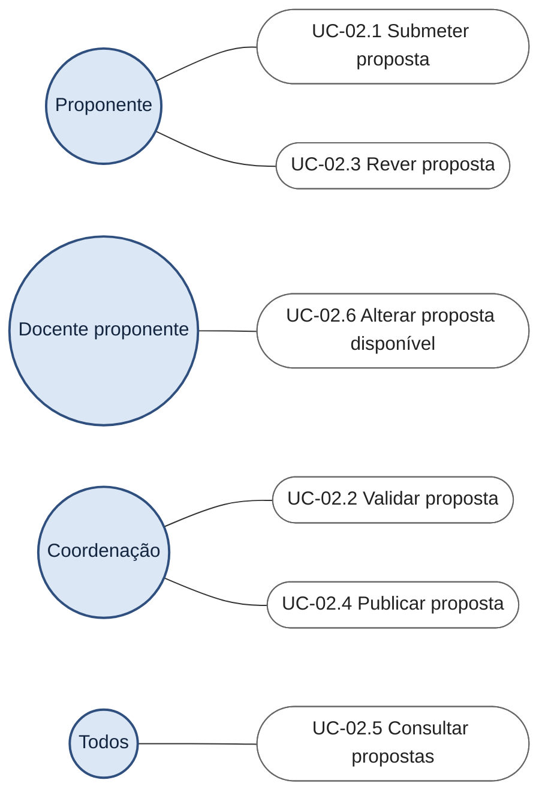

O proponente é um docente, um aluno ou um proponente externo. Ordem habitual: UC-02.1 → UC-02.2 → UC-02.4. Se a coordenação pedir alterações em UC-02.2, o proponente faz UC-02.3 e a proposta volta a UC-02.2.

### UC-02.1 Submeter proposta
- **Ator principal:** Docente, Aluno ou Proponente externo.
- **Objetivo:** propor um tema de TFC.
- **Evento:** o proponente quer propor um tema.
- **Pré-condições:** autenticado; fase de propostas do seu tipo aberta; se for aluno, inscrito na UC.
- **Fluxo principal:**
  1. Abre o formulário do seu tipo (docente, aluno, empresa ou outro departamento).
  2. Preenche título, descrição, orientador sugerido (só docentes ativos), modalidade, cursos, disciplinas, tecnologias e perfil do candidato ou alunos pré-selecionados.
  3. A plataforma verifica os campos obrigatórios.
  4. A plataforma regista a proposta.
- **Alternativas e exceções:** fase fechada → formulário indisponível; sem perfil de candidato nem alunos pré-selecionados → não submete; proposta individual com 2.º aluno → não submete; 2.º aluno já indicado noutra proposta em grupo → não submete.

**Critérios de aceitação (casos de teste)**

| Teste | Situação inicial | Passos | Resultado esperado |
|---|---|---|---|
| CT-02.1.1 | Docente DEISI ativo; fase de propostas de docentes aberta | O docente submete uma proposta sem aluno indicado | A proposta fica no estado Aceite |
| CT-02.1.2 | Aluno inscrito na UC; fase de propostas de alunos aberta | O aluno submete uma proposta | A proposta fica Em validação e a coordenação recebe uma notificação |
| CT-02.1.3 | Formulário com modalidade individual e um 2.º aluno indicado | O proponente carrega em **Submeter** | A proposta não é registada e a plataforma indica o erro na modalidade |

- **Pós-condições:** proposta de docente DEISI sem aluno indicado → **Aceite**; restantes → **Em validação**; a coordenação é notificada.
- **Regras:** propostas de docentes aceites sem validação, exceto com aluno indicado (regulamento [1], cap. 3); um aluno pode submeter várias propostas e a proposta em grupo é submetida por um só elemento (cap. 3); o orientador indicado pelo aluno tem de ter dado acordo prévio (cap. 3); empresas e outros departamentos têm formulários diferentes e podem indicar um coorientador (Reunião 6, 04/11); a modalidade é vinculativa (orientador, email de 01/11).
- **Modelo de dados:** o 03 já prevê campos que o P-02.1 não lista: área de aplicação, proposta de que é continuação, anexos em PDF e notas internas (pedidos no inquérito). Ver a lacuna 3.

### UC-02.2 Validar proposta
- **Ator principal:** Coordenação.
- **Objetivo:** só deixar seguir temas adequados e nomear o orientador.
- **Evento:** existe uma proposta Em validação.
- **Pré-condições:** proposta Em validação.
- **Fluxo principal:**
  1. Abre a lista de propostas por validar.
  2. Analisa o tema, o esforço, o enquadramento e a disponibilidade do orientador.
  3. Aceita, pede alterações (com mensagem) ou recusa (com justificação obrigatória).
  4. Se aceitar, pode acrescentar tarefas ou requisitos e nomeia o orientador e o coorientador.

**Critérios de aceitação (casos de teste)**

| Teste | Situação inicial | Passos | Resultado esperado |
|---|---|---|---|
| CT-02.2.1 | Proposta Em validação | A coordenação escolhe **Recusar** sem escrever justificação | A plataforma não deixa recusar e pede a justificação |
| CT-02.2.2 | Docente já com 5 orientações | A coordenação nomeia-o orientador de mais uma proposta | Aparece um aviso, mas a nomeação fica registada |

- **Pós-condições:** proposta **Aceite**, **Alterações solicitadas** ou **Recusada**; a mudança fica no histórico; o proponente é notificado.
- **Regras:** nas propostas de empresas e outros departamentos, a coordenação nomeia o orientador pela área científica e pode substituir o sugerido (cap. 2 e 3); aviso quando o orientador passa as 5 orientações, sem bloquear.
- **Relações:** desencadeia UC-02.3 (alterações) ou UC-02.4 (aceite).

### UC-02.3 Rever proposta
- **Ator principal:** o proponente.
- **Objetivo:** corrigir a proposta conforme o pedido da coordenação.
- **Evento:** a coordenação pediu alterações.
- **Pré-condições:** proposta em **Alterações solicitadas**; fase de propostas aberta.
- **Fluxo principal:**
  1. Lê o pedido.
  2. Edita a proposta.
  3. Reenvia.
- **Alternativas e exceções:** fase fechada → só consulta.

**Critérios de aceitação (casos de teste)**

| Teste | Situação inicial | Passos | Resultado esperado |
|---|---|---|---|
| CT-02.3.1 | Proposta em Alterações solicitadas; fase de propostas aberta | O proponente edita a proposta e carrega em **Reenviar** | A proposta volta a Em validação e a coordenação recebe uma notificação |

- **Pós-condições:** proposta volta a **Em validação**; a coordenação é notificada.

### UC-02.4 Publicar proposta
- **Ator principal:** Coordenação.
- **Objetivo:** tornar uma proposta aceite visível para candidatura.
- **Evento:** abertura da fase de candidaturas, ou aceitação de uma proposta durante essa fase.
- **Pré-condições:** proposta **Aceite**.
- **Fluxo principal:**
  1. Escolhe as propostas aceites a publicar (pode ser todas).
  2. Confirma.

**Critérios de aceitação (casos de teste)**

| Teste | Situação inicial | Passos | Resultado esperado |
|---|---|---|---|
| CT-02.4.1 | 3 propostas Aceites, sem aluno pré-selecionado | A coordenação seleciona as 3 e carrega em **Publicar** | As 3 propostas ficam Disponíveis e aparecem na lista dos alunos |
| CT-02.4.2 | Proposta Aceite com o aluno A pré-selecionado | A coordenação publica a proposta; o aluno A e o aluno B abrem a lista | A proposta fica Pré-atribuída; o aluno A vê-a e o aluno B não |

- **Pós-condições:** sem aluno pré-selecionado → **Disponível**, visível para todos os alunos elegíveis; com aluno pré-selecionado → **Pré-atribuída**, visível só para esse aluno; o proponente é notificado.
- **Regras:** «aceite» e «disponível» são estados diferentes porque a publicação é um evento entre eles (Reunião 6, 04/11); mesmo com pré-seleção, o aluno tem de se candidatar (cap. 3).

### UC-02.5 Consultar propostas
- **Ator principal:** Aluno, Docente, Proponente externo ou Coordenação.
- **Objetivo:** encontrar propostas e ver o seu detalhe.
- **Evento:** o utilizador quer ver as propostas.
- **Pré-condições:** autenticado.
- **Fluxo principal:**
  1. A lista mostra ID, título, orientador e coorientador, com pesquisa por orientador e filtro por modalidade.
  2. O utilizador abre uma proposta e vê empresa, orientador, título, descrição, modalidade, estado, cursos, disciplinas e tecnologias.

**Critérios de aceitação (casos de teste)**

| Teste | Situação inicial | Passos | Resultado esperado |
|---|---|---|---|
| CT-02.5.1 | Lista com 4 propostas Disponíveis, 2 delas com a tecnologia Python | O aluno escolhe o filtro de tecnologia «Python» | A lista mostra só as 2 propostas com Python |
| CT-02.5.2 | Lista com 4 propostas Disponíveis | O aluno abre a lista sem escolher filtros | A lista mostra as 4 propostas |
| CT-02.5.3 | Proposta X no estado Atribuída | O aluno abre a lista de propostas | A proposta X não aparece como disponível para candidatura |

- **Pós-condições:** nenhum dado é alterado.
- **Regras:** o aluno vê as propostas Disponíveis e a sua Pré-atribuída; o proponente vê as suas em todos os estados.
- **Melhorias pedidas no inquérito** (analise-exploratoria, secção 6; a incluir em 02): filtros por tecnologia (42%), disciplina (35%), orientador e palavra-chave (29% cada); descrição breve na lista; TFC atribuídos assinalados ou retirados; consulta e candidatura na mesma página.

### UC-02.6 Alterar proposta disponível
- **Ator principal:** Docente (proponente).
- **Objetivo:** corrigir uma proposta já publicada sem prejudicar quem já se candidatou.
- **Evento:** o docente quer alterar uma proposta publicada.
- **Pré-condições:** proposta **Disponível** ou **Pré-atribuída**.
- **Fluxo principal:**
  1. Altera os dados.
  2. A plataforma verifica a compatibilidade com as candidaturas existentes.
  3. Guarda.
- **Alternativas e exceções:** mudar para grupo com candidaturas individuais existentes → não guarda; mudar para individual com candidaturas em grupo → não guarda.

**Critérios de aceitação (casos de teste)**

| Teste | Situação inicial | Passos | Resultado esperado |
|---|---|---|---|
| CT-02.6.1 | Proposta Disponível, individual, com 2 candidaturas individuais | O docente muda a modalidade para «em grupo» e guarda | A alteração não é guardada e a plataforma explica que há candidaturas individuais |
| CT-02.6.2 | Proposta Disponível com 2 candidatos | O docente altera a descrição e guarda | A alteração fica guardada e os 2 candidatos recebem uma notificação |

- **Pós-condições:** proposta com os novos dados, no mesmo estado; candidatos notificados.
- **Regras:** o docente pode alterar tudo num TFC não atribuído, desde que compatível com as candidaturas existentes (orientador, email de 01/11).

---

## 7. MP-03 — Candidatura e atribuição

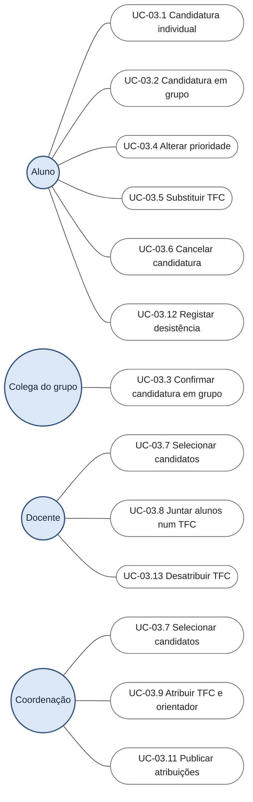

Num grupo, só o aluno que submete (submissor) faz UC-03.2 e UC-03.4 a UC-03.6. UC-03.7 também pode ser feito por um proponente externo. Ordem habitual: UC-03.1 ou UC-03.2 (confirmado em UC-03.3) → UC-03.7 → UC-03.9 → UC-03.11. Ao atribuir um TFC (UC-03.9), a plataforma retira-o automaticamente das listas dos outros candidatos (UC-03.10).

**Lista de candidaturas** (secção 4.2 de 02): contém as candidaturas Pendentes e Ativas do aluno ou grupo, com prioridade de 1 a n, sem lacunas. Sempre que uma sai, as seguintes sobem uma posição. Num grupo, só o **submissor** cria, ordena, substitui e cancela; o **colega** confirma cada candidatura e consulta a lista.

### UC-03.1 Submeter candidatura individual
- **Ator principal:** Aluno.
- **Objetivo:** candidatar-se a um TFC.
- **Evento:** o aluno escolhe um TFC e pede para se candidatar.
- **Pré-condições:** inscrito na UC; fase de candidaturas aberta; TFC **Disponível** com modalidade individual ou «individual ou em grupo», ou **Pré-atribuída** se for o pré-selecionado; limite de candidaturas não atingido; sem candidatura a esse TFC.
- **Fluxo principal:**
  1. Abre o detalhe do TFC (mostra o número de candidaturas atuais).
  2. Carrega em **Candidatar**.
  3. A plataforma verifica os créditos e o perfil.
  4. A plataforma regista a candidatura.
- **Alternativas e exceções:** sem os créditos mínimos → mensagem e candidatura **Recusada** registada (aluno, TFC, data, motivo); limite atingido → botão desativado («retire uma candidatura de outro TFC»); TFC só para grupos → mensagem; TFC atribuído entretanto → não regista.

**Critérios de aceitação (casos de teste)**

| Teste | Situação inicial | Passos | Resultado esperado |
|---|---|---|---|
| CT-03.1.1 | Aluno elegível com 3 candidaturas Ativas | O aluno candidata-se a um quarto TFC Disponível | A nova candidatura fica Ativa na posição 4 |
| CT-03.1.2 | Aluno com 85 ECTS (mínimo 90) | O aluno candidata-se a um TFC | Aparece a mensagem de créditos insuficientes; a candidatura fica Recusada e aparece no relatório da coordenação |
| CT-03.1.3 | Aluno com 6 candidaturas Ativas (limite 6) | O aluno abre o detalhe de outro TFC | O botão **Candidatar** está desativado, com a mensagem a indicar o limite |
| CT-03.1.4 | Aluno com uma candidatura Ativa ao TFC X | O aluno tenta candidatar-se outra vez ao TFC X | A segunda candidatura não é registada |

- **Pós-condições:** candidatura **Ativa** na última posição, com data e hora; número de candidaturas do TFC aumenta um. Na alternativa, **Recusada**, fora da lista e visível nos relatórios da coordenação (UC-09.3).
- **Regras:** pelo menos 90 ECTS na data de referência (cap. 4); 3 a 6 candidaturas por ordem de preferência, limite parametrizável (cap. 3 e 4); com pré-seleção, a candidatura é obrigatória (cap. 3).

### UC-03.2 Submeter candidatura em grupo
- **Ator principal:** Aluno (submissor).
- **Objetivo:** candidatar o grupo a um TFC.
- **Evento:** o aluno escolhe um TFC e pede para se candidatar com um colega.
- **Pré-condições:** os dois alunos inscritos; fase aberta; TFC **Disponível** com modalidade em grupo ou «individual ou em grupo»; nenhum dos dois noutro grupo; limite do grupo não atingido.
- **Fluxo principal:**
  1. Abre o detalhe do TFC e carrega em **Candidatar em grupo**.
  2. Indica o número do colega (nas candidaturas seguintes vem preenchido).
  3. A plataforma verifica créditos e perfil dos dois, modalidade, limite e duplicação.
  4. A plataforma regista a candidatura e notifica o colega.
- **Alternativas e exceções:** TFC individual → mensagem; um dos alunos sem créditos → **Recusada**, como em UC-03.1; colega já noutro grupo → não regista.

**Critérios de aceitação (casos de teste)**

| Teste | Situação inicial | Passos | Resultado esperado |
|---|---|---|---|
| CT-03.2.1 | TFC X com modalidade em grupo; alunos A e B elegíveis e sem grupo | O aluno A indica o número do aluno B e carrega em **Candidatar em grupo** | A candidatura fica Pendente de confirmação e o aluno B recebe uma notificação |
| CT-03.2.2 | TFC Y com modalidade individual | O aluno A tenta candidatar o grupo ao TFC Y | Aparece a mensagem «este TFC é individual e não aceita grupos» e nada é registado |
| CT-03.2.3 | Grupo A + B com uma candidatura já feita | O aluno A abre outro TFC e carrega em **Candidatar em grupo** | O número do aluno B já vem preenchido |

- **Pós-condições:** candidatura **Pendente de confirmação** na última posição, com data e hora; não entra na seleção enquanto pendente.
- **Regras:** cada aluno só pode estar num grupo (cap. 4); só o submissor cria e altera as candidaturas do grupo (Reunião 6, 04/11).
- **Relações:** desencadeia UC-03.3.

### UC-03.3 Confirmar candidatura em grupo
- **Ator principal:** Aluno (colega).
- **Objetivo:** aceitar ou recusar cada candidatura que o grupo faz.
- **Evento:** notificação de uma candidatura por confirmar.
- **Pré-condições:** candidatura **Pendente de confirmação**; fase aberta.
- **Fluxo principal:**
  1. Abre a candidatura e o detalhe do TFC.
  2. Carrega em **Confirmar**.
  3. A plataforma verifica de novo a disponibilidade do TFC e o perfil do colega.
- **Alternativas e exceções:** recusa → candidatura sai da lista e as seguintes sobem; sem resposta até ao fim da fase → fecha sem confirmação.

**Critérios de aceitação (casos de teste)**

| Teste | Situação inicial | Passos | Resultado esperado |
|---|---|---|---|
| CT-03.3.1 | Candidatura do grupo Pendente de confirmação, na posição 2 | O aluno B carrega em **Confirmar** | A candidatura fica Ativa e mantém a posição 2 |
| CT-03.3.2 | Lista do grupo com 4 candidaturas; a da posição 2 está Pendente | O aluno B carrega em **Recusar** na posição 2 | A candidatura fica Encerrada; as das posições 3 e 4 passam a 2 e 3 |
| CT-03.3.3 | Candidatura Pendente de confirmação; a fase de candidaturas acaba hoje | A fase de candidaturas fecha sem resposta do aluno B | A candidatura fica Encerrada com o motivo «sem confirmação» |

- **Pós-condições:** confirmada → **Ativa** na mesma posição e o submissor é notificado; recusada ou sem resposta → **Encerrada**, com o motivo.
- **Regras:** o colega confirma cada candidatura, uma a uma, e pode aceitar umas e recusar outras (decisão da equipa depois da Reunião 6, 04/11).

### UC-03.4 Alterar a prioridade de uma candidatura
- **Ator principal:** Aluno (submissor, se for grupo).
- **Objetivo:** ordenar as candidaturas pela preferência real.
- **Evento:** o aluno quer mudar a ordem.
- **Pré-condições:** fase aberta; candidatura Ativa ou Pendente.
- **Fluxo principal:**
  1. Abre a lista (ID, título, orientador, prioridade).
  2. Sobe ou desce uma candidatura.
  3. A plataforma renumera.
- **Alternativas e exceções:** fase fechada → só consulta.

**Critérios de aceitação (casos de teste)**

| Teste | Situação inicial | Passos | Resultado esperado |
|---|---|---|---|
| CT-03.4.1 | Lista do aluno: A(1), B(2), C(3) | O aluno sobe a candidatura C uma posição | A lista fica A(1), C(2), B(3) |
| CT-03.4.2 | Candidaturas criadas pela ordem C, A, B, com prioridades A(1), B(2), C(3) | O aluno abre a lista de candidaturas | A lista aparece pela ordem A, B, C |
| CT-03.4.3 | Grupo A + B com 3 candidaturas | O aluno B (colega) abre a lista de candidaturas | O aluno B vê a ordem, mas os controlos para a alterar não aparecem |

- **Pós-condições:** lista com a nova ordem, de 1 a n e sem lacunas; posições anterior e nova registadas; data e hora da candidatura inalteradas.
- **Regras:** num grupo, só o submissor altera a ordem.
- **Melhoria pedida no inquérito:** a lista deve aparecer **pela ordem de prioridade**, não pela ordem de criação.

### UC-03.5 Substituir o TFC de uma candidatura
- **Ator principal:** Aluno (submissor, se for grupo).
- **Objetivo:** trocar o TFC A pelo TFC B sem perder a posição.
- **Evento:** o aluno quer trocar de TFC numa candidatura.
- **Pré-condições:** candidatura a A Ativa ou Pendente; fase aberta; B **Disponível**.
- **Fluxo principal:**
  1. Escolhe a candidatura a A e carrega em **Substituir**.
  2. Escolhe B.
  3. A plataforma verifica B (créditos, perfil, disponibilidade, modalidade, duplicação).
  4. Regista a troca.
- **Alternativas e exceções:** B já na lista, indisponível ou atribuído → não troca e mantém A; fase fechada → só consulta.

**Critérios de aceitação (casos de teste)**

| Teste | Situação inicial | Passos | Resultado esperado |
|---|---|---|---|
| CT-03.5.1 | Candidatura ao TFC A na posição 2; TFC B Disponível | O aluno escolhe **Substituir** em A e seleciona B | A candidatura a B fica na posição 2 e a candidatura a A fica Cancelada |
| CT-03.5.2 | Candidaturas aos TFC A e B já na lista | O aluno tenta substituir A por B | Nada muda e a plataforma explica que B já está na lista |

- **Pós-condições:** candidatura a A **Cancelada** (substituída); candidatura a B na mesma posição, com data e hora da troca, **Ativa** se individual ou **Pendente** se for em grupo; número de candidaturas inalterado.
- **Regras:** só na fase de candidaturas; um TFC atribuído não se troca sem ser primeiro desatribuído (UC-03.13) (orientador, email de 01/11). Ver questão 2 de 02.

### UC-03.6 Cancelar candidatura
- **Ator principal:** Aluno (submissor, se for grupo).
- **Objetivo:** retirar uma candidatura.
- **Evento:** o aluno quer retirar uma candidatura.
- **Pré-condições:** fase aberta; candidatura Ativa ou Pendente.
- **Fluxo principal:**
  1. Escolhe a candidatura e carrega em **Cancelar**.
  2. A plataforma pede confirmação.
  3. O aluno confirma.
- **Alternativas e exceções:** fase fechada → não cancela.

**Critérios de aceitação (casos de teste)**

| Teste | Situação inicial | Passos | Resultado esperado |
|---|---|---|---|
| CT-03.6.1 | Lista do aluno: A(1), B(2), C(3) | O aluno cancela a candidatura A e confirma | A lista fica B(1), C(2) e aparece o aviso de menos de 3 candidaturas |

- **Pós-condições:** candidatura **Cancelada**, fora da lista e no histórico; as seguintes sobem; com menos de 3 candidaturas, aparece um aviso.
- **Regras:** o mínimo de 3 é verificado no fim da fase (cap. 3).

### UC-03.7 Selecionar candidatos
- **Ator principal:** Docente (proponente), Proponente externo ou Coordenação.
- **Objetivo:** escolher o candidato de cada TFC.
- **Evento:** fim da fase de candidaturas.
- **Pré-condições:** TFC com pelo menos uma candidatura **Ativa** (as pendentes não entram).
- **Fluxo principal:**
  1. A plataforma mostra os candidatos com média, notas nas UCs do perfil, prioridade dada ao TFC e data da candidatura.
  2. Com proponente, este escolhe (pode entrevistar fora da plataforma); sem proponente, a plataforma ordena pelas notas nas UCs do perfil e, em empate, pela data.
  3. A plataforma mostra uma simulação das atribuições, sem gravar.
  4. A coordenação revê, ajusta com justificação e confirma.
- **Alternativas e exceções:** TFC sem candidatos → continua Disponível; aluno sem TFC no fim → atribuição pela coordenação, com justificação.

**Critérios de aceitação (casos de teste)**

| Teste | Situação inicial | Passos | Resultado esperado |
|---|---|---|---|
| CT-03.7.1 | TFC com 1 candidatura Pendente e 2 Ativas; fase de candidaturas fechada | O proponente abre a seleção de candidatos | Aparecem só as 2 candidaturas Ativas |
| CT-03.7.2 | Simulação de atribuições gerada | A coordenação altera uma atribuição sem escrever justificação | A plataforma não guarda o ajuste e pede a justificação |

- **Pós-condições:** cada TFC com candidatos tem um selecionado e confirmado; ordenações e ajustes registados.
- **Regras:** ordem para aluno com tema próprio e candidaturas (cap. 4).
- **Relações:** desencadeia UC-03.9.

### UC-03.8 Juntar alunos num TFC
- **Ator principal:** Docente (proponente ou orientador); validação da Coordenação.
- **Objetivo:** formar um grupo de dois alunos para um TFC que aceita grupos.
- **Evento:** o docente identifica dois alunos que podem trabalhar juntos.
- **Pré-condições:** TFC Disponível com modalidade em grupo ou «individual ou em grupo»; os dois alunos sem TFC, sem grupo e com os créditos.
- **Fluxo principal:**
  1. Vê os candidatos individuais e os alunos sem TFC.
  2. Escolhe dois e carrega em **Juntar**.
  3. A plataforma verifica e notifica os alunos e a coordenação.
  4. Os dois alunos aceitam.
  5. A coordenação valida.
- **Alternativas e exceções:** um aluno recusa ou a coordenação não valida → não se forma o grupo; TFC individual → não junta; aluno já num grupo → não junta.

**Critérios de aceitação (casos de teste)**

| Teste | Situação inicial | Passos | Resultado esperado |
|---|---|---|---|
| CT-03.8.1 | TFC em grupo Disponível; alunos A e B sem TFC e sem grupo | O docente junta A e B; os dois aceitam; a coordenação valida | O TFC fica atribuído ao grupo A + B e as outras candidaturas dos dois ficam Encerradas |
| CT-03.8.2 | Junção proposta para os alunos A e B | O aluno B recusa | O grupo não é criado e as candidaturas de A e B não mudam |

- **Pós-condições:** grupo formado; candidaturas anteriores dos dois **Encerradas**; TFC atribuído ao grupo (UC-03.9) sem passar pela lista.
- **Regras:** os dois alunos têm de aceitar (orientador, email de 01/11); grupos de 2 e cada aluno num só grupo (cap. 4).
- **Relações:** desencadeia UC-03.9.

### UC-03.9 Atribuir TFC e orientador
- **Ator principal:** Coordenação.
- **Objetivo:** atribuir o TFC e nomear o orientador e o coorientador.
- **Evento:** seleção confirmada (UC-03.7), grupo formado (UC-03.8) ou candidatura de um aluno pré-selecionado.
- **Pré-condições:** proposta Disponível ou Pré-atribuída; aluno ou grupo sem TFC.
- **Fluxo principal:**
  1. A plataforma propõe a atribuição e o orientador sugerido.
  2. A coordenação confirma ou nomeia outro orientador e o coorientador (só ativos).
  3. A plataforma regista e executa UC-03.10.
- **Alternativas e exceções:** pré-selecionado sem créditos → alerta; pré-selecionado em dois TFC → decide a coordenação; orientador com mais de 5 orientações → aviso, sem bloquear.

**Critérios de aceitação (casos de teste)**

| Teste | Situação inicial | Passos | Resultado esperado |
|---|---|---|---|
| CT-03.9.1 | Aluno com 4 candidaturas Ativas | A coordenação atribui-lhe o TFC da posição 2 e confirma o orientador | A candidatura da posição 2 fica Contemplada e as outras 3 ficam Encerradas |
| CT-03.9.2 | Seleção confirmada para o TFC X, com orientador e coorientador | A coordenação confirma a atribuição | O TFC X fica Em curso; o aluno, o orientador e o coorientador recebem uma notificação |

- **Pós-condições:** proposta **Atribuída**; TFC **Em curso**; candidatura do aluno **Contemplada** e as restantes dele **Encerradas** (aluno já contemplado); orientador e coorientador associados; aluno, orientador e coorientador notificados.
- **Regras:** cada aluno só tem um TFC (cap. 4); atribuição automática quando o pré-selecionado se candidata ou quando o aluno só tem tema próprio aceite (cap. 3 e 4); o aluno pode começar logo após a atribuição (cap. 5).
- **Relações:** include UC-03.10.

### UC-03.10 Atualizar as listas de candidaturas após a atribuição
- **Ator principal:** Plataforma (incluído em UC-03.9).
- **Objetivo:** retirar o TFC atribuído das listas dos outros candidatos sem deixar lacunas.
- **Evento:** um TFC passa a Atribuída.
- **Pré-condições:** existem candidaturas de outros alunos a esse TFC, Ativas ou Pendentes.
- **Fluxo principal:**
  1. Encontra as candidaturas dos outros alunos ao TFC.
  2. Fecha cada uma, guardando a posição *k*.
  3. Em cada lista, as candidaturas abaixo de *k* sobem uma posição.
- **Alternativas e exceções:** falha a meio → nenhuma lista fica atualizada só em parte; aluno a alterar a lista (UC-03.4) → prevalece a atualização da plataforma e o aluno vê um aviso.

**Critérios de aceitação (casos de teste)**

| Teste | Situação inicial | Passos | Resultado esperado |
|---|---|---|---|
| CT-03.10.1 | Lista de outro aluno: A(1), B(2), C(3), D(4) | O TFC B é atribuído a um aluno diferente | A lista fica A(1), C(2), D(3) e a candidatura a B fica Encerrada |
| CT-03.10.2 | 5 listas afetadas pela atribuição; uma falha simulada a meio da atualização | A plataforma executa a atribuição | A atribuição é desfeita e nenhuma das 5 listas fica alterada |

- **Pós-condições:** essas candidaturas ficam **Encerradas** (TFC atribuído a outro); cada lista fica de 1 a n−1, com a mesma ordem relativa; posições registadas.
- **Regras:** os outros candidatos não são notificados; veem a lista atualizada quando a abrem (Reunião 6, 04/11).

### UC-03.11 Publicar atribuições
- **Ator principal:** Coordenação.
- **Objetivo:** tornar pública a lista final de TFC atribuídos e orientadores.
- **Evento:** data da lista final de atribuídos (UC-01.1).
- **Pré-condições:** seleção concluída em todos os TFC com candidatos.
- **Fluxo principal:**
  1. Revê a lista final.
  2. Publica.
- **Alternativas e exceções:** correção depois da publicação → registada e envolvidos notificados.

**Critérios de aceitação (casos de teste)**

| Teste | Situação inicial | Passos | Resultado esperado |
|---|---|---|---|
| CT-03.11.1 | Lista final publicada; aluno com TFC atribuído | O aluno entra na plataforma | O aluno vê o seu TFC e o orientador |
| CT-03.11.2 | Lista final já publicada | A coordenação corrige o orientador de um TFC | A correção fica registada e o aluno e os dois orientadores recebem uma notificação |

- **Pós-condições:** lista visível para alunos e docentes; alunos atribuídos notificados.

### UC-03.12 Registar desistência
- **Ator principal:** Aluno; parecer do orientador e validação da coordenação.
- **Objetivo:** desistir do TFC e libertá-lo.
- **Evento:** o aluno pede para desistir.
- **Pré-condições:** TFC **Em curso** com o aluno associado.
- **Fluxo principal:**
  1. O aluno pede e indica o motivo.
  2. A plataforma mostra as consequências e pede confirmação.
  3. O orientador regista o parecer.
  4. A coordenação valida.
- **Alternativas e exceções:** num grupo, se um desiste e o outro continua, o TFC mantém-se com quem fica e o orientador ajusta o âmbito.

**Critérios de aceitação (casos de teste)**

| Teste | Situação inicial | Passos | Resultado esperado |
|---|---|---|---|
| CT-03.12.1 | TFC X Em curso; fase de candidaturas aberta | O aluno pede a desistência, o orientador dá parecer e a coordenação valida | O TFC fica Cancelado e a proposta X volta a aparecer na lista de propostas |
| CT-03.12.2 | Aluno com 3 candidaturas Encerradas antes da atribuição | A desistência do aluno é validada | As 3 candidaturas continuam Encerradas |

- **Pós-condições:** TFC **Cancelado** e histórico guardado; candidatura contemplada **Encerrada** (desistência); proposta volta a **Disponível**; com a fase aberta, volta à lista de propostas; com a fase fechada, só a coordenação a atribui; orientador, coorientador, proponente e coordenação notificados.
- **Regras:** as candidaturas antigas do aluno não são repostas; não se admitem novos trabalhos depois da data-limite das candidaturas (cap. 1).
- **Modelo de dados:** registada como Pedido do tipo desistência, com motivo, parecer do orientador e validação. O mesmo padrão (pedido → parecer → validação) serve UC-03.13, UC-04.2 e UC-04.3, por isso o frontend pode usar o mesmo ecrã para os quatro.

### UC-03.13 Desatribuir TFC
- **Ator principal:** Docente (orientador); validação da Coordenação.
- **Objetivo:** desfazer uma atribuição.
- **Evento:** o orientador pede a desatribuição.
- **Pré-condições:** TFC **Em curso**.
- **Fluxo principal:**
  1. O orientador pede e indica o motivo.
  2. A coordenação valida.
- **Alternativas e exceções:** a coordenação não valida → atribuição mantém-se.

**Critérios de aceitação (casos de teste)**

| Teste | Situação inicial | Passos | Resultado esperado |
|---|---|---|---|
| CT-03.13.1 | TFC Em curso; fase de candidaturas aberta | O orientador pede a desatribuição e a coordenação valida | O TFC fica Cancelado e a candidatura do aluno volta a Ativa |
| CT-03.13.2 | TFC Em curso | O orientador pede a desatribuição e a coordenação recusa | O TFC continua Em curso |

- **Pós-condições:** TFC **Cancelado** e histórico guardado; proposta volta a **Disponível**; com a fase aberta, a candidatura do aluno volta a **Ativa** e pode ser alterada (UC-03.4 a UC-03.6); aluno, orientador e coordenação notificados.
- **Regras:** um TFC atribuído só se altera depois de desatribuído; pedida pelo orientador, validada pela coordenação (orientador, email de 01/11). Ao contrário da desistência, não é pedida pelo aluno.

---

## 8. MP-04 — Acompanhamento do TFC [mezzo]

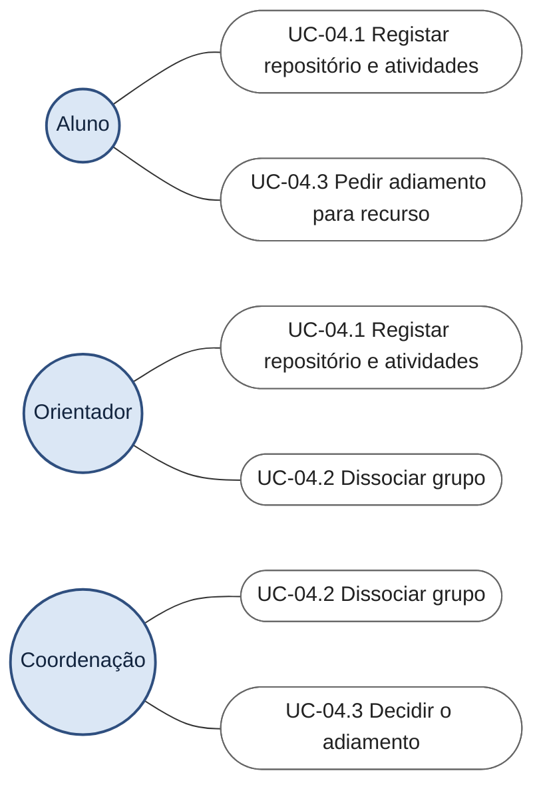

Estes casos de uso têm só o que o nível mezzo de 02 permite afirmar. Os pontos marcados *a validar* são propostas da equipa.

### UC-04.1 Registar repositório e atividades [mezzo]
- **Ator principal:** Aluno ou Docente (orientador).
- **Objetivo:** associar o repositório Git ao TFC e registar atividades e reuniões.
- **Pré-condições:** TFC **Em curso**.
- **Fluxo principal:**
  1. Indica o link do repositório.
  2. Regista atividades e reuniões.
- **Pós-condições:** repositório associado ao TFC; atividades no histórico do TFC.
- **Ator secundário:** agente de verificação (DEISI2258).
- **A combinar com o DEISI2258:** que verificações o agente faz ao repositório e como o resultado chega à base de dados: escrita direta, ação a pedido no frontend ou tarefa do servidor em batch (questão 3 de 03).

### UC-04.2 Dissociar grupo [mezzo]
- **Ator principal:** Docente (orientador) e Coordenação.
- **Objetivo:** separar um grupo quando não há equilíbrio de esforço.
- **Pré-condições:** TFC **Em curso** de um grupo.
- **Pós-condições:** os alunos deixam de estar no mesmo grupo; as avaliações já feitas não se repetem.
- **A validar:** quem fica com o TFC e em que estado fica o aluno que sai.

### UC-04.3 Pedir adiamento para a época de recurso [mezzo]
- **Ator principal:** Aluno; parecer do orientador e decisão da coordenação.
- **Objetivo:** passar a entrega final para a época de recurso.
- **Pré-condições:** TFC **Em curso**.

**Critérios de aceitação (casos de teste)**

| Teste | Situação inicial | Passos | Resultado esperado |
|---|---|---|---|
| CT-04.3.1 | TFC Em curso; pedido de adiamento com parecer favorável do orientador | A coordenação aprova o pedido | O TFC fica Adiado para recurso |

- **Pós-condições:** com parecer favorável do orientador e aprovação → TFC **Adiado para recurso** (secção 4.3 de 02).

---

## 9. MP-05 — Submissão de entregáveis

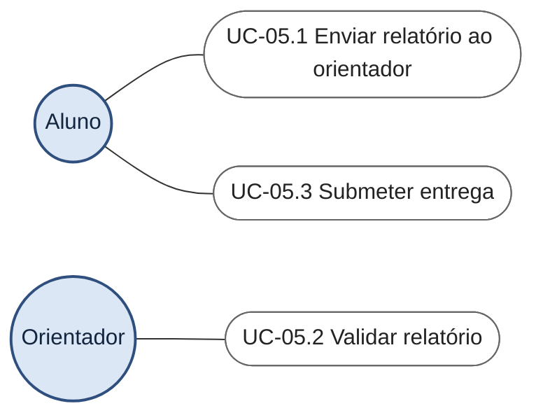

Ordem: UC-05.1 → UC-05.2 → UC-05.3. Se o orientador devolver o relatório em UC-05.2, o aluno volta a UC-05.1.

**Entregáveis por momento** (regulamento [1], cap. 5 e anexo D):

| Momento | Entregáveis |
|---|---|
| AI1 | Relatório; vídeo até 2 min |
| AI2 | Relatório; versão funcional no Git; vídeo até 5 min |
| Final | Relatório; texto de divulgação (máx. 10 linhas) e imagem; código-fonte no Git; versão operacional; vídeo até 5 min |

### UC-05.1 Enviar relatório ao orientador
- **Ator principal:** Aluno.
- **Objetivo:** pôr o relatório de um momento à validação do orientador.
- **Evento:** o relatório de um momento está pronto.
- **Pré-condições:** TFC **Em curso**; momento de avaliação definido (UC-06.1); antes do prazo de entrega.
- **Fluxo principal:**
  1. Carrega o relatório em PDF.
  2. A plataforma verifica a antecedência em relação ao prazo.
  3. A plataforma guarda o ficheiro e apaga o anterior, se existir.
- **Alternativas e exceções:** fora da antecedência mínima → aviso; o orientador pode recusar.

**Critérios de aceitação (casos de teste)**

| Teste | Situação inicial | Passos | Resultado esperado |
|---|---|---|---|
| CT-05.1.1 | Relatório da AI1 já enviado (ficheiro v1) | O aluno envia um novo PDF (v2) | Só existe o ficheiro v2; o v1 foi apagado da pasta |
| CT-05.1.2 | Prazo de entrega da AI1 daqui a 3 dias (antecedência mínima 7 dias) | O aluno envia o relatório | Aparece um aviso de antecedência, mas o envio fica registado |
| CT-05.1.3 | TFC Em curso; momento AI1 aberto | O aluno envia o relatório | O orientador recebe uma notificação e a base de dados guarda só o caminho do ficheiro |

- **Pós-condições:** relatório à espera de validação, com data e hora; só existe um ficheiro por momento, o último; orientador notificado.
- **Regras:** antecedência mínima parametrizável, por defeito 1 semana (regulamento [1], cap. 1, ponto 13); versões anteriores não são guardadas; ficheiros numa pasta do servidor e não na base de dados (Reunião 7, 11/11). Ver questão 7 de 02 (ficheiros no GitHub).
- **Modelo de dados:** o ficheiro fica numa pasta do servidor e a entrega guarda só o caminho; a base de dados nunca guarda o ficheiro.
- **Relações:** desencadeia UC-05.2.

### UC-05.2 Validar relatório
- **Ator principal:** Docente (orientador).
- **Objetivo:** aceitar ou devolver o relatório.
- **Evento:** existe um relatório para validar.
- **Pré-condições:** relatório à espera de validação (UC-05.1).
- **Fluxo principal:**
  1. Abre o relatório na plataforma.
  2. Aceita-o ou devolve-o com comentários.

**Critérios de aceitação (casos de teste)**

| Teste | Situação inicial | Passos | Resultado esperado |
|---|---|---|---|
| CT-05.2.1 | Relatório da AI1 à espera de validação | O orientador devolve-o com o comentário «rever a secção 3» | O aluno vê o comentário e pode enviar um novo ficheiro |
| CT-05.2.2 | Relatório da AI1 à espera de validação | O orientador aceita-o | O relatório aparece como entregue, com a data e o nome do orientador |

- **Pós-condições:** aceite → registado como entregue, com a data e o orientador que aceitou, e a coordenação é informada; devolvido → o aluno vê os comentários e pode enviar outro (UC-05.1).
- **Regras:** só são aceites para avaliação relatórios validados pelo orientador (cap. 5); o relatório só está entregue quando o orientador o aceita (Reunião 7, 11/11).

### UC-05.3 Submeter entrega
- **Ator principal:** Aluno (qualquer elemento, se for grupo).
- **Objetivo:** completar a entrega de um momento de avaliação.
- **Evento:** o aluno quer completar a entrega.
- **Pré-condições:** relatório aceite (UC-05.2); momento aberto; antes do prazo de entrega.
- **Fluxo principal:**
  1. Abre a entrega do momento e vê o relatório aceite, os restantes entregáveis e o prazo.
  2. Indica os links (repositório Git e vídeo; na final, também a versão operacional).
  3. A plataforma verifica os links.
  4. A plataforma guarda a entrega.
- **Alternativas e exceções:** prazo ultrapassado → não submete e regista a falta; link para um canal em vez de um vídeo, ou link inacessível → alerta.

**Critérios de aceitação (casos de teste)**

| Teste | Situação inicial | Passos | Resultado esperado |
|---|---|---|---|
| CT-05.3.1 | Relatório da AI1 ainda não aceite | O aluno abre a entrega da AI1 | O botão **Submeter entrega** está desativado |
| CT-05.3.2 | Relatório aceite | O aluno indica como vídeo o link de um canal e submete | Aparece um alerta a pedir o link de um vídeo |
| CT-05.3.3 | Entrega da AI1 submetida; prazo de entrega ultrapassado | O aluno tenta alterar o link do vídeo | A alteração não é possível; a entrega continua visível |
| CT-05.3.4 | TFC Em curso; relatório final aceite | O aluno submete a entrega final | O TFC fica Entregue |

- **Pós-condições:** entrega registada com data e hora; orientador e coordenação notificados; na entrega final, o TFC passa a **Entregue**; depois do prazo, a entrega não pode ser alterada, mas continua visível.
- **Regras:** vídeo público, indicado pelo link, e inalterável até à nota final (anexo D); todos os relatórios incluem o inquérito sobre IA generativa (anexo E); num grupo, qualquer elemento submete, sem validação do outro (orientador, email de 01/11); o prazo fecha as entregas, que continuam consultáveis (Reunião 6, 04/11).
- **Ator secundário:** agente de verificação (DEISI2258); o resultado fica em VerificacaoAutomatica (cumpre, não cumpre ou erro) e é mostrado ao aluno e ao orientador.
- **Modelo de dados:** `Entrega.commit_hash` já existe, mas o P-05.3 não diz quando é preenchido. Ver a lacuna 4.

---

## 10. MP-06 — Avaliação e MP-07 — Apuramento de resultados

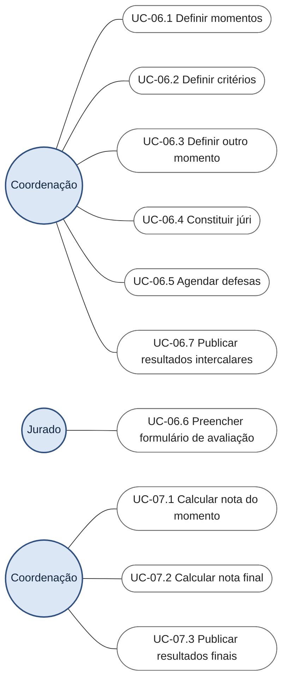

A Coordenação aparece duas vezes: em cima, a preparar a avaliação; em baixo, a calcular e publicar as notas (MP-07). No meio está a avaliação feita pelos jurados. Ordem: UC-06.1 a UC-06.5 → UC-06.6 → UC-07.1 → UC-06.7 (intercalares) ou UC-07.2 → UC-07.3 (final).

### UC-06.1 Definir momentos de avaliação
- **Ator principal:** Coordenação.
- **Objetivo:** definir os momentos do ano, com datas, pesos e mecanismo de avaliação.
- **Evento:** preparação do ano letivo.
- **Pré-condições:** perfil Coordenação; ano letivo criado (UC-01.1).
- **Fluxo principal:**
  1. Cria os momentos do ano.
  2. Indica, para cada um, o nome, o prazo de entrega, o prazo de avaliação, a data de publicação, o peso e o mecanismo (júri com critérios, votação ou presença).
  3. Indica os dados do modelo (escala, diferença máxima entre jurados, majoração do orientador, arredondamentos).
  4. A plataforma verifica que a soma dos pesos é 100% e ativa o modelo.
- **Alternativas e exceções:** soma diferente de 100% → não ativa; alterar um momento com avaliações → nova versão do modelo, sem mudar as avaliações feitas.

**Critérios de aceitação (casos de teste)**

| Teste | Situação inicial | Passos | Resultado esperado |
|---|---|---|---|
| CT-06.1.1 | Momentos com pesos AI1 20%, AI2 20%, final 50% e DEISIFest 5% (total 95%) | A coordenação tenta ativar o modelo | O modelo não é ativado e a plataforma indica que os pesos somam 95% |
| CT-06.1.2 | Momento AI1 com 3 avaliações já submetidas (versão 1 do modelo) | A coordenação altera o peso da AI1 | É criada a versão 2 do modelo; as 3 avaliações continuam ligadas à versão 1 |

- **Pós-condições:** momentos no calendário de alunos e docentes; prazos aplicados em UC-05.3 e UC-06.6; cada avaliação fica associada à versão do modelo.
- **Regras:** 2026/27: AI1 20%, AI2 20%, final 55%, DEISIFest 5% (regulamento [1], cap. 6); escala de 10 níveis; justificação acima de 2 níveis de diferença (cap. 6); notas parciais com 2 casas decimais e final às unidades; aprovação com 10 ou mais (cap. 6); nota = nível × 2 (orientador, email de 01/11); majoração do orientador começa em 0 (questão 1 de 02).
- **Modelo de dados:** o tipo do momento prevê INTERCALAR, FINAL, DEISIFEST, PRESENCAS e OUTRO; o modelo de 2026/27 já está carregado no backend. Ver a lacuna 7 sobre os quatro modelos base.

### UC-06.2 Definir critérios de avaliação
- **Ator principal:** Coordenação.
- **Objetivo:** definir os critérios e os pesos de cada momento avaliado por júri.
- **Evento:** foi criado um momento com mecanismo «júri com critérios».
- **Pré-condições:** momento com esse mecanismo (UC-06.1).
- **Fluxo principal:**
  1. Escolhe o momento.
  2. Cria os critérios (nome, descrição, peso).
  3. A plataforma verifica que somam 100%.
- **Alternativas e exceções:** soma diferente de 100% → não guarda; alterar critérios com avaliações feitas → nova versão do modelo.

**Critérios de aceitação (casos de teste)**

| Teste | Situação inicial | Passos | Resultado esperado |
|---|---|---|---|
| CT-06.2.1 | Momento AI1 com 7 critérios cujos pesos somam 100% | A coordenação guarda os critérios | O formulário de avaliação da AI1 mostra os 7 critérios |

- **Pós-condições:** o formulário de avaliação do momento (UC-06.6) mostra os critérios.
- **Regras:** critérios e pesos do regulamento (cap. 5); por exemplo, a entrega de 13/12 tem 7 critérios (Reunião 6, 04/11).

### UC-06.3 Definir outro momento de avaliação
- **Ator principal:** Coordenação.
- **Objetivo:** acrescentar um momento que não está no modelo base.
- **Evento:** a coordenação quer acrescentar um momento (seminário, apresentação, avaliação adicional).
- **Pré-condições:** modelo do ano criado (UC-06.1).
- **Fluxo principal:**
  1. Cria o momento (nome, data, tipo com nota ou só presença, a que conta, peso, mecanismo, critérios).
  2. Se tiver nota, indica se conta para a nota final ou para um momento específico.
  3. A plataforma recalcula os pesos afetados e mostra-os.
  4. A coordenação confirma.

**Critérios de aceitação (casos de teste)**

| Teste | Situação inicial | Passos | Resultado esperado |
|---|---|---|---|
| CT-06.3.1 | Modelo base: AI1 20%, AI2 20%, final 55%, DEISIFest 5% | A coordenação acrescenta um momento de 10% na nota final | Antes de guardar, a plataforma mostra AI1 18%, AI2 18%, final 49,5% e DEISIFest 4,5% |
| CT-06.3.2 | Modelo de avaliação ativo | A coordenação cria um seminário só de presença | O seminário não entra no cálculo das notas e aparece no registo de presenças (UC-08.1) |

- **Pós-condições:** momento no calendário; com nota, entra no cálculo (UC-07.1, UC-07.2); de presença, as presenças registam-se em UC-08.1.
- **Regras:** o novo momento tem peso fixo e os restantes são recalculados na mesma proporção; com 10% na nota final ficam AI1 18%, AI2 18%, final 49,5% e DEISIFest 4,5% (orientador, email de 01/11); o processo é genérico (Reunião 6, 04/11).

### UC-06.4 Constituir júri [mezzo]
- **Ator principal:** Coordenação.
- **Objetivo:** definir o júri de cada TFC em cada momento.

**Critérios de aceitação (casos de teste)**

| Teste | Situação inicial | Passos | Resultado esperado |
|---|---|---|---|
| CT-06.4.1 | Momento AI1 do TFC X, cujo orientador é o docente D | A coordenação tenta pôr o docente D no júri | A plataforma não permite e explica porquê |

- **Pós-condições:** os jurados veem o TFC nas suas avaliações pendentes (UC-06.6).
- **Regras:** nas intercalares, o orientador não pode ser jurado do seu TFC (secção 1 de 02); júri cego nas intercalares (cap. 5).

### UC-06.5 Agendar defesas [mezzo]
- **Ator principal:** Coordenação.
- **Objetivo:** marcar e publicar as defesas finais.

**Critérios de aceitação (casos de teste)**

| Teste | Situação inicial | Passos | Resultado esperado |
|---|---|---|---|
| CT-06.5.1 | Defesa marcada para daqui a 24 h | A coordenação tenta publicá-la | A plataforma indica que são precisas pelo menos 48 h de antecedência |

- **Pós-condições:** as defesas ficam publicadas, com data, hora e local, e visíveis para os alunos e o júri.
- **Regras:** publicadas com pelo menos 48 h de antecedência.

### UC-06.6 Preencher formulário de avaliação
- **Ator principal:** Docente (jurado).
- **Objetivo:** classificar cada critério e escrever a apreciação.
- **Evento:** existe uma entrega num momento em que o docente é jurado.
- **Pré-condições:** jurado do TFC nesse momento (UC-06.4); entrega submetida (UC-05.3); antes do prazo de avaliação.
- **Fluxo principal:**
  1. Abre o formulário (critérios e entregáveis).
  2. Classifica cada critério de 1 a 10 e escreve a apreciação.
  3. Submete.
  4. A plataforma compara com os outros jurados.
- **Alternativas e exceções:** diferença acima do limite num critério → pede justificação (extend) e só submete depois; prazo ultrapassado → só consulta.

**Critérios de aceitação (casos de teste)**

| Teste | Situação inicial | Passos | Resultado esperado |
|---|---|---|---|
| CT-06.6.1 | O jurado 1 deu nível 5 no critério «relatório» | O jurado 2 dá nível 8 nesse critério e submete | A plataforma pede uma justificação; a avaliação só fica submetida depois de a escrever |
| CT-06.6.2 | Prazo de avaliação da AI1 ultrapassado | O jurado abre o formulário da AI1 | O formulário abre só para consulta |
| CT-06.6.3 | Jurado a meio da apreciação | A sessão expira e o jurado volta a entrar | O texto já escrito está guardado como rascunho |

- **Pós-condições:** avaliação submetida, associada ao jurado, TFC, momento e versão do modelo; alterável até ao prazo; depois, só consulta.
- **Regras:** justificação acima de 2 níveis de diferença (cap. 6); júri cego nas intercalares (cap. 5); depois do prazo não se submete nem altera (Reunião 6, 04/11).
- **Modelo de dados:** a avaliação tem estado Rascunho ou Submetida, e o rascunho é guardado à medida que o jurado escreve (03, pedido no inquérito). O P-06.6 ainda não o refere (lacuna 8).

### UC-06.7 Publicar resultados intercalares
- **Ator principal:** Coordenação.
- **Objetivo:** disponibilizar aos alunos as notas e apreciações de uma intercalar.
- **Evento:** data de publicação do momento (UC-06.1).
- **Pré-condições:** notas do momento calculadas e confirmadas (UC-07.1).
- **Fluxo principal:**
  1. Revê as notas.
  2. Publica.

**Critérios de aceitação (casos de teste)**

| Teste | Situação inicial | Passos | Resultado esperado |
|---|---|---|---|
| CT-06.7.1 | Notas da AI1 publicadas | O aluno abre as avaliações | O aluno vê a nota e as apreciações da AI1 |

- **Pós-condições:** cada aluno vê a nota e as apreciações (UC-09.2) e é notificado.
- **Regras:** até 10 dias úteis depois do prazo de entrega (cap. 5).

### UC-07.1 Calcular a nota de cada momento
- **Ator principal:** Coordenação (cálculo pela Plataforma).
- **Objetivo:** obter a nota do momento de forma automática e verificável.
- **Evento:** fim do prazo de avaliação de um momento.
- **Pré-condições:** avaliações submetidas por todos os jurados (UC-06.6).
- **Fluxo principal:**
  1. Nota de cada jurado a partir das classificações (convertidas para 0 a 20) e dos pesos dos critérios.
  2. Média aritmética das notas dos jurados, com a majoração do orientador.
  3. Junta os outros momentos que contam para este (UC-06.3).
  4. A coordenação revê e confirma.
- **Alternativas e exceções:** falta a avaliação de um jurado → não calcula e alerta; diferença acima do limite sem justificação → não calcula.

**Critérios de aceitação (casos de teste)**

| Teste | Situação inicial | Passos | Resultado esperado |
|---|---|---|---|
| CT-07.1.1 | 2 jurados com notas 14,00 e 16,00; majoração do orientador 0 | A coordenação pede o cálculo da nota do momento | A nota do momento é 15,00 |
| CT-07.1.2 | 1 de 2 jurados sem avaliação submetida | A coordenação pede o cálculo | O cálculo não é feito e a coordenação vê um alerta |

- **Pós-condições:** nota com 2 casas decimais, publicável (UC-06.7); cálculo guardado com as notas de cada jurado.
- **Regras:** média aritmética de 2 a 4 jurados, sem peso por jurado; majoração começa em 0 (orientador, email de 01/11; questão 1 de 02).

### UC-07.2 Calcular a nota final e a situação
- **Ator principal:** Coordenação (cálculo pela Plataforma).
- **Objetivo:** combinar as notas dos momentos e decidir a situação.
- **Evento:** notas de todos os momentos confirmadas.
- **Pré-condições:** notas dos momentos (UC-07.1); presenças (UC-08.1) e DEISIFest (UC-08.2) registados.
- **Fluxo principal:**
  1. Combina as notas com os pesos do modelo (incluindo os outros momentos).
  2. Arredonda às unidades.
  3. Determina a situação (aprovado, reprovado ou excluído).
  4. A coordenação confirma.

**Critérios de aceitação (casos de teste)**

| Teste | Situação inicial | Passos | Resultado esperado |
|---|---|---|---|
| CT-07.2.1 | AI1 = 14, AI2 = 15, final = 16, DEISIFest = 12; pesos de 2026/27 | A coordenação pede o cálculo da nota final | A nota final é 15 (14×0,20 + 15×0,20 + 16×0,55 + 12×0,05 = 15,2, arredondado às unidades) |
| CT-07.2.2 | Aluno com nota final 14 e presença em 60% dos seminários | A coordenação pede o cálculo da situação | O aluno não fica Aprovado, porque não tem 70% de presenças (cap. 5) |

- **Pós-condições:** nota final e situação registadas; TFC **Avaliado**; cálculo guardado.
- **Regras:** aprovação com 10 ou mais (cap. 6); presença em pelo menos 70% dos seminários do ano (cap. 5).

### UC-07.3 Publicar resultados finais
- **Ator principal:** Coordenação.
- **Objetivo:** disponibilizar a nota final e a situação.
- **Evento:** nota final de uma época confirmada.
- **Pré-condições:** TFC **Avaliado**.
- **Fluxo principal:**
  1. Revê as notas finais da época.
  2. Publica.
- **Alternativas e exceções:** correção depois da publicação → registada com motivo; envolvidos notificados.

**Critérios de aceitação (casos de teste)**

| Teste | Situação inicial | Passos | Resultado esperado |
|---|---|---|---|
| CT-07.3.1 | Resultados finais publicados | O orientador abre um TFC que orienta | O orientador vê a nota final e a situação do aluno |

- **Pós-condições:** o aluno vê a nota final e a situação; o orientador vê o resultado dos TFC que orienta; TFC **Concluído**; aluno e orientador notificados.
- **Regras:** publicação existe também no apuramento final (Reunião 6, 04/11).

---

## 11. MP-08 — Seminários e DEISIFest [mezzo]

### UC-08.1 Registar presenças em seminários [mezzo]
- **Ator principal:** Organização de seminários ou Coordenação.
- **Objetivo:** registar as presenças nos seminários definidos como momentos (UC-06.3).
- **Pós-condições:** presenças disponíveis para a regra dos 70% (UC-07.2).
- **A validar:** como se identifica o aluno no seminário (lista, código, leitura de cartão).

### UC-08.2 Registar resultado do DEISIFest [mezzo]
- **Ator principal:** Coordenação.
- **Objetivo:** registar a média das votações de cada trabalho.
- **Pós-condições:** resultado disponível para a nota final (UC-07.2).
- **A validar:** se a votação é feita na plataforma ou fora dela (só se regista a média). Ver também a questão 6 de 02 (retirar o MP-08 ou transformá-lo na definição dos modelos base).

---

## 12. MP-09 — Consulta e notificações

### UC-09.1 Consultar estado do TFC [mezzo]
- **Ator principal:** Aluno ou Docente (orientador).
- **Objetivo:** ver o TFC, os prazos, o estado das entregas e o que está por fazer.

**Critérios de aceitação (casos de teste)**

| Teste | Situação inicial | Passos | Resultado esperado |
|---|---|---|---|
| CT-09.1.1 | Relatório da AI1 do aluno devolvido pelo orientador | O aluno entra na plataforma | A página inicial mostra a tarefa «enviar novo relatório» e o prazo |
| CT-09.1.2 | Jurado com 2 avaliações por fazer | O jurado entra na plataforma | A página inicial mostra as 2 avaliações pendentes |

- **Pós-condições:** nenhum dado é alterado.
- **Pedidos do inquérito** (a incluir em 02): na página inicial, o aluno quer ver o estado do TFC (73%), a linha temporal com as etapas e prazos (67%) e as tarefas pendentes (60%); o docente quer ver as tarefas e as avaliações pendentes (7 em 8).

### UC-09.2 Consultar avaliações
- **Ator principal:** Aluno ou Docente (orientador).
- **Objetivo:** ver as notas e apreciações de cada momento.
- **Evento:** o utilizador quer ver as avaliações de um TFC.
- **Pré-condições:** aluno: resultados publicados (UC-06.7 ou UC-07.3); orientador: é orientador do TFC.
- **Fluxo principal:**
  1. Escolhe o TFC e, se for orientador, o ano letivo.
  2. Vê os momentos com a nota.
  3. Abre um momento e vê a classificação por critério e as apreciações.

**Critérios de aceitação (casos de teste)**

| Teste | Situação inicial | Passos | Resultado esperado |
|---|---|---|---|
| CT-09.2.1 | Docente orientador de um TFC de 2025/26 | O docente escolhe o ano 2025/26 e abre as avaliações desse TFC | O docente vê todas as avaliações desse TFC |
| CT-09.2.2 | TFC com a AI1 publicada e a AI2 por publicar | O aluno abre as avaliações | O aluno vê só a AI1 |
| CT-09.2.3 | Aluno com a AI1 avaliada e a entrega da AI2 submetida | O orientador abre as avaliações do TFC | O orientador continua a ver a avaliação da AI1 |

- **Pós-condições:** nenhum dado é alterado.
- **Regras:** o orientador consulta sempre as avaliações dos TFC que orienta, em todos os momentos e anos (Reunião 6, 04/11); o aluno só vê momentos publicados.

### UC-09.3 Consultar relatórios de gestão [mezzo]
- **Ator principal:** Coordenação.
- **Objetivo:** ver propostas, candidaturas (incluindo as recusadas por falta de créditos), alunos sem TFC, entregas em atraso e avaliações por lançar.

**Critérios de aceitação (casos de teste)**

| Teste | Situação inicial | Passos | Resultado esperado |
|---|---|---|---|
| CT-09.3.1 | Aluno com candidatura Recusada por falta de créditos | A coordenação abre o relatório de candidaturas | A candidatura aparece no relatório com o motivo «sem créditos» |

- **Pós-condições:** nenhum dado é alterado.
- **Pedido do inquérito** (a incluir em 02): exportação para Excel ou PDF (6 em 8 docentes).
- **Modelo de dados:** o 03 já prevê estes relatórios (avaliações pendentes, entregas em falta, TFC por estado, candidaturas por proposta, alunos sem TFC e discrepâncias entre jurados) e as exportações a partir deles.

### UC-09.4 Receber notificações [mezzo]
- **Ator principal:** Plataforma (envia); destinatários: todos.
- **Objetivo:** avisar cada utilizador dos eventos relevantes, na plataforma e por email.

**Critérios de aceitação (casos de teste)**

| Teste | Situação inicial | Passos | Resultado esperado |
|---|---|---|---|
| CT-09.4.1 | TFC Em curso | O aluno envia o relatório da AI1 (UC-05.1) | O orientador recebe uma notificação na plataforma e um email |

- **Pós-condições:** o destinatário tem a notificação na plataforma e, nos eventos que o exigem, um email.
- **Regras:** as notificações são um subsistema, detalhado na arquitetura; os outros candidatos não são notificados quando um TFC é atribuído (UC-03.10).

---

## Referências

[1] Universidade Lusófona, DEISI. *Regulamento de Trabalho Final de Curso 2026/27*. Disponível em: [link a acrescentar].

- [02_processos.md](02_processos.md): processos, estados e questões em aberto.
- [03_modelo_de_dados.md](03_modelo_de_dados.md): classes e relações do modelo de dados.
- [analise-exploratoria.md](analise-exploratoria.md): resultados do inquérito.
