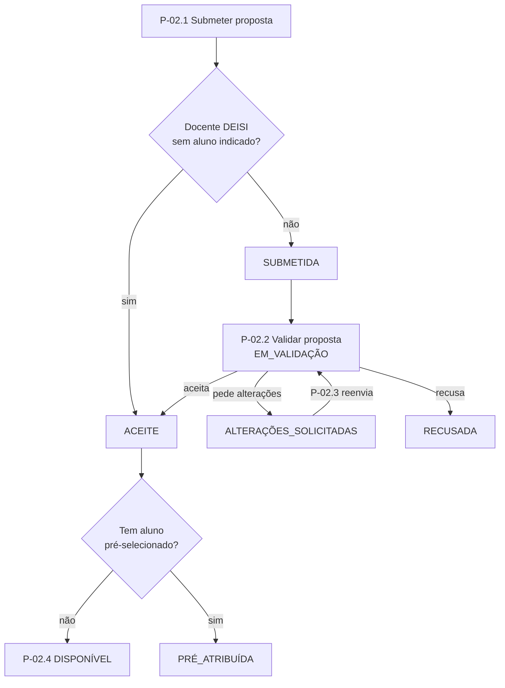
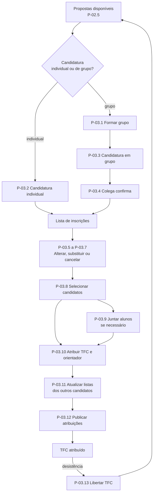
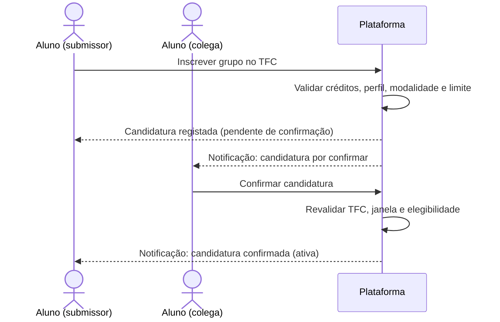
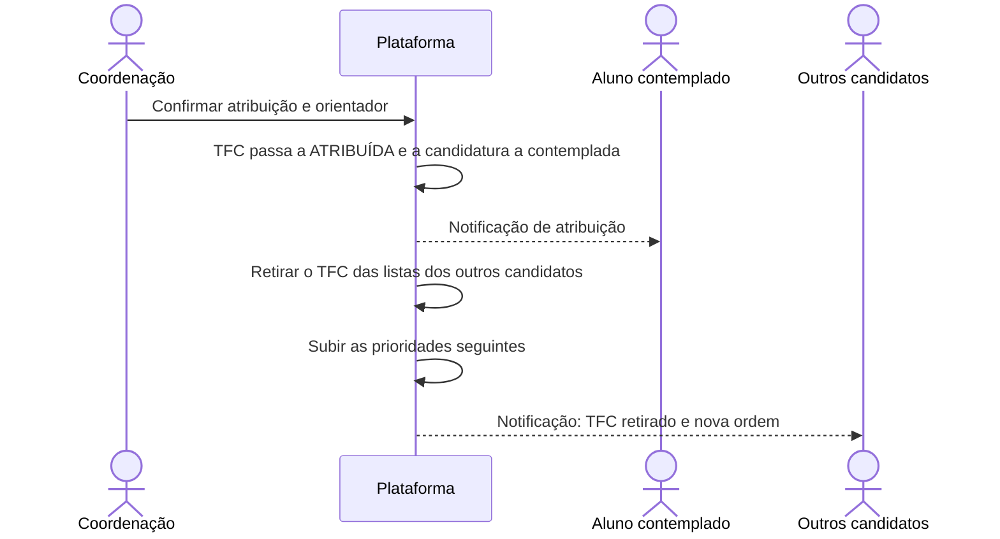
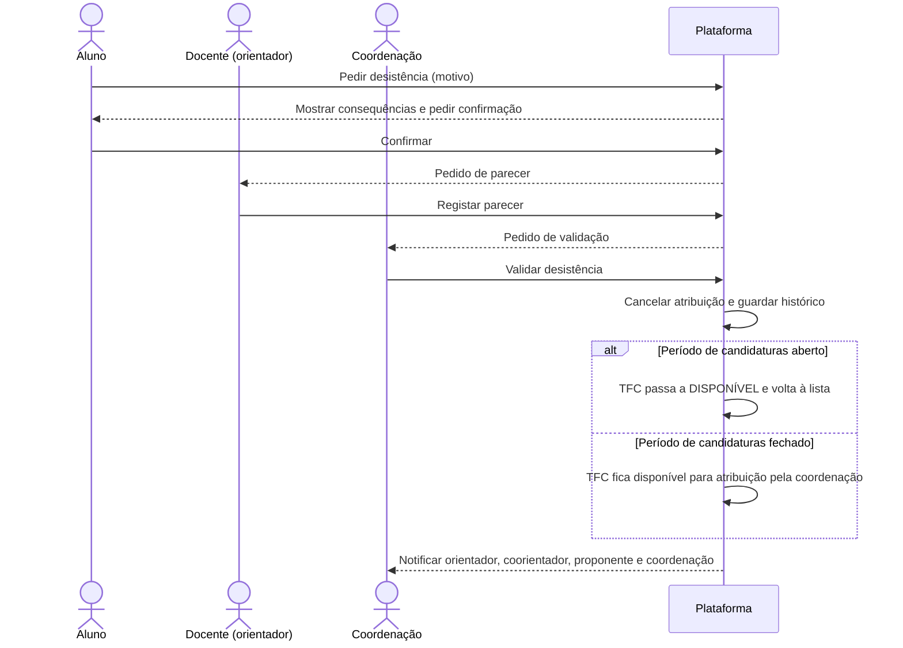
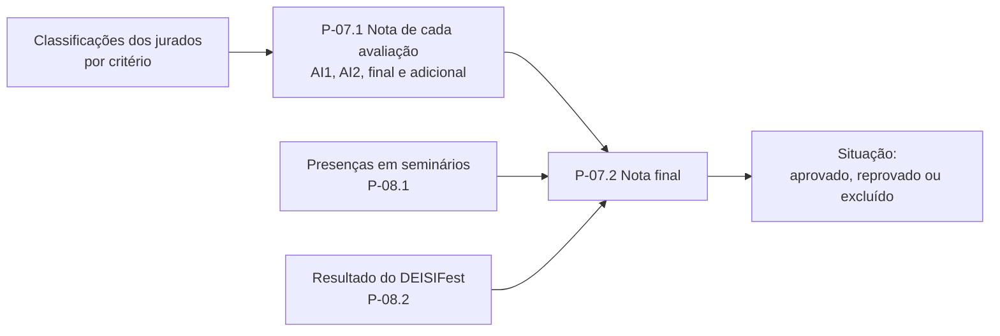

# 02 — Macro-processos e processos
Estrutura do método de ERT: **macro-processos** (grandes áreas e objetivo) → **processos** (mezzo) → **descrição detalhada** (micro). Os macro-processos seguem a ordem do ano letivo e, dentro de cada um, os processos seguem a ordem de execução. A descrição detalhada cobre a configuração do ano letivo (calendário, utilizadores e cursos), o registo de temas, a candidatura, a atribuição, a submissão de entregáveis, o modelo de avaliação e o apuramento de resultados; os restantes processos estão descritos em linhas gerais.
## 1. Atores
| Ator | Descrição |
|---|---|
| Aluno | Inscrito na UC de TFC, individualmente ou em grupo de 2 |
| Docente | Docente do DEISI. É o **mesmo ator** em todos os papéis: em cada TFC pode ter a função de proponente, orientador, coorientador ou jurado |
| Coordenação | Coordenação de TFC |
| Proponente externo | Docente de outro departamento ou empresa/instituição parceira |
| Organização de seminários | Valida as presenças |
| Administrador | Gestão técnica da plataforma |
**Funções do docente num TFC** (o ator é sempre o Docente; muda a função):
| Função | Descrição |
|---|---|
| Proponente | Propõe o tema do TFC |
| Orientador | Orienta o TFC; é nomeado por TFC |
| Coorientador | Apoia a orientação; pode ser externo |
| Jurado | Avalia o TFC (nas intercalares é externo ao trabalho) |
O acesso depende do **perfil da conta** e da **função do docente em cada TFC** (um docente pode ser proponente num TFC, orientador noutro e jurado noutro).
**O sistema não é um ator.** O sistema (a plataforma) executa as regras automáticas (prazos, validações, cálculos e notificações) descritas nos fluxos. Nos diagramas de sequência aparece como «Plataforma».
## 2. Macro-processos
| ID | Macro-processo | Objetivo | Atores principais |
|---|---|---|---|
| MP-01 | Configuração do ano letivo | Definir prazos, utilizadores e cursos sem alterar a plataforma | Coordenação, Administrador |
| MP-02 | Gestão de propostas (registo de temas) | Só disponibilizar temas validados e com esforço adequado | Docente, Aluno, Proponente externo, Coordenação |
| MP-03 | Candidatura e atribuição | Atribuir os TFC aos alunos de forma justa, transparente e dentro dos prazos | Aluno, Docente (proponente), Proponente externo, Coordenação |
| MP-04 | Acompanhamento do TFC | Registar a evolução e as alterações ao longo do ano | Aluno, Docente (orientador) |
| MP-05 | Submissão de entregáveis | Entregas completas, validadas pelo orientador e dentro do prazo | Aluno, Docente (orientador) |
| MP-06 | Avaliação | Definir os momentos e critérios de avaliação e obter avaliações individuais, rastreáveis e, nas intercalares, cegas | Docente (jurado), Coordenação |
| MP-07 | Apuramento de resultados | Calcular a nota de cada avaliação e a nota final de forma automática e auditável | Coordenação |
| MP-08 | Seminários e DEISIFest | Controlar obrigações que não são entregas | Organização de seminários, Coordenação |
| MP-09 | Consulta e notificações | Dar a cada perfil a informação de que precisa | Todos |
## 3. Processos (nível mezzo)
### MP-01 — Configuração do ano letivo
| ID | Processo | Ator | Descrição |
|---|---|---|---|
| P-01.1 | Definir calendário e épocas de avaliação | Coordenação | Registar as fases do ano (propostas, candidaturas, publicação, entregas, defesas) com início e fim; o sistema abre e fecha as funcionalidades. |
| P-01.2 | Gerir utilizadores e perfis | Coordenação, Administrador | Registar alunos inscritos na UC (número, curso, ECTS, UCs concluídas), docentes (com indicação de **ativo ou inativo**) e entidades externas e atribuir perfis. |
| P-01.3 | Gerir cursos e grupos de cursos | Coordenação | Manter a tabela de cursos (por exemplo LEI, LIG, LCD) e de grupos de cursos (por exemplo "LEI + LIG") usada nas propostas e nos perfis de candidato. |
### MP-02 — Gestão de propostas (registo de temas)
| ID | Processo | Ator | Descrição |
|---|---|---|---|
| P-02.1 | Submeter proposta | Docente, Aluno, Proponente externo | Propor um tema com modalidade (individual, em grupo, ou individual ou em grupo), cursos, disciplinas e tecnologias, e perfil de candidato ou alunos pré-selecionados. |
| P-02.2 | Validar proposta | Coordenação | Aceitar, pedir alterações ou recusar uma proposta e nomear o orientador. |
| P-02.3 | Rever proposta | Docente, Aluno, Proponente externo | Alterar uma proposta após pedido de alterações. |
| P-02.4 | Publicar proposta | Coordenação | Tornar a proposta aceite disponível para candidatura (estado `DISPONÍVEL`). |
| P-02.5 | Consultar propostas | Aluno, Docente, Proponente externo, Coordenação | Listar e filtrar as propostas e ver o detalhe; o proponente vê as suas propostas e o estado de cada uma. |
| P-02.6 | Alterar proposta disponível | Docente (proponente) | Alterar um TFC ainda não atribuído, desde que a alteração seja compatível com as candidaturas existentes. |
### MP-03 — Candidatura e atribuição
| ID | Processo | Ator | Descrição |
|---|---|---|---|
| P-03.1 | Formar grupo | Aluno | Constituir um grupo de 2 alunos, com confirmação do colega. |
| P-03.2 | Submeter candidatura individual | Aluno | Candidatar-se a um TFC com uma prioridade na lista de inscrições; é recusada se o aluno não tiver os créditos exigidos. |
| P-03.3 | Submeter candidatura em grupo | Aluno (submissor) | Candidatar o grupo a um TFC em grupo; a candidatura fica pendente até o colega confirmar. |
| P-03.4 | Confirmar candidatura de grupo | Aluno (colega de grupo) | O colega confirma ou recusa a candidatura submetida pelo submissor. |
| P-03.5 | Alterar candidatura | Aluno | Reordenar as prioridades da lista de inscrições dentro do prazo. |
| P-03.6 | Substituir TFC da candidatura (de A para B) | Aluno | Trocar um TFC da lista por outro, mantendo a posição da candidatura, dentro do prazo. |
| P-03.7 | Cancelar candidatura | Aluno | Retirar uma candidatura da lista; as seguintes sobem uma posição. |
| P-03.8 | Selecionar candidatos | Docente (proponente), Proponente externo, Coordenação | Escolher o candidato de cada TFC quando há mais de um. |
| P-03.9 | Juntar alunos num TFC | Docente (proponente ou orientador), Coordenação | O docente propõe juntar dois alunos para fazerem em grupo um TFC que aceita grupos; os alunos aceitam, a coordenação valida e o TFC é atribuído diretamente ao grupo. |
| P-03.10 | Atribuir TFC e orientador | Coordenação | Atribuir o TFC ao aluno ou grupo e nomear orientador e coorientador. |
| P-03.11 | Atualizar listas de candidaturas após atribuição | Coordenação (desencadeado pela atribuição, P-03.10) | Retirar o TFC atribuído das listas dos outros candidatos e subir as prioridades seguintes. |
| P-03.12 | Publicar atribuições | Coordenação | Publicar a lista final de TFC atribuídos e orientadores. |
| P-03.13 | Registar desistência e libertar TFC | Aluno, Docente (orientador), Coordenação | Registar a desistência de um aluno e libertar o TFC: volta à lista de inscrições se o período de candidaturas estiver aberto; caso contrário, fica disponível para atribuição pela coordenação. |
| P-03.14 | Desatribuir TFC | Docente (orientador), Coordenação | O orientador desfaz a atribuição de um TFC e a coordenação valida; só depois a candidatura pode voltar a ser alterada. |
### MP-04 — Acompanhamento do TFC
| ID | Processo | Ator | Descrição |
|---|---|---|---|
| P-04.1 | Registar repositório e atividades | Aluno, Docente (orientador) | Associar o link do repositório Git e registar atividades e reuniões. |
| P-04.2 | Dissociar grupo | Docente (orientador), Coordenação | Separar um grupo quando não há equilíbrio de esforço; as avaliações já feitas não se repetem. |
| P-04.3 | Pedir adiamento para época de recurso | Aluno, Docente (orientador), Coordenação | Adiar a entrega final para a época de recurso, com parecer favorável do orientador. |
### MP-05 — Submissão de entregáveis
| ID | Processo | Ator | Descrição |
|---|---|---|---|
| P-05.1 | Enviar relatório ao orientador | Aluno | Enviar o relatório em PDF para validação, com antecedência mínima. |
| P-05.2 | Validar relatório | Docente (orientador) | Aceitar ou devolver o relatório e informar a coordenação. |
| P-05.3 | Submeter entrega | Aluno | Submeter o relatório em PDF e as ligações dos restantes entregáveis de cada momento. |
### MP-06 — Avaliação
| ID | Processo | Ator | Descrição |
|---|---|---|---|
| P-06.1 | Definir momentos e critérios de avaliação | Coordenação | Definir os momentos de avaliação (incluindo uma eventual avaliação adicional) e os seus pesos, os critérios e pesos de cada momento, a escala de classificação e as regras de apuramento de resultados. |
| P-06.2 | Constituir júri | Coordenação | Definir o júri de cada TFC e momento (júri cego nas intercalares). |
| P-06.3 | Agendar defesas | Coordenação | Marcar e publicar as defesas finais com pelo menos 48 h de antecedência; TFC com AND não são gravados nem divulgados. |
| P-06.4 | Preencher formulário de avaliação | Docente (jurado) | Classificar cada critério (Likert 1–10) e escrever a apreciação; justificação obrigatória se a discrepância entre jurados for superior a 2 níveis. |
| P-06.5 | Publicar resultados | Coordenação | Disponibilizar notas e apreciações aos alunos (intercalares até 10 dias úteis após o prazo). |
### MP-07 — Apuramento de resultados
| ID | Processo | Ator | Descrição |
|---|---|---|---|
| P-07.1 | Calcular a nota de cada avaliação | Coordenação | Calcular, para cada momento (AI1, AI2, final e, se existir, avaliação adicional), a nota a partir das classificações de cada jurado por critério e dos pesos dos critérios; inclui a **nota intercalar**. |
| P-07.2 | Calcular a nota final e a situação | Coordenação | Combinar as notas de cada avaliação com os pesos do modelo (P-06.1; em 2026/27: AI1 20%, AI2 20%, AF 55%, DF 5%), arredondar à unidade e determinar aprovado, reprovado ou excluído, tendo também em conta o cumprimento dos seminários (P-08.1). |
### MP-08 — Seminários e DEISIFest
| ID | Processo | Ator | Descrição |
|---|---|---|---|
| P-08.1 | Registar presenças em seminários | Organização de seminários, Coordenação | Registar presenças individuais; o aluno cumpre com pelo menos 70% dos seminários do ano. |
| P-08.2 | Registar resultado do DEISIFest | Coordenação | Registar a média das votações de cada trabalho (5% da nota final). |
### MP-09 — Consulta e notificações
| ID | Processo | Ator | Descrição |
|---|---|---|---|
| P-09.1 | Consultar estado do TFC | Aluno, Docente (orientador) | Ver o TFC, os prazos, o estado das entregas e as pendências. |
| P-09.2 | Consultar relatórios de gestão | Coordenação | Ver propostas, candidaturas (incluindo as recusadas por falta de créditos), alunos sem TFC, entregas em atraso e avaliações por lançar. |
| P-09.3 | Receber notificações | Todos | Receber avisos na plataforma e por e-mail dos eventos relevantes. |
## 4. Descrição detalhada (nível micro)
Cada ficha indica pré-condições, fluxo, exceções e regras. `[UI]` indica comportamento observado na plataforma atual; as regras citam o capítulo do regulamento. Os diagramas de workflow e de sequência usam «Plataforma» para designar o sistema.
### 4.1 MP-01 — Configuração do ano letivo
**P-01.1 Definir calendário e épocas de avaliação** — *Coordenação*
- **Pré-condições:** perfil Coordenação.
- **Fluxo:**
  1. a coordenação cria as fases do ano (propostas, candidaturas, publicação, entregas, defesas) com início e fim;
  2. o sistema valida a coerência das datas;
  3. a coordenação publica o calendário;
  4. o sistema abre e fecha as funcionalidades de acordo com as datas.
- **Exceções:** alterar uma data com submissões já feitas pede confirmação e fica registado; sem época de avaliação ativa, a entrega mostra "Não existe nenhuma época de avaliação disponível" `[UI]`.
- **Regras:** o servidor valida sempre a janela; as datas do ano letivo são as da secção 5 deste documento (regulamento, "Datas importantes") e podem ser alteradas. Os dados de cada ano letivo (propostas, candidaturas, atribuições, avaliações e notas) ficam associados ao seu ano e são mantidos: a plataforma guarda o **histórico de todos os anos letivos**.
**P-01.2 Gerir utilizadores e perfis** — *Coordenação, Administrador*
- **Pré-condições:** perfil Coordenação ou Administrador.
- **Dados:** alunos (número, curso, ECTS, UCs concluídas); docentes (nome e **estado: ativo ou inativo**); entidades externas; perfil de cada utilizador.
- **Fluxo:**
  1. a coordenação ou o administrador regista ou importa os utilizadores;
  2. atribui o perfil de cada um;
  3. para cada docente, indica se está **ativo** (a trabalhar com TFC) ou **inativo**;
  4. o sistema valida duplicados e guarda.
- **Exceções:** utilizador duplicado → fundir os registos; aluno com menos de 90 ECTS → fica não elegível para candidaturas (P-03.2).
- **Regras:** só os docentes **ativos** podem ser proponentes, orientadores, coorientadores DEISI ou jurados, e só eles aparecem nas listas de escolha (orientador preferencial ou sugerido, nomeação pela coordenação, júri); os inativos mantêm o histórico.
**P-01.3 Gerir cursos e grupos de cursos** — *Coordenação*
- **Pré-condições:** perfil Coordenação.
- **Dados:** curso (código e nome, por exemplo LEI, LIG, LCD); grupo de cursos (por exemplo "LEI + LIG"); cursos que pertencem a cada grupo.
- **Fluxo:**
  1. a coordenação cria ou edita a tabela de cursos e de grupos de cursos;
  2. associa cada curso ao seu grupo;
  3. o sistema disponibiliza a tabela nas propostas (P-02.1) e no perfil do candidato.
- **Regras:** nas propostas, os cursos e grupos de cursos são escolhidos por **caixas de verificação** (checkbox) a partir desta tabela; os itens desativados mantêm o histórico.
### 4.2 MP-02 — Gestão de propostas (registo de temas)
**Estados da proposta:** `SUBMETIDA` → `EM_VALIDAÇÃO` ↔ `ALTERAÇÕES_SOLICITADAS` → `ACEITE` ou `RECUSADA`; `ACEITE` → `DISPONÍVEL` ("A Aguardar Atribuição" `[UI]`) ou `PRÉ_ATRIBUÍDA` (tem aluno indicado); `PRÉ_ATRIBUÍDA` → `ATRIBUÍDA` (depois da candidatura do(s) aluno(s) pré-selecionado(s)); `DISPONÍVEL` → `ATRIBUÍDA` → `DISPONÍVEL` (se houver desistência com o período de candidaturas aberto).
**Workflow**

**P-02.1 Submeter proposta** — *Docente, Aluno, Proponente externo*
- **Pré-condições:** autenticado; janela do seu tipo de proponente aberta; aluno inscrito na UC.
- **Dados:** título, descrição, empresa/entidade, orientador (preferencial ou sugerido, apenas docentes ativos), **modalidade (individual, em grupo de 2, ou individual ou em grupo)**, curso(s) escolhidos por **caixas de verificação** a partir da tabela de cursos e grupos de cursos (P-01.3), disciplina(s), tecnologia(s) `[UI]`; e aluno(s) pré-selecionado(s) **ou** perfil do candidato (curso e UCs concluídas ou em curso); 2.º aluno, se a modalidade for grupo.
- **Fluxo:**
  1. o proponente preenche o formulário do seu tipo e indica a modalidade;
  2. o sistema valida os campos obrigatórios;
  3. proposta de **docente DEISI sem aluno indicado** → fica `ACEITE` e passa a `DISPONÍVEL` (P-02.4); as restantes → `SUBMETIDA`;
  4. o sistema notifica a coordenação (e o 2.º aluno, se for grupo).
- **Exceções:** janela fechada → formulário indisponível; sem perfil nem pré-seleção → bloquear; 2.º aluno já noutro grupo → bloquear; proposta individual com 2.º aluno → bloquear.
- **Regras (regulamento, cap. 3):** o aluno pode submeter várias propostas; a proposta de grupo é submetida por um só elemento; o orientador preferencial indicado pelo aluno exige aprovação prévia dele (senão a proposta pode ser excluída); empresas e outros departamentos podem ser coorientadores. A **modalidade** é vinculativa e define quem se pode candidatar: um TFC **individual** só aceita candidaturas individuais (P-03.2); um TFC **em grupo** só aceita candidaturas de grupo (P-03.3); um TFC **individual ou em grupo** aceita os dois tipos (esclarecido pelo orientador a 01/11).
**P-02.2 Validar proposta** — *Coordenação*
- **Pré-condições:** proposta `SUBMETIDA` ou `EM_VALIDAÇÃO`.
- **Fluxo:**
  1. a coordenação abre a lista de propostas por validar; ao abrir uma proposta `SUBMETIDA`, esta passa a `EM_VALIDAÇÃO`;
  2. analisa tema, esforço, enquadramento e disponibilidade do orientador;
  3. **aceita**, **pede alterações** (com mensagem) ou **recusa** (justificação obrigatória);
  4. se aceitar, pode acrescentar tarefas ou requisitos e nomear orientador e coorientador;
  5. o sistema atualiza o estado e notifica o proponente. Aceite sem pré-seleção → `DISPONÍVEL`; com pré-seleção → `PRÉ_ATRIBUÍDA`.
- **Regras (cap. 2 e 3):** nas propostas de departamentos e empresas a coordenação nomeia o orientador por área científica (o sugerido é considerado e pode ser substituído); limite sugerido de 5 orientações por docente (aviso); o histórico de estados fica registado.
**P-02.3 Rever proposta** — *Docente, Aluno, Proponente externo*
- **Fluxo:** com a proposta em `ALTERAÇÕES_SOLICITADAS`, o proponente lê o pedido, edita e reenvia; volta a `EM_VALIDAÇÃO`.
- **Exceções:** fora da janela → só leitura.
**P-02.4 Publicar proposta** — *Coordenação*
- **Pré-condições:** proposta `ACEITE`.
- **Fluxo:**
  1. a coordenação publica as propostas aceites (P-02.2); as propostas de docente DEISI sem aluno indicado são publicadas automaticamente quando são submetidas (P-02.1), porque são aceites de imediato (regulamento, cap. 3). O estado passa a: sem aluno pré-selecionado → `DISPONÍVEL`; com aluno pré-selecionado → `PRÉ_ATRIBUÍDA`;
  2. a proposta `DISPONÍVEL` passa a constar da lista de propostas para candidatura (P-02.5), com a sua modalidade;
  3. o sistema notifica o proponente.
- **Regras:** um TFC `PRÉ_ATRIBUÍDA` só aparece ao(s) aluno(s) pré-selecionado(s), para fazerem a candidatura formal (P-03.2 ou P-03.3); não aparece aos restantes alunos. Um TFC libertado por desistência volta a `DISPONÍVEL` (P-03.13).
**P-02.5 Consultar propostas** — *Aluno, Docente, Proponente externo, Coordenação*
- **Fluxo:**
  1. a listagem mostra ID, título e orientador/coorientador, com pesquisa por orientador `[UI]` e **filtro por modalidade** (individual, em grupo, ou individual ou em grupo);
  2. o detalhe mostra empresa, orientador, título, descrição, modalidade, estado, curso, disciplinas e tecnologias `[UI]`;
  3. o proponente vê as suas propostas e o estado de cada uma; sem propostas aparece "Ainda não submeteu nenhum tema para TFC" `[UI]`.
- **Regras:** o aluno vê as propostas `DISPONÍVEL` e, se for pré-selecionado, a sua `PRÉ_ATRIBUÍDA`.
**P-02.6 Alterar proposta disponível** — *Docente (proponente)*
- **Pré-condições:** proposta `DISPONÍVEL` ou `PRÉ_ATRIBUÍDA`, ainda não atribuída.
- **Fluxo:**
  1. o docente abre a sua proposta e altera os dados (por exemplo, a descrição, os cursos ou a modalidade);
  2. o sistema verifica se a alteração é compatível com as candidaturas existentes;
  3. o sistema guarda a alteração e notifica os candidatos.
- **Exceções:** TFC já atribuído → alteração bloqueada; mudar para modalidade **em grupo** com candidaturas individuais existentes → bloquear; mudar para modalidade **individual** com candidaturas de grupo existentes → bloquear.
- **Regras:** o docente pode alterar tudo num TFC ainda não atribuído, desde que a alteração seja compatível com as candidaturas existentes; mudar para **individual ou em grupo** é sempre possível (esclarecido pelo orientador a 01/11).
### 4.3 MP-03 — Candidatura e atribuição
Os processos estão descritos **pela ordem de execução**: formar grupo → candidatar-se (individual ou em grupo) → confirmação do colega (se for grupo) → gerir a lista (alterar, substituir, cancelar) → selecionar → juntar alunos → atribuir → atualizar as listas dos outros candidatos → publicar. A desistência (P-03.13) pode ocorrer depois da atribuição e devolve o TFC à lista de disponíveis.
**Workflow**

**Estados da candidatura**
| Estado | Significado | Aparece na lista de inscrições? |
|---|---|---|
| `PENDENTE_CONFIRMAÇÃO` | Candidatura de grupo submetida; o colega ainda não confirmou | Sim, com aviso |
| `ATIVA` | Válida e a concorrer | Sim |
| `CONTEMPLADA` | O TFC foi atribuído a este aluno ou grupo | Não (passa a ser o seu TFC) |
| `ENCERRADA` | Terminou sem atribuição, com motivo: TFC atribuído a outro; aluno já contemplado; recusada pelo colega; sem confirmação a tempo; anulada por novo grupo | Não (fica no histórico) |
| `CANCELADA` | Retirada ou substituída pelo aluno | Não (fica no histórico) |
| `RECUSADA` | Não foi registada porque o aluno não tem os créditos exigidos | Não (fica no registo da coordenação) |
**Lista de inscrições:** contém as candidaturas `PENDENTE_CONFIRMAÇÃO` e `ATIVA`, com prioridade de 1 a n, sem lacunas. Sempre que uma candidatura sai da lista, as seguintes **sobem uma posição**.
**P-03.1 Formar grupo** — *Aluno*
- **Pré-condições:** os dois alunos inscritos na UC, elegíveis (≥ 90 ECTS, referência 04.10.2026) e sem grupo ativo; janela de candidaturas aberta.
- **Fluxo:**
  1. o aluno indica o número do 2.º aluno;
  2. o sistema valida (inscrito, elegível, sem grupo);
  3. o sistema avisa que formar o grupo **anula as candidaturas anteriores** de ambos e pede confirmação;
  4. o sistema envia o convite ao colega;
  5. o colega **confirma**;
  6. o sistema ativa o grupo, fixa o **submissor** (quem convidou) e anula as candidaturas anteriores de ambos.
- **Exceções:** colega recusa → grupo não se forma e o aluno mantém as suas candidaturas; colega já noutro grupo → bloquear; colega não elegível → informar; janela fechada → indisponível.
- **Regras (cap. 4):** cada aluno só pode estar num grupo; só o submissor cria e altera candidaturas do grupo.
**P-03.2 Submeter candidatura individual** — *Aluno*
- **Pré-condições:** aluno inscrito na UC; janela aberta; TFC `DISPONÍVEL`, ou `PRÉ_ATRIBUÍDA` quando o aluno é o pré-selecionado; limite de candidaturas não atingido.
- **Fluxo:**
  1. o aluno abre o detalhe do TFC, que mostra o número de inscrições atuais;
  2. carrega em **Inscrever**;
  3. o sistema valida os créditos, a elegibilidade, a disponibilidade do TFC, a janela, o limite e a duplicação;
  4. o sistema regista a candidatura na última posição da lista, com **data e hora**, no estado `ATIVA`.
- **Alternativa — candidatura recusada por falta de créditos:** no passo 3, se o aluno não tem os créditos mínimos (≥ 90 ECTS à data de referência), o sistema recusa a candidatura, mostra a mensagem "não reúne os créditos mínimos exigidos para se candidatar a um TFC", **regista a recusa** (aluno, TFC, data e motivo) no estado `RECUSADA` e não a coloca na lista. A coordenação vê estes registos (P-09.2).
- **Exceções:** limite atingido → botão desativado e mensagem "retire uma inscrição de outro TFC" `[UI]`; outro requisito em falta → mensagem a indicar qual; TFC atribuído entretanto → bloquear; TFC com modalidade em grupo → bloquear com a mensagem "este TFC é para grupos de 2 e não aceita candidaturas individuais".
- **Regras (cap. 3 e 4):** 3 a 6 TFC por ordem de preferência (a plataforma atual bloqueia aos 5; o limite é parametrizável); mesmo com pré-seleção, a candidatura na plataforma é obrigatória, porque a atribuição formal é necessária para a avaliação; um TFC em grupo não aceita candidaturas individuais, mas um TFC individual ou em grupo aceita (questão 3, esclarecida a 01/11).
**P-03.3 Submeter candidatura em grupo** — *Aluno (submissor)*
- **Descrição:** o submissor candidata o **grupo** a um TFC que aceita grupos. A candidatura é do grupo: fica pendente até o colega confirmar e só então concorre. A lista de inscrições é a do grupo e o colega pode consultá-la.
- **Pré-condições:** grupo ativo (P-03.1); janela aberta; TFC `DISPONÍVEL` e com modalidade **em grupo** ou **individual ou em grupo**; os dois alunos inscritos na UC; limite do grupo não atingido.
- **Fluxo:**
  1. o submissor abre o detalhe do TFC, onde vê que a modalidade aceita grupos;
  2. carrega em **Inscrever grupo**;
  3. o sistema valida os créditos dos dois alunos, a elegibilidade para o perfil, a disponibilidade, a janela, o limite e a duplicação;
  4. o sistema regista a candidatura do grupo na última posição da lista, com **data e hora**, no estado `PENDENTE_CONFIRMAÇÃO`;
  5. o sistema notifica o colega (P-03.4).
- **Exceções:** TFC individual → bloquear com a mensagem "este TFC é individual e não aceita grupos"; um dos alunos sem os créditos exigidos → candidatura `RECUSADA` e registo da recusa (como em P-03.2); quem não é o submissor não pode submeter.
- **Regras (cap. 4):** só o submissor cria e altera candidaturas do grupo; cada aluno só pode estar num grupo.
**P-03.4 Confirmar candidatura de grupo** — *Aluno (colega de grupo)*
- **Pré-condições:** grupo ativo; candidatura `PENDENTE_CONFIRMAÇÃO`; janela aberta.
- **Fluxo:**
  1. o sistema notifica o colega de que o submissor se candidatou a um TFC em nome do grupo;
  2. o colega abre a candidatura e o detalhe do TFC;
  3. carrega em **Confirmar**;
  4. o sistema revalida (TFC disponível, janela aberta, colega elegível para o perfil);
  5. a candidatura passa a `ATIVA`, na mesma posição;
  6. o sistema notifica o submissor.
- **Alternativas:** o colega **recusa** → `ENCERRADA` (recusada), sai da lista e as seguintes sobem uma posição; sem resposta até ao fecho da janela → `ENCERRADA` (sem confirmação).
- **Regras:** uma candidatura pendente não entra na seleção; só o colega a pode confirmar.
**Sequência: candidatura em grupo**

**P-03.5 Alterar candidatura** — *Aluno (submissor, se for grupo)*
- **Fluxo:**
  1. na "Lista de Inscrições" (ID, título, orientador, prioridade; pesquisa por orientador e por ordem) `[UI]` o aluno vê as suas candidaturas;
  2. altera a posição de uma candidatura (subir ou descer);
  3. o sistema renumera de 1 a n, sem lacunas, regista a posição anterior e a nova e mantém a data e hora da inscrição.
- **Exceções:** janela fechada → só leitura.
- **Regras:** só dentro do prazo; em grupo só o submissor altera e o colega consulta.
**P-03.6 Substituir TFC da candidatura (de A para B)** — *Aluno (submissor, se for grupo)*
- **Pré-condições:** candidatura ao TFC A em estado `ATIVA` ou `PENDENTE_CONFIRMAÇÃO`; janela aberta; TFC B `DISPONÍVEL`.
- **Fluxo:**
  1. na lista de inscrições o aluno escolhe a candidatura ao TFC A e carrega em **Substituir**;
  2. escolhe o TFC B entre as propostas disponíveis;
  3. o sistema valida o TFC B (créditos, elegibilidade para o perfil, disponibilidade, modalidade, duplicação);
  4. o sistema passa a candidatura ao TFC A a `CANCELADA` (substituída) e regista a candidatura ao TFC B **na mesma posição**, com a data e hora da substituição;
  5. em grupo, a candidatura ao TFC B fica `PENDENTE_CONFIRMAÇÃO` até o colega confirmar (P-03.4).
- **Exceções:** TFC B já na lista → bloquear; TFC B indisponível ou atribuído → bloquear e manter o TFC A; janela fechada → só leitura.
- **Regras:** o número de candidaturas não muda; só durante o período de candidaturas; um TFC atribuído não pode ser alterado: é preciso primeiro desatribuí-lo (P-03.14) (questão 1, esclarecida a 01/11).
**P-03.7 Cancelar candidatura** — *Aluno (submissor, se for grupo)*
- **Fluxo:**
  1. na lista de inscrições o aluno escolhe a candidatura e carrega em **Cancelar**;
  2. o sistema pede confirmação;
  3. a candidatura passa a `CANCELADA`, fica no histórico e sai da lista;
  4. as candidaturas seguintes sobem uma posição e a lista fica de 1 a n;
  5. se ficarem menos de 3 candidaturas, o sistema mostra um aviso (verificado no fecho da janela).
- **Exceções:** janela fechada → bloquear; candidatura pendente de grupo → o colega deixa de a ver.
- **Regras:** só dentro do prazo; em grupo só o submissor cancela.
**P-03.8 Selecionar candidatos** — *Docente (proponente), Proponente externo, Coordenação*
- **Pré-condições:** fim das candidaturas; TFC com um ou mais candidatos `ATIVA` (as pendentes não entram).
- **Fluxo:**
  1. o sistema lista os candidatos de cada TFC com média, notas nas UCs do perfil, prioridade dada ao TFC e data de inscrição;
  2. **com proponente**, este escolhe (pode entrevistar os candidatos fora da plataforma); **sem proponente**, o sistema ordena por (1) resultados nas UCs do perfil e (2) cronologia da inscrição;
  3. o sistema propõe as atribuições e permite **simular** o resultado, sem efeitos;
  4. a coordenação revê, ajusta se necessário (com justificação) e confirma.
- **Exceções:** TFC sem candidatos → "A Aguardar Atribuição" `[UI]`; aluno sem TFC no fim → atribuição manual pela coordenação, com justificação.
- **Regras (cap. 4):** quem tem tema próprio e candidaturas: (1) candidaturas a temas de docentes ou empresas, pela ordem indicada, (2) temas de docentes ou empresas que sobreponham o tema próprio, (3) o tema próprio.
**P-03.9 Juntar alunos num TFC** — *Docente (proponente ou orientador), Coordenação*
- **Descrição:** o docente pode propor que dois alunos façam em grupo um TFC que aceita grupos. Por exemplo: dois alunos que se candidataram individualmente ao mesmo TFC com modalidade individual ou em grupo, ou dois alunos que ficaram sem TFC no fim da seleção.
- **Pré-condições:** TFC `DISPONÍVEL` com modalidade em grupo ou individual ou em grupo; os dois alunos sem TFC atribuído, sem grupo ativo e com os créditos exigidos.
- **Fluxo:**
  1. o docente vê os candidatos individuais do TFC e os alunos sem TFC atribuído (P-03.8);
  2. escolhe **dois** alunos e carrega em **Juntar**;
  3. o sistema valida (o TFC aceita grupos, nenhum dos dois com grupo ativo, créditos e perfil);
  4. o sistema notifica os dois alunos e a coordenação;
  5. os alunos aceitam e a coordenação valida;
  6. o sistema cria o grupo `ATIVO`, encerra as candidaturas anteriores de ambos e atribui o TFC diretamente ao grupo (P-03.10), sem passar pela lista de inscrições.
- **Exceções:** TFC com modalidade individual → bloquear (o docente pode antes mudar a modalidade, P-02.6); um dos alunos já noutro grupo → bloquear; um aluno recusa → o grupo não se forma e os alunos mantêm as suas candidaturas.
- **Regras:** o grupo tem 2 alunos; cada aluno só pode estar num grupo; como o TFC é atribuído diretamente, o grupo não tem candidaturas a gerir e não precisa de submissor para as candidaturas; os dois alunos têm de aceitar (questão 2, esclarecida a 01/11).
**P-03.10 Atribuir TFC e orientador** — *Coordenação*
- **Fluxo:**
  1. a atribuição é **automática** quando há pré-seleção de alunos elegíveis que fizeram a candidatura (P-03.2 ou P-03.3), ou quando o aluno só tem tema próprio aceite; caso contrário vem da seleção confirmada (P-03.8) ou do grupo formado pelo docente (P-03.9);
  2. a coordenação nomeia orientador e coorientador (o sugerido na proposta aparece por defeito; só docentes ativos);
  3. o TFC passa a `ATRIBUÍDA` e a candidatura do aluno a `CONTEMPLADA`;
  4. as restantes candidaturas do aluno contemplado ficam `ENCERRADA` (aluno já contemplado);
  5. o sistema executa P-03.11;
  6. o sistema notifica aluno(s), orientador e coorientador.
- **Exceções:** pré-selecionado sem elegibilidade → alerta; aluno pré-selecionado em dois TFC → decide a coordenação; orientador acima do limite sugerido de 5 → aviso, não bloqueio.
- **Regras (cap. 2, 4 e 5):** cada aluno só pode ter um TFC; o aluno começa o trabalho logo que lhe é atribuído tema, mesmo antes da lista final.
**P-03.11 Atualizar listas de candidaturas após atribuição** — *Coordenação (desencadeado pela atribuição, P-03.10)*
- **Pré-condições:** um TFC passou a `ATRIBUÍDA` e existem candidaturas de outros alunos a esse TFC (ativas ou pendentes).
- **Fluxo:**
  1. o sistema identifica as candidaturas ao TFC atribuído feitas por alunos que não são os contemplados;
  2. cada uma passa a `ENCERRADA` (TFC atribuído a outro), guardando a posição *k* que tinha;
  3. em cada lista afetada, as candidaturas com posição superior a *k* **sobem uma posição**; a lista fica de 1 a n − 1, sem lacunas;
  4. o sistema regista a posição anterior e a nova;
  5. se o aluno ficar com menos de 3 candidaturas, vê um aviso (janela aberta) ou a coordenação é alertada (janela fechada);
  6. o sistema notifica cada aluno afetado: TFC retirado e nova ordem.
- **Exemplo:** a lista de um aluno é 1 TFC A · 2 TFC B · 3 TFC C · 4 TFC D. O TFC B é atribuído a outro aluno. A lista passa a 1 TFC A · 2 TFC C (antes 3) · 3 TFC D (antes 4).
- **Exceções:** falha a meio → nenhuma lista fica parcialmente atualizada; o aluno estava a editar a lista (P-03.5) → a atualização do sistema prevalece e o aluno é avisado.
- **Regras:** mantém-se a ordem relativa das restantes candidaturas; a data/hora de inscrição não muda.
**Sequência: atribuição e atualização das listas**

**P-03.12 Publicar atribuições** — *Coordenação*
- **Fluxo:** a coordenação revê e publica a lista final (TFC, aluno(s), orientador); o sistema notifica os atribuídos e encerra o período de candidaturas.
- **Exceções:** correções posteriores ficam registadas e notificadas.
**P-03.13 Registar desistência e libertar TFC** — *Aluno, Docente (orientador), Coordenação*
- **Pré-condições:** TFC `ATRIBUÍDA` com o aluno associado.
- **Fluxo:**
  1. o aluno pede a desistência e indica o motivo;
  2. o sistema mostra as consequências e pede confirmação;
  3. o orientador regista o seu parecer;
  4. a coordenação valida;
  5. o sistema cancela a atribuição e guarda o histórico;
  6. com o período de candidaturas **aberto**, o TFC passa a `DISPONÍVEL` e **volta à lista de TFC disponíveis para inscrição**; com o período **fechado**, o TFC fica disponível apenas para atribuição pela coordenação (não são admitidos novos trabalhos depois da data-limite de candidaturas, regulamento cap. 1);
  7. o sistema notifica orientador, coorientador, proponente e coordenação.
- **Alternativas (grupo):** se um elemento desiste e o outro quer continuar a título individual, o TFC mantém-se atribuído ao remanescente com o âmbito ajustado pelo orientador; se nenhum continuar, aplica-se o passo 6.
- **Regras:** as candidaturas antigas do aluno não são repostas.
**Sequência: desistência**

**P-03.14 Desatribuir TFC** — *Docente (orientador), Coordenação*
- **Pré-condições:** TFC `ATRIBUÍDA`.
- **Fluxo:**
  1. o orientador pede a desatribuição do TFC e indica o motivo;
  2. a coordenação valida;
  3. o sistema cancela a atribuição e guarda o histórico;
  4. o TFC deixa de estar atribuído e a candidatura do aluno pode voltar a ser alterada (P-03.5 a P-03.7), se o período de candidaturas estiver aberto;
  5. o sistema notifica o(s) aluno(s), o orientador e a coordenação.
- **Exceções:** coordenação não valida → a atribuição mantém-se.
- **Regras:** um TFC atribuído não pode ser alterado sem ser primeiro desatribuído; a desatribuição é pedida pelo orientador e validada pela coordenação (esclarecido pelo orientador a 01/11). Ao contrário da desistência (P-03.13), não é pedida pelo aluno.
### 4.4 MP-05 — Submissão de entregáveis
**P-05.1 Enviar relatório ao orientador** — *Aluno*
- **Fluxo:** o aluno carrega a versão em PDF; o sistema verifica a antecedência mínima face ao prazo e notifica o orientador.
- **Regras:** antecedência parametrizável, por defeito 1 semana (regulamento, cap. 1, ponto 13); fora da antecedência há aviso e o relatório pode ser recusado.
**P-05.2 Validar relatório** — *Docente (orientador)*
- **Fluxo:** o orientador **valida** ou **devolve com comentários**; ao validar, a coordenação é informada e a entrega fica desbloqueada.
- **Regras (cap. 5):** só relatórios validados pelo orientador são aceites para avaliação.
**P-05.3 Submeter entrega** — *Aluno (qualquer elemento, se for grupo)*
- **Pré-condições:** relatório validado; época de avaliação ativa; dentro do prazo.
- **Fluxo:**
  1. o aluno abre "Entrega de artefactos" `[UI]` e vê a lista de entregáveis do momento (AI1, AI2 ou final) e o prazo;
  2. carrega o **PDF** do relatório e indica as **ligações** (repositório Git e vídeo; na entrega final, também a versão operacional);
  3. o sistema valida o formato e as ligações e guarda a versão com data;
  4. o sistema notifica orientador e coordenação.
- **Exceções:** prazo expirado → bloquear e registar falta; PDF acima do limite de tamanho → restringir e passar o resto para o Git; ligação de canal em vez de vídeo, ou ligação inacessível → alerta.
- **Regras (cap. 5 e anexo D):** entregáveis por momento — AI1: relatório e vídeo até 2 min; AI2: relatório, versão funcional no Git e vídeo até 5 min; final: relatório, texto de divulgação (máx. 10 linhas) e imagem, código-fonte no Git, versão operacional e vídeo até 5 min. O vídeo é indicado pela ligação do vídeo (não do canal), público e inalterado até à nota final. Todos os relatórios incluem o inquérito de IA generativa (anexo E). Num grupo, a entrega pode ser submetida por qualquer dos elementos, sem validação do outro (esclarecido pelo orientador a 01/11).
### 4.5 MP-06 — Avaliação
**P-06.1 Definir momentos e critérios de avaliação** — *Coordenação*
- **Pré-condições:** perfil Coordenação; ano letivo criado (P-01.1).
- **Fluxo:**
  1. a coordenação define os momentos de avaliação (AI1, AI2, final, DF e, se existir, uma **avaliação adicional**) e o peso de cada um na nota final;
  2. para cada momento com júri, define os critérios e o peso de cada critério;
  3. define a escala de classificação, o limiar de discrepância entre jurados que obriga a justificação, a majoração do orientador e as regras de arredondamento;
  4. o sistema valida as somas dos pesos e ativa o modelo para o ano letivo.
- **Exceções:** soma dos pesos diferente de 100% → bloquear a ativação; alterar um momento que já tem avaliações registadas → criar uma nova versão do modelo, sem alterar as avaliações já feitas.
- **Regras (cap. 5 e 6):** em 2026/27: AI1 20%, AI2 20%, AF 55%, DF 5%; critérios e pesos das intercalares e da final do cap. 5; escala Likert de 10 níveis; justificação obrigatória com discrepância superior a 2 níveis; notas parciais arredondadas a 2 casas decimais e nota final à unidade; aprovação com nota final ≥ 10. O modelo tem versões e cada avaliação fica associada à versão usada. A avaliação adicional é opcional (pode não existir); o peso e os critérios são definidos quando é criada. O peso da avaliação adicional é fixo e os pesos dos restantes momentos são recalculados mantendo a proporção entre eles. Por exemplo, uma avaliação adicional de 10% deixa 90% para os restantes: AI1 18%, AI2 18%, AF 49,5%, DF 4,5% (questão 4, esclarecida a 01/11). A escala de 10 níveis converte-se para 0–20 por regra de três simples: nota = nível × 20 ÷ 10 (por exemplo, nível 7 → 14 valores). A majoração do orientador é um parâmetro do modelo, inicialmente 0 (questão 5).
### 4.6 MP-07 — Apuramento de resultados
**Workflow**

**P-07.1 Calcular a nota de cada avaliação** — *Coordenação*
- **Pré-condições:** avaliações do momento lançadas por todos os jurados (P-06.4).
- **Fluxo:**
  1. para cada jurado, o sistema calcula a nota da avaliação a partir da classificação de cada critério e do peso do critério (P-06.1);
  2. calcula a nota do momento (AI1, AI2, final e, se existir, avaliação adicional) pela **média aritmética** das avaliações submetidas (2 a 4 jurados), aplicando a majoração do orientador definida no modelo (inicialmente 0), e arredonda a 2 casas decimais;
  3. a coordenação revê e confirma;
  4. as notas das intercalares (**nota intercalar**) ficam disponíveis para publicação (P-06.5).
- **Exceções:** avaliação em falta → bloquear o cálculo do momento e alertar a coordenação; discrepância acima do limiar sem justificação → bloquear.
- **Regras:** cada avaliação fica associada à versão do modelo usada (P-06.1); a classificação de cada critério converte-se da escala de 10 níveis para 0–20 por regra de três simples; não há um peso fixo por jurado; o cálculo da majoração do orientador (por proporção) está *por confirmar* (questão 5).
**P-07.2 Calcular a nota final e a situação** — *Coordenação*
- **Pré-condições:** notas de todos os momentos calculadas (P-07.1); presenças em seminários (P-08.1) e resultado do DEISIFest (P-08.2) registados.
- **Fluxo:**
  1. o sistema combina as notas de cada momento com os pesos do modelo (em 2026/27: AI1 20%, AI2 20%, AF 55%, DF 5%);
  2. arredonda a nota final à unidade;
  3. determina a situação (aprovado, reprovado ou excluído) tendo em conta a nota mínima e o cumprimento dos seminários;
  4. a coordenação confirma e o resultado fica registado.
- **Regras (cap. 5 e 6):** aprovação com nota final ≥ 10; cumprimento dos seminários com pelo menos 70% (P-08.1); o cálculo é auditável; uma eventual avaliação adicional entra no cálculo com o peso fixo definido na sua criação, e os pesos dos restantes momentos são recalculados mantendo a proporção (P-06.1).
## 5. Calendário 2026/27 (parametrizável)
| Fase | Datas |
|---|---|
| Propostas de docentes, departamentos e empresas | 01.09 – 30.09.2026 |
| Propostas de alunos / sua avaliação | 10.09 – 27.09 / 11.09 – 30.09.2026 |
| Candidaturas (data de referência da elegibilidade: 04.10) | 09.09 – 04.10.2026 |
| Lista final de atribuídos | 05.10.2026 |
| AI1: entrega / resultados | 13.12.2026 / 04.01.2027 |
| AI2: entrega / resultados | 04.04.2027 / 18.04.2027 |
| Entrega final 1.ª época / defesas | 04.06.2027 / 07 a 19.06.2027 |
| Entrega final 2.ª época / defesas | 02.07.2027 / 05 a 16.07.2027 |
## 6. Questões em aberto
Pontos que ainda têm de ser pensados e esclarecidos com o orientador. As fichas da secção 4 remetem para estas questões pelo número.
| # | Questão | Processos |
|---|---|---|
| 1 | ~~Pode trocar-se de TFC (de A para B) depois da atribuição?~~ **Esclarecida a 01/11:** só durante o período de candidaturas; um TFC atribuído tem de ser primeiro desatribuído pelo orientador, com validação da coordenação. | P-03.6, P-03.14 |
| 2 | ~~Quando o docente junta dois alunos num TFC, os alunos têm de aceitar?~~ **Esclarecida a 01/11:** sim. | P-03.9 |
| 3 | ~~Um TFC com modalidade em grupo aceita também candidaturas individuais?~~ **Esclarecida a 01/11:** há três modalidades vinculativas (individual, em grupo, individual ou em grupo); o docente pode alterar um TFC não atribuído desde que a alteração seja compatível com as candidaturas existentes. | P-02.1, P-02.6, P-03.2, P-03.3 |
| 4 | ~~Como entra a avaliação adicional no cálculo?~~ **Esclarecida a 01/11:** o peso é fixo e definido na criação; os pesos dos restantes momentos são recalculados mantendo a proporção. | P-06.1, P-07.2 |
| 5 | Como se aplica a majoração do orientador no cálculo da nota (cálculo por proporção)? *Parcialmente esclarecida a 01/11:* a nota é a média aritmética das avaliações submetidas, a majoração começa em 0 e a escala converte-se por regra de três simples; o cálculo da majoração fica para a próxima reunião. | P-06.1, P-07.1 |
