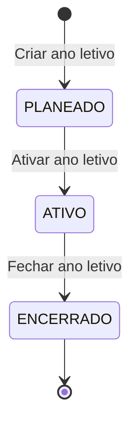
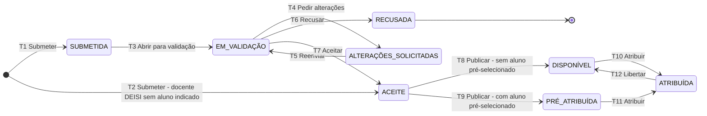
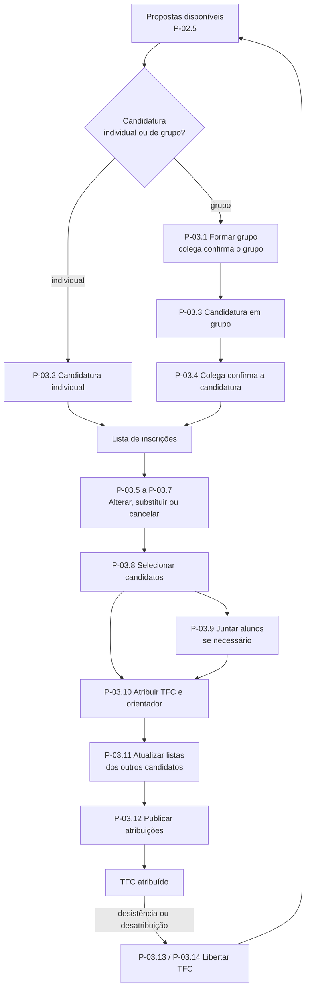
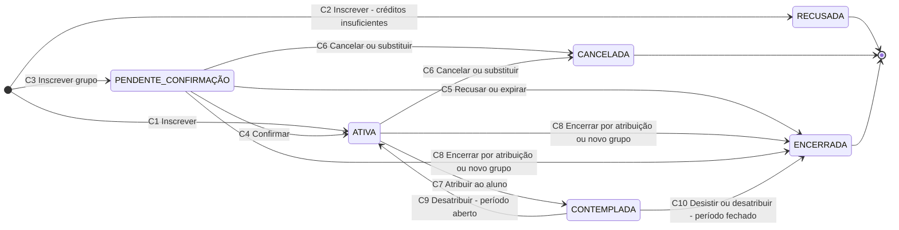
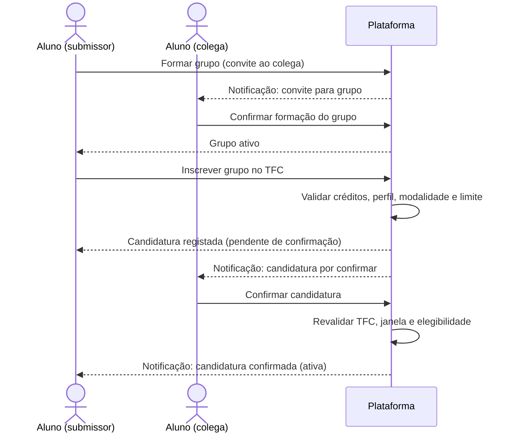
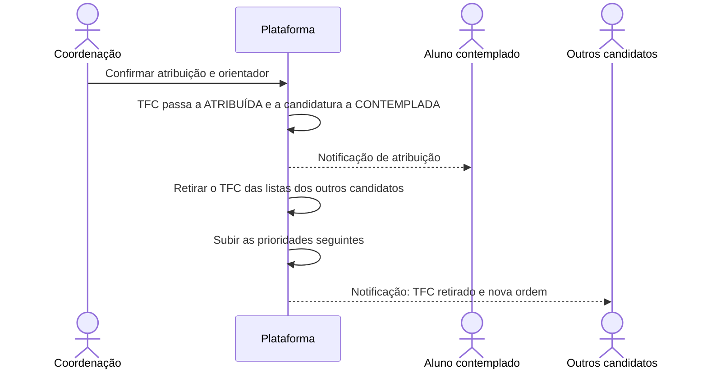
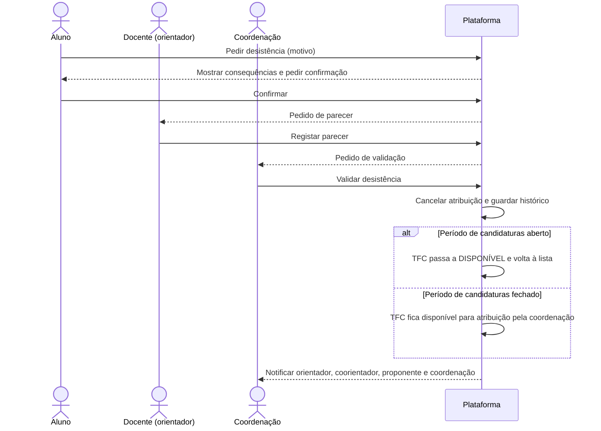
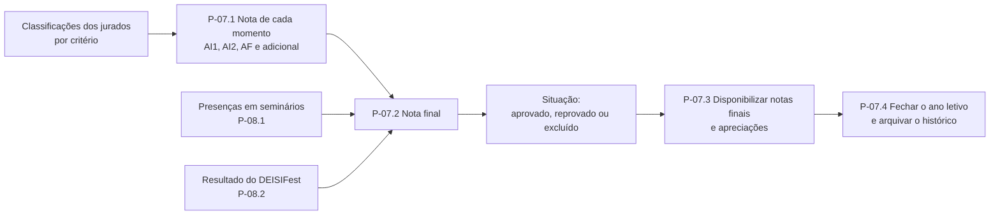
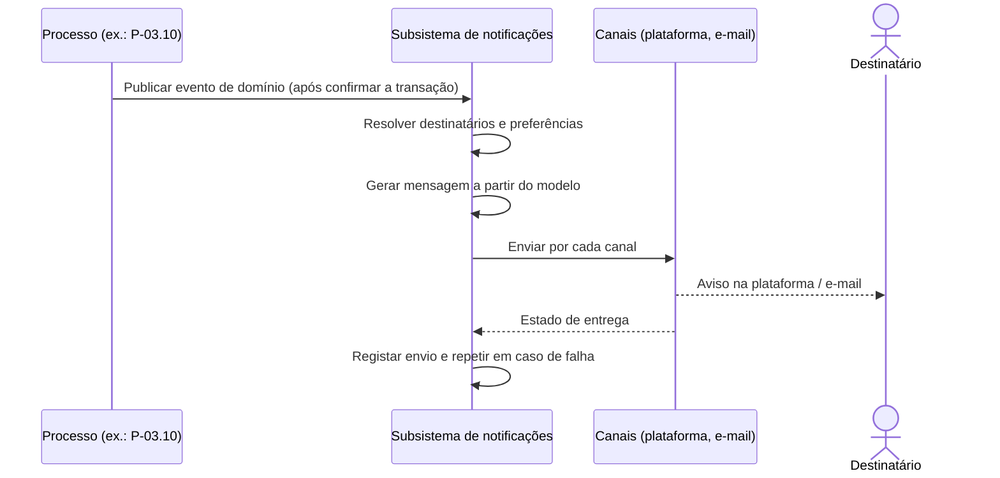

# 02 — Macro-processos e processos (versão revista)

Estrutura do método de ERT: **macro-processos** (grandes áreas e objetivo) → **processos** (mezzo) → **descrição detalhada** (micro). Os macro-processos seguem a ordem do ano letivo e, dentro de cada um, os processos seguem a ordem de execução. A descrição detalhada cobre a configuração do ano letivo, o registo de temas, a candidatura, a atribuição, a submissão de entregáveis, o modelo de avaliação, o apuramento de resultados, o fecho do ano letivo e o subsistema de consulta e notificações; os restantes processos estão descritos em linhas gerais.

**Convenções.** `[UI]` indica comportamento observado na plataforma atual. As regras do regulamento são citadas pelo capítulo ou anexo do *Regulamento de TFC 2026/27* (ver secção 7). Os diagramas de workflow, de sequência e de estados usam «Plataforma» para designar o sistema.

## 1. Atores

| Ator | Descrição |
|---|---|
| Aluno | Inscrito na UC de TFC, individualmente ou em grupo de 2 |
| Docente | Docente do DEISI. É o **mesmo ator** em todos os papéis: em cada TFC pode ter a função de proponente, orientador, coorientador ou jurado |
| Coordenação | Coordenação de TFC |
| Proponente externo | Docente de outro departamento ou empresa/instituição parceira |
| Organização de seminários | Valida as presenças |
| Administrador | Gestão técnica da plataforma |

**Funções do docente num TFC** (o ator é sempre o Docente; muda a função):

| Função | Descrição |
|---|---|
| Proponente | Propõe o tema do TFC |
| Orientador | Orienta o TFC; é nomeado por TFC |
| Coorientador | Apoia a orientação; pode ser externo |
| Jurado | Avalia o TFC (nas intercalares é externo ao trabalho) |

O acesso depende do **perfil da conta** e da **função do docente em cada TFC** (um docente pode ser proponente num TFC, orientador noutro e jurado noutro). O acesso do orientador aos dados do TFC que orienta depende apenas desta função e não do estado da entrega em curso (ver P-09.2 e secção 4.7).

**A Plataforma não é um ator.** Executa as regras automáticas (prazos, validações, cálculos, arquivo do histórico) e aloja o **subsistema de notificações** (secção 4.7), que reage aos eventos emitidos pelos processos.

## 2. Macro-processos

| ID | Macro-processo | Objetivo | Atores principais |
|---|---|---|---|
| MP-01 | Configuração do ano letivo | Definir prazos, utilizadores e cursos de cada ano letivo, mantendo os anos separados, sem alterar a plataforma | Coordenação, Administrador |
| MP-02 | Gestão de propostas (registo de temas) | Só disponibilizar temas validados e com esforço adequado | Docente, Aluno, Proponente externo, Coordenação |
| MP-03 | Candidatura e atribuição | Atribuir os TFC aos alunos de forma justa, transparente e dentro dos prazos | Aluno, Docente (proponente), Proponente externo, Coordenação |
| MP-04 | Acompanhamento do TFC | Registar a evolução e as alterações ao longo do ano | Aluno, Docente (orientador) |
| MP-05 | Submissão de entregáveis | Entregas completas, validadas pelo orientador e dentro do prazo | Aluno, Docente (orientador) |
| MP-06 | Avaliação | Definir os momentos e os critérios de avaliação e obter avaliações individuais, rastreáveis e, nas intercalares, cegas | Docente (jurado), Coordenação |
| MP-07 | Apuramento de resultados e fecho do ano | Calcular a nota de cada momento e a nota final de forma automática e auditável, disponibilizar os resultados e fechar o ano letivo, transitando os dados para o histórico | Coordenação |
| MP-08 | Outros momentos de avaliação | Controlar obrigações que não são entregas | Organização de seminários, Coordenação |
| MP-09 | Consulta e notificações | Dar a cada perfil o acesso de que precisa (estado, resultados, avaliações e histórico) e notificá-lo dos eventos relevantes | Todos |

## 3. Processos (nível mezzo)

### MP-01 — Configuração do ano letivo

| ID | Processo | Ator | Descrição |
|---|---|---|---|
| P-01.1 | Definir calendário e épocas de avaliação e ativar o ano letivo | Coordenação | Criar o ano letivo, registar as fases (propostas, candidaturas, publicação, entregas, defesas) com início e fim e ativá-lo; o sistema abre e fecha as funcionalidades. Só existe um ano letivo ativo. |
| P-01.2 | Gerir utilizadores e perfis | Coordenação, Administrador | Registar alunos inscritos na UC (número, curso, ECTS, UCs concluídas), docentes (com indicação de **ativo ou inativo**) e entidades externas e atribuir perfis. |
| P-01.3 | Gerir cursos e grupos de cursos | Coordenação | Manter a tabela de cursos (por exemplo LEI, LIG, LCD) e de grupos de cursos (por exemplo "LEI + LIG") usada nas propostas e nos perfis de candidato. |

O fecho do ano letivo e a transição para o histórico estão em MP-07 (P-07.4), porque ocorrem depois do apuramento.

### MP-02 — Gestão de propostas (registo de temas)

| ID | Processo | Ator | Descrição |
|---|---|---|---|
| P-02.1 | Submeter proposta | Docente, Aluno, Proponente externo | Propor um tema com modalidade (individual, em grupo, ou individual ou em grupo), cursos, disciplinas e tecnologias, e perfil de candidato ou alunos pré-selecionados. |
| P-02.2 | Validar proposta | Coordenação | Abrir a proposta para validação e aceitá-la, pedir alterações ou recusá-la, nomeando o orientador. |
| P-02.3 | Rever proposta | Docente, Aluno, Proponente externo | Alterar e reenviar uma proposta após pedido de alterações. |
| P-02.4 | Publicar proposta | Coordenação (ou Plataforma, nas propostas de docente DEISI sem aluno indicado) | Tornar a proposta aceite disponível para candidatura. |
| P-02.5 | Consultar propostas | Aluno, Docente, Proponente externo, Coordenação | Listar e filtrar as propostas e ver o detalhe; o proponente vê as suas propostas e o estado de cada uma. |
| P-02.6 | Alterar proposta disponível | Docente (proponente) | Alterar um TFC ainda não atribuído, desde que a alteração seja compatível com as candidaturas existentes. |

### MP-03 — Candidatura e atribuição

| ID | Processo | Ator | Descrição |
|---|---|---|---|
| P-03.1 | Formar grupo | Aluno (submissor) | Constituir um grupo de 2 alunos; o colega confirma **a formação do grupo** (uma única vez). |
| P-03.2 | Submeter candidatura individual | Aluno | Candidatar-se a um TFC com uma prioridade na lista de inscrições; é recusada se o aluno não tiver os créditos exigidos. |
| P-03.3 | Submeter candidatura em grupo | Aluno (submissor) | Candidatar o grupo a um TFC que aceita grupos; a candidatura fica pendente até o colega a confirmar. |
| P-03.4 | Confirmar candidatura de grupo | Aluno (colega de grupo) | O colega confirma ou recusa **cada candidatura** submetida pelo submissor. |
| P-03.5 | Alterar candidatura | Aluno (submissor, se for grupo) | Reordenar as prioridades da lista de inscrições dentro do prazo. |
| P-03.6 | Substituir TFC da candidatura (de A para B) | Aluno (submissor, se for grupo) | Operação atómica que troca o TFC A pelo TFC B **mantendo a posição** na lista; combina o cancelamento de P-03.7 com o registo de P-03.2 ou P-03.3. |
| P-03.7 | Cancelar candidatura | Aluno (submissor, se for grupo) | Retirar uma candidatura da lista; as seguintes sobem uma posição. |
| P-03.8 | Selecionar candidatos | Docente (proponente), Proponente externo, Coordenação | Escolher o candidato de cada TFC quando há mais de um. |
| P-03.9 | Juntar alunos num TFC | Docente (proponente ou orientador), Coordenação | O docente propõe juntar dois alunos para fazerem em grupo um TFC que aceita grupos; os dois alunos aceitam, a coordenação valida e o TFC é atribuído diretamente ao grupo. |
| P-03.10 | Atribuir TFC e orientador | Coordenação | Atribuir o TFC ao aluno ou grupo e nomear orientador e coorientador. |
| P-03.11 | Atualizar listas de candidaturas após atribuição | Plataforma (desencadeado por P-03.10) | Retirar o TFC atribuído das listas dos outros candidatos e subir as prioridades seguintes. |
| P-03.12 | Publicar atribuições | Coordenação | Publicar a lista final de TFC atribuídos e orientadores. |
| P-03.13 | Registar desistência e libertar TFC | Aluno, Docente (orientador), Coordenação | Registar a desistência de um aluno e libertar o TFC: volta à lista de inscrições se o período de candidaturas estiver aberto; caso contrário, fica disponível para atribuição pela coordenação. |
| P-03.14 | Desatribuir TFC | Docente (orientador), Coordenação | O orientador pede a desatribuição e a coordenação valida; só depois a candidatura pode voltar a ser alterada. |

### MP-04 — Acompanhamento do TFC

| ID | Processo | Ator | Descrição |
|---|---|---|---|
| P-04.1 | Registar repositório e atividades | Aluno, Docente (orientador) | Associar o link do repositório Git e registar atividades e reuniões. |
| P-04.2 | Dissociar grupo | Docente (orientador), Coordenação | Separar um grupo quando não há equilíbrio de esforço; as avaliações já feitas não se repetem. |
| P-04.3 | Pedir adiamento para época de recurso | Aluno, Docente (orientador), Coordenação | Adiar a entrega final para a época de recurso, com parecer favorável do orientador. |

### MP-05 — Submissão de entregáveis

| ID | Processo | Ator | Descrição |
|---|---|---|---|
| P-05.1 | Enviar relatório ao orientador | Aluno | Enviar o relatório em PDF para validação, com antecedência mínima. |
| P-05.2 | Validar relatório | Docente (orientador) | Aceitar ou devolver o relatório e informar a coordenação. |
| P-05.3 | Submeter entrega | Aluno | Submeter o relatório em PDF e as ligações dos restantes entregáveis de cada momento. |

### MP-06 — Avaliação

| ID | Processo | Ator | Descrição |
|---|---|---|---|
| P-06.1 | Definir momentos de avaliação | Coordenação | Definir os momentos (AI1, AI2, AF, DF, seminários e uma eventual avaliação adicional), o tipo de contribuição de cada um, o peso na nota final e as regras de cálculo. |
| P-06.2 | Definir critérios de avaliação | Coordenação | Definir, para cada momento com júri, os critérios, os entregáveis ou parâmetros a que se aplicam, os pesos, a escala e o limiar de discrepância. |
| P-06.3 | Constituir júri | Coordenação | Definir o júri de cada TFC e momento (júri cego nas intercalares). |
| P-06.4 | Agendar defesas | Coordenação | Marcar e publicar as defesas finais com pelo menos 48 h de antecedência; TFC com AND não são gravados nem divulgados. |
| P-06.5 | Preencher formulário de avaliação | Docente (jurado) | Classificar cada critério (Likert 1–10) e escrever a apreciação; justificação obrigatória se a discrepância entre jurados for superior a 2 níveis. |
| P-06.6 | Publicar resultados dos momentos | Coordenação | Disponibilizar notas e apreciações aos alunos e aos orientadores (intercalares até 10 dias úteis após o prazo). |

### MP-07 — Apuramento de resultados e fecho do ano

| ID | Processo | Ator | Descrição |
|---|---|---|---|
| P-07.1 | Calcular a nota de cada momento | Coordenação | Calcular, para cada momento com júri (AI1, AI2, AF e, se existir, avaliação adicional), a nota a partir das classificações de cada jurado por critério e dos pesos dos critérios; inclui a **nota intercalar**. |
| P-07.2 | Calcular a nota final e a situação | Coordenação | Combinar as notas dos momentos ponderados com os pesos do modelo (P-06.1), arredondar à unidade e determinar aprovado, reprovado ou excluído, tendo em conta o cumprimento dos seminários (P-08.1). |
| P-07.3 | Disponibilizar notas finais e apreciações | Coordenação | Tornar consultáveis pelos alunos e pelos orientadores a nota final, a situação e o histórico completo de avaliações de cada TFC. |
| P-07.4 | Fechar o ano letivo e arquivar o histórico | Coordenação (execução técnica: Administrador) | Verificar que não há pendências, encerrar o ano e fazer transitar os seus dados para o histórico, consultável apenas em leitura. |

### MP-08 — Outros momentos de avaliação

| ID | Processo | Ator | Descrição |
|---|---|---|---|
| P-08.1 | Registar presenças em seminários | Organização de seminários, Coordenação | Registar presenças individuais; o aluno cumpre com pelo menos 70% dos seminários do ano. Contribui como **condição**, não como nota. |
| P-08.2 | Registar resultado do DEISIFest | Coordenação | Registar a média das votações de cada trabalho; contribui com 5% da nota final em 2026/27. |

### MP-09 — Consulta e notificações

| ID | Processo | Ator | Descrição |
|---|---|---|---|
| P-09.1 | Consultar estado do TFC | Aluno, Docente (orientador) | Ver o TFC, os prazos, o estado das entregas e as pendências. |
| P-09.2 | Consultar resultados e avaliações | Aluno, Docente (orientador) | Ver as notas por momento, as classificações por critério, as apreciações, a nota final e a situação. O orientador tem acesso permanente ao histórico de avaliações dos TFC que orienta. |
| P-09.3 | Consultar histórico de anos letivos | Aluno, Docente, Coordenação | Ver por defeito o ano ativo e retroceder aos anos encerrados, em modo de leitura. |
| P-09.4 | Consultar relatórios de gestão | Coordenação | Ver propostas, candidaturas (incluindo as recusadas por falta de créditos), alunos sem TFC, entregas em atraso, avaliações por lançar e pendências de fecho do ano. |
| P-09.5 | Configurar o subsistema de notificações | Coordenação, Administrador | Manter o catálogo de eventos, os destinatários, os modelos de mensagem e os canais. |
| P-09.6 | Receber notificações | Todos | Receber avisos na plataforma e por e-mail dos eventos relevantes, com consulta do registo e do estado de leitura. |

## 4. Descrição detalhada (nível micro)

Cada ficha indica pré-condições, fluxo, exceções e regras.

### 4.1 MP-01 — Configuração do ano letivo

**Estados do ano letivo.** A plataforma mantém cada ano letivo como uma unidade separada, com o seu calendário, utilizadores inscritos na UC, propostas, candidaturas, atribuições, avaliações, notas e versão do modelo de avaliação.

| De | Evento (trigger) | Ator | Condição | Para |
|---|---|---|---|---|
| (início) | Criar ano letivo | Coordenação | Calendário coerente (P-01.1) | `PLANEADO` |
| `PLANEADO` | Ativar ano letivo | Coordenação | Não existe outro ano `ATIVO` | `ATIVO` |
| `ATIVO` | Fechar ano letivo (P-07.4) | Coordenação | Sem pendências de apuramento | `ENCERRADO` |

Um ano `ENCERRADO` não volta a `ATIVO`. Qualquer correção excecional é uma questão em aberto (questão 6).

**P-01.1 Definir calendário e épocas de avaliação e ativar o ano letivo** — *Coordenação*
- **Pré-condições:** perfil Coordenação.
- **Fluxo:**
  1. a coordenação cria o ano letivo e as suas fases (propostas, candidaturas, publicação, entregas, defesas) com início e fim;
  2. o sistema valida a coerência das datas;
  3. a coordenação publica o calendário e ativa o ano letivo;
  4. o sistema abre e fecha as funcionalidades de acordo com as datas.
- **Exceções:** alterar uma data com submissões já feitas pede confirmação e fica registado; sem época de avaliação ativa, a entrega mostra "Não existe nenhuma época de avaliação disponível" `[UI]`; existir já um ano `ATIVO` → a ativação é bloqueada até ao fecho do anterior (P-07.4).
- **Regras:** o servidor valida sempre a janela; as datas do ano letivo são as da secção 5 e podem ser alteradas (regulamento, cap. 1, "Datas importantes"). Todos os dados operacionais ficam associados ao seu ano letivo. Só o ano `ATIVO` aceita escritas; os anos `ENCERRADO` são histórico (P-07.4, P-09.3).

**P-01.2 Gerir utilizadores e perfis** — *Coordenação, Administrador*
- **Pré-condições:** perfil Coordenação ou Administrador.
- **Dados:** alunos (número, curso, ECTS, UCs concluídas); docentes (nome e **estado: ativo ou inativo**); entidades externas; perfil de cada utilizador.
- **Fluxo:**
  1. a coordenação ou o administrador regista ou importa os utilizadores;
  2. atribui o perfil de cada um;
  3. para cada docente, indica se está **ativo** (a trabalhar com TFC) ou **inativo**;
  4. o sistema valida duplicados e guarda.
- **Exceções:** utilizador duplicado → fundir os registos; aluno com menos de 90 ECTS → fica não elegível para candidaturas (P-03.2).
- **Regras:** só os docentes **ativos** podem ser proponentes, orientadores, coorientadores DEISI ou jurados, e só eles aparecem nas listas de escolha (orientador preferencial ou sugerido, nomeação pela coordenação, júri); os inativos mantêm o histórico e continuam a consultar os TFC que orientaram (P-09.2, P-09.3).

**P-01.3 Gerir cursos e grupos de cursos** — *Coordenação*
- **Pré-condições:** perfil Coordenação.
- **Dados:** curso (código e nome, por exemplo LEI, LIG, LCD); grupo de cursos (por exemplo "LEI + LIG"); cursos que pertencem a cada grupo.
- **Fluxo:**
  1. a coordenação cria ou edita a tabela de cursos e de grupos de cursos;
  2. associa cada curso ao seu grupo;
  3. o sistema disponibiliza a tabela nas propostas (P-02.1) e no perfil do candidato.
- **Regras:** nas propostas, os cursos e grupos de cursos são escolhidos por **caixas de verificação** (checkbox) a partir desta tabela; os itens desativados mantêm o histórico.

### 4.2 MP-02 — Gestão de propostas (registo de temas)

**Máquina de estados da proposta**

**Tabela de transições**

| # | De | Evento (trigger) | Ator | Condição (guarda) | Para | Efeitos |
|---|---|---|---|---|---|---|
| T1 | (início) | Submeter proposta | Docente, Aluno, Proponente externo | Janela do tipo de proponente aberta; campos obrigatórios válidos; não se aplica T2 | `SUBMETIDA` | Notifica a coordenação (e o 2.º aluno, se for grupo) |
| T2 | (início) | Submeter proposta | Docente DEISI | Sem aluno indicado (regulamento, cap. 3: aceitação imediata) | `ACEITE` | Dispara a publicação automática (T8) |
| T3 | `SUBMETIDA` | Abrir para validação | Coordenação | — | `EM_VALIDAÇÃO` | Regista a data de abertura |
| T4 | `EM_VALIDAÇÃO` | Pedir alterações | Coordenação | Mensagem obrigatória | `ALTERAÇÕES_SOLICITADAS` | Notifica o proponente |
| T5 | `ALTERAÇÕES_SOLICITADAS` | Reenviar proposta (P-02.3) | Proponente | Janela aberta | `EM_VALIDAÇÃO` | Notifica a coordenação |
| T6 | `EM_VALIDAÇÃO` | Recusar | Coordenação | Justificação obrigatória | `RECUSADA` | Estado final; notifica o proponente |
| T7 | `EM_VALIDAÇÃO` | Aceitar | Coordenação | Orientador nomeado | `ACEITE` | Notifica o proponente |
| T8 | `ACEITE` | **Publicar** (P-02.4) | Coordenação; Plataforma no caminho T2 | Sem aluno pré-selecionado | `DISPONÍVEL` | Proposta entra na lista de candidatura; notifica o proponente |
| T9 | `ACEITE` | **Publicar** (P-02.4) | Coordenação | Com aluno(s) pré-selecionado(s) | `PRÉ_ATRIBUÍDA` | Visível só para o(s) pré-selecionado(s); notifica-os |
| T10 | `DISPONÍVEL` | Atribuir TFC (P-03.10) | Coordenação | Seleção confirmada (P-03.8) ou grupo juntado (P-03.9) | `ATRIBUÍDA` | Executa P-03.11 |
| T11 | `PRÉ_ATRIBUÍDA` | Atribuir TFC (P-03.10) | Plataforma | O(s) pré-selecionado(s) fez(fizeram) a candidatura formal (P-03.2 ou P-03.3) e é(são) elegível(eis) | `ATRIBUÍDA` | Executa P-03.11 |
| T12 | `ATRIBUÍDA` | Libertar TFC (P-03.13 ou P-03.14) | Coordenação | Desistência ou desatribuição validadas | `DISPONÍVEL` | Período de candidaturas aberto: volta à lista; fechado: só a coordenação o pode atribuir |

**Eventos internos (sem mudança de estado).** *Alterar proposta* (P-02.6) em `DISPONÍVEL` e `PRÉ_ATRIBUÍDA`, sujeito às guardas de P-02.6. "A Aguardar Atribuição" `[UI]` é o nome na interface do estado `DISPONÍVEL`.

**Simplificações face à versão anterior.** `ACEITE` é sempre seguido de um evento *Publicar* explícito, também nas propostas de docente DEISI sem aluno indicado, onde o evento é executado automaticamente pela Plataforma. As transições `DISPONÍVEL → ATRIBUÍDA → DISPONÍVEL` ficaram com eventos nomeados (T10 e T12).

**P-02.1 Submeter proposta** — *Docente, Aluno, Proponente externo*
- **Pré-condições:** autenticado; janela do seu tipo de proponente aberta; aluno inscrito na UC.
- **Dados:** título, descrição, empresa/entidade, orientador (preferencial ou sugerido, apenas docentes ativos), **modalidade (individual, em grupo de 2, ou individual ou em grupo)**, curso(s) escolhidos por **caixas de verificação** a partir da tabela de cursos e grupos de cursos (P-01.3), disciplina(s), tecnologia(s) `[UI]`; e aluno(s) pré-selecionado(s) **ou** perfil do candidato (curso e UCs concluídas ou em curso); 2.º aluno, se a modalidade for grupo.
- **Fluxo:**
  1. o proponente preenche o formulário do seu tipo e indica a modalidade;
  2. o sistema valida os campos obrigatórios;
  3. o sistema aplica T1 (`SUBMETIDA`) ou, para docente DEISI sem aluno indicado, T2 (`ACEITE`, seguido de T8);
  4. o sistema notifica a coordenação (e o 2.º aluno, se for grupo).
- **Exceções:** janela fechada → formulário indisponível; sem perfil nem pré-seleção → bloquear; 2.º aluno já noutro grupo → bloquear; proposta individual com 2.º aluno → bloquear.
- **Regras (regulamento, cap. 3):** o aluno pode submeter várias propostas; a proposta de grupo é submetida por um só elemento; o orientador preferencial indicado pelo aluno exige aprovação prévia dele (senão a proposta pode ser excluída); empresas e outros departamentos podem ser coorientadores. A **modalidade** é vinculativa e define quem se pode candidatar: um TFC **individual** só aceita candidaturas individuais (P-03.2); um TFC **em grupo** só aceita candidaturas de grupo (P-03.3); um TFC **individual ou em grupo** aceita os dois tipos (esclarecido pelo orientador a 01/11).

**P-02.2 Validar proposta** — *Coordenação*
- **Pré-condições:** proposta `SUBMETIDA` ou `EM_VALIDAÇÃO`.
- **Fluxo:**
  1. a coordenação abre a lista de propostas por validar; ao abrir uma proposta `SUBMETIDA` ocorre T3;
  2. analisa tema, esforço, enquadramento e disponibilidade do orientador;
  3. decide: **aceitar** (T7), **pedir alterações** com mensagem (T4) ou **recusar** com justificação (T6);
  4. se aceitar, pode acrescentar tarefas ou requisitos e nomear orientador e coorientador;
  5. o sistema atualiza o estado e notifica o proponente. A publicação é um evento à parte (P-02.4).
- **Regras (regulamento, cap. 2 e 3):** nas propostas de departamentos e empresas a coordenação nomeia o orientador por área científica (o sugerido é considerado e pode ser substituído); limite sugerido de 5 orientações por docente (aviso); o histórico de estados fica registado.

**P-02.3 Rever proposta** — *Docente, Aluno, Proponente externo*
- **Fluxo:** com a proposta em `ALTERAÇÕES_SOLICITADAS`, o proponente lê o pedido, edita e reenvia (T5).
- **Exceções:** fora da janela → só leitura.

**P-02.4 Publicar proposta** — *Coordenação (ou Plataforma, no caminho T2)*
- **Pré-condições:** proposta `ACEITE`.
- **Fluxo:**
  1. a coordenação executa a ação **Publicar** sobre as propostas aceites; nas propostas de docente DEISI sem aluno indicado a Plataforma executa o mesmo evento logo após T2;
  2. o estado passa a `DISPONÍVEL` (T8) ou `PRÉ_ATRIBUÍDA` (T9);
  3. a proposta `DISPONÍVEL` passa a constar da lista para candidatura (P-02.5), com a sua modalidade;
  4. o sistema notifica o proponente.
- **Regras:** um TFC `PRÉ_ATRIBUÍDA` só aparece ao(s) aluno(s) pré-selecionado(s), para fazerem a candidatura formal (P-03.2 ou P-03.3). Um TFC libertado volta a `DISPONÍVEL` (T12).

**P-02.5 Consultar propostas** — *Aluno, Docente, Proponente externo, Coordenação*
- **Fluxo:**
  1. a listagem mostra ID, título e orientador/coorientador, com pesquisa por orientador `[UI]` e **filtro por modalidade**;
  2. o detalhe mostra empresa, orientador, título, descrição, modalidade, estado, curso, disciplinas e tecnologias `[UI]`;
  3. o proponente vê as suas propostas e o estado de cada uma; sem propostas aparece "Ainda não submeteu nenhum tema para TFC" `[UI]`.
- **Regras:** o aluno vê as propostas `DISPONÍVEL` e, se for pré-selecionado, a sua `PRÉ_ATRIBUÍDA`. A consulta incide sobre o ano ativo; os anos anteriores consultam-se em P-09.3.

**P-02.6 Alterar proposta disponível** — *Docente (proponente)*
- **Pré-condições:** proposta `DISPONÍVEL` ou `PRÉ_ATRIBUÍDA`, ainda não atribuída.
- **Fluxo:**
  1. o docente abre a sua proposta e altera os dados (por exemplo, a descrição, os cursos ou a modalidade);
  2. o sistema verifica se a alteração é compatível com as candidaturas existentes;
  3. o sistema guarda a alteração (o estado não muda) e notifica os candidatos.
- **Exceções:** TFC já atribuído → alteração bloqueada; mudar para modalidade **em grupo** com candidaturas individuais existentes → bloquear; mudar para modalidade **individual** com candidaturas de grupo existentes → bloquear.
- **Regras:** o docente pode alterar tudo num TFC ainda não atribuído, desde que a alteração seja compatível com as candidaturas existentes; mudar para **individual ou em grupo** é sempre possível (esclarecido pelo orientador a 01/11).

### 4.3 MP-03 — Candidatura e atribuição

Os processos estão descritos **pela ordem de execução**: formar grupo → candidatar-se (individual ou em grupo) → confirmação do colega (se for grupo) → gerir a lista (alterar, substituir, cancelar) → selecionar → juntar alunos → atribuir → atualizar as listas dos outros candidatos → publicar. A desistência (P-03.13) e a desatribuição (P-03.14) podem ocorrer depois da atribuição e devolvem o TFC à lista de disponíveis.

**Workflow**

#### Máquina de estados da candidatura

A **lista de inscrições** contém as candidaturas `PENDENTE_CONFIRMAÇÃO` e `ATIVA`, com prioridade de 1 a n, sem lacunas. Sempre que uma candidatura sai da lista, as seguintes **sobem uma posição**.

| # | De | Evento (trigger) | Ator | Condição (guarda) | Para | Efeitos |
|---|---|---|---|---|---|---|
| C1 | (início) | Inscrever (P-03.2) | Aluno | Créditos ≥ 90 ECTS à data de referência; janela aberta; limite não atingido; TFC `DISPONÍVEL` ou `PRÉ_ATRIBUÍDA` do próprio; modalidade compatível; sem duplicação | `ATIVA` | Entra na última posição, com data e hora |
| C2 | (início) | Inscrever (P-03.2) ou Inscrever grupo (P-03.3) | Aluno | Créditos insuficientes (de um dos alunos, no caso de grupo) | `RECUSADA` | Regista aluno, TFC, data e motivo; não entra na lista; visível à coordenação (P-09.4) |
| C3 | (início) | Inscrever grupo (P-03.3) | Aluno (submissor) | Grupo ativo; créditos dos dois alunos; modalidade que aceita grupos; janela e limite | `PENDENTE_CONFIRMAÇÃO` | Entra na última posição; notifica o colega |
| C4 | `PENDENTE_CONFIRMAÇÃO` | Confirmar candidatura (P-03.4) | Aluno (colega) | Revalidação: TFC disponível, janela aberta, colega elegível | `ATIVA` | Mantém a posição; notifica o submissor |
| C5 | `PENDENTE_CONFIRMAÇÃO` | Recusar candidatura (P-03.4) ou Fechar janela de candidaturas | Aluno (colega); Plataforma | Recusa explícita, ou ausência de resposta até ao fecho da janela | `ENCERRADA` (motivo: recusada pelo colega, ou sem confirmação a tempo) | Sai da lista; as seguintes sobem |
| C6 | `PENDENTE_CONFIRMAÇÃO`, `ATIVA` | Cancelar candidatura (P-03.7) ou Substituir TFC (P-03.6) | Aluno (submissor, se for grupo) | Janela aberta | `CANCELADA` (motivo: retirada ou substituída) | Sai da lista; fica no histórico |
| C7 | `ATIVA` | Atribuir TFC (P-03.10) | Coordenação | TFC atribuído a este aluno ou grupo | `CONTEMPLADA` | O TFC passa a `ATRIBUÍDA` (T10 ou T11) |
| C8 | `PENDENTE_CONFIRMAÇÃO`, `ATIVA` | Atribuir TFC a outro (P-03.11), Atribuir ao mesmo aluno outro TFC (P-03.10, passo 4) ou Formar grupo (P-03.1, P-03.9) | Plataforma | Respetivamente: TFC atribuído a outro; aluno já contemplado; candidatura anulada por novo grupo | `ENCERRADA` (com o motivo correspondente) | Sai da lista; as seguintes sobem |
| C9 | `CONTEMPLADA` | Desatribuir TFC (P-03.14) | Orientador, Coordenação | Período de candidaturas aberto | `ATIVA` | A candidatura pode voltar a ser alterada (P-03.5 a P-03.7) |
| C10 | `CONTEMPLADA` | Registar desistência (P-03.13), ou Desatribuir TFC (P-03.14) | Aluno, Orientador, Coordenação | Desistência validada; ou desatribuição com período de candidaturas fechado | `ENCERRADA` (motivo: desistência ou desatribuição) | As candidaturas antigas não são repostas |

**Eventos internos (sem mudança de estado).** *Reordenar* (P-03.5) altera apenas a prioridade e renumera de 1 a n; mantém a data e hora da inscrição. Os estados `RECUSADA`, `CANCELADA` e `ENCERRADA` são finais e ficam no histórico do ano letivo.

#### Quem confirma o quê nas candidaturas de grupo

O colega de grupo valida dois atos distintos: a **associação** ao grupo e **cada escolha de TFC** feita em nome do grupo. A confirmação da formação do grupo (P-03.1) não dispensa a confirmação de cada candidatura (P-03.4): o fluxo não é automatizado.

| Ato | Quem executa | Confirmação do colega | Estado resultante |
|---|---|---|---|
| Formar grupo (P-03.1) | Submissor (quem convida) | Sim, uma vez, ao formar o grupo | Grupo `ATIVO`; candidaturas individuais anteriores de ambos `ENCERRADA` (C8) |
| Candidatar o grupo a um TFC (P-03.3) | Submissor | Sim, **em cada candidatura** (P-03.4) | `PENDENTE_CONFIRMAÇÃO` → `ATIVA` |
| Substituir TFC (P-03.6) | Submissor | Sim, a nova candidatura ao TFC B é confirmada como em P-03.4 | `PENDENTE_CONFIRMAÇÃO` → `ATIVA` |
| Reordenar (P-03.5) | Submissor | Não; o colega é notificado e consulta | Sem alteração de estado |
| Cancelar (P-03.7) | Submissor | Não; o colega é notificado e deixa de ver a candidatura | `CANCELADA` |

**P-03.1 Formar grupo** — *Aluno (submissor)*
- **Pré-condições:** os dois alunos inscritos na UC, elegíveis (≥ 90 ECTS, referência 04.10.2026) e sem grupo ativo; janela de candidaturas aberta.
- **Fluxo:**
  1. o aluno indica o número do 2.º aluno;
  2. o sistema valida (inscrito, elegível, sem grupo);
  3. o sistema avisa que formar o grupo **anula as candidaturas anteriores** de ambos e pede confirmação ao submissor;
  4. o sistema envia o convite ao colega;
  5. o colega **confirma a formação do grupo**;
  6. o sistema ativa o grupo, fixa o **submissor** (quem convidou) e encerra as candidaturas anteriores de ambos (C8).
- **Exceções:** colega recusa → grupo não se forma e o aluno mantém as suas candidaturas; colega já noutro grupo → bloquear; colega não elegível → informar; janela fechada → indisponível.
- **Regras (regulamento, cap. 4):** cada aluno só pode estar num grupo; só o submissor cria e altera candidaturas do grupo. Esta confirmação diz respeito ao grupo; cada candidatura é confirmada à parte em P-03.4.

**P-03.2 Submeter candidatura individual** — *Aluno*
- **Pré-condições:** aluno inscrito na UC; janela aberta; TFC `DISPONÍVEL`, ou `PRÉ_ATRIBUÍDA` quando o aluno é o pré-selecionado; limite de candidaturas não atingido.
- **Fluxo:**
  1. o aluno abre o detalhe do TFC, que mostra o número de inscrições atuais;
  2. carrega em **Inscrever**;
  3. o sistema valida os créditos, a elegibilidade, a disponibilidade do TFC, a janela, o limite e a duplicação;
  4. o sistema aplica C1: regista a candidatura na última posição da lista, com **data e hora**, no estado `ATIVA`.
- **Alternativa — falta de créditos:** no passo 3, se o aluno não tem os créditos mínimos (≥ 90 ECTS à data de referência), o sistema aplica C2, mostra a mensagem "não reúne os créditos mínimos exigidos para se candidatar a um TFC" e regista a recusa. A coordenação vê estes registos (P-09.4).
- **Exceções:** limite atingido → botão desativado e mensagem "retire uma inscrição de outro TFC" `[UI]`; outro requisito em falta → mensagem a indicar qual; TFC atribuído entretanto → bloquear; TFC com modalidade em grupo → bloquear com a mensagem "este TFC é para grupos de 2 e não aceita candidaturas individuais".
- **Regras (regulamento, cap. 3 e 4):** 3 a 6 TFC por ordem de preferência (a plataforma atual bloqueia aos 5; o limite é parametrizável); mesmo com pré-seleção, a candidatura na plataforma é obrigatória, porque a atribuição formal é necessária para a avaliação; um TFC em grupo não aceita candidaturas individuais, mas um TFC individual ou em grupo aceita (questão 3, esclarecida a 01/11).

**P-03.3 Submeter candidatura em grupo** — *Aluno (submissor)*
- **Descrição:** o submissor candidata o **grupo** a um TFC que aceita grupos. A candidatura pertence ao grupo, fica pendente até o colega a confirmar (P-03.4) e só então concorre. A lista de inscrições é a do grupo e o colega pode consultá-la.
- **Pré-condições:** grupo ativo (P-03.1); janela aberta; TFC `DISPONÍVEL` e com modalidade **em grupo** ou **individual ou em grupo**; os dois alunos inscritos na UC; limite do grupo não atingido.
- **Fluxo:**
  1. o submissor abre o detalhe do TFC, onde vê que a modalidade aceita grupos;
  2. carrega em **Inscrever grupo**;
  3. o sistema valida os créditos dos dois alunos, a elegibilidade para o perfil, a disponibilidade, a janela, o limite e a duplicação;
  4. o sistema aplica C3: regista a candidatura na última posição da lista, com **data e hora**, no estado `PENDENTE_CONFIRMAÇÃO`;
  5. o sistema notifica o colega.
- **Exceções:** TFC individual → bloquear com a mensagem "este TFC é individual e não aceita grupos"; um dos alunos sem os créditos exigidos → C2; quem não é o submissor não pode submeter.
- **Regras (regulamento, cap. 4):** só o submissor cria e altera candidaturas do grupo; cada aluno só pode estar num grupo.

**P-03.4 Confirmar candidatura de grupo** — *Aluno (colega de grupo)*
- **Pré-condições:** grupo ativo; candidatura `PENDENTE_CONFIRMAÇÃO`; janela aberta.
- **Fluxo:**
  1. o sistema notifica o colega de que o submissor se candidatou a um TFC em nome do grupo;
  2. o colega abre a candidatura e o detalhe do TFC;
  3. carrega em **Confirmar** (C4);
  4. o sistema revalida (TFC disponível, janela aberta, colega elegível para o perfil);
  5. a candidatura passa a `ATIVA`, na mesma posição;
  6. o sistema notifica o submissor.
- **Alternativas:** o colega **recusa** → C5 (recusada pelo colega), sai da lista e as seguintes sobem uma posição; sem resposta até ao fecho da janela → C5 (sem confirmação a tempo).
- **Regras:** uma candidatura pendente não entra na seleção; só o colega a pode confirmar; **cada candidatura de grupo exige a sua confirmação**, incluindo as criadas por substituição (P-03.6).

**Sequência: candidatura em grupo**

**P-03.5 Alterar candidatura** — *Aluno (submissor, se for grupo)*
- **Fluxo:**
  1. na "Lista de Inscrições" (ID, título, orientador, prioridade; pesquisa por orientador e por ordem) `[UI]` o aluno vê as suas candidaturas;
  2. altera a posição de uma candidatura (subir ou descer);
  3. o sistema renumera de 1 a n, sem lacunas, regista a posição anterior e a nova e mantém a data e hora da inscrição.
- **Exceções:** janela fechada → só leitura.
- **Regras:** só dentro do prazo; em grupo só o submissor altera e o colega é notificado e consulta (não confirma, porque a reordenação não cria nem altera candidaturas).

**P-03.6 Substituir TFC da candidatura (de A para B)** — *Aluno (submissor, se for grupo)*
- **Descrição:** operação atómica equivalente a cancelar a candidatura ao TFC A (P-03.7) e registar uma nova ao TFC B (P-03.2 ou P-03.3), com a diferença de que a nova candidatura **herda a posição** da cancelada. Não introduz estados nem regras novas: reutiliza C6 e C1/C3.
- **Porque se mantém como operação própria.** Cancelar e voltar a inscrever tem dois efeitos que a substituição evita:

| Critério | Cancelar (P-03.7) + nova inscrição (P-03.2/P-03.3) | Substituir (P-03.6) |
|---|---|---|
| Posição na lista | A candidatura B entra no fim e as seguintes subiram uma posição | A candidatura B ocupa a posição de A; as outras não se movem |
| Falha na validação de B | O aluno já perdeu A | A mantém-se (tudo ou nada) |
| Data e hora | Nova | Nova, da substituição |
| Validações | As de P-03.2 ou P-03.3 | As mesmas |
| Grupo | Nova candidatura pendente de confirmação | Nova candidatura pendente de confirmação |

  A prioridade é uma decisão do aluno e o resto da lista é independente do TFC trocado; por isso a posição é preservada e a operação não pode falhar a meio.
- **Pré-condições:** candidatura ao TFC A em estado `ATIVA` ou `PENDENTE_CONFIRMAÇÃO`; janela aberta; TFC B `DISPONÍVEL`.
- **Fluxo:**
  1. na lista de inscrições o aluno escolhe a candidatura ao TFC A e carrega em **Substituir**;
  2. escolhe o TFC B entre as propostas disponíveis;
  3. o sistema valida o TFC B como em P-03.2 ou P-03.3 (créditos, elegibilidade para o perfil, disponibilidade, modalidade, duplicação);
  4. numa só transação, a candidatura ao TFC A passa a `CANCELADA` (substituída, C6) e é criada a candidatura ao TFC B **na mesma posição** (C1 ou C3);
  5. em grupo, a candidatura ao TFC B fica `PENDENTE_CONFIRMAÇÃO` até o colega confirmar (P-03.4).
- **Exceções:** TFC B já na lista → bloquear; TFC B indisponível ou atribuído → bloquear e manter o TFC A; janela fechada → só leitura.
- **Regras:** o número de candidaturas não muda; só durante o período de candidaturas; um TFC atribuído não pode ser alterado: é preciso primeiro desatribuí-lo (P-03.14) (questão 1, esclarecida a 01/11).

**P-03.7 Cancelar candidatura** — *Aluno (submissor, se for grupo)*
- **Fluxo:**
  1. na lista de inscrições o aluno escolhe a candidatura e carrega em **Cancelar**;
  2. o sistema pede confirmação;
  3. a candidatura passa a `CANCELADA` (C6), fica no histórico e sai da lista;
  4. as candidaturas seguintes sobem uma posição e a lista fica de 1 a n;
  5. se ficarem menos de 3 candidaturas, o sistema mostra um aviso (verificado no fecho da janela).
- **Exceções:** janela fechada → bloquear; candidatura pendente de grupo → o colega deixa de a ver.
- **Regras:** só dentro do prazo; em grupo só o submissor cancela.

**P-03.8 Selecionar candidatos** — *Docente (proponente), Proponente externo, Coordenação*
- **Pré-condições:** fim das candidaturas; TFC com um ou mais candidatos `ATIVA` (as pendentes não entram).
- **Fluxo:**
  1. o sistema lista os candidatos de cada TFC com média, notas nas UCs do perfil, prioridade dada ao TFC e data de inscrição;
  2. **com proponente**, este escolhe (pode entrevistar os candidatos fora da plataforma); **sem proponente**, o sistema ordena por (1) resultados nas UCs do perfil e (2) cronologia da inscrição;
  3. o sistema propõe as atribuições e permite **simular** o resultado, sem efeitos;
  4. a coordenação revê, ajusta se necessário (com justificação) e confirma.
- **Exceções:** TFC sem candidatos → "A Aguardar Atribuição" `[UI]`; aluno sem TFC no fim → atribuição manual pela coordenação, com justificação.
- **Regras (regulamento, cap. 4):** quem tem tema próprio e candidaturas: (1) candidaturas a temas de docentes ou empresas, pela ordem indicada, (2) temas de docentes ou empresas que sobreponham o tema próprio, (3) o tema próprio.

**P-03.9 Juntar alunos num TFC** — *Docente (proponente ou orientador), Coordenação*
- **Descrição:** o docente pode propor que dois alunos façam em grupo um TFC que aceita grupos. Por exemplo: dois alunos que se candidataram individualmente ao mesmo TFC com modalidade individual ou em grupo, ou dois alunos que ficaram sem TFC no fim da seleção.
- **Pré-condições:** TFC `DISPONÍVEL` com modalidade em grupo ou individual ou em grupo; os dois alunos sem TFC atribuído, sem grupo ativo e com os créditos exigidos.
- **Fluxo:**
  1. o docente vê os candidatos individuais do TFC e os alunos sem TFC atribuído (P-03.8);
  2. escolhe **dois** alunos e carrega em **Juntar**;
  3. o sistema valida (o TFC aceita grupos, nenhum dos dois com grupo ativo, créditos e perfil);
  4. o sistema notifica os dois alunos e a coordenação;
  5. os dois alunos aceitam e a coordenação valida;
  6. o sistema cria o grupo `ATIVO`, encerra as candidaturas anteriores de ambos (C8) e atribui o TFC diretamente ao grupo (P-03.10), sem passar pela lista de inscrições.
- **Exceções:** TFC com modalidade individual → bloquear (o docente pode antes mudar a modalidade, P-02.6); um dos alunos já noutro grupo → bloquear; um aluno recusa → o grupo não se forma e os alunos mantêm as suas candidaturas.
- **Regras:** o grupo tem 2 alunos; cada aluno só pode estar num grupo; como o TFC é atribuído diretamente, o grupo não tem candidaturas a gerir; os dois alunos têm de aceitar (questão 2, esclarecida a 01/11).

**P-03.10 Atribuir TFC e orientador** — *Coordenação*
- **Fluxo:**
  1. a atribuição é **automática** quando há pré-seleção de alunos elegíveis que fizeram a candidatura (P-03.2 ou P-03.3), ou quando o aluno só tem tema próprio aceite; caso contrário vem da seleção confirmada (P-03.8) ou do grupo formado pelo docente (P-03.9);
  2. a coordenação nomeia orientador e coorientador (o sugerido na proposta aparece por defeito; só docentes ativos);
  3. o TFC passa a `ATRIBUÍDA` (T10 ou T11) e a candidatura do aluno a `CONTEMPLADA` (C7);
  4. as restantes candidaturas do aluno contemplado ficam `ENCERRADA` (aluno já contemplado, C8);
  5. o sistema executa P-03.11;
  6. o sistema notifica aluno(s), orientador e coorientador.
- **Exceções:** pré-selecionado sem elegibilidade → alerta; aluno pré-selecionado em dois TFC → decide a coordenação; orientador acima do limite sugerido de 5 → aviso, não bloqueio.
- **Regras (regulamento, cap. 2, 4 e 5):** cada aluno só pode ter um TFC; o aluno começa o trabalho logo que lhe é atribuído tema, mesmo antes da lista final.

**P-03.11 Atualizar listas de candidaturas após atribuição** — *Plataforma (desencadeado por P-03.10)*
- **Pré-condições:** um TFC passou a `ATRIBUÍDA` e existem candidaturas de outros alunos a esse TFC (ativas ou pendentes).
- **Fluxo:**
  1. o sistema identifica as candidaturas ao TFC atribuído feitas por alunos que não são os contemplados;
  2. cada uma passa a `ENCERRADA` (TFC atribuído a outro, C8), guardando a posição *k* que tinha;
  3. em cada lista afetada, as candidaturas com posição superior a *k* **sobem uma posição**; a lista fica de 1 a n − 1, sem lacunas;
  4. o sistema regista a posição anterior e a nova;
  5. se o aluno ficar com menos de 3 candidaturas, vê um aviso (janela aberta) ou a coordenação é alertada (janela fechada);
  6. o sistema notifica cada aluno afetado: TFC retirado e nova ordem.
- **Exemplo:** a lista de um aluno é 1 TFC A · 2 TFC B · 3 TFC C · 4 TFC D. O TFC B é atribuído a outro aluno. A lista passa a 1 TFC A · 2 TFC C (antes 3) · 3 TFC D (antes 4).
- **Exceções:** falha a meio → nenhuma lista fica parcialmente atualizada; o aluno estava a editar a lista (P-03.5) → a atualização do sistema prevalece e o aluno é avisado.
- **Regras:** mantém-se a ordem relativa das restantes candidaturas; a data/hora de inscrição não muda.

**Sequência: atribuição e atualização das listas**

**P-03.12 Publicar atribuições** — *Coordenação*
- **Fluxo:** a coordenação revê e publica a lista final (TFC, aluno(s), orientador); o sistema notifica os atribuídos e encerra o período de candidaturas.
- **Exceções:** correções posteriores ficam registadas e notificadas.

**P-03.13 Registar desistência e libertar TFC** — *Aluno, Docente (orientador), Coordenação*
- **Pré-condições:** TFC `ATRIBUÍDA` com o aluno associado.
- **Fluxo:**
  1. o aluno pede a desistência e indica o motivo;
  2. o sistema mostra as consequências e pede confirmação;
  3. o orientador regista o seu parecer;
  4. a coordenação valida;
  5. o sistema cancela a atribuição e guarda o histórico (C10, T12);
  6. com o período de candidaturas **aberto**, o TFC passa a `DISPONÍVEL` e **volta à lista de TFC disponíveis para inscrição**; com o período **fechado**, o TFC fica disponível apenas para atribuição pela coordenação (não são admitidos novos trabalhos depois da data-limite de candidaturas, regulamento cap. 1);
  7. o sistema notifica orientador, coorientador, proponente e coordenação.
- **Alternativas (grupo):** se um elemento desiste e o outro quer continuar a título individual, o TFC mantém-se atribuído ao remanescente com o âmbito ajustado pelo orientador; se nenhum continuar, aplica-se o passo 6.
- **Regras:** as candidaturas antigas do aluno não são repostas.

**Sequência: desistência**

**P-03.14 Desatribuir TFC** — *Docente (orientador), Coordenação*
- **Pré-condições:** TFC `ATRIBUÍDA`.
- **Fluxo:**
  1. o orientador pede a desatribuição do TFC e indica o motivo;
  2. a coordenação valida;
  3. o sistema cancela a atribuição e guarda o histórico (T12);
  4. o TFC deixa de estar atribuído; com o período de candidaturas aberto, a candidatura do aluno volta a `ATIVA` e pode ser alterada (C9; P-03.5 a P-03.7); com o período fechado, passa a `ENCERRADA` (C10);
  5. o sistema notifica o(s) aluno(s), o orientador e a coordenação.
- **Exceções:** coordenação não valida → a atribuição mantém-se.
- **Regras:** um TFC atribuído não pode ser alterado sem ser primeiro desatribuído; a desatribuição é pedida pelo orientador e validada pela coordenação (esclarecido pelo orientador a 01/11). Ao contrário da desistência (P-03.13), não é pedida pelo aluno.

### 4.4 MP-05 — Submissão de entregáveis

**P-05.1 Enviar relatório ao orientador** — *Aluno*
- **Fluxo:** o aluno carrega a versão em PDF; o sistema verifica a antecedência mínima face ao prazo e notifica o orientador.
- **Regras:** antecedência parametrizável, por defeito 1 semana (regulamento, cap. 1, ponto 13); fora da antecedência há aviso e o relatório pode ser recusado.

**P-05.2 Validar relatório** — *Docente (orientador)*
- **Fluxo:** o orientador **valida** ou **devolve com comentários**; ao validar, a coordenação é informada e a entrega fica desbloqueada.
- **Regras (regulamento, cap. 5):** só relatórios validados pelo orientador são aceites para avaliação.

**P-05.3 Submeter entrega** — *Aluno (qualquer elemento, se for grupo)*
- **Pré-condições:** relatório validado; época de avaliação ativa; dentro do prazo.
- **Fluxo:**
  1. o aluno abre "Entrega de artefactos" `[UI]` e vê a lista de entregáveis do momento (AI1, AI2 ou final) e o prazo;
  2. carrega o **PDF** do relatório e indica as **ligações** (repositório Git e vídeo; na entrega final, também a versão operacional);
  3. o sistema valida o formato e as ligações e guarda a **nova versão** com data, **sem substituir as anteriores**;
  4. o sistema notifica orientador e coordenação.
- **Exceções:** prazo expirado → bloquear e registar falta; PDF acima do limite de tamanho → restringir e passar o resto para o Git; ligação de canal em vez de vídeo, ou ligação inacessível → alerta.
- **Regras (regulamento, cap. 5 e anexo D):** entregáveis por momento — AI1: relatório e vídeo até 2 min; AI2: relatório, versão funcional no Git e vídeo até 5 min; final: relatório, texto de divulgação (máx. 10 linhas) e imagem, código-fonte no Git, versão operacional e vídeo até 5 min. O vídeo é indicado pela ligação do vídeo (não do canal), público e inalterado até à nota final. Todos os relatórios incluem o inquérito de IA generativa (anexo E). Num grupo, a entrega pode ser submetida por qualquer dos elementos, sem validação do outro (esclarecido pelo orientador a 01/11). Uma nova entrega acrescenta uma versão ao TFC e não afeta o acesso do orientador às entregas e avaliações anteriores (P-09.2).

### 4.5 MP-06 — Avaliação

**Modelo de avaliação.** O modelo de um ano letivo organiza-se em três níveis:

1. **Momento de avaliação** (P-06.1): AI1, AI2, AF, DF, seminários e, se existir, a avaliação adicional. Cada momento tem um tipo de contribuição, um peso (quando pondera) e uma regra de cálculo.
2. **Entregável ou parâmetro avaliado** (P-06.2): o que é avaliado dentro de um momento com júri (por exemplo o relatório, o vídeo, a versão funcional, a defesa).
3. **Critério** (P-06.2): a dimensão em que se classifica (por exemplo originalidade, qualidade técnica, qualidade do relatório). Um critério pode aplicar-se a mais do que um entregável ou parâmetro do mesmo momento.

O modelo tem **versões**; cada avaliação fica associada à versão usada.

**P-06.1 Definir momentos de avaliação** — *Coordenação*
- **Pré-condições:** perfil Coordenação; ano letivo criado (P-01.1).
- **Fluxo:**
  1. a coordenação cria ou edita os momentos do ano letivo;
  2. classifica cada momento num dos tipos da tabela abaixo;
  3. define o peso de cada momento ponderado na nota final e a regra de cálculo dos que não resultam de formulário de júri;
  4. define as regras de apuramento: majoração do orientador, arredondamentos e nota mínima de aprovação;
  5. o sistema valida a soma dos pesos e ativa a versão do modelo para o ano letivo.
- **Exceções:** soma dos pesos dos momentos ponderados diferente de 100% → bloquear a ativação; alterar um momento que já tem avaliações registadas → criar uma nova versão do modelo, sem alterar as avaliações já feitas.

| Tipo de contribuição | Exemplos em 2026/27 | Como entra na nota final | Origem da nota |
|---|---|---|---|
| **Ponderado, com júri** | AI1 (20%), AI2 (20%), AF (55%) | Peso próprio na nota final | Formulários dos jurados (P-06.5) calculados em P-07.1 |
| **Ponderado, resultado externo** | DF, DEISIFest (5%) | Peso próprio na nota final | Média das votações registada em P-08.2 |
| **Condição, sem peso** | Seminários (≥ 70% de presenças) | Não altera o valor da nota; condiciona a situação (excluído se não cumprir) | Presenças registadas em P-08.1 |
| **Adicional, opcional** | Avaliação adicional | Peso fixo definido na criação; os pesos dos outros momentos ponderados são recalculados mantendo a proporção entre eles | Como o momento com júri, com critérios próprios |
| **Componente integrada** | Apresentação parcelar ou outro parâmetro sem momento próprio | Entra como critério de um momento existente, com peso dentro desse momento (P-06.2); não tem peso na nota final por si | Formulário do momento a que pertence |

- **Cálculo auditável.** A nota final obtém-se por **Nota final = Σ (peso do momento × nota do momento)**, sobre os momentos ponderados, arredondada à unidade, com a soma dos pesos igual a 100%. Cada momento guarda o tipo, o peso, a regra e a versão do modelo, o que permite reproduzir o cálculo de qualquer TFC. Por exemplo, uma avaliação adicional de 10% deixa 90% para os restantes: AI1 18%, AI2 18%, AF 49,5%, DF 4,5% (questão 4, esclarecida a 01/11).
- **Regras (regulamento, cap. 5 e 6):** em 2026/27: AI1 20%, AI2 20%, AF 55%, DF 5%; aprovação com nota final ≥ 10; notas parciais arredondadas a 2 casas decimais e nota final à unidade. A avaliação adicional é opcional; o peso e os critérios são definidos quando é criada. A majoração do orientador é um parâmetro do modelo, inicialmente 0 (questão 5). A modelação de apresentações parcelares como componentes integradas é uma proposta a confirmar (questão 6).

**P-06.2 Definir critérios de avaliação** — *Coordenação*
- **Pré-condições:** momentos definidos (P-06.1).
- **Fluxo:**
  1. para cada momento do tipo com júri (ponderado ou adicional), a coordenação lista os entregáveis ou parâmetros avaliados;
  2. define os critérios e indica a que entregáveis ou parâmetros cada um se aplica (um critério pode aplicar-se a vários);
  3. atribui o peso de cada critério dentro do momento;
  4. define a escala de classificação e o limiar de discrepância entre jurados que obriga a justificação;
  5. o sistema valida que os pesos dos critérios de cada momento somam 100% e associa o conjunto à versão do modelo.
- **Exceções:** soma dos pesos de um momento diferente de 100% → bloquear; critério sem entregável ou parâmetro associado → bloquear; alterar critérios de um momento com avaliações lançadas → nova versão do modelo.
- **Regras (regulamento, cap. 5 e 6):** os critérios e pesos das intercalares e da final são os do cap. 5, que deve ser a fonte da tabela configurada; escala Likert de 10 níveis; justificação obrigatória com discrepância superior a 2 níveis. A escala de 10 níveis converte-se para 0–20 por regra de três simples: nota = nível × 20 ÷ 10 (por exemplo, nível 7 → 14 valores).

### 4.6 MP-07 — Apuramento de resultados e fecho do ano

**Workflow**

**P-07.1 Calcular a nota de cada momento** — *Coordenação*
- **Pré-condições:** avaliações do momento lançadas por todos os jurados (P-06.5).
- **Fluxo:**
  1. para cada jurado, o sistema calcula a nota da avaliação a partir da classificação de cada critério e do peso do critério (P-06.2);
  2. calcula a nota do momento (AI1, AI2, AF e, se existir, avaliação adicional) pela **média aritmética** das avaliações submetidas (2 a 4 jurados), aplicando a majoração do orientador definida no modelo (inicialmente 0), e arredonda a 2 casas decimais;
  3. a coordenação revê e confirma;
  4. as notas das intercalares (**nota intercalar**) ficam disponíveis para publicação (P-06.6) e para consulta (P-09.2).
- **Exceções:** avaliação em falta → bloquear o cálculo do momento e alertar a coordenação; discrepância acima do limiar sem justificação → bloquear.
- **Regras:** cada avaliação fica associada à versão do modelo usada; a classificação de cada critério converte-se da escala de 10 níveis para 0–20 por regra de três simples; não há um peso fixo por jurado; o cálculo da majoração do orientador (por proporção) está *por confirmar* (questão 5).

**P-07.2 Calcular a nota final e a situação** — *Coordenação*
- **Pré-condições:** notas de todos os momentos ponderados calculadas (P-07.1 e P-08.2); presenças em seminários registadas (P-08.1).
- **Fluxo:**
  1. o sistema aplica a fórmula da nota final (P-06.1) aos momentos ponderados;
  2. arredonda a nota final à unidade;
  3. determina a situação (aprovado, reprovado ou excluído) tendo em conta a nota mínima e a condição dos seminários;
  4. a coordenação confirma e o resultado fica registado.
- **Regras (regulamento, cap. 5 e 6):** aprovação com nota final ≥ 10; cumprimento dos seminários com pelo menos 70% (P-08.1); o cálculo é auditável; uma eventual avaliação adicional entra com o peso fixo definido na sua criação, e os pesos dos restantes momentos são recalculados mantendo a proporção (P-06.1).

**P-07.3 Disponibilizar notas finais e apreciações** — *Coordenação*
- **Pré-condições:** nota final e situação confirmadas (P-07.2).
- **Fluxo:**
  1. a coordenação publica os resultados finais do ano letivo;
  2. o aluno (ou grupo) passa a ver a nota de cada momento, as classificações por critério, as apreciações, a nota final e a situação;
  3. o orientador vê o mesmo para cada TFC que orienta, acrescentado ao histórico de avaliações a que já tinha acesso;
  4. o sistema notifica alunos e orientadores (P-09.6).
- **Regras:** a consulta é feita em P-09.2; o acesso do orientador é permanente e não termina com a publicação nem com entregas posteriores.

**P-07.4 Fechar o ano letivo e arquivar o histórico** — *Coordenação (execução técnica: Administrador)*
- **Pré-condições:** ano letivo `ATIVO`; terminadas as épocas de avaliação do ano (incluindo a de recurso); todos os TFC com situação final confirmada ou com adiamento decidido (P-04.3); resultados disponibilizados (P-07.3).
- **Fluxo:**
  1. o sistema verifica as pendências (avaliações por lançar, notas por confirmar, TFC sem situação, seminários por registar) e mostra-as à coordenação (P-09.4);
  2. sem pendências, a coordenação confirma o fecho;
  3. o ano passa a `ENCERRADO` (evento *Fechar ano letivo*);
  4. o sistema congela propostas, candidaturas, atribuições, entregas, avaliações, notas, presenças, resultado do DEISIFest e versão do modelo desse ano;
  5. o sistema retira o ano das funcionalidades operativas (candidatura, submissão, lançamento de avaliações, listas de disponíveis, prazos e lembretes) e mantém-no no histórico, consultável em leitura (P-09.3);
  6. o sistema notifica a coordenação e os administradores.
- **Exceções:** pendências → bloquear o fecho e listar o que falta; falha no arquivo → reverter e manter o ano `ATIVO`.
- **Regras:** só um ano é `ATIVO` e os anteriores são `ENCERRADO`; o histórico é uma base de dados de consulta, sem efeito nos cálculos, nos limites ou nas listas do ano atual; as funcionalidades operativas nunca escrevem num ano encerrado; o ano ativo só pode ser aberto depois do fecho do anterior (P-01.1).

### 4.7 MP-09 — Consulta e notificações

#### Acessos por perfil e função

| Perfil ou função | O que consulta | Âmbito temporal |
|---|---|---|
| Aluno (ou grupo) | Estado do seu TFC, prazos, entregas, notas e apreciações publicadas | Ano ativo por defeito; os seus TFC de anos anteriores no histórico |
| Docente na função de **orientador** | Estado do TFC, **todas as versões das entregas** e o **histórico completo de avaliações** (notas por momento, classificações por critério, apreciações, nota final) | **Permanente**, em todo o ciclo do TFC e depois do fecho do ano, no histórico |
| Docente na função de proponente | As suas propostas, o estado de cada uma, os candidatos dos seus TFC | Ano ativo; histórico das suas propostas |
| Docente na função de jurado | As avaliações que lança e o respetivo estado | Ano ativo; histórico das que lançou |
| Coordenação | Tudo, incluindo relatórios de gestão | Todos os anos |

**Regra do acesso do orientador.** O acesso depende apenas da função de orientador no TFC. Não depende do estado da entrega, do momento do ano nem de entregas posteriores. Cada nova entrega acrescenta uma versão e cada avaliação fica ligada ao seu momento e à versão do modelo, pelo que o orientador mantém acesso às entregas e avaliações anteriores. Isto corrige o comportamento atual da plataforma, em que o orientador perde esse acesso depois de novas entregas.

**P-09.1 Consultar estado do TFC** — *Aluno, Docente (orientador)*
- **Fluxo:** o utilizador escolhe o TFC (do ano ativo por defeito) e vê o estado, os prazos, o estado das entregas e as pendências.

**P-09.2 Consultar resultados e avaliações** — *Aluno, Docente (orientador)*
- **Pré-condições:** TFC associado ao utilizador (como aluno ou como orientador); para o aluno, resultados publicados (P-06.6, P-07.3).
- **Fluxo:**
  1. o utilizador escolhe o TFC;
  2. a plataforma lista os momentos pela ordem do ano (AI1, AI2, AF, DF e adicional, se existir), com a nota e o estado de cada um;
  3. ao abrir um momento, mostra as classificações por critério, as apreciações e a versão do modelo usada;
  4. mostra a nota final e a situação, quando apuradas.
- **Exceções:** momento ainda não publicado → o aluno vê "ainda não disponível" e o orientador vê o estado do lançamento; sem avaliações → mensagem informativa.
- **Regras:** o orientador vê o histórico completo das avaliações dos TFC que orienta (regra acima). Nas intercalares com júri cego mantém-se a regra de cegueira: a identidade de cada jurado só é mostrada a quem o modelo previr (questão 7).

**P-09.3 Consultar histórico de anos letivos** — *Aluno, Docente, Coordenação*
- **Fluxo:**
  1. todas as consultas abrem no **ano letivo ativo**;
  2. um seletor de ano letivo permite **retroceder** aos anos `ENCERRADO`;
  3. ao escolher um ano anterior, a plataforma mostra um aviso de "modo de leitura" e as mesmas vistas (propostas, TFC, entregas, avaliações), sem botões de escrita;
  4. a pesquisa e os filtros aplicam-se ao ano escolhido.
- **Regras:** cada utilizador vê no histórico o que a sua função lhe permitia no momento (um orientador vê os TFC que orientou, um aluno os seus); o histórico não alimenta cálculos, limites nem listas do ano atual.

**P-09.4 Consultar relatórios de gestão** — *Coordenação*
- **Fluxo:** a coordenação vê propostas, candidaturas (incluindo as `RECUSADA` por falta de créditos, C2), alunos sem TFC, entregas em atraso, avaliações por lançar e as pendências que impedem o fecho do ano (P-07.4).

**P-09.5 Configurar o subsistema de notificações** — *Coordenação, Administrador*
- **Fluxo:**
  1. a coordenação ou o administrador consulta o catálogo de eventos (tabela abaixo);
  2. para cada evento, define os destinatários por perfil e função no TFC, o modelo de mensagem e os canais;
  3. marca os eventos **obrigatórios** (não desativáveis pelo utilizador);
  4. o sistema valida e guarda a configuração, versionada.

**P-09.6 Receber notificações** — *Todos*
- **Fluxo:** o utilizador vê as notificações na plataforma e recebe-as por e-mail; pode marcá-las como lidas e consultar o histórico; define preferências de canal nos eventos não obrigatórios.

#### O subsistema de notificações

As notificações são um subsistema da Plataforma com módulo próprio, e não uma linha de texto em cada processo. Os restantes módulos limitam-se a **publicar eventos de domínio** através de uma interface única; o subsistema decide o que enviar, a quem e por que canal.

| Componente | Função |
|---|---|
| Catálogo de eventos | Lista os eventos publicados pelos processos e o respetivo conteúdo |
| Resolução de destinatários | Determina quem recebe cada evento, com base no perfil e na função do docente em cada TFC |
| Modelos de mensagem | Textos parametrizados por evento e canal |
| Canais | Notificação na plataforma e e-mail |
| Agendador de lembretes | Gera avisos de proximidade de prazos a partir do calendário (P-01.1) |
| Registo de envios | Guarda destinatário, evento, canal, data, estado de entrega e de leitura |
| Preferências | Escolha de canais por utilizador, exceto nos eventos obrigatórios |

**Regras do subsistema**
- O evento só é publicado depois de a transação do processo estar confirmada, para que ninguém seja notificado de uma ação revertida.
- O envio é assíncrono: uma falha de e-mail não bloqueia nem desfaz o processo; o subsistema repete o envio e regista o resultado.
- Cada evento gera, no máximo, uma notificação por destinatário e canal.
- Todas as notificações ficam registadas e são auditáveis.
- Num ano `ENCERRADO` não são gerados lembretes nem avisos operativos.

**Catálogo de eventos (resumo)**

| Evento | Origem | Destinatários |
|---|---|---|
| Proposta submetida | P-02.1 | Coordenação; 2.º aluno, se grupo |
| Alterações solicitadas, proposta aceite ou recusada | P-02.2 | Proponente |
| Proposta publicada | P-02.4 | Proponente; pré-selecionados, se existirem |
| Candidatura de grupo por confirmar, confirmada ou recusada | P-03.3, P-03.4 | Colega; submissor |
| TFC atribuído | P-03.10 | Aluno(s), orientador, coorientador |
| TFC retirado da lista e nova ordem | P-03.11 | Alunos afetados |
| Desistência ou desatribuição registada | P-03.13, P-03.14 | Orientador, coorientador, proponente, coordenação, aluno(s) |
| Relatório enviado, validado ou devolvido | P-05.1, P-05.2 | Orientador; aluno; coordenação |
| Prazo a aproximar-se | Agendador (P-01.1) | Alunos e docentes com entregas ou avaliações pendentes |
| Resultados de momento publicados | P-06.6 | Alunos e orientadores |
| Resultados finais publicados | P-07.3 | Alunos e orientadores |
| Ano letivo encerrado | P-07.4 | Coordenação, administradores |

## 5. Calendário 2026/27 (parametrizável)

| Fase | Datas |
|---|---|
| Propostas de docentes, departamentos e empresas | 01.09 – 30.09.2026 |
| Propostas de alunos / sua avaliação | 10.09 – 27.09 / 11.09 – 30.09.2026 |
| Candidaturas (data de referência da elegibilidade: 04.10) | 09.09 – 04.10.2026 |
| Lista final de atribuídos | 05.10.2026 |
| AI1: entrega / resultados | 13.12.2026 / 04.01.2027 |
| AI2: entrega / resultados | 04.04.2027 / 18.04.2027 |
| Entrega final 1.ª época / defesas | 04.06.2027 / 07 a 19.06.2027 |
| Entrega final 2.ª época / defesas | 02.07.2027 / 05 a 16.07.2027 |
| Fecho do ano letivo (P-07.4) | Depois de concluída a 2.ª época; data a definir pela coordenação |

## 6. Questões em aberto

Pontos que ainda têm de ser pensados e esclarecidos com o orientador. As fichas da secção 4 remetem para estas questões pelo número.

| # | Questão | Processos |
|---|---|---|
| 1 | ~~Pode trocar-se de TFC (de A para B) depois da atribuição?~~ **Esclarecida a 01/11:** só durante o período de candidaturas; um TFC atribuído tem de ser primeiro desatribuído pelo orientador, com validação da coordenação. | P-03.6, P-03.14 |
| 2 | ~~Quando o docente junta dois alunos num TFC, os alunos têm de aceitar?~~ **Esclarecida a 01/11:** sim. | P-03.9 |
| 3 | ~~Um TFC com modalidade em grupo aceita também candidaturas individuais?~~ **Esclarecida a 01/11:** há três modalidades vinculativas (individual, em grupo, individual ou em grupo); o docente pode alterar um TFC não atribuído desde que a alteração seja compatível com as candidaturas existentes. | P-02.1, P-02.6, P-03.2, P-03.3 |
| 4 | ~~Como entra a avaliação adicional no cálculo?~~ **Esclarecida a 01/11:** o peso é fixo e definido na criação; os pesos dos restantes momentos são recalculados mantendo a proporção. | P-06.1, P-07.2 |
| 5 | Como se aplica a majoração do orientador no cálculo da nota (cálculo por proporção)? *Parcialmente esclarecida a 01/11:* a nota é a média aritmética das avaliações submetidas, a majoração começa em 0 e a escala converte-se por regra de três simples; o cálculo da majoração fica para a próxima reunião. | P-06.1, P-07.1 |
| 6 | Um ano `ENCERRADO` pode ser reaberto para correções excecionais (por exemplo, uma revisão de nota)? Se sim, por quem e com que registo? E as apresentações parcelares devem ser modeladas como componentes integradas num momento (proposta de P-06.1) ou como momentos autónomos? | P-06.1, P-07.4 |
| 7 | Nas intercalares com júri cego, o orientador e o aluno veem a identidade dos jurados no histórico de avaliações? | P-06.3, P-09.2 |

## 7. Referências

- *Regulamento de TFC 2026/27* (DEISI, Universidade Lusófona), documento de referência para todas as citações "regulamento, cap. X" e "anexo X" deste documento. **[Inserir aqui a ligação oficial de consulta pública do regulamento.]** A numeração dos capítulos e anexos citados deve ser confirmada contra essa versão.

## 8. Registo de alterações face à versão anterior

| Feedback | Alteração | Onde |
|---|---|---|
| Fecho do ano e histórico | Estados do ano letivo, processo P-07.4 (fecho e arquivo), regra de separação dos anos e consulta do histórico com ano atual por defeito | 4.1, P-07.4, P-09.3 |
| Subsistema de notificações | Passa de linha estática a subsistema, com componentes, sequência, regras e catálogo de eventos; processos P-09.5 e P-09.6 | 4.7 |
| Consulta de resultados e avaliações | Novos P-07.3 e P-09.2; acesso permanente do orientador e versionamento das entregas | 4.4, 4.6, 4.7 |
| Grupo (P-03.1, P-03.3, P-03.4) | Tabela "quem confirma o quê": o colega confirma o grupo uma vez e cada candidatura individualmente | 4.3 |
| Substituir vs. cancelar + nova inscrição | P-03.6 mantido como operação atómica, com tabela comparativa e justificação | 4.3 |
| Desdobrar P-6.1 | P-06.1 (momentos) e P-06.2 (critérios); renumeração de P-06.3 a P-06.6 e das referências | 3, 4.5, 4.6 |
| Outros momentos de avaliação | Tipos de contribuição (com júri, resultado externo, condição, adicional, componente integrada) e fórmula auditável da nota final | P-06.1 |
| Máquinas de estados | Propostas (T1–T12) e candidaturas (C1–C10) com diagramas Mermaid, evento, ator, guarda e efeitos; *Publicar* explícito em `ACEITE → DISPONÍVEL` | 4.2, 4.3 |
| Rigor de linguagem e citações | Regras do regulamento citadas por capítulo ou anexo; secção de referências; linguagem condensada | todo o documento, 7 |
