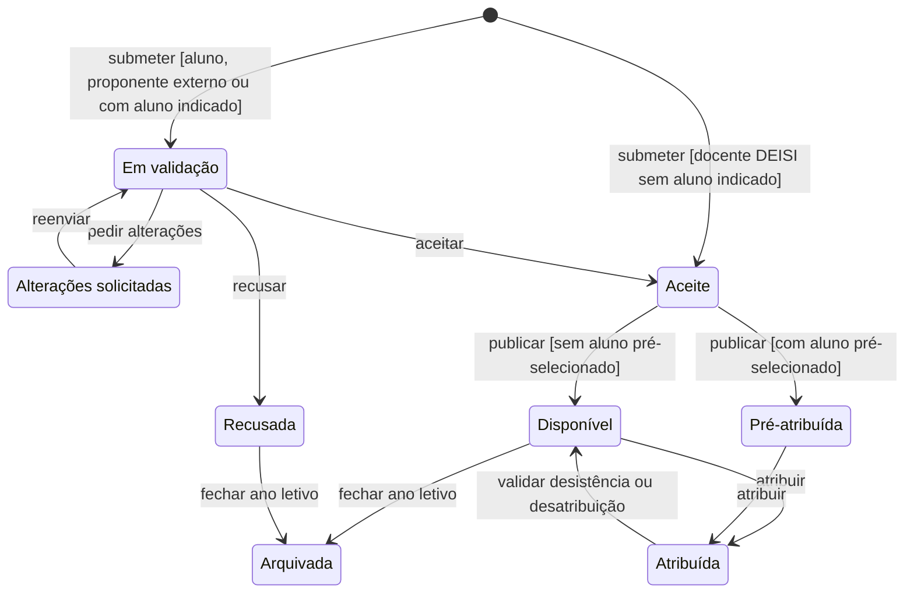
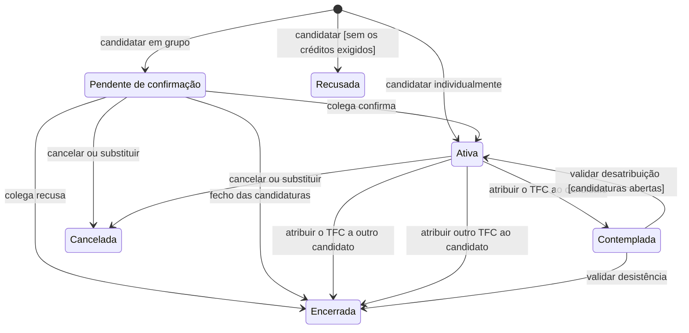
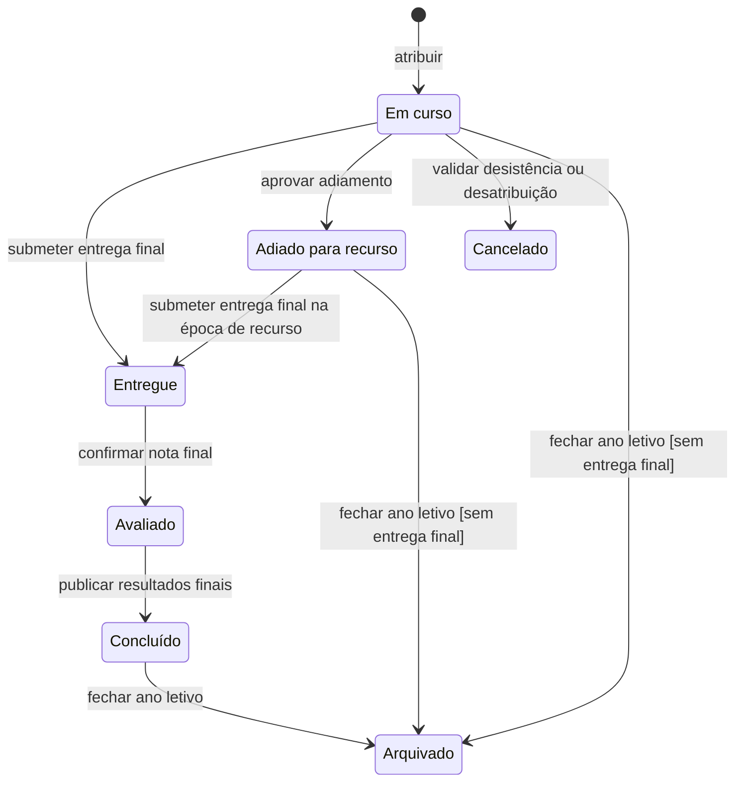
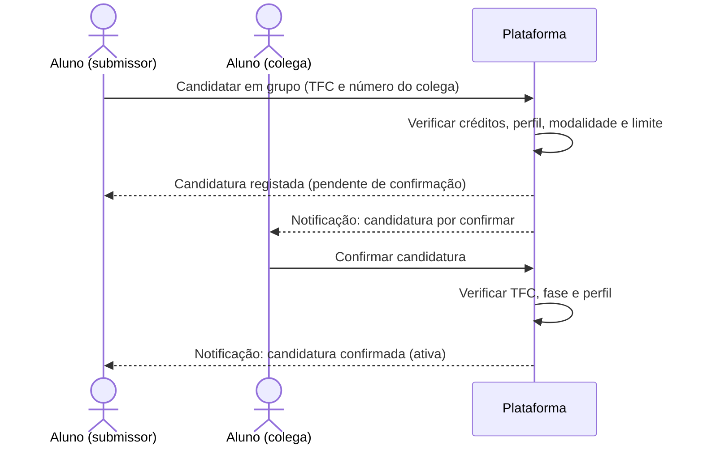
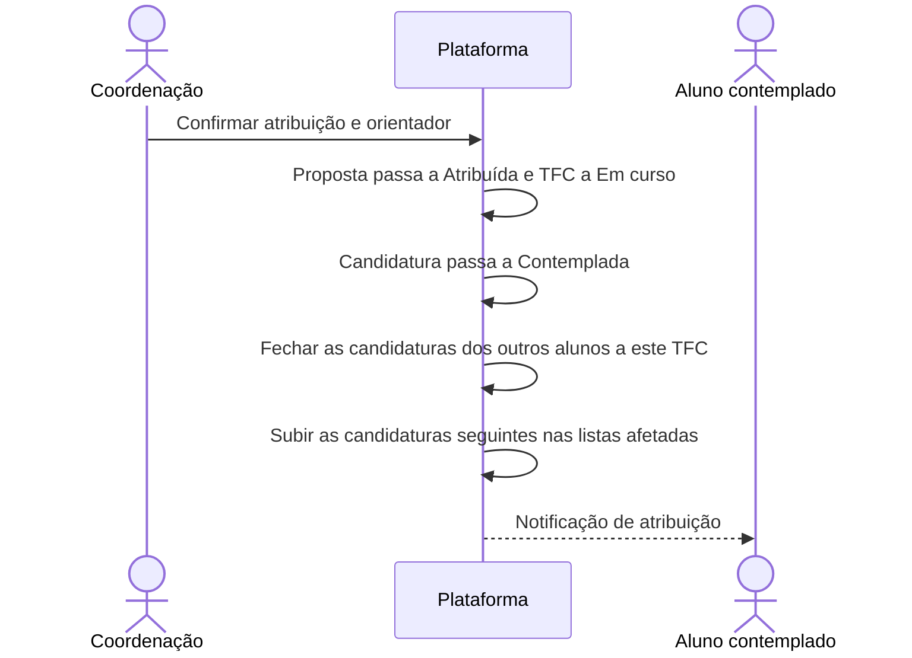
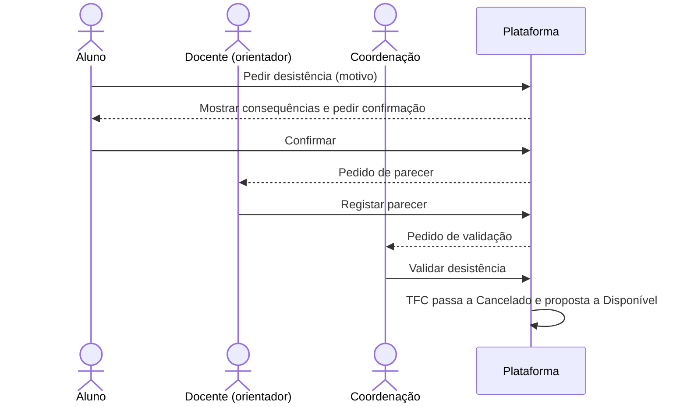
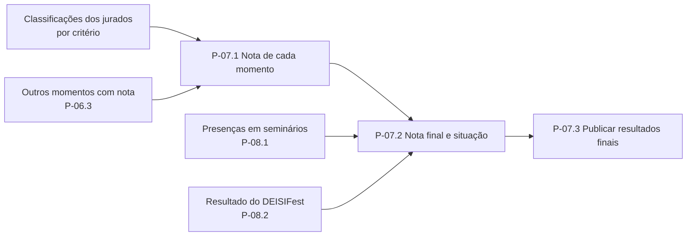

> **Aviso:** documento elaborado com apoio de IA generativa (Claude, Anthropic). A utilização, os prompts, as fontes e a revisão estão descritos em [04_utilizacao_de_ia.md](04_utilizacao_de_ia.md).

# 02 — Macro-processos e processos

Este documento descreve os processos da plataforma de gestão de TFC que se pretende construir. Segue o método de ERT em três níveis: macro-processos (macro), processos (mezzo) e descrição detalhada de cada processo (micro). Os macro-processos seguem a ordem do ano letivo e, dentro de cada um, os processos seguem a ordem em que são executados.

Cada regra indica a sua fonte: o regulamento de TFC 2026/27 [1], as reuniões com o orientador ou as respostas do orientador por email.

## 1. Atores

| Ator | Descrição |
|---|---|
| Aluno | Aluno inscrito na UC de TFC. Faz o TFC individualmente ou em grupo de 2. |
| Docente | Docente do DEISI. Em cada TFC pode ser proponente, orientador, coorientador ou jurado. É sempre o mesmo ator, com funções diferentes. |
| Empresa ou instituição | Entidade externa que propõe TFC. Pode indicar um coorientador. |
| Outro departamento | Docente de outro departamento da universidade que propõe TFC. Pode ser coorientador. |
| Coordenação | Coordenação de TFC. |
| Organização de seminários | Regista as presenças nos seminários. |
| Administrador | Gestão técnica da plataforma. |

Empresas e outros departamentos têm formulários de proposta diferentes (P-02.1). Quando um processo se aplica aos dois, usa-se o termo **proponente externo**.

Funções do docente num TFC:

| Função | Descrição |
|---|---|
| Proponente | Propõe o tema do TFC. |
| Orientador | Orienta o TFC. É nomeado para cada TFC. |
| Coorientador | Apoia a orientação. Pode ser externo. |
| Jurado | Avalia o TFC. Nas avaliações intercalares não pode ser o orientador do trabalho. |

O que cada utilizador pode fazer depende do perfil da conta e da função que tem em cada TFC: um docente pode ser proponente num TFC, orientador noutro e jurado noutro.

O sistema não é um ator. A plataforma executa as regras automáticas (prazos, validações, cálculos e notificações) descritas nos fluxos e aparece como «Plataforma» nos diagramas de sequência.

## 2. Macro-processos

| ID | Macro-processo | Objetivo | Atores principais |
|---|---|---|---|
| MP-01 | Configuração do ano letivo | Preparar o ano letivo (prazos, utilizadores e cursos) e fechá-lo no fim, sem alterar a plataforma | Coordenação, Administrador |
| MP-02 | Gestão de propostas | Só disponibilizar temas validados e com esforço adequado | Docente, Aluno, Proponente externo, Coordenação |
| MP-03 | Candidatura e atribuição | Atribuir os TFC aos alunos de forma justa, transparente e dentro dos prazos | Aluno, Docente, Proponente externo, Coordenação |
| MP-04 | Acompanhamento do TFC | Registar a evolução e as alterações ao longo do ano | Aluno, Docente (orientador) |
| MP-05 | Submissão de entregáveis | Receber entregas completas, validadas pelo orientador e dentro do prazo | Aluno, Docente (orientador) |
| MP-06 | Avaliação | Definir os momentos, os critérios e os prazos de avaliação e obter avaliações individuais e rastreáveis | Docente (jurado), Coordenação |
| MP-07 | Apuramento de resultados | Calcular e publicar a nota de cada momento e a nota final de forma automática e auditável | Coordenação |
| MP-08 | Seminários e DEISIFest | Registar a participação em atividades que não são entregas | Organização de seminários, Coordenação |
| MP-09 | Consulta e notificações | Dar a cada perfil a informação de que precisa | Todos |

## 3. Processos (nível mezzo)

### MP-01 — Configuração do ano letivo

| ID | Processo | Ator | Descrição |
|---|---|---|---|
| P-01.1 | Definir calendário | Coordenação | Registar as fases do ano (propostas, candidaturas, lista final, entregas e defesas) com início e fim. A plataforma abre e fecha as funcionalidades conforme as datas. |
| P-01.2 | Gerir utilizadores e perfis | Coordenação, Administrador | Registar os alunos inscritos na UC (número, curso, ECTS e UCs concluídas), os docentes (ativos ou inativos) e as entidades externas, e atribuir perfis. |
| P-01.3 | Gerir cursos e grupos de cursos | Coordenação | Manter a tabela de cursos (por exemplo LEI, LIG e LCD) e de grupos de cursos (por exemplo "LEI + LIG") usada nas propostas e nos perfis de candidato. |
| P-01.4 | Fechar o ano letivo | Coordenação | Passar os TFC e as propostas do ano para o histórico. O histórico pode ser consultado, mas já não pode ser alterado. |

### MP-02 — Gestão de propostas

| ID | Processo | Ator | Descrição |
|---|---|---|---|
| P-02.1 | Submeter proposta | Docente, Aluno, Proponente externo | Propor um tema no formulário do seu tipo de proponente, indicando a modalidade, os cursos, as disciplinas, as tecnologias e o perfil de candidato ou os alunos pré-selecionados. |
| P-02.2 | Validar proposta | Coordenação | Aceitar, pedir alterações ou recusar uma proposta e nomear o orientador. |
| P-02.3 | Rever proposta | Docente, Aluno, Proponente externo | Alterar uma proposta depois de um pedido de alterações. |
| P-02.4 | Publicar proposta | Coordenação | Tornar uma proposta aceite visível para candidatura. |
| P-02.5 | Consultar propostas | Aluno, Docente, Proponente externo, Coordenação | Listar e filtrar as propostas e ver o detalhe. O proponente vê as suas propostas e o estado de cada uma. |
| P-02.6 | Alterar proposta disponível | Docente (proponente) | Alterar um TFC ainda não atribuído, desde que a alteração seja compatível com as candidaturas existentes. |

### MP-03 — Candidatura e atribuição

| ID | Processo | Ator | Descrição |
|---|---|---|---|
| P-03.1 | Submeter candidatura individual | Aluno | Candidatar-se a um TFC, que fica na última posição da lista de candidaturas. É recusada se o aluno não tiver os créditos exigidos. |
| P-03.2 | Submeter candidatura em grupo | Aluno (submissor) | Candidatar-se a um TFC com um colega. O submissor identifica os dois elementos e a candidatura fica pendente até o colega a confirmar. |
| P-03.3 | Confirmar candidatura em grupo | Aluno (colega) | O colega aceita ou recusa cada candidatura do grupo. |
| P-03.4 | Alterar a prioridade de uma candidatura | Aluno | Mudar a posição de uma candidatura na lista de candidaturas, dentro do prazo. |
| P-03.5 | Substituir o TFC de uma candidatura | Aluno | Trocar o TFC A pelo TFC B, mantendo a posição na lista, dentro do prazo. |
| P-03.6 | Cancelar candidatura | Aluno | Retirar uma candidatura da lista; as seguintes sobem uma posição. |
| P-03.7 | Selecionar candidatos | Docente (proponente), Proponente externo, Coordenação | Escolher o candidato de cada TFC quando há mais do que um. |
| P-03.8 | Juntar alunos num TFC | Docente (proponente ou orientador), Coordenação | O docente propõe que dois alunos façam em grupo um TFC que aceita grupos. Os alunos aceitam, a coordenação valida e o TFC é atribuído ao grupo. |
| P-03.9 | Atribuir TFC e orientador | Coordenação | Atribuir o TFC ao aluno ou ao grupo e nomear o orientador e o coorientador. |
| P-03.10 | Atualizar as listas de candidaturas após a atribuição | Coordenação (desencadeado por P-03.9) | Retirar o TFC atribuído das listas dos outros candidatos e subir as candidaturas seguintes. |
| P-03.11 | Publicar atribuições | Coordenação | Publicar a lista final de TFC atribuídos e dos orientadores. |
| P-03.12 | Registar desistência | Aluno, Docente (orientador), Coordenação | Registar a desistência de um aluno e libertar o TFC. |
| P-03.13 | Desatribuir TFC | Docente (orientador), Coordenação | O orientador desfaz a atribuição de um TFC e a coordenação valida. |

### MP-04 — Acompanhamento do TFC

| ID | Processo | Ator | Descrição |
|---|---|---|---|
| P-04.1 | Registar repositório e atividades | Aluno, Docente (orientador) | Associar o link do repositório Git e registar atividades e reuniões. |
| P-04.2 | Dissociar grupo | Docente (orientador), Coordenação | Separar um grupo quando não há equilíbrio de esforço. As avaliações já feitas não se repetem. |
| P-04.3 | Pedir adiamento para a época de recurso | Aluno, Docente (orientador), Coordenação | Adiar a entrega final para a época de recurso, com parecer favorável do orientador. |

### MP-05 — Submissão de entregáveis

| ID | Processo | Ator | Descrição |
|---|---|---|---|
| P-05.1 | Enviar relatório ao orientador | Aluno | Carregar o relatório em PDF na plataforma, com a antecedência mínima. Cada ficheiro enviado substitui o anterior. |
| P-05.2 | Validar relatório | Docente (orientador) | Aceitar ou devolver o relatório, na plataforma. O relatório só fica entregue quando o orientador o aceita. |
| P-05.3 | Submeter entrega | Aluno | Indicar os links dos restantes entregáveis de um momento de avaliação (repositório, vídeo e versão operacional), até ao prazo de entrega. |

### MP-06 — Avaliação

| ID | Processo | Ator | Descrição |
|---|---|---|---|
| P-06.1 | Definir momentos de avaliação | Coordenação | Definir cada momento de avaliação do ano (por exemplo AI1, AI2, avaliação final e DEISIFest), com as datas, o peso na nota final e o mecanismo de avaliação. |
| P-06.2 | Definir critérios de avaliação | Coordenação | Definir os critérios de cada momento avaliado por júri e o peso de cada critério. |
| P-06.3 | Definir outro momento de avaliação | Coordenação | Acrescentar um momento que não está no modelo base (por exemplo um seminário de presença obrigatória, uma apresentação ou uma avaliação adicional), que conta para a nota final ou para um momento específico. |
| P-06.4 | Constituir júri | Coordenação | Definir o júri de cada TFC em cada momento. |
| P-06.5 | Agendar defesas | Coordenação | Marcar e publicar as defesas finais com pelo menos 48 h de antecedência. |
| P-06.6 | Preencher formulário de avaliação | Docente (jurado) | Classificar cada critério e escrever a apreciação, até ao prazo de avaliação. |
| P-06.7 | Publicar resultados intercalares | Coordenação | Disponibilizar aos alunos as notas e as apreciações de uma avaliação intercalar. |

### MP-07 — Apuramento de resultados

| ID | Processo | Ator | Descrição |
|---|---|---|---|
| P-07.1 | Calcular a nota de cada momento | Coordenação | Calcular a nota de cada momento a partir das classificações dos jurados por critério. |
| P-07.2 | Calcular a nota final e a situação | Coordenação | Combinar as notas dos momentos com os seus pesos e determinar se o aluno fica aprovado, reprovado ou excluído. |
| P-07.3 | Publicar resultados finais | Coordenação | Disponibilizar aos alunos e aos orientadores a nota final e a situação. |

### MP-08 — Seminários e DEISIFest

| ID | Processo | Ator | Descrição |
|---|---|---|---|
| P-08.1 | Registar presenças em seminários | Organização de seminários, Coordenação | Registar as presenças de cada aluno nos seminários definidos como momentos de avaliação (P-06.3). |
| P-08.2 | Registar resultado do DEISIFest | Coordenação | Registar a média das votações de cada trabalho. |

### MP-09 — Consulta e notificações

| ID | Processo | Ator | Descrição |
|---|---|---|---|
| P-09.1 | Consultar estado do TFC | Aluno, Docente (orientador) | Ver o TFC, os prazos, o estado das entregas e o que está por fazer. |
| P-09.2 | Consultar avaliações | Aluno, Docente (orientador) | Ver as notas e as apreciações de cada momento. O orientador vê sempre as avaliações dos TFC que orienta, incluindo as dos anos anteriores. |
| P-09.3 | Consultar relatórios de gestão | Coordenação | Ver propostas, candidaturas (incluindo as recusadas por falta de créditos), alunos sem TFC, entregas em atraso e avaliações por lançar. |
| P-09.4 | Receber notificações | Todos | Receber avisos na plataforma e por email dos eventos relevantes. As notificações são um subsistema, detalhado na arquitetura da aplicação. |

## 4. Estados

Os estados da proposta, da candidatura e do TFC são descritos como máquinas de estados. Cada transição tem o nome do evento que a provoca e, entre parênteses retos, a condição, quando existe. As fichas da secção 5 indicam em que estado fica cada objeto no fim de cada processo.

### 4.1 Proposta

| Estado | Significado |
|---|---|
| Em validação | Submetida e à espera da decisão da coordenação. |
| Alterações solicitadas | A coordenação pediu alterações ao proponente. |
| Aceite | Validada, mas ainda não visível para candidatura. |
| Recusada | Não foi aceite. |
| Disponível | Visível para candidatura por todos os alunos que cumprem o perfil. |
| Pré-atribuída | Só é visível para os alunos pré-selecionados, que têm de fazer a candidatura. |
| Atribuída | Atribuída a um aluno ou grupo. A partir daqui o trabalho segue a máquina de estados do TFC (4.3). |
| Arquivada | Passou para o histórico no fecho do ano letivo. |

### 4.2 Candidatura

| Estado | Significado | Está na lista de candidaturas? |
|---|---|---|
| Pendente de confirmação | Candidatura em grupo à espera da confirmação do colega. | Sim, com aviso |
| Ativa | Válida e a concorrer. | Sim |
| Recusada | Não foi aceite porque o aluno não tem os créditos exigidos. | Não (fica no registo da coordenação) |
| Contemplada | O TFC foi atribuído a este aluno ou grupo. | Não (passa a ser o seu TFC) |
| Encerrada | Terminou sem atribuição. O motivo fica registado: TFC atribuído a outro, aluno já contemplado, recusada pelo colega, sem confirmação a tempo ou desistência. | Não (fica no histórico) |
| Cancelada | Retirada ou substituída pelo aluno. | Não (fica no histórico) |

A lista de candidaturas tem as candidaturas pendentes e ativas, com prioridade de 1 a n, sem lacunas. Sempre que uma candidatura sai da lista, as seguintes sobem uma posição.

### 4.3 TFC

O TFC começa quando a proposta é atribuída.

| Estado | Significado |
|---|---|
| Em curso | O aluno está a desenvolver o trabalho e faz as entregas intercalares. |
| Adiado para recurso | A entrega final passou para a época de recurso. |
| Entregue | A entrega final foi submetida e aguarda a defesa e a avaliação. |
| Avaliado | A nota final e a situação foram calculadas e confirmadas pela coordenação. |
| Concluído | Os resultados finais foram publicados. |
| Cancelado | O TFC terminou por desistência ou desatribuição. |
| Arquivado | Passou para o histórico no fecho do ano letivo. |

## 5. Descrição detalhada (nível micro)

Cada ficha tem o ator, o evento que inicia o processo, as pré-condições, o fluxo, as alternativas e exceções, as pós-condições (o que se pode observar no fim do processo) e as regras com a respetiva fonte.

Os processos de MP-04 e MP-08, a constituição do júri (P-06.4), o agendamento das defesas (P-06.5) e os processos de consulta e notificações (P-09.1, P-09.3 e P-09.4) ficam descritos apenas no nível mezzo (secção 3).

### 5.1 MP-01 — Configuração do ano letivo

**P-01.1 Definir calendário** — *Coordenação*
- **Evento:** preparação de um novo ano letivo.
- **Pré-condições:** utilizador com perfil Coordenação.
- **Fluxo:**
  1. A coordenação cria as fases do ano (propostas, candidaturas, lista final, entregas e defesas) com início e fim.
  2. A plataforma verifica se as datas são coerentes (por exemplo, o fim de uma fase não pode ser anterior ao início).
  3. A coordenação publica o calendário.
- **Exceções:** datas incoerentes → a plataforma indica o erro e não publica; alterar uma data quando já há submissões nessa fase → pede confirmação e regista a alteração.
- **Pós-condições:** o calendário fica publicado e visível para todos os utilizadores; cada funcionalidade só está disponível dentro da sua fase (por exemplo, fora da fase de candidaturas não é possível candidatar-se).
- **Regras:** as datas de 2026/27 são as do regulamento [1] (Anexo A deste documento) e podem ser alteradas pela coordenação; a plataforma verifica sempre as datas do lado do servidor.

**P-01.2 Gerir utilizadores e perfis** — *Coordenação, Administrador*
- **Evento:** início do ano letivo ou entrada de um novo utilizador.
- **Pré-condições:** utilizador com perfil Coordenação ou Administrador.
- **Dados:** alunos (número, curso, ECTS e UCs concluídas); docentes (nome e estado: ativo ou inativo); empresas e instituições; outros departamentos; perfil de cada utilizador.
- **Fluxo:**
  1. A coordenação ou o administrador regista ou importa os utilizadores.
  2. Atribui o perfil de cada um.
  3. Indica, para cada docente, se está ativo (a trabalhar com TFC) ou inativo.
  4. A plataforma verifica se há duplicados e guarda.
- **Exceções:** utilizador duplicado → os registos são fundidos.
- **Pós-condições:** cada utilizador consegue entrar na plataforma com o perfil atribuído; os alunos com menos de 90 ECTS aparecem como não elegíveis para candidaturas.
- **Regras:** só os docentes ativos aparecem nas listas de escolha de proponente, orientador, coorientador e jurado; os docentes inativos mantêm o histórico (Reunião 5, 28/10).

**P-01.3 Gerir cursos e grupos de cursos** — *Coordenação*
- **Evento:** preparação do ano letivo ou criação de um curso.
- **Pré-condições:** utilizador com perfil Coordenação.
- **Dados:** curso (código e nome, por exemplo LEI, LIG e LCD); grupo de cursos (por exemplo "LEI + LIG"); cursos de cada grupo.
- **Fluxo:**
  1. A coordenação cria ou edita os cursos e os grupos de cursos.
  2. Associa cada curso aos seus grupos.
- **Pós-condições:** os cursos e os grupos aparecem como caixas de verificação no formulário de proposta (P-02.1) e no perfil do candidato.
- **Regras:** um curso ou grupo desativado deixa de aparecer nas novas propostas, mas mantém-se nas propostas antigas (Reunião 5, 28/10).

**P-01.4 Fechar o ano letivo** — *Coordenação*
- **Evento:** fim do ano letivo, depois da publicação dos resultados finais da última época (P-07.3).
- **Pré-condições:** utilizador com perfil Coordenação; resultados finais publicados em todas as épocas.
- **Fluxo:**
  1. A coordenação pede para fechar o ano letivo.
  2. A plataforma mostra o que ainda está pendente (por exemplo, avaliações por lançar ou TFC sem situação definida).
  3. A coordenação confirma.
  4. A plataforma passa os TFC e as propostas do ano para o histórico.
- **Exceções:** existem pendências → a plataforma avisa e a coordenação decide se fecha o ano na mesma.
- **Pós-condições:** o ano letivo fica fechado; os TFC ficam no estado Arquivado e as propostas não atribuídas no estado Arquivada; os dados do ano podem ser consultados, mas não alterados.
- **Regras:** a plataforma guarda os dados de todos os anos letivos (Reunião 5, 28/10); o fecho do ano letivo passa os dados para um histórico consultável (Reunião 6, 04/11).

### 5.2 MP-02 — Gestão de propostas

**P-02.1 Submeter proposta** — *Docente, Aluno, Proponente externo*
- **Evento:** o proponente quer propor um tema.
- **Pré-condições:** utilizador autenticado; fase de propostas do seu tipo de proponente aberta; se for aluno, inscrito na UC.
- **Dados:** título, descrição, empresa ou instituição, orientador sugerido (só docentes ativos), modalidade (individual, em grupo, ou individual ou em grupo), cursos escolhidos por caixas de verificação (P-01.3), disciplinas e tecnologias; alunos pré-selecionados ou perfil do candidato (curso e UCs concluídas ou em curso); 2.º aluno, se a modalidade for em grupo.
- **Fluxo:**
  1. O proponente abre o formulário do seu tipo (docente, aluno, empresa ou outro departamento).
  2. Preenche os dados e indica a modalidade.
  3. A plataforma verifica os campos obrigatórios.
  4. A plataforma regista a proposta.
- **Exceções:** fase de propostas fechada → formulário indisponível; sem perfil de candidato nem alunos pré-selecionados → não submete; proposta individual com 2.º aluno → não submete; 2.º aluno já indicado noutra proposta em grupo → não submete.
- **Pós-condições:** proposta de docente DEISI sem aluno indicado → estado Aceite; restantes propostas → estado Em validação; a coordenação é notificada.
- **Regras:** as propostas de docentes são aceites sem validação, exceto se tiverem aluno indicado (regulamento [1], cap. 3); um aluno pode submeter várias propostas e a proposta em grupo é submetida por um só elemento (cap. 3); o orientador indicado pelo aluno tem de ter dado acordo prévio (cap. 3); empresas e outros departamentos têm formulários diferentes e podem indicar um coorientador (Reunião 6, 04/11). A modalidade é vinculativa: um TFC individual só aceita candidaturas individuais, um TFC em grupo só aceita candidaturas em grupo e um TFC individual ou em grupo aceita as duas (orientador, email de 01/11).

**P-02.2 Validar proposta** — *Coordenação*
- **Evento:** existe uma proposta em validação.
- **Pré-condições:** proposta no estado Em validação.
- **Fluxo:**
  1. A coordenação abre a lista de propostas por validar.
  2. Analisa o tema, o esforço, o enquadramento e a disponibilidade do orientador.
  3. Aceita, pede alterações (com mensagem) ou recusa (com justificação obrigatória).
  4. Se aceitar, pode acrescentar tarefas ou requisitos e nomeia o orientador e o coorientador.
- **Pós-condições:** a proposta fica Aceite, Alterações solicitadas ou Recusada; a mudança de estado fica no histórico da proposta; o proponente é notificado.
- **Regras:** nas propostas de empresas e de outros departamentos, a coordenação nomeia o orientador de acordo com a área científica e pode substituir o orientador sugerido (cap. 2 e 3); a plataforma avisa quando um orientador passa as 5 orientações sugeridas, mas não bloqueia.

**P-02.3 Rever proposta** — *Docente, Aluno, Proponente externo*
- **Evento:** a coordenação pediu alterações.
- **Pré-condições:** proposta no estado Alterações solicitadas; fase de propostas aberta.
- **Fluxo:**
  1. O proponente lê o pedido da coordenação.
  2. Edita a proposta.
  3. Reenvia.
- **Exceções:** fase de propostas fechada → a proposta só pode ser consultada.
- **Pós-condições:** a proposta volta ao estado Em validação e a coordenação é notificada.

**P-02.4 Publicar proposta** — *Coordenação*
- **Evento:** abertura da fase de candidaturas, ou aceitação de uma proposta durante essa fase.
- **Pré-condições:** proposta no estado Aceite.
- **Fluxo:**
  1. A coordenação escolhe as propostas aceites a publicar (pode publicar todas de uma vez).
  2. Confirma a publicação.
- **Pós-condições:** proposta sem aluno pré-selecionado → estado Disponível, visível para todos os alunos na lista de propostas; proposta com aluno pré-selecionado → estado Pré-atribuída, visível apenas para os alunos pré-selecionados; o proponente é notificado.
- **Regras:** "aceite" e "disponível" são estados diferentes porque há um evento entre eles, a publicação (Reunião 6, 04/11); mesmo com pré-seleção, o aluno tem de fazer a candidatura na plataforma (cap. 3).

**P-02.5 Consultar propostas** — *Aluno, Docente, Proponente externo, Coordenação*
- **Evento:** o utilizador quer ver as propostas.
- **Pré-condições:** utilizador autenticado.
- **Fluxo:**
  1. A lista mostra o ID, o título e o orientador e coorientador de cada proposta, com pesquisa por orientador e filtro por modalidade.
  2. O utilizador abre uma proposta e vê a empresa, o orientador, o título, a descrição, a modalidade, o estado, os cursos, as disciplinas e as tecnologias.
- **Pós-condições:** nenhum dado é alterado.
- **Regras:** o aluno vê as propostas disponíveis e, se for pré-selecionado, a sua proposta pré-atribuída; o proponente vê as suas propostas em todos os estados.

**P-02.6 Alterar proposta disponível** — *Docente (proponente)*
- **Evento:** o docente quer alterar uma proposta já publicada.
- **Pré-condições:** proposta no estado Disponível ou Pré-atribuída.
- **Fluxo:**
  1. O docente abre a proposta e altera os dados (por exemplo, a descrição, os cursos ou a modalidade).
  2. A plataforma verifica se a alteração é compatível com as candidaturas existentes.
  3. A plataforma guarda a alteração.
- **Exceções:** mudar para a modalidade em grupo quando já há candidaturas individuais → não guarda; mudar para a modalidade individual quando já há candidaturas em grupo → não guarda.
- **Pós-condições:** a proposta fica com os novos dados e mantém o estado; os candidatos são notificados da alteração.
- **Regras:** o docente pode alterar tudo num TFC ainda não atribuído, desde que a alteração seja compatível com as candidaturas existentes; mudar para individual ou em grupo é sempre possível (orientador, email de 01/11).

### 5.3 MP-03 — Candidatura e atribuição

**P-03.1 Submeter candidatura individual** — *Aluno*
- **Evento:** o aluno escolhe um TFC e pede para se candidatar.
- **Pré-condições:** aluno inscrito na UC; fase de candidaturas aberta; TFC no estado Disponível com modalidade individual ou individual ou em grupo, ou Pré-atribuída se o aluno for o pré-selecionado; o aluno ainda não atingiu o limite de candidaturas nem tem candidatura a esse TFC.
- **Fluxo:**
  1. O aluno abre o detalhe do TFC, que mostra o número de candidaturas atuais.
  2. Carrega em **Candidatar**.
  3. A plataforma verifica os créditos e o perfil do aluno.
  4. A plataforma regista a candidatura.
- **Alternativa — sem créditos:** no passo 3, se o aluno não tiver os créditos mínimos, a plataforma mostra a mensagem "não reúne os créditos mínimos exigidos para se candidatar a um TFC" e regista a candidatura como Recusada (aluno, TFC, data e motivo).
- **Exceções:** limite de candidaturas atingido → botão desativado, com a mensagem "retire uma candidatura de outro TFC"; TFC só para grupos → mensagem "este TFC é para grupos de 2 e não aceita candidaturas individuais"; TFC atribuído entretanto → não regista.
- **Pós-condições:** a candidatura fica Ativa, na última posição da lista de candidaturas do aluno, com data e hora; no detalhe do TFC, o número de candidaturas aumenta um. Na alternativa, a candidatura fica Recusada, fora da lista, e aparece nos relatórios da coordenação (P-09.3).
- **Regras:** o aluno precisa de pelo menos 90 ECTS na data de referência (cap. 4); candidata-se a 3 a 6 TFC por ordem de preferência (cap. 3 e 4), com o limite parametrizável; mesmo com pré-seleção, a candidatura é obrigatória, porque a atribuição formal é necessária para a avaliação (cap. 3).

**P-03.2 Submeter candidatura em grupo** — *Aluno (submissor)*
- **Evento:** o aluno escolhe um TFC e pede para se candidatar com um colega.
- **Pré-condições:** os dois alunos inscritos na UC; fase de candidaturas aberta; TFC no estado Disponível com modalidade em grupo ou individual ou em grupo; nenhum dos dois alunos está num grupo com outro colega; o limite de candidaturas do grupo ainda não foi atingido.
- **Fluxo:**
  1. O submissor abre o detalhe do TFC.
  2. Carrega em **Candidatar em grupo**.
  3. Indica o número do colega. Nas candidaturas seguintes do grupo, o colega já vem preenchido.
  4. A plataforma verifica os créditos e o perfil dos dois alunos, a modalidade do TFC, o limite e se já existe candidatura do grupo a esse TFC.
  5. A plataforma regista a candidatura e notifica o colega (P-03.3).
- **Exceções:** TFC individual → mensagem "este TFC é individual e não aceita grupos"; um dos alunos sem os créditos exigidos → candidatura Recusada, como em P-03.1; o colega já está num grupo com outro aluno → não regista.
- **Pós-condições:** a candidatura fica Pendente de confirmação, na última posição da lista de candidaturas do grupo, com data e hora; o colega vê a candidatura por confirmar; enquanto estiver pendente, a candidatura não entra na seleção.
- **Regras:** cada aluno só pode estar num grupo (cap. 4); o aluno que submete identifica os dois elementos do grupo e só ele cria e altera as candidaturas do grupo; o colega consulta a lista e confirma cada candidatura (Reunião 6, 04/11).

**P-03.3 Confirmar candidatura em grupo** — *Aluno (colega)*
- **Evento:** o colega recebe a notificação de uma candidatura por confirmar.
- **Pré-condições:** candidatura no estado Pendente de confirmação; fase de candidaturas aberta.
- **Fluxo:**
  1. O colega abre a candidatura e o detalhe do TFC.
  2. Carrega em **Confirmar** ou em **Recusar**.
  3. Se confirmar, a plataforma verifica de novo se o TFC está disponível e se o colega cumpre o perfil.
- **Alternativas:** o colega recusa → a candidatura sai da lista e as seguintes sobem uma posição; o colega não responde até ao fim da fase de candidaturas → a candidatura fecha sem confirmação.
- **Pós-condições:** se confirmar, a candidatura fica Ativa na mesma posição e o submissor é notificado; se recusar ou não responder, fica Encerrada, com o motivo registado.
- **Regras:** o colega confirma cada candidatura do grupo, uma a uma, e pode aceitar umas e recusar outras (decisão da equipa depois da Reunião 6, 04/11); só o colega pode confirmar.

**Sequência: candidatura em grupo**

**P-03.4 Alterar a prioridade de uma candidatura** — *Aluno (submissor, se for grupo)*
- **Evento:** o aluno quer mudar a ordem das suas candidaturas.
- **Pré-condições:** fase de candidaturas aberta; candidatura Ativa ou Pendente de confirmação.
- **Fluxo:**
  1. O aluno abre a lista de candidaturas (ID, título, orientador e prioridade).
  2. Sobe ou desce uma candidatura.
  3. A plataforma renumera a lista.
- **Exceções:** fase de candidaturas fechada → a lista só pode ser consultada.
- **Pós-condições:** a lista fica com a nova ordem, de 1 a n e sem lacunas; a posição anterior e a nova ficam registadas; a data e a hora da candidatura não mudam.
- **Regras:** num grupo, só o submissor altera a ordem; o colega consulta.

**P-03.5 Substituir o TFC de uma candidatura** — *Aluno (submissor, se for grupo)*
- **Evento:** o aluno quer trocar o TFC A pelo TFC B sem perder a posição.
- **Pré-condições:** candidatura ao TFC A Ativa ou Pendente de confirmação; fase de candidaturas aberta; TFC B Disponível.
- **Fluxo:**
  1. Na lista de candidaturas, o aluno escolhe a candidatura ao TFC A e carrega em **Substituir**.
  2. Escolhe o TFC B.
  3. A plataforma verifica o TFC B (créditos, perfil, disponibilidade, modalidade e se já está na lista).
  4. A plataforma regista a troca.
- **Exceções:** TFC B já está na lista, indisponível ou atribuído → não troca e mantém o TFC A; fase fechada → só consulta.
- **Pós-condições:** a candidatura ao TFC A fica Cancelada (substituída); a candidatura ao TFC B fica na mesma posição, com a data e a hora da troca, Ativa se for individual ou Pendente de confirmação se for em grupo; o número de candidaturas não muda.
- **Regras:** só durante a fase de candidaturas; um TFC atribuído não pode ser trocado sem ser primeiro desatribuído (P-03.13) (orientador, email de 01/11). Ver a questão 2 da secção 6.

**P-03.6 Cancelar candidatura** — *Aluno (submissor, se for grupo)*
- **Evento:** o aluno quer retirar uma candidatura.
- **Pré-condições:** fase de candidaturas aberta; candidatura Ativa ou Pendente de confirmação.
- **Fluxo:**
  1. Na lista de candidaturas, o aluno escolhe a candidatura e carrega em **Cancelar**.
  2. A plataforma pede confirmação.
  3. O aluno confirma.
- **Exceções:** fase fechada → não cancela.
- **Pós-condições:** a candidatura fica Cancelada, sai da lista e fica no histórico; as seguintes sobem uma posição; se ficarem menos de 3 candidaturas, o aluno vê um aviso na lista.
- **Regras:** num grupo, só o submissor cancela; o número mínimo de 3 candidaturas é verificado no fim da fase (cap. 3).

**P-03.7 Selecionar candidatos** — *Docente (proponente), Proponente externo, Coordenação*
- **Evento:** fim da fase de candidaturas.
- **Pré-condições:** TFC com pelo menos um candidato com candidatura Ativa (as pendentes não entram).
- **Fluxo:**
  1. A plataforma mostra os candidatos de cada TFC com a média, as notas nas UCs do perfil, a prioridade dada ao TFC e a data da candidatura.
  2. Se o TFC tem proponente, o proponente escolhe o candidato (pode entrevistá-los fora da plataforma). Se não tem, a plataforma ordena os candidatos pelos resultados nas UCs do perfil e, em caso de empate, pela data da candidatura.
  3. A plataforma mostra uma simulação das atribuições, sem as gravar.
  4. A coordenação revê, ajusta se for preciso (com justificação) e confirma.
- **Exceções:** TFC sem candidatos → continua Disponível; aluno sem TFC no fim → atribuição pela coordenação, com justificação.
- **Pós-condições:** cada TFC com candidatos tem um candidato selecionado e confirmado, o que desencadeia a atribuição (P-03.9); as ordenações e os ajustes ficam registados.
- **Regras:** para um aluno com tema próprio e com candidaturas, a ordem é: (1) candidaturas a temas de docentes ou empresas, pela ordem do aluno, (2) temas de docentes ou empresas que se sobreponham ao tema próprio, (3) o tema próprio (cap. 4).

**P-03.8 Juntar alunos num TFC** — *Docente (proponente ou orientador), Coordenação*
- **Evento:** o docente identifica dois alunos que podem fazer juntos um TFC (por exemplo, dois candidatos individuais ao mesmo TFC ou dois alunos sem TFC no fim da seleção).
- **Pré-condições:** TFC Disponível com modalidade em grupo ou individual ou em grupo; os dois alunos sem TFC atribuído, sem grupo e com os créditos exigidos.
- **Fluxo:**
  1. O docente vê os candidatos individuais do TFC e os alunos sem TFC.
  2. Escolhe dois alunos e carrega em **Juntar**.
  3. A plataforma verifica a modalidade, os créditos e o perfil e notifica os dois alunos e a coordenação.
  4. Os dois alunos aceitam.
  5. A coordenação valida.
- **Alternativas:** um dos alunos recusa ou a coordenação não valida → o grupo não se forma e os alunos mantêm as suas candidaturas.
- **Exceções:** TFC com modalidade individual → não junta (o docente pode antes mudar a modalidade, P-02.6); um dos alunos já está num grupo → não junta.
- **Pós-condições:** existe um grupo com os dois alunos; as candidaturas anteriores de ambos ficam Encerradas; o TFC é atribuído ao grupo (P-03.9) sem passar pela lista de candidaturas.
- **Regras:** os dois alunos têm de aceitar (orientador, email de 01/11); o grupo tem 2 alunos e cada aluno só pode estar num grupo (cap. 4).

**P-03.9 Atribuir TFC e orientador** — *Coordenação*
- **Evento:** seleção confirmada (P-03.7), grupo formado pelo docente (P-03.8) ou candidatura de um aluno pré-selecionado.
- **Pré-condições:** proposta Disponível ou Pré-atribuída; aluno ou grupo sem TFC atribuído.
- **Fluxo:**
  1. A plataforma propõe a atribuição e o orientador sugerido na proposta.
  2. A coordenação confirma ou nomeia outro orientador e o coorientador (só docentes ativos).
  3. A plataforma regista a atribuição e atualiza as listas dos outros candidatos (P-03.10).
- **Exceções:** aluno pré-selecionado sem os créditos exigidos → alerta à coordenação; aluno pré-selecionado em dois TFC → decide a coordenação; orientador com mais de 5 orientações → aviso, sem bloquear.
- **Pós-condições:** a proposta fica Atribuída e o TFC fica Em curso; a candidatura do aluno fica Contemplada e as restantes candidaturas dele ficam Encerradas (aluno já contemplado); o orientador e o coorientador ficam associados ao TFC; o aluno, o orientador e o coorientador são notificados.
- **Regras:** cada aluno só pode ter um TFC (cap. 4); a atribuição é automática quando o aluno pré-selecionado se candidata ou quando o aluno só tem tema próprio aceite (cap. 3 e 4); o aluno pode começar o trabalho logo que o TFC lhe é atribuído, mesmo antes da lista final (cap. 5).

**P-03.10 Atualizar as listas de candidaturas após a atribuição** — *Coordenação (desencadeado por P-03.9)*
- **Evento:** um TFC passa a Atribuída.
- **Pré-condições:** existem candidaturas de outros alunos a esse TFC, ativas ou pendentes.
- **Fluxo:**
  1. A plataforma encontra as candidaturas ao TFC atribuído feitas por outros alunos.
  2. Fecha cada uma, guardando a posição *k* que tinha.
  3. Em cada lista afetada, as candidaturas abaixo da posição *k* sobem uma posição.
- **Exemplo:** a lista de um aluno é 1 TFC A, 2 TFC B, 3 TFC C, 4 TFC D. O TFC B é atribuído a outro aluno. A lista passa a 1 TFC A, 2 TFC C, 3 TFC D.
- **Exceções:** falha a meio → nenhuma lista fica atualizada só em parte; o aluno estava a alterar a lista (P-03.4) → prevalece a atualização da plataforma e o aluno vê um aviso.
- **Pós-condições:** as candidaturas dos outros alunos a esse TFC ficam Encerradas (TFC atribuído a outro); cada lista afetada fica de 1 a n − 1, sem lacunas, com a mesma ordem relativa; a posição anterior e a nova ficam registadas.
- **Regras:** os outros candidatos não são notificados; veem a lista atualizada quando a abrem (Reunião 6, 04/11).

**Sequência: atribuição e atualização das listas**

**P-03.11 Publicar atribuições** — *Coordenação*
- **Evento:** data da lista final de atribuídos (P-01.1).
- **Pré-condições:** seleção concluída para todos os TFC com candidatos.
- **Fluxo:**
  1. A coordenação revê a lista final (TFC, alunos e orientador).
  2. Publica a lista.
- **Exceções:** correção depois da publicação → fica registada e os envolvidos são notificados.
- **Pós-condições:** a lista final fica visível para todos os alunos e docentes; os alunos atribuídos são notificados.

**P-03.12 Registar desistência** — *Aluno, Docente (orientador), Coordenação*
- **Evento:** o aluno pede para desistir do TFC.
- **Pré-condições:** TFC Em curso com o aluno associado.
- **Fluxo:**
  1. O aluno pede a desistência e indica o motivo.
  2. A plataforma mostra as consequências e pede confirmação.
  3. O orientador regista o seu parecer.
  4. A coordenação valida.
- **Alternativa (grupo):** se um elemento desiste e o outro quer continuar sozinho, o TFC mantém-se com o aluno que fica e o orientador ajusta o âmbito.
- **Pós-condições:** o TFC fica Cancelado e o histórico é guardado; a candidatura contemplada fica Encerrada (desistência); a proposta volta a Disponível; com a fase de candidaturas aberta, volta a aparecer na lista de propostas; com a fase fechada, só a coordenação a pode atribuir; o orientador, o coorientador, o proponente e a coordenação são notificados.
- **Regras:** as candidaturas antigas do aluno não são repostas; não são admitidos novos trabalhos depois da data-limite das candidaturas (cap. 1).

**Sequência: desistência**

**P-03.13 Desatribuir TFC** — *Docente (orientador), Coordenação*
- **Evento:** o orientador pede para desfazer a atribuição de um TFC.
- **Pré-condições:** TFC Em curso.
- **Fluxo:**
  1. O orientador pede a desatribuição e indica o motivo.
  2. A coordenação valida.
- **Exceções:** a coordenação não valida → a atribuição mantém-se.
- **Pós-condições:** o TFC fica Cancelado e o histórico é guardado; a proposta volta a Disponível; com a fase de candidaturas aberta, a candidatura do aluno volta a Ativa e pode ser alterada (P-03.4 a P-03.6); o aluno, o orientador e a coordenação são notificados.
- **Regras:** um TFC atribuído só pode ser alterado depois de ser desatribuído; a desatribuição é pedida pelo orientador e validada pela coordenação (orientador, email de 01/11). Ao contrário da desistência (P-03.12), não é pedida pelo aluno.

### 5.4 MP-05 — Submissão de entregáveis

**P-05.1 Enviar relatório ao orientador** — *Aluno*
- **Evento:** o aluno tem o relatório de um momento de avaliação pronto.
- **Pré-condições:** TFC Em curso; momento de avaliação definido (P-06.1); antes do prazo de entrega.
- **Fluxo:**
  1. O aluno carrega o relatório em PDF na plataforma.
  2. A plataforma verifica a antecedência em relação ao prazo de entrega.
  3. A plataforma guarda o ficheiro e apaga o que tinha sido enviado antes, se existir.
- **Exceções:** fora da antecedência mínima → aviso; o orientador pode recusar o relatório.
- **Pós-condições:** o relatório fica à espera de validação, com data e hora; só existe um ficheiro do relatório por momento, o último enviado; o orientador é notificado.
- **Regras:** a antecedência mínima é parametrizável e é, por defeito, de 1 semana (regulamento [1], cap. 1, ponto 13); as versões anteriores do relatório não são guardadas, e os ficheiros ficam numa pasta do servidor e não na base de dados (Reunião 7, 11/11).

**P-05.2 Validar relatório** — *Docente (orientador)*
- **Evento:** o orientador recebe um relatório para validar.
- **Pré-condições:** relatório à espera de validação (P-05.1).
- **Fluxo:**
  1. O orientador abre o relatório na plataforma.
  2. Aceita-o ou devolve-o com comentários.
- **Pós-condições:** relatório aceite → fica registado como entregue, com a data e o orientador que o aceitou, e a coordenação é informada; relatório devolvido → o aluno vê os comentários e pode enviar um novo ficheiro (P-05.1).
- **Regras:** só são aceites para avaliação os relatórios validados pelo orientador (cap. 5); a validação é feita na plataforma, e o relatório só está entregue quando o orientador o aceita (Reunião 7, 11/11).

**P-05.3 Submeter entrega** — *Aluno (qualquer elemento, se for grupo)*
- **Evento:** o aluno quer completar a entrega de um momento de avaliação.
- **Pré-condições:** relatório aceite pelo orientador (P-05.2); momento de avaliação aberto; antes do prazo de entrega.
- **Fluxo:**
  1. O aluno abre a entrega do momento (AI1, AI2 ou final) e vê o relatório aceite, a lista dos restantes entregáveis e o prazo.
  2. Indica os links (repositório Git e vídeo; na entrega final, também a versão operacional).
  3. A plataforma verifica os links.
  4. A plataforma guarda a entrega.
- **Exceções:** prazo de entrega ultrapassado → não submete e regista a falta; link de um canal em vez de um vídeo, ou link inacessível → alerta.
- **Pós-condições:** a entrega fica registada com data e hora; o orientador e a coordenação são notificados; na entrega final, o TFC passa a Entregue; depois do prazo de entrega, a entrega deixa de poder ser alterada, mas continua visível.
- **Regras:** entregáveis de cada momento — AI1: relatório e vídeo até 2 min; AI2: relatório, versão funcional no Git e vídeo até 5 min; final: relatório, texto de divulgação (máx. 10 linhas) e imagem, código-fonte no Git, versão operacional e vídeo até 5 min (cap. 5 e anexo D); o vídeo é indicado pelo link do vídeo, é público e não pode ser alterado até à nota final (anexo D); todos os relatórios incluem o inquérito sobre IA generativa (anexo E); num grupo, qualquer elemento pode submeter, sem validação do outro (orientador, email de 01/11); o prazo fecha as entregas, que continuam disponíveis para consulta (Reunião 6, 04/11).

### 5.5 MP-06 — Avaliação

**P-06.1 Definir momentos de avaliação** — *Coordenação*
- **Evento:** preparação do ano letivo.
- **Pré-condições:** utilizador com perfil Coordenação; ano letivo criado (P-01.1).
- **Dados de cada momento:** nome; prazo de entrega; prazo de avaliação; data de publicação dos resultados; peso na nota final; mecanismo de avaliação (júri com critérios, votação ou registo de presença).
- **Dados do modelo:** escala de classificação; diferença entre jurados a partir da qual é obrigatória uma justificação; majoração do orientador; regras de arredondamento.
- **Fluxo:**
  1. A coordenação cria os momentos de avaliação do ano.
  2. Indica os dados de cada momento.
  3. Indica os dados do modelo.
  4. A plataforma verifica se a soma dos pesos é 100% e ativa o modelo.
- **Exceções:** soma dos pesos diferente de 100% → não ativa; alterar um momento que já tem avaliações → cria uma nova versão do modelo, sem alterar as avaliações já feitas.
- **Pós-condições:** os momentos ficam no calendário de alunos e docentes; os prazos passam a ser aplicados na entrega (P-05.3) e na avaliação (P-06.6); cada avaliação fica associada à versão do modelo usada.
- **Regras:** em 2026/27: AI1 20%, AI2 20%, avaliação final 55% e DEISIFest 5% (regulamento [1], cap. 6); escala de 10 níveis; justificação obrigatória quando a diferença entre jurados é superior a 2 níveis (cap. 6); notas parciais arredondadas a 2 casas decimais e nota final às unidades; aprovação com nota final igual ou superior a 10 (cap. 6); a classificação de 1 a 10 converte-se para 0 a 20 por regra de três simples, ou seja, nota = nível × 2 (orientador, email de 01/11); a majoração do orientador começa em 0 (orientador, email de 01/11; ver a questão 1 da secção 6).

**P-06.2 Definir critérios de avaliação** — *Coordenação*
- **Evento:** foi criado um momento avaliado por júri (P-06.1).
- **Pré-condições:** momento de avaliação com o mecanismo "júri com critérios".
- **Fluxo:**
  1. A coordenação escolhe o momento.
  2. Cria os critérios, com nome, descrição e peso.
  3. A plataforma verifica se a soma dos pesos dos critérios é 100%.
- **Exceções:** soma diferente de 100% → não guarda; alterar critérios de um momento que já tem avaliações → nova versão do modelo, como em P-06.1.
- **Pós-condições:** o formulário de avaliação do momento (P-06.6) mostra os critérios definidos.
- **Regras:** os critérios e os pesos de 2026/27 são os do regulamento (cap. 5); por exemplo, a entrega de 13/12 tem 7 critérios (Reunião 6, 04/11).

**P-06.3 Definir outro momento de avaliação** — *Coordenação*
- **Evento:** a coordenação quer acrescentar um momento que não está no modelo base.
- **Pré-condições:** modelo de avaliação do ano criado (P-06.1).
- **Dados:** nome; data; tipo (com nota ou só de presença obrigatória); a que conta (nota final ou um momento específico); peso; mecanismo de avaliação; critérios, se for avaliado por júri.
- **Fluxo:**
  1. A coordenação cria o momento e indica os dados.
  2. Se o momento tiver nota, indica se conta para a nota final ou para um momento específico e o seu peso.
  3. A plataforma recalcula os pesos afetados e mostra-os antes de guardar.
  4. A coordenação confirma.
- **Exemplos:** seminário de presença obrigatória sem nota; apresentações de dezembro que contam apenas para a nota da AI1; avaliação adicional que conta para a nota final.
- **Pós-condições:** o momento aparece no calendário; se tiver nota, entra no cálculo da nota final ou do momento escolhido (P-07.1 e P-07.2); se for de presença, as presenças são registadas em P-08.1.
- **Regras:** o peso do novo momento é fixo e os pesos dos restantes são recalculados mantendo a proporção entre eles. Por exemplo, um momento de 10% na nota final deixa 90% para os restantes: AI1 18%, AI2 18%, avaliação final 49,5% e DEISIFest 4,5% (orientador, email de 01/11). O processo é genérico e não se limita aos seminários (Reunião 6, 04/11).

**P-06.6 Preencher formulário de avaliação** — *Docente (jurado)*
- **Evento:** existe uma entrega submetida num momento em que o docente é jurado.
- **Pré-condições:** o docente faz parte do júri do TFC nesse momento (P-06.4); entrega submetida (P-05.3); antes do prazo de avaliação.
- **Fluxo:**
  1. O jurado abre o formulário do momento, que mostra os critérios (P-06.2) e os entregáveis.
  2. Classifica cada critério de 1 a 10 e escreve a apreciação.
  3. Submete.
  4. A plataforma compara as classificações com as dos outros jurados.
- **Alternativa — diferença entre jurados:** se a diferença num critério for superior ao limite definido (P-06.1), a plataforma pede uma justificação, e a avaliação só fica submetida depois de o jurado a escrever.
- **Exceções:** prazo de avaliação ultrapassado → o formulário fica só para consulta.
- **Pós-condições:** a avaliação fica submetida, associada ao jurado, ao TFC, ao momento e à versão do modelo; até ao prazo de avaliação, o jurado pode alterá-la; depois do prazo, fica apenas para consulta.
- **Regras:** justificação obrigatória quando a diferença entre jurados é superior a 2 níveis (cap. 6); o júri das avaliações intercalares é cego (cap. 5); depois do prazo não é possível submeter nem alterar avaliações, mas estas continuam disponíveis para consulta (Reunião 6, 04/11).

**P-06.7 Publicar resultados intercalares** — *Coordenação*
- **Evento:** data de publicação dos resultados de uma avaliação intercalar (P-06.1).
- **Pré-condições:** notas do momento calculadas e confirmadas (P-07.1).
- **Fluxo:**
  1. A coordenação revê as notas do momento.
  2. Publica.
- **Pós-condições:** cada aluno vê a nota e as apreciações do momento (P-09.2) e é notificado.
- **Regras:** os resultados das avaliações intercalares são publicados até 10 dias úteis depois do prazo de entrega (cap. 5).

### 5.6 MP-07 — Apuramento de resultados

**Fluxo de dados do apuramento**

**P-07.1 Calcular a nota de cada momento** — *Coordenação*
- **Evento:** fim do prazo de avaliação de um momento.
- **Pré-condições:** avaliações do momento submetidas por todos os jurados (P-06.6).
- **Fluxo:**
  1. A plataforma calcula a nota de cada jurado a partir das classificações por critério, convertidas para 0 a 20, e dos pesos dos critérios.
  2. Calcula a nota do momento pela média aritmética das notas dos jurados e aplica a majoração do orientador.
  3. Se houver outros momentos que contam para este momento (P-06.3), junta-os com o seu peso.
  4. A coordenação revê e confirma.
- **Exceções:** falta a avaliação de um jurado → não calcula e alerta a coordenação; diferença acima do limite sem justificação → não calcula.
- **Pós-condições:** a nota do momento fica registada, com 2 casas decimais, e pode ser publicada (P-06.7); o cálculo fica guardado com as notas de cada jurado, para poder ser verificado.
- **Regras:** a nota é a média aritmética das avaliações submetidas (2 a 4 jurados), sem peso fixo por jurado; a majoração do orientador começa em 0 (orientador, email de 01/11; ver a questão 1 da secção 6).

**P-07.2 Calcular a nota final e a situação** — *Coordenação*
- **Evento:** notas de todos os momentos confirmadas.
- **Pré-condições:** notas de todos os momentos calculadas (P-07.1); presenças em seminários (P-08.1) e resultado do DEISIFest (P-08.2) registados.
- **Fluxo:**
  1. A plataforma combina as notas de cada momento com os pesos do modelo, incluindo os outros momentos que contam para a nota final (P-06.3).
  2. Arredonda a nota final às unidades.
  3. Determina a situação: aprovado, reprovado ou excluído.
  4. A coordenação confirma.
- **Pós-condições:** a nota final e a situação ficam registadas; o TFC passa a Avaliado; o cálculo fica guardado para poder ser verificado.
- **Regras:** aprovação com nota final igual ou superior a 10 (cap. 6); o aluno tem de ter presença em pelo menos 70% dos seminários do ano (cap. 5).

**P-07.3 Publicar resultados finais** — *Coordenação*
- **Evento:** a nota final de uma época está confirmada.
- **Pré-condições:** TFC Avaliado (P-07.2).
- **Fluxo:**
  1. A coordenação revê as notas finais da época.
  2. Publica.
- **Exceções:** correção depois da publicação → fica registada, com o motivo, e os envolvidos são notificados.
- **Pós-condições:** o aluno vê a nota final e a situação; o orientador vê o resultado dos TFC que orienta; o TFC passa a Concluído; aluno e orientador são notificados.
- **Regras:** a publicação de resultados existe também no apuramento dos resultados finais, e não apenas nas avaliações intercalares (Reunião 6, 04/11).

### 5.7 MP-09 — Consulta e notificações

**P-09.2 Consultar avaliações** — *Aluno, Docente (orientador)*
- **Evento:** o utilizador quer ver as avaliações de um TFC.
- **Pré-condições:** aluno: resultados do momento publicados (P-06.7 ou P-07.3); orientador: é orientador do TFC.
- **Fluxo:**
  1. O utilizador escolhe o TFC e, se for orientador, o ano letivo.
  2. Vê a lista de momentos, com a nota de cada um.
  3. Abre um momento e vê a classificação de cada critério e as apreciações.
- **Pós-condições:** nenhum dado é alterado.
- **Regras:** os orientadores podem consultar sempre as avaliações dos TFC que orientam, em todos os momentos e incluindo os anos anteriores (Reunião 6, 04/11); o aluno só vê os momentos com resultados publicados.

## 6. Questões em aberto

| # | Questão | Processos |
|---|---|---|
| 1 | Como se calcula a majoração do orientador na nota de cada momento? Já se sabe que a nota é a média aritmética das avaliações e que a majoração começa em 0. | P-06.1, P-07.1 |
| 2 | Mantém-se o processo de substituição (P-03.5), ou o aluno cancela, candidata-se de novo e reordena? Os dois caminhos são válidos (Reunião 6, 04/11). | P-03.5 |
| 3 | Um aluno pode ter ao mesmo tempo candidaturas individuais e candidaturas em grupo? | P-03.1, P-03.2 |
| 4 | Cada momento tem um prazo de entrega e um prazo de avaliação diferentes? | P-05.3, P-06.1, P-06.6 |
| 5 | As propostas não atribuídas podem passar para o ano letivo seguinte quando se fecha o ano? | P-01.4 |
| 6 | O MP-08 é retirado, porque o DEISIFest já é um momento de avaliação (P-06.1), ou passa a definir os modelos do modelo base de avaliação: avaliação intercalar, avaliação final, DEISIFest e presenças (Reunião 7, 11/11)? | MP-08, P-06.1 |
| 7 | Os entregáveis podem ficar só no repositório GitHub, registando a plataforma a versão pelo hash do commit? Para já, o relatório é carregado na plataforma (Reunião 7, 11/11). | P-05.1, P-05.3 |

## 7. Referências

[1] Universidade Lusófona, DEISI. *Regulamento de Trabalho Final de Curso 2026/27*. Disponível em: [link a acrescentar].

## Anexo A — Calendário 2026/27

Fonte: regulamento [1], "Datas importantes". As datas são parametrizáveis (P-01.1).

| Fase | Datas |
|---|---|
| Propostas de docentes, departamentos e empresas | 01.09 – 30.09.2026 |
| Propostas de alunos / avaliação dessas propostas | 10.09 – 27.09 / 11.09 – 30.09.2026 |
| Candidaturas (data de referência da elegibilidade: 04.10) | 09.09 – 04.10.2026 |
| Lista final de atribuídos | 05.10.2026 |
| AI1: entrega / resultados | 13.12.2026 / 04.01.2027 |
| AI2: entrega / resultados | 04.04.2027 / 18.04.2027 |
| Entrega final 1.ª época / defesas | 04.06.2027 / 07 a 19.06.2027 |
| Entrega final 2.ª época / defesas | 02.07.2027 / 05 a 16.07.2027 |
